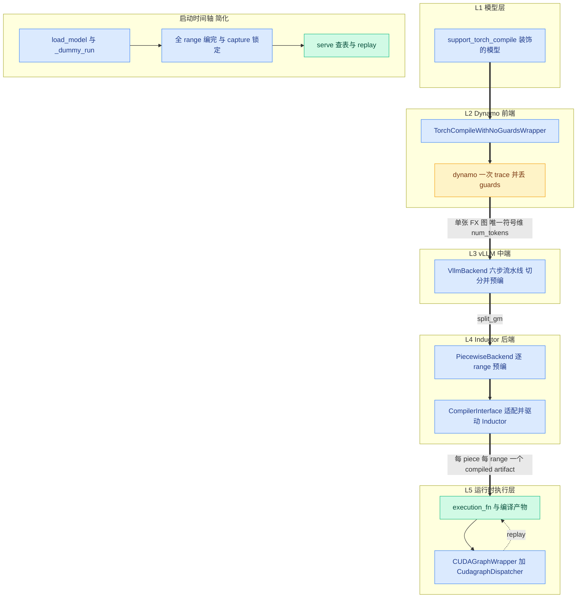

# 前言与阅读指南

## 一、前言:为什么写这本书

每个做过 Inductor 开发的人,多少都经历过同一种落差:在自己的测试脚本里,`torch.compile` 是几行代码就能打开的加速开关;到了真实的推理服务,同一条流水线却要面对几十个模型的形状洪流、要与 CUDA Graph 共处、还要把编译全部塞进启动期。vLLM 是把 `torch.compile` 推到这种工业强度的代表:它不把 `torch.compile` 当开关用,而是当一根轴线——围绕这条轴线重排了自己的运行时、算子边界与缓存策略。对编译器工程师来说,这是一份难得的范本:一个工业级系统为了吃下编译收益,愿意把多少东西重塑给编译器让路;它的每一次取舍——为什么敢把 dynamo 的 **guard(守卫条件,判断"何时不需重编译"的断言集合)** 全部丢掉、为什么把 attention 留在图外——都是编译原理落进工程现场的第一手样本。更难得的是,这套工程完全开源、可逐行指认——每个设计决定都能落到具体的 `file:line` 上,这正是本书采用的方法。这不是"又一份框架使用文档",而是一次工业级编译器工程的完整解剖。

但读懂它的代价不小。这套集成没有一个集中的入口文件:核心逻辑散落在 `vllm/compilation/` 的 45 个源码文件、约 1.6 万行代码里,还牵着模型目录中 120 余个使用 **`@support_torch_compile`(编译支持装饰器)** 的模型文件、worker 侧的启动编排,以及配置体系里成串的枚举;官方设计文档按主题切成多篇,默认读者已熟悉 vLLM 的运行时概念。于是,懂 Inductor 却不懂 vLLM 的读者两头都是黑盒:既不知道 vLLM 为什么这样要求编译器,也不知道 Inductor 的哪些隐含假设被绕了过去。市面上缺少的,正是一本把两边接起来的系统教材——这就是本书的来由。

本书的目标可以概括成三个词:全景、直观、俯瞰。它讲机制(what)、设计思想(why)与关键流程(how),不讲部署运维,也不做逐行源码注解;它回答的是一组架构问题——五层各守什么产物契约、编译为什么全部挤在启动期、serve 期靠什么做到零 Python 编排。全书 15 章 + 3 附录,每章 3000~5000 字,按编译栈层次推进:背景与全景(第 1~3 章)→ 配置与前端(第 4~5 章)→ 中端切分(第 6~7 章)→ 后端编译(第 8~10 章)→ 产物与运行时(第 11~13 章)→ 哲学与实践(第 14~15 章)。各章自成闭环:开头 300~500 字的俯瞰节先抛问题、再给答案预告,读前扫一眼即可决定精读还是略读。

读者契约一句话:**假设你懂 dynamo / AOTAutograd / Inductor 流水线、做过简单的 Inductor 开发;不假设任何 vLLM 知识(第 2 章兜底)**。第 2 章只讲理解编译所需的 V1 引擎最小背景——调度器如何把全部动态性压进一个整数、执行器如何组织一次前向,到此为止。反过来,本书不会解释 fake tensor、joint graph、lowering 这些你本该熟悉的概念;若恰好生疏,建议先补齐再读,否则第 9、10 章会吃力。

素材与版本声明同样一句话:**vLLM 0.27.1 源码为唯一事实基准;官方文档仅作叙事背景,凡不一致处以源码为准**。全书论断尽量钉在源码上,锚点一律双保险——`路径:行号`(`符号名`),行号随版本漂移时用符号名重定位;附录 C 汇总全书锚点,版本升级时可按表批量校对。书中的数字(文件数、行数、默认值)同样取自该版本源码,凡非源码所得的输出样例都会明示「示意」。

体例只在这里说三点,细节见[附录 B](appendix-B-图例与写作规范.md)。其一,每章五段式(俯瞰→最小前置→设计思想→具体流程→小结),机制一律写成"上游给我 X(file:line)→ 我做 Y → 产出 Z(去向 file:line)"的流水线产物句式,保证每句话都能回到源码验证;其二,类名/函数名/env var 保持英文原文,首次出现加粗并给中文释义,此后只用英文;其三,全书统一五色图例——蓝=vLLM 代码、橙=torch/Inductor 上游、绿=编译产物与缓存、灰=外部系统、红=危险点,实线=编译期数据流、虚线=运行时调用流、粗线=本章主线索。

最后交代全书的叙事主线,一条所有章节共享的因果链:**decode 是 CPU/launch bound → 必须消灭 Python 开销 → 代价是编译 → 编译的代价是启动时间 → 所以全部编译前置 + 缓存 → 所以敢丢 guards、敢一次 trace、敢去泛函化——所有机制都是这条因果链上的必然产物**。往后任何一章读卡住了,回到这条链上找位置;下一节的总览大图,就是这条链在架构上的投影。

## 二、全书总览:一张大图与一条主线

> 五色与线型约定见[附录 B](appendix-B-图例与写作规范.md);完整版(每层内部构件、启动时间轴全步骤、20 步编号清单)见[第 3 章](03-编译栈全景架构.md)。

读这张图有两个方向。自上而下,是一次 forward 的旅程:模型层交出普通 forward,Dynamo 前端一次 trace 交出单张 FX 图,vLLM 中端由 **`VllmBackend`(vLLM 编译后端)** 执行六步流水线完成切分与预编,Inductor 后端逐 **piece(片段,切分后的子图)** 逐 range 产出编译产物,运行时执行层把这一切变成每步一次的查表与 replay。图侧的时间轴则提醒你这趟旅程的工期:五层同时醒着的时段只是启动期的几十秒,总闸是 **`compile_or_warm_up_model`(编译与预热入口,`vllm/v1/worker/gpu_worker.py:679`)**;serve 开始后,图上只剩最底层还在工作。图中每条粗箭头都是一份产物交接,第 3 章的完整版会给每个格子装上构件、给时间轴补上每一步。

## 三、阅读指南:三条路径与四件工具

本节回答四个问题:按什么顺序读、导航图怎么用、术语去哪查、命题编号与章末表格怎么看。你可以现在跳过它,读完第 3 章再回来——那时你会更需要它。

### 三条阅读路径

- **速览(约 2 小时,建立心智模型)**:第 1 → 3 → 14 章。第 1 章给动机——decode 为什么是 CPU/launch bound;第 3 章给上面这张全景图;第 14 章把全部机制收拢成七条命题。走完应能回答"vLLM 为什么敢丢 guards"这类问题,并对五层图有肌肉记忆。
- **主线(教材式)**:第 1~15 章顺序读,这是本书设计的默认路径,每章末尾有下一章预告。难度在目录与章首如实标注:第 1、2 章两星,第 9、12 章五星——五星章允许第一遍只记结论,二刷再钻细节。
- **深潜(要改代码的读者)**:第 3 章站稳后,按 Part III → IV → V 逐层下钻,边读边对照各章末的源码索引开源码;最后用第 15 章的调试工具亲手验证机制,把"读懂"变成"会改"。

### 位置导航图怎么用

每章开头有一张 ASCII 位置导航图,把 15 章按编译栈阶段排成 6 行,当前章以 `◄==` 标出。两个用法:读完一章的小结后再看一眼,固化"本章住在全局哪一格"的空间记忆;跳读时当作路标,配合章首 `depends` 字段确认前序依赖,缺什么回补什么。本前言不挂导航图——你此刻正站在全书的入口。

### 术语去哪查

正文术语首次出现时加粗并给中文释义,此后只用英文。遇到眼生的词,先查[附录 A](appendix-A-术语表中英对照.md):99 条术语按主题分组(引擎与调度、编译模式、Dynamo 前端、图与切分、算子层、后端编译、shape 机制、pass 与融合、运行时执行、缓存、调试),每条附首见章节与一句话说明;A.12 的易混词速查专治近义对——capture size 与 compile size、compile size 与 compile range、splitting op 与 vllm_ir 算子。

### 命题编号与章末表格怎么看

各章"设计思想"节里标注【哲学时刻】的段落,是全书七条设计命题在当章的落点;编号 P1~P7 全书稳定,**定义处是第 14 章**——P1(compile once, run forever)、P2(不变量换性能)、P3(custom op 既是墙也是桥)、P4(最小侵入上游)、P5(显式优于隐式)、P6(平台与后端可插拔)、P7(shape 是推理编译的核心矛盾)。读到"P7"而不记得含义时不必中断,上下文通常足以推进;每章小结末尾都会注明"本机制服务于哪条命题",可据此反向索引。

每章末尾有两张表:**本章源码索引**(该章出现过的全部 `file:line` 锚点,可当作"开源码时的待办清单")与**参考资料**(每条官方引用都标注口径——「已与 0.27.1 源码核对一致」或「仅作背景叙事」)。建议的读法:第一遍通读时忽略锚点,先把流水线走向看懂;第二遍开着源码按索引表逐锚点对照,收益最大。全书锚点汇总在附录 C,版本升级时按表批量校对即可。

## 四、结语

这本书读完,你会带走三样东西。第一,一张能落地的架构地图:vLLM 的 `torch.compile` 集成不再是散落 45 个文件的黑盒,而是五层产物契约加一条启动时间轴;日后遇到任何新机制,先问它住在哪层、醒在哪个时段。第二,一套可迁移的设计原则:P1~P7 并非 vLLM 专属——当你为自己的推理引擎或新后端做编译集成时,它们就是现成的取舍清单与检查表。第三,一双能亲手验证的眼睛:第 15 章的调试工具会教你把书上的每个论断,变成终端里亲眼看到的产物。祝阅读愉快。

### 参考资料

1. [vLLM design doc — torch.compile](https://docs.vllm.ai/en/latest/design/torch_compile/) — 已与 0.27.1 源码核对一致
2. [vLLM blog — Introduction to torch.compile and How It Works with vLLM (2025-08-20)](https://vllm.ai/blog/2025-08-20-torch-compile) — 仅作背景叙事
3. [vLLM design doc — Optimization Levels](https://docs.vllm.ai/en/latest/design/optimization_levels/) — 仅作背景叙事(详见第 4 章)
4. [vLLM design doc — CUDA Graphs](https://docs.vllm.ai/en/stable/design/cuda_graphs/) — 已与 0.27.1 源码核对一致
5. [vLLM design doc — Fusions](https://docs.vllm.ai/en/latest/design/fusions/) — 仅作背景叙事(详见第 10 章)
6. [vLLM design doc — Debug vLLM Compile](https://docs.vllm.ai/en/latest/design/debug_vllm_compile/) — 仅作背景叙事(详见第 15 章)
7. [RFC issue #6378 — A Graph Optimization System in vLLM using torch.compile](https://github.com/vllm-project/vllm/issues/6378) — 仅作背景叙事
8. [PyTorch blog — PyTorch + vLLM](https://pytorch.org/blog/pytorch-vllm-%E2%99%A5%EF%B8%8F/) — 仅作背景叙事
9. [vLLM v0.8.1 设计文档 — torch_compile(历史版)](https://docs.vllm.ai/en/v0.8.1/design/v1/torch_compile.html) — 仅作背景叙事(演进对比用)

---

**下一步**:翻开[第 1 章 为何推理服务需要 torch.compile](01-为何推理服务需要torch-compile.md),从"计算量最小的阶段为什么最慢"这个问题出发,走上这条因果链的第一环。
