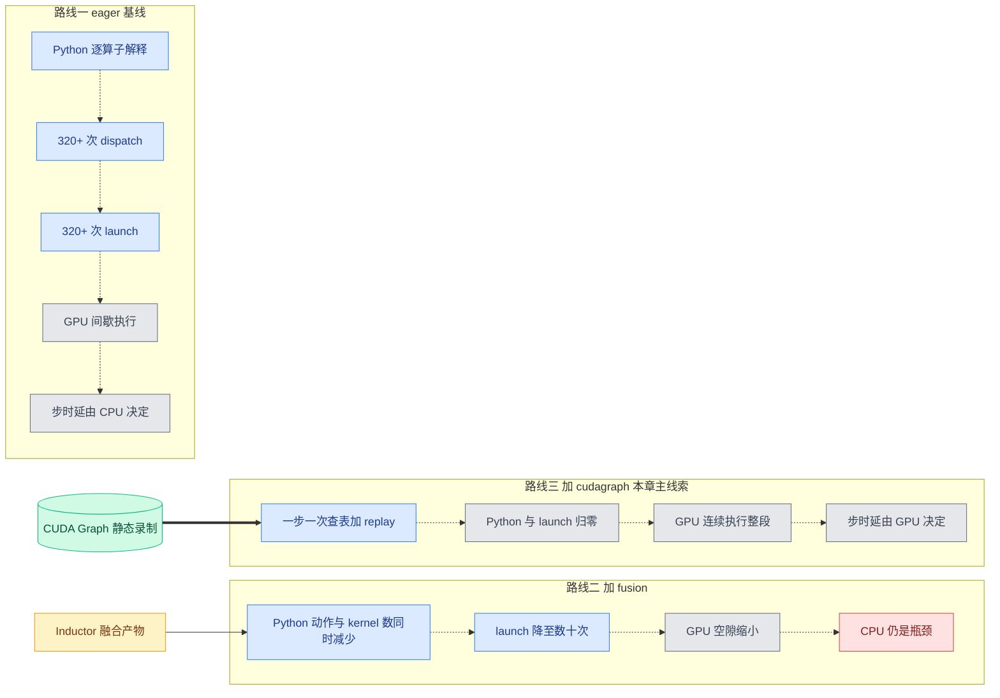

# 第 1 章 为何推理服务需要 torch.compile:launch-bound 的 decode

```text
I   背景:   [1 为何compile]◄== → [2 V1引擎] → [3 编译栈全景]
II  前端:   [4 配置体系] → [5 Dynamo一次捕获]
III 中端:   [6 Piecewise切分] → [7 算子边界与vllm_ir]
IV  后端:   [8 VllmBackend] → [9 逐range编译] → [10 Pass与融合]
V   运行时: [11 代码生成] → [12 CUDA Graph] → [13 缓存与AOT]
VI  收官:   [14 设计哲学] → [15 动手实践]
```

## 1.0 本章俯瞰

一个看似反直觉的事实是:大模型推理里最难加速、也最值得加速的阶段,恰恰是每步计算量最小的那个阶段。生成回答时,模型像人写字一样一个 token 一个 token 地往外吐,每吐一个 token 就要把几十层网络完整跑一遍。这一步真正花在矩阵乘法上的时间少得可怜——几百个请求凑在一起,单层的输入也不过是几百行向量,GPU 读取权重一遍就把活干完了。可服务延迟偏偏卡在这里,吞吐也卡在这里。为什么计算量最小的阶段反而最慢?答案预告:因为 GPU 在这一步的大部分时间不是在算,而是在等——等 CPU 用 Python 一个算子一个算子地解释、分发、启动;把 CPU 从每步的执行路径上请出去,就是本书要讲的全部机制共同服务的那个目标,而付出的代价(一次性的编译)恰好可以藏进服务启动阶段。

## 1.1 最小前置知识

本章只依赖五个概念,已有 Inductor 经验的读者可以快速扫过。

1. **prefill(预填充)与 decode(逐 token 解码)**:推理分两阶段。prefill 一次吃进整个 prompt,做一次大并行前向;decode 每步为每个正在生成的请求只算一个新 token。二者由 vLLM 的调度器混在同一个 batch 里连续执行(continuous batching,连续批处理),详见第 2 章。
2. **dispatch(分发)与 launch(启动)**:eager 模式下,Python 里每写一个 `torch` 算子,框架都要走一遍算子分发选出实现,再由驱动把该 **kernel(核函数,GPU 上一次执行的最小单位)** 启动起来。这两件事都发生在 CPU 上,每次都是不可忽略的微观开销。
3. **memory-bound(访存受限)与 compute-bound(计算受限)**:一个 kernel 若耗时由"搬多少数据"决定而非"做多少次乘加"决定,就是 memory-bound。小 batch 下的 GEMM、归一化、激活全是这一类——GPU 算力远未喂饱,时间花在读写显存上。
4. **CUDA Graph capture/replay(捕获/重放)**:先把一整段 GPU 工作"录"成一张静态图(capture),之后每步只需一次调用就把整段工作原样重放(replay)。录制期间地址被钉死,重放期间 CPU 不再逐个启动 kernel。这是消灭 launch 开销的原生手段,详见第 12 章。
5. **fusion(算子融合)**:Inductor 把相邻的 elementwise/reduction 算子合成一个 kernel,减少 kernel 数量,也减少中间结果在显存的往返。本书读者已熟悉其机制,本章只关心它对"每步启动次数"的减法作用,融合细节详见第 10 章。

## 1.2 设计思想与设计哲学

先陈述本章的核心论断,再讲为什么由此必然推出"vLLM 必须深度改造 torch.compile"。

**论断:decode 是 CPU/launch 受限的阶段,而不是 GPU 受限的阶段。**decode 步的输入极小:纯 decode 批里每个请求恰好一个 token,**`num_tokens`(本步总 token 数)**就等于请求数,常见并发下是个两位数到三位数的小数字。这么小的输入让整步三百多次 dispatch 所对应的 kernel 全部 memory-bound、单个往往只需微秒量级;而 CPU 侧的 Python 解释加 dispatch 加 launch,单次开销与 kernel 执行时间同量级。两侧同量级、又必须串行排队,快的一方就被慢的一方拖住——GPU 在两个 kernel 之间空转等 CPU 下命令。此时换更强的 GPU、更高的带宽都无济于事,唯一有效的方向是削减 CPU 侧动作的次数与单价。

【哲学时刻】这正是贯穿全书叙事主线的第一环:**decode 是 CPU/launch bound → 必须消灭 Python 开销 → 代价是编译 → 编译代价是启动时间 → 所以全部编译前置+缓存 → 所以敢丢 guards、敢一次 trace、敢去泛函化**。推理服务的负载是封闭的:输入只有 token id、位置和少量元数据,没有任意用户 Python 代码,模型结构在 serve 期间永不改变。"图不会变"这个在训练或通用场景里不成立的假设,在推理服务里天然成立——于是 vLLM 用它换性能(P2,不变量换性能):一次 trace 之后把 **guard(守卫条件,dynamo 判断"何时不需重编译"的断言集合)** 全部丢掉、把编译全部前置到启动期、运行期断言零编译(P1,compile once, run forever)。第 14 章将把这套交换展开成完整命题。

torch.compile 恰好提供了两件互补的武器。**Inductor fusion 做"减法"**:把每层十余个小算子合并成少数几个 kernel,Python 动作与 kernel 数同时减少;**CUDA Graph 做"归零"**:对 fusion 剩下的 kernel,把逐个 launch 合并为一次 replay,CPU 侧动作直接消失。注意二者作用面不同:减法同时作用于 CPU 侧(动作变少)与 GPU 侧(访存往返变少),归零只作用于 CPU 侧(单个 kernel 的 GPU 耗时不变)。因此它们是叠加而非替代——就算融合到极致,32 层乘上每层若干 kernel 仍有成百次 launch,只有归零能终结这笔账;反过来,没有 fusion 时被录进图里的一堆碎 kernel 也白白消耗 GPU 时间。vLLM 的默认配置 **`cudagraph_mode`(CUDA Graph 模式)= `FULL_AND_PIECEWISE`(整图+分片,v1 默认)** 正是两件武器同时上场的制度化表达(`vllm/config/compilation.py:607-638`(`cudagraph_mode`)。

为什么不干脆接受 eager?官方把这一权衡写进了优化级别的定义里:`O0` 是"no compilation, no cudagraphs, no other optimization, just starting up immediately",`O1` 加上 Dynamo+Inductor 编译与 PIECEWISE cudagraph,`O2` 再加 FULL cudagraph(`vllm/config/vllm.py:104-116`(`OptimizationLevel`))——默认 `O2` 说明:在 vLLM 看来,牺牲启动时间去换取 decode 每步的确定性低延迟,几乎总是一笔划算的交易,而"启动慢"这笔代价又被第 13 章的缓存体系进一步摊销。

## 1.3 具体流程(流水线视角)

### 1.3.1 一步 decode 的全程

先看一个 decode 步里引擎做了什么。**`execute_model`(模型执行入口)** 是执行侧的总管:

> 调度器给我 **`SchedulerOutput`**(调度产物,含 `total_num_scheduled_tokens` 即本步 `num_tokens`;入口签名见 `vllm/v1/worker/gpu_model_runner.py:4166`(`execute_model`),取值于 `gpu_model_runner.py:4202`;调度细节详见第 2 章)→ 我做状态更新、输入准备、以及 cudagraph 模式与 padding 桶的判定(`gpu_model_runner.py:4271`(`_determine_batch_execution_and_padding`))→ 产出一次模型前向的全部实参,交 `_model_forward` 在 `set_forward_context` 上下文里调用(`gpu_model_runner.py:4432-4456`)。

模型本体返回 hidden states,随后只对每请求最后一个 token 的位置做 lm_head 与采样。也就是说,decode 步的全部延迟中,占比最大的就是这一段被 Python 编排的前向;本章余下篇幅都在解剖它。

### 1.3.2 手数一层:launch 账本

以 Llama-7B(32 层)为例,逐行数 `LlamaDecoderLayer.forward`。承重墙代码如下:

```python
# vllm/model_executor/models/llama.py:310-327 (v0.27.1)
def forward(self, positions, hidden_states, residual):
    # Self Attention
    if residual is None:
        residual = hidden_states
        hidden_states = self.input_layernorm(hidden_states)
    else:
        hidden_states, residual = self.input_layernorm(hidden_states, residual)
    hidden_states = self.self_attn(positions=positions, hidden_states=hidden_states)

    # Fully Connected
    hidden_states, residual = self.post_attention_layernorm(hidden_states, residual)
    hidden_states = self.mlp(hidden_states)
    return hidden_states, residual
```

`self_attn` 与 `mlp` 内部再展开一层:

```python
# vllm/model_executor/models/llama.py:221-231 (v0.27.1)
def forward(self, positions, hidden_states):
    qkv, _ = self.qkv_proj(hidden_states)
    q, k, v = qkv.split([self.q_size, self.kv_size, self.kv_size], dim=-1)
    q, k = self.rotary_emb(positions, q, k)
    attn_output = self.attn(q, k, v)
    output, _ = self.o_proj(attn_output)
    return output
```

由此得到每层的 launch 账本(示意图——按源码调用点清点,非 profiler 实测):

| # | 调用 | 锚点 | 类型 |
|---|---|---|---|
| 1 | `input_layernorm`(fused_add_rms_norm) | `llama.py:319,321` | 归一化+residual |
| 2 | `qkv_proj` | `llama.py:226` | GEMM |
| 3 | `split` | `llama.py:227` | view,零拷贝但仍是 Python 动作 |
| 4 | `rotary_emb` | `llama.py:228` | RoPE |
| 5 | `attn` | `llama.py:229` | attention(后端 kernel) |
| 6 | `o_proj` | `llama.py:230` | GEMM |
| 7 | `post_attention_layernorm` | `llama.py:325` | 归一化+residual |
| 8 | `gate_up_proj` | `llama.py:116` | GEMM(已合并 gate/up) |
| 9 | `act_fn`(silu_and_mul) | `llama.py:117` | elementwise |
| 10 | `down_proj` | `llama.py:118` | GEMM |

单层 10 个 Python 级调用;张量并行时两个 RowParallelLinear 各再加一次 all_reduce,量化模型再加量化算子,轻松越过 10+。乘上 32 层,加上 embed_tokens、final norm 与 lm_head:**约 320+ 次 dispatch 与 launch,每步如此**。这些 kernel 无一例外 memory-bound、单个只占 GPU 极短时间,GPU 的时间线被切成细碎的片段,缝隙全是 CPU。

```text
        一个 decode 步的 launch 流水线(Llama-7B,32 层,示意图)
图例: N=rms_norm Q=qkv_proj R=rope A=attn O=o_proj
      G=gate_up_proj S=silu_and_mul D=down_proj [py]=Python 编排

CPU: [py]N Q R A O N G S D[py] N Q R A O N G S D[py] ...... x 32 层
       \_每 1 个 CPU 动作(dispatch+launch)紧跟 1 个 kernel_/
GPU:    n  q r a o n g s d    n  q r a o n g s d    ...
        ^^ kernel 极短, 算完即闲置, 空隙全在等 CPU 的下一条命令

+fusion:    每 2~3 个相邻算子并成 1 个 kernel, launch 次数近乎减半
+cudagraph: 320+ 次 launch 合并为 1 次 replay, CPU 只剩查表与拷贝
```

对比 prefill:大 batch 大 GEMM 是 compute-bound,单个 kernel 占 GPU 数百微秒以上,launch 开销占比自然小,fusion 的收益也主要来自减少访存而非减少 launch。更麻烦的是 v1 调度把长 prompt 切块(**chunked prefill,分块预填充**)与 decode 混进同一批、共用同一个模型前向与同一套编译产物,所以编译系统必须一张图同时服务两类负载——这就是默认策略"纯 decode 批走 FULL、混合批走 PIECEWISE"的由来(`vllm/config/compilation.py:630-632`)。

### 1.3.3 两件武器如何落在这份账本上

fusion 的减法由 Inductor 完成:**Inductor 给我融合后的 kernel 序列**(经 vLLM 的适配器调用 `compile_fx` 产出,详见第 9 章)→ 融合把上表里的 residual+归一化、gate_up+silu、RoPE 变换这类相邻 elementwise 算子并链(GEMM 在 max_autotune 下还能以 epilogue 形式吞并后继小算子)→ 产出更少的 launch 与更少的显存往返。vLLM 甚至反过来为 fusion 重新设计算子边界,最直接的证据是 attention 层的这条注释:

```python
# vllm/model_executor/layers/attention/attention.py:514-524,533-541 (v0.27.1)
        if self.query_quant is not None:
            # quantizing with a simple torch operation enables
            # torch.compile to fuse this into previous ops
            # which reduces overheads during decoding.
            # Otherwise queries are quantized using custom ops
            # which causes decoding overheads
            ...
            query, _ = self.query_quant(query, self._q_scale)
        ...
        # Reshape the query, key, and value tensors.
        # NOTE(woosuk): We do this outside the custom op to minimize the
        # CPU overheads from the non-CUDA-graph regions.
        query = query.view(-1, self.num_heads, self.head_size)
```

两段注释各自承认了一个事实:其一,**custom op(自定义算子)是融合之墙**——query 量化若用 custom op 实现就融合不进前序算子,decode 因此付出开销,所以刻意降级为"简单 torch op";其二,图外区域是 CPU 开销的来源,连一次 reshape 都要搬到 custom op 外面去做。此外 vLLM 还专门实现了 `direct_register_custom_op` 绕开 `torch.library.custom_op` 的分发逻辑,官方 docstring 明说后者 "can have significant overhead because it needs to consider complicated dispatching logic"(`vllm/utils/torch_utils.py:901-913`)。对 CPU 开销锱铢必较到这个程度,本身就是 launch-bound 论断的源码级佐证。

cudagraph 的归零由运行时完成:**`CUDAGraphWrapper` 在启动期给我按尺寸桶预录的静态图**(捕获尺寸默认从 1、2、4 起,8 步长铺到 256,再 16 步长到上限;详见第 4 章)→ serve 期每步把实际 `num_tokens` 向上取整到桶尺寸、拷入静态缓冲 → 产出一次 replay,Python 编排与逐 kernel launch 全部消失。FULL 模式之外,vLLM 还刻意把整图捕获放在 FX 图之外进行,官方注释解释这能"reduce some cpu overhead when the runtime batch_size is not cudagraph captured"(`vllm/config/compilation.py:1147-1155`),即未命中捕获桶的批也走轻路径。三条路线的时间分解对比如下(示意图,长度仅表定性对比):



### 1.3.4 官方实测背书

这套"减法+归零"在真实服务里的收益,vLLM 官方博客给出过一组数字(仅作背景叙事,数字来自官方博客,vllm.ai/blog/2025-08-20-torch-compile):

| 融合项 | 收益 | 配置 |
|---|---|---|
| SiLU+Quant fusion | 最高 +8% | Llama-3.1-405B FP8,8x MI300 |
| Attention+Quant | 最高 +7% | — |
| AllReduce+RMSNorm | 最高 +15% | — |
| AR+RMSNorm+Quant | FP8 最高 +8% / FP4 最高 +10% | — |
| Sequence Parallelism / Async-TP | 最高 +10% | — |

值得注意的规律:收益最大的几项(AllReduce+RMSNorm、SiLU+Quant)恰恰都是"多个小 memory-bound 算子串在 GEMM/通信后面"的形状——正是 1.3.2 账本里那些被逐个 launch 的碎片。这组数字是"decode 受 CPU/launch 与碎片访存双重支配"这一诊断的疗效报告。

### 1.3.5 三宗罪:原生 torch.compile 为什么不能直接上线

诊断成立、武器有效,为什么不 `torch.compile(model)` 一裹了之?因为推理服务的运行形态与 torch.compile 的设计前提有三处正面冲突。这三宗罪是全书问题清单,后续章节逐一化解。

**罪一:recompile(重编译)不可控。**推理批大小每步都在变,`num_tokens` 是个准随机的整数序列。原生路径下,每个新形状都可能触发一次 dynamo 重 trace 加 Inductor 重编译,每次以秒计;编译发生在 serve 期,直接变成用户可感的卡顿。化解:一次 trace + 丢 guards + `fail_on_recompile` 断言 + 形状走有限的尺寸表与区间(详见第 5 章、第 9 章,缓存详见第 13 章)。

**罪二:dynamic shape(动态形状)退化。**自动 dynamic 会让 kernel 长出符号形状,模板失去静态信息,性能明显劣于按确切尺寸编译的产物。化解:**compile_sizes(精确尺寸表)** + **compile_ranges(区间表)**——热门尺寸逐个全静态编译并开 max_autotune,长尾用一个符号产物兜底(详见第 4 章、第 9 章)。这正是 P7(shape 是推理编译的核心矛盾)的第一次露面:模型唯一"活"的维度只有 `num_tokens`,连它都来自 `@support_torch_compile` 装饰器里的显式声明(`vllm/model_executor/models/llama.py:334-343`(`dynamic_arg_dims`,把第 0 维标成符号维 `b`))。

**罪三:CUDA Graph 与 attention 后端无法共存。**attention 是外部 kernel 且依赖每步变化的 **`attn_metadata`(注意力元数据,变长序列信息)**,还有 CPU 侧控制流;对整个 forward 做原生整图捕获,要么失败、要么被迫退化。化解有两条:按 attention 切图,把 attention 留在图外、只对可编译片段捕获(PIECEWISE,详见第 6 章);或在 FX 图之外、以 padding 到捕获桶的方式录整图,并让 attention 后端满足捕获约束(FULL,详见第 12 章)。1.3.3 引用的 `compilation.py:1147-1155` 注释即第二条路线的落点。

最后回到叙事主线的中间环节:编译代价是启动时间。vLLM 对冷启动的敏感程度,从一条注释可见一斑——为了避免把各 MoE 层名字符串硬编码进图、使各层编译产物无法复用而拖慢冷启动,"For torch.compile cold start times, we need to avoid hard-coding any strings into the graph"(`vllm/forward_context.py:161-185`)。为了启动快到极致,连字符串都不许进图:这就是"编译全部前置、产物全部缓存、serve 期只剩查表与 replay"(不变量 d)这条终点线的起点。

## 1.4 本章小结

- decode 步计算量最小、延迟却最难压:CPU 编排是瓶颈。
- Llama 单层约 10 算子,32 层每步 320+ 次 dispatch+launch。
- fusion 做减法,cudagraph 做归零,两者叠加而非替代。
- 官方实测:小算子融合最高 +15%,印证 launch/访存双重支配。
- 原生 torch.compile 三宗罪:recompile、形状退化、图与 attention 冲突。

本机制服务于 P1(compile once, run forever)、P2(不变量换性能)与 P7(shape 是推理编译的核心矛盾)。下一章(第 2 章)给出理解编译所需的 vLLM V1 引擎最小背景——编译所服务的运行时长什么样。只有先看清调度器如何产出每步的 `num_tokens`、执行器如何组织一次前向,才能理解编译系统为何被设计成后面的样子。

### 本章源码索引

| 锚点 | 内容 |
|---|---|
| `vllm/model_executor/models/llama.py:310-327`(`LlamaDecoderLayer.forward`) | 手数每层算子的依据 |
| `vllm/model_executor/models/llama.py:221-231`(`LlamaAttention.forward`) | attention 支路 5 个调用点 |
| `vllm/model_executor/models/llama.py:115-119`(`LlamaMLP.forward`) | MLP 支路 gate_up_proj/silu_and_mul/down_proj |
| `vllm/model_executor/models/llama.py:305-308` | 两个 RMSNorm 成员 |
| `vllm/model_executor/models/llama.py:334-343`(`support_torch_compile`) | 唯一符号维 b 的显式声明 |
| `vllm/model_executor/layers/attention/attention.py:514-524` | query 量化刻意用简单 torch op 以便融合 |
| `vllm/model_executor/layers/attention/attention.py:533-541` | reshape 移出 custom op 以降 CPU 开销 |
| `vllm/utils/torch_utils.py:901-913`(`direct_register_custom_op`) | custom op dispatch 开销的官方表述 |
| `vllm/config/vllm.py:104-116`(`OptimizationLevel`) | O0~O3 动机表述(启动时间换性能) |
| `vllm/config/compilation.py:607-638`(`cudagraph_mode`) | FULL_AND_PIECEWISE 默认值与语义 |
| `vllm/config/compilation.py:1147-1155` | FULL cudagraph 在 FX 图之外捕获 |
| `vllm/v1/worker/gpu_model_runner.py:4166`(`execute_model`) | 一步 decode 的执行总入口 |
| `vllm/v1/worker/gpu_model_runner.py:4202` | total_num_scheduled_tokens 即 num_tokens |
| `vllm/v1/worker/gpu_model_runner.py:4271`(`_determine_batch_execution_and_padding`) | cudagraph 模式与 padding 桶判定 |
| `vllm/v1/worker/gpu_model_runner.py:4432-4456` | set_forward_context 内的模型调用点 |
| `vllm/forward_context.py:161-185` | 避免字符串硬编码进图以缩冷启动 |

### 参考资料

1. [vLLM blog — Introduction to torch.compile and How It Works with vLLM (2025-08-20)](https://vllm.ai/blog/2025-08-20-torch-compile) — 仅作背景叙事(1.3.4 全部数字来自该博客)
2. [vLLM design doc — torch_compile](https://docs.vllm.ai/en/latest/design/torch_compile/) — 仅作背景叙事
3. [vLLM design doc — optimization_levels](https://docs.vllm.ai/en/latest/design/optimization_levels/) — 仅作背景叙事(O0~O3 定义与 `vllm/config/vllm.py:104-116` 一致)
4. [vLLM design doc — cuda_graphs](https://docs.vllm.ai/en/stable/design/cuda_graphs/) — 仅作背景叙事(PIECEWISE/FULL 语义与 `compilation.py:607-638` 一致)
5. [vLLM design doc — fusions](https://docs.vllm.ai/en/latest/design/fusions/) — 仅作背景叙事
6. [vLLM design doc — debug_vllm_compile](https://docs.vllm.ai/en/latest/design/debug_vllm_compile/) — 仅作背景叙事
7. [RFC issue #6378 — A Graph Optimization System in vLLM using torch.compile](https://github.com/vllm-project/vllm/issues/6378) — 仅作背景叙事
8. [PyTorch blog — PyTorch + vLLM](https://pytorch.org/blog/pytorch-vllm-%E2%99%A5%EF%B8%8F/) — 仅作背景叙事
9. [v0.8.1 历史 torch_compile 设计文档](https://docs.vllm.ai/en/v0.8.1/design/v1/torch_compile.html) — 仅作背景叙事(演进对比用)
