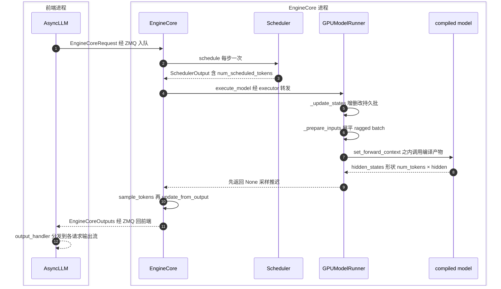
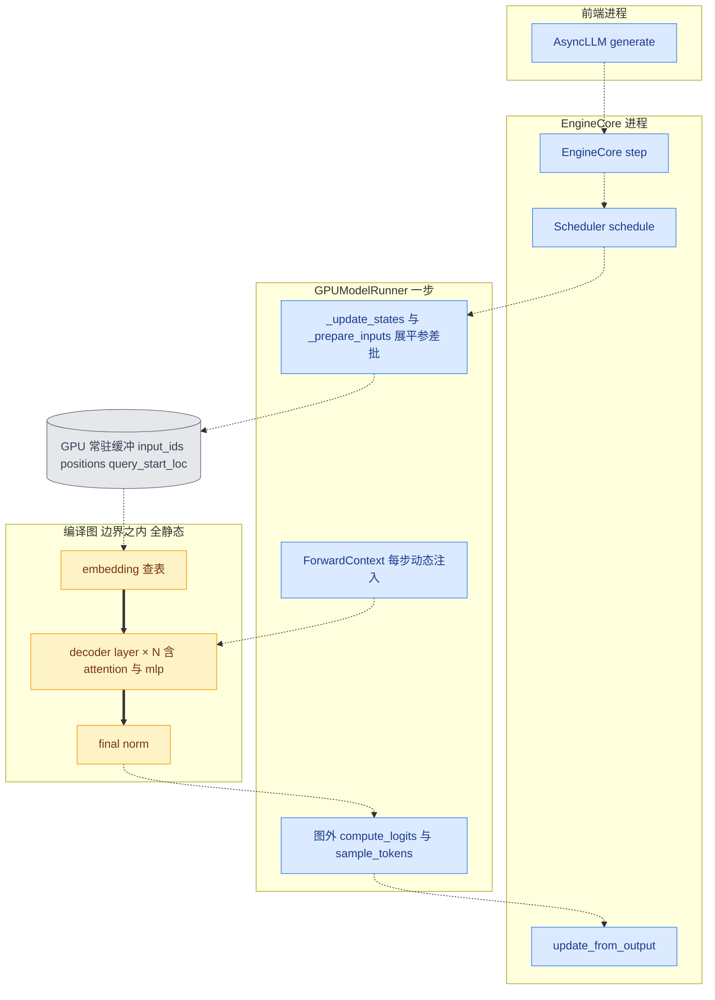

# 第 2 章 vLLM V1 引擎最小背景:编译所服务的运行时

```text
I   背景:   [1 为何compile] → [2 V1引擎]◄== → [3 编译栈全景]
II  前端:   [4 配置体系] → [5 Dynamo一次捕获]
III 中端:   [6 Piecewise切分] → [7 算子边界与vllm_ir]
IV  后端:   [8 VllmBackend] → [9 逐range编译] → [10 Pass与融合]
V   运行时: [11 代码生成] → [12 CUDA Graph] → [13 缓存与AOT]
VI  收官:   [14 设计哲学] → [15 动手实践]
```

## 2.0 本章俯瞰

要理解 vLLM 怎样使用 torch.compile,得先回答一个更根本的问题:编译出来的东西,到底运行在一个什么样的世界里?第 1 章已经说明,生成式推理的 decode 阶段每步只算一两个 token,计算量小到喂不饱 GPU,真正的瓶颈在 CPU 侧的 Python 编排与 kernel 启动(详见第 1 章)。而 torch.compile 消灭的恰恰是 Python 开销——但它只优化被捕获的那一段代码。如果每一步执行时还要现造输入张量、现查请求状态、现走一堆 if/else 分支,那么编译图之外的开销会原样回来,优化等于白做。

本章先给答案的预告:vLLM 的 V1 引擎把每一步执行规约成三件事——查一次表决定本步调度哪些 token、往几块固定不变的显存里填一份数据、调用一个预先编译好的函数。在这个世界里,唯一随时间变化的量是一个整数:本步的 token 总数。后面所有章节的编译机制——为什么敢只编译一次(第 5 章)、为什么切图要切在注意力上(第 6、7 章)、为什么尺寸要建表分桶(第 4 章)、为什么 CUDA Graph 敢整段重放(第 12 章)——全部从这个运行时形状里生长出来。换句话说,不是 vLLM 在现有运行时上"加了编译",而是运行时本身被重新塑形成了编译友好的形状。本章就是把这个形状看清楚。

先把本章放进整条推理服务链:

```text
推理服务(每个 step 循环一次)
│
├─ V1 调度器 ◄== 本章:两个数字喂出 num_tokens
│    ├─ schedule():running 优先、token 预算、chunked prefill
│    └─ 产出:本 step 输入张量(num_tokens 行)+ KV 写入计划
│
├─ 模型 forward(num_tokens 成为后文全图唯一的动态维)
│    ├─ eager 执行
│    └─ torch.compile(第 3 章起进入编译栈)
│
├─ 采样 / 输出
│
└─ KV cache 读写贯穿始终
```

## 2.1 最小前置知识

- **continuous batching(连续批处理)**:推理服务没有固定迭代边界的批处理方式。请求随到随加入同一个 batch,算完一个 token 就走一步,请求结束即退出,不必等整批凑齐或算完。vLLM 的调度器每一步都在做"这个 batch 里此刻该有谁"的决定。
- **prefill(预填充)与 decode(解码)**:自回归推理的两个传统阶段。prefill 一次性吃进整段 prompt 并填充 KV 缓存,是计算密集的大矩阵乘;decode 每步为每个请求只算一个新 token,是访存与启动密集的小 kernel。**chunked prefill(分块预填充)** 把长 prompt 切成多块、跨多步调度,使两种负载可以混在同一个 batch 里摊平开销。
- **KV cache(键值缓存)**:注意力层把历史 token 的 key/value 缓存下来避免重算。vLLM 按块(block)组织它,用 **block table(块表)** 记录每个请求的逻辑块到显存块的映射;`seq_lens`(每请求当前序列长度)与块表一起,构成注意力 kernel 每步需要的动态信息。
- **CUDA Graph 的 capture 与 replay(捕获/重放)**:把一段 GPU 工作流录制成一张图,此后每步一次调用整段重放,省掉逐 kernel 的启动开销。这是 decode 阶段消灭 CPU 开销的最后一块拼图,细节详见第 12 章。

进程结构方面只需知道一件事:vLLM V1 把"对外服务"与"引擎核心"拆成两个操作系统进程,前端是 **`AsyncLLM`(异步推理前端)**,后端是 **`EngineCore`(引擎核心进程)**,两者经 **ZMQ(一种轻量消息队列)** 通信。编译发生在 EngineCore 一侧,本章的主角全部住在那里。

## 2.2 设计思想与设计哲学

把 2.0 节的答案展开,就是本章的三条设计决定,它们共同构成后续编译机制的地基。

**第一,把"每步都不一样"压缩成"每步只有一个数不一样"。** 传统推理引擎按阶段(prefill batch / decode batch)组织执行,两套路径、两套形状。V1 的调度器不做这种区分(2.3.2 节),它每步只产出一个映射:每个请求本步算几个 token。于是无论请求在做什么——首块 prompt、第几十块 prompt、第一个生成 token、推测解码的草稿 token——对执行侧来说都只是"一维展平的 token 序列 + 一个总量"。这就是命题 **P7(shape 是推理编译的核心矛盾)** 的运行时根源:形状矛盾没有被消灭,而是被收敛到单一维度 `num_tokens` 上,使它变得可以枚举、可以建表、可以分桶预编译。

**第二,零分配哲学:内存世界是静态的。** 如果每步要 `torch.empty` 新输入、要重建 batch 结构,那么分配器与 Python 对象 churn 的开销就会回到热路径,而且地址每步都变,CUDA Graph capture 也就无从谈起(录下来的指针下一刻就失效了)。V1 反其道而行:所有输入张量在启动时按上限一次性分配,每步只往里写数据、按 `[:num_tokens]` 切片使用(2.3.4 节)。这是命题 **P2(不变量换性能)** 的典型落点——"buffer 地址与形状永不改变"这条不变量,换来了"每步零分配、零拷贝编排"的性能,也换来了"编译图可以直接钉住这些 buffer"的资格。

**第三,图内/图外边界是显式画出来的。** 哪些计算进编译图、哪些留在图外,vLLM 不是让编译器碰运气,而是在运行时结构里就长出了边界:语言模型头(lm_head)与采样器永远在图外,注意力永远在图内的边界处(2.3.5、2.3.6 节)。这体现了命题 **P5(显式优于隐式)**——边界由运行时架构决定,编译只是服从;同时也预告了命题 **P3(custom op 既是墙也是桥)**:注意力算子作为图内边界,既是隔开"静态图"与"动态元数据"的墙,又是两者互通的桥。

【哲学时刻】回扣全书叙事主线:decode 是 CPU/launch bound,所以必须消灭 Python 开销;要消灭得彻底,运行时自己先得变成静态的;运行时静态化之后,编译才敢"一次编译、永远重放"(P1)。本章的立场可以概括成一句话:**不是编译技术选择了 vLLM,而是 V1 运行时为了编译重塑了自己。** 理解了这一点,第 5 章"敢丢 guards"、第 12 章"敢整图重放"这些看似激进的举动,都会显得顺理成章。

## 2.3 具体流程(流水线视角)

### 2.3.1 调用链:一次 generate 请求的旅程

从前端到 GPU 的完整链路是五站:`AsyncLLM` → `EngineCore` → **`Scheduler`(调度器)** → **`GPUModelRunner`(GPU 模型执行器)** → 编译后的模型。逐站看流水线产物:

> `AsyncLLM.generate` 从 API server 收到 prompt 与采样参数 → 调 `add_request` 校验并打包 → 产出一条 `EngineCoreRequest` 消息,经 ZMQ 发往 EngineCore 进程;同时后台的 `output_handler` 任务持续把 EngineCore 回传的输出分发到各请求的输出流。

> `EngineCoreProc.run_busy_loop` 在独立进程里循环处理输入队列,有活就调 `step` → 一次 `step` 内完成"调度 → 执行 → 更新"→ 产出 `EngineCoreOutputs` 经 ZMQ 回前端。busy loop 里没有定时器轮询,常规路径也不 sleep:有活时立刻推进下一步,空闲时才阻塞在输入队列上等新请求;唯一例外是"本步没执行模型但调度器仍有请求"的边缘情形,会让出 1ms 供后台传输线程推进——GPU 一旦忙起来就永远有下一步可做。

`step` 是理解 V1 的钥匙。**为什么必须有它**:V1 把"一步"定义为一个原子推进——查表决定本步算谁、调用编译产物算出结果、采样并更新状态,三件事必须在同一个函数里完成;任何一环拆出去单独编排,Python 开销就会回到热路径,2.0 节的担忧就会成真。**怎么做**:一步 = 调度 → 执行 → 采样,核心只剩几行:

```python
# vllm/v1/engine/core.py:584-614 (v0.27.1,节选)
scheduler_output = self.scheduler.schedule(...)  # 调度:本步每请求算几个 token
future = self.model_executor.execute_model(scheduler_output, non_block=True)
model_output = future.result()
if model_output is None:  # 编译产物只算 hidden_states,采样是后置阶段
    model_output = self.model_executor.sample_tokens(grammar_output)
outputs = self.scheduler.update_from_output(scheduler_output, model_output)
return outputs, scheduler_output.total_num_scheduled_tokens > 0
```

注意两个细节:其一,`execute_model(non_block=True)` 返回 future,调度与输入准备可以和上一步的收尾重叠;其二,采样被拆成独立的 `sample_tokens` 阶段——这是 2.3.5 节"图外采样"在控制流上的体现。`step` 的返回值第二项是"本步是否真的执行了模型",busy loop 据此决定空转还是推进。**交给下一环什么**:`step` 最重要的中间产物是 `SchedulerOutput`——调度如何在没有阶段概念的世界里产出这份决定,正是 2.3.2 节的主题;一次完整调用的时序见下图。



### 2.3.2 调度:没有 prefill 阶段,也没有 decode 阶段

> `Scheduler.schedule` 从 EngineCore 拿到待调度的请求集合(waiting 队列与 running 队列)→ 在 `token_budget = max_num_scheduled_tokens` 的预算内,为每个请求分配"本步算几个 token",运行中的请求优先 → 产出一份 **`SchedulerOutput`(调度器输出)**,交回 `step` 去执行。

V1 调度的关键观念写在源码的一条 NOTE 里,值得整段意译:每个请求只有两个数字——已经算完多少、总共要算多少,调度就是让前者追上后者。prefill 是"差得多"的请求,decode 是"差一个"的请求,chunked prefill 是"差得多但本步只分给它一块"的请求,推测解码是"一次追好几个"的请求——同一套算法自然覆盖全部情形。对编译而言这意味着革命性的简化:**执行侧不需要为任何"阶段"准备不同的图,一条路径打天下。**

`SchedulerOutput` 里两个承重字段:`num_scheduled_tokens: dict[str, int]`(请求号 → 本步 token 数)与 `total_num_scheduled_tokens`(全部之和)。另有 `scheduled_new_reqs` / `scheduled_cached_reqs` 只传新请求或增量(diff)——请求的完整状态缓存在 worker 侧,不逐步重发,通信本身也是零冗余的。

### 2.3.3 核心例子:ragged batch [2, 5, 3]

现在看全书贯穿的例子。设本步调度 3 个请求,`num_scheduled_tokens = [2, 5, 3]`:请求 0 算 2 个 token(prefill 的一块),请求 1 算 5 个(另一块),请求 2 算 3 个(可能是 decode 拼推测解码)。GPU 侧如何把这份"参差"的决策变成一个标准的 forward?

> `_prepare_inputs` 从 `SchedulerOutput` 拿到每请求的 token 数数组 → 用 `np.repeat` 与 `cumsum` 把二维的"请求 × token"展平成一维 → 产出三组下标(`req_indices`、`query_start_loc`、`positions`),写入常驻 buffer,供 `_preprocess` 组装成编译图的输入。

```python
# vllm/v1/worker/gpu_model_runner.py:1981-1989 (v0.27.1)
# Get request indices.
# E.g., [2, 5, 3] -> [0, 0, 1, 1, 1, 1, 1, 2, 2, 2]
req_indices = np.repeat(self.arange_np[:num_reqs], num_scheduled_tokens)

# cu_num_tokens: [2, 5, 3] -> [2, 7, 10]
# self.query_pos.np[:10]: [0, 1, 0, 1, 2, 3, 4, 0, 1, 2]
cu_num_tokens = self._get_cumsum_and_arange(
    num_scheduled_tokens, self.query_pos.np
)
```

这段代码的注释本身就是例子,展开成图(示意图):

```text
num_scheduled_tokens = [2, 5, 3]            ← 3 个请求, 各调度 2/5/3 个
       │ np.repeat(arange[:3], [2,5,3])     ← 请求编号展开到每个 token
       ▼
req_indices   = [0 0 | 1 1 1 1 1 | 2 2 2]
query_pos     = [0 1 | 0 1 2 3 4 | 0 1 2]   ← cumsum + arange, 组内相对位置
cu_num_tokens = [2 7 10]                    ← cumsum, 每个请求的右边界
       │ 展平为一维, 顺序即显存布局
       ▼
flat batch    | r0:t0 r0:t1 | r1:t0 … r1:t4 | r2:t0 r2:t1 r2:t2 | 共 10 个
query_start_loc = [0 2 7 10 10 10 …]        ← 尾部非递减, FA kernel 要求
positions     = num_computed_tokens[req_indices] + query_pos   ← 绝对位置
```

几个下标各司其职:`req_indices` 让每个 token 知道自己属于哪个请求;`positions` 由"该请求已算完的 token 数 + 组内位置"得到绝对位置;`query_start_loc`(长度 num_reqs+1)是每个请求在展平序列里的边界,尾部用 `cu_num_tokens[-1]` 填成非递减——源码注释明说,这是 FlashAttention 一类 kernel 的要求。取 token 本身用 `torch.index_select` 写进常驻 buffer(注释解释了为何不用 `np.take`:大张量上 `index_select` 快得多)。至此,"3 个请求各算几个"的调度决策变成了一个干净的 10-token 一维 batch:`input_ids[10]`、`positions[10]`,外加一份描述参差结构的 attention 元数据。

### 2.3.4 零分配哲学:常驻 buffer 与持久 batch

展平结果之所以能"写入"而非"创建",是因为目标内存在启动时就已存在:

> `GPUModelRunner` 在初始化时按上限一次性预分配全部输入 buffer:`input_ids`、`positions`、`query_start_loc`、`seq_lens`、`req_indices` 等各一块,长度都是 `max_num_reqs` 或 `max_num_tokens` → 每步只做两件事:CPU 侧往 `buffer.cpu[:total]` 写入,GPU 侧按 `buffer.gpu[:num_input_tokens]` 切片 → 产出"地址永远不变的输入张量"直接喂给编译图。

请求状态同样是持久的。**`InputBatch`(持久输入批状态)**(`vllm/v1/worker/gpu_input_batch.py:92`)常驻内存,持有全部在批请求的 token 表、块表、采样参数等;每步的 `_update_states`(`gpu_model_runner.py:1192`)拿到 `SchedulerOutput` 后只做增删改——结束的请求移出、新请求写入空位、幸存请求原地更新——而不重建任何容器。这种"静态内存 + 动态内容"的取向甚至渗入 attention 后端的细节:`v1/attention/backends/flash_attn.py:294-295` 的注释解释了为何把一个 `[1]` 的 int32 窗口张量在 `build()` 里预分配——"这样 forward() 内部在 CUDA graph capture 期间就不需要 CPU→GPU 拷贝"。

这一切都是在为第 12 章铺路:capture 一张 CUDA Graph 要求图内读写过的每块显存地址在重放时依然有效,零分配哲学恰好保证了这一点;启动后 `set_cudagraph_capturing_enabled(False)`(`gpu_model_runner.py:6900`)一执行,任何"运行期还想捕获"的意外都会直接报错——capture 结束即锁定,不变量靠断言维护。

### 2.3.5 图内/图外边界:lm_head 与采样器留在图外

模型 forward 的输出是全部 token 的 `hidden_states`,但自回归推理下一步只需要每个请求**最后一个** token 的 logits。这个"降维"发生在编译图之外:

> `_prepare_inputs` 产出 **`logits_indices`(logits 下标)**——非推测解码时就是 `query_start_loc[1:] - 1`,即每请求右边界减一;推测解码时改由 `spec_decode_metadata` 提供 → `execute_model` 在 forward 返回后执行 `hidden_states[logits_indices]` 再调 `model.compute_logits` → 产出 logits 交给后置的 `sample_tokens` 完成采样。

为什么 `compute_logits`(语言模型头)与采样器不进编译图?三个理由叠加。第一,形状不划算:lm_head 输出是 `[num_reqs, vocab]`,词表数万、请求数每步在变,这是全模型最大的张量之一,而真正需要的只有每请求一行——先在图外用 `logits_indices` 把 `hidden_states` 缩到 `[num_reqs, hidden]` 再投影,计算量小几个量级。第二,采样器是分支密集的 Python 代码:温度、top-p、top-k、惩罚项、结构化输出各走各的路径,强行进图会把图撕成碎片,违背"整图一次编译"的初衷。第三,采样需要 CPU 上的调度信息(每个请求的采样参数),天然属于编排世界。于是边界自然落在"norm 之后的 hidden_states"处:图内是纯张量到张量的变换,图外是"形状与控制流随请求集合变化"的一切。



图中虚线是运行时的调用与数据流,粗线是本章主线索——展平后的 token 流穿过编译图内部的全静态路径;`ForwardContext` 对图内每一层注意力的虚线注入,是下一小节的主角。

### 2.3.6 ForwardContext:图是静态的,信息是动态的

还有一个难题没有解决。attention 是图内算子,但它每步需要的信息——`query_start_loc`、`seq_lens`、`block_table`、`slot_mapping`——全都是随批内容变化的动态数据。这些数据如果编进图里,图就得每步重编;不传进图里,attention 又无从计算。V1 的解法是把它们放进一个每步重建、但**对图不可见**的侧信道:

> `GPUModelRunner.execute_model` 在调用模型前,把本步的 attention 元数据与执行模式装进 **`ForwardContext`(前向上下文)**,字段包括 **`attn_metadata`(注意力元数据)**(按注意力层名索引的 `FlashAttentionMetadata` 等,字段如 `num_actual_tokens`、`max_query_len`、`query_start_loc`、`seq_lens`、`block_table`、`slot_mapping`)、`cudagraph_runtime_mode` 与 `batch_descriptor` → 经 `set_forward_context` 上下文管理器写入进程级全局,精确包住 `_model_forward` 这一次调用 → 图内的 attention 算子在执行时经 `get_forward_context()` 取回**当步**的元数据。

```text
「示意图」gpu_model_runner.py:4432-4456 的包裹结构
set_forward_context( 图外一次性装配: attn_metadata,
    vllm_config, num_tokens_padded, cudagraph_runtime_mode,
    batch_descriptor )
   │ 精确包住, 且仅包住这一次调用
   ▼
_model_forward( input_ids, positions, ... )
   └─ self.model( ... )  ← torch.compile 编译入口, 见下
```

被包住的 `_model_forward`(`gpu_model_runner.py:3879-3909`)就是一行 `self.model(input_ids, positions, ...)`——这个 `model` 正是 torch.compile 的编译入口,第 3 章将从这里展开整条编译栈。机制上要紧的一点是:dynamo trace 时,attention 是一个不透明符号(P3:custom op 既是墙也是桥),变长信息根本不进图;运行时每次执行,算子"隔着编译"从侧信道取当步数据。于是**图是静态的,信息是动态的**,两句话同时成立。`cudagraph_runtime_mode` 与 `batch_descriptor` 也走这条侧信道:第 12 章会看到 CUDA Graph 包装器如何在图内读取它们来决定本步重放哪张图。(实现细节:0.27.1 用模块级全局加上下文管理器保存 `ForwardContext`——同一进程同一时刻只有一次 forward 在飞行。)

### 2.3.7 num_tokens:全书 shape 机制的根源

把本章收拢到一句话:从 `Scheduler` 的预算分配,到 `GPUModelRunner` 的展平、切片、上下文注入,最终全部动态性都被压缩进一个整数——`total_num_scheduled_tokens`,也就是编译图唯一符号维 `num_tokens`(请求个数 `num_reqs` 只影响图外采样与元数据,不影响图内 shape)。第 4 章的 **`compile_sizes`(精确编译尺寸表)** 与 **`compile_ranges`(区间编译表)** 正是围绕 `num_tokens` 建立的:小尺寸逐点编译、全静态开 max_autotune;大尺寸按区间编一份符号产物覆盖。第 12 章则会继续演我们的例子:`[2, 5, 3]` 展平出的 10 个 token 会被向上补齐到 16(`_determine_batch_execution_and_padding`(`gpu_model_runner.py:3932`,由 `execute_model` 调用)按 cudagraph 捕获桶计算 `num_tokens_padded`,`gpu_model_runner.py:3975-3990`),连同 query 的 padding 行一起交给一张按 16 捕获的 CUDA Graph 重放。`num_tokens` 之外的一切都已静态化——这就是 vLLM 敢于"一次编译、永不重编、零 Python 编排地服务"的全部前提。

## 2.4 本章小结

- 调用链五站:前端经 ZMQ 驱动独立引擎进程的 busy loop。
- 调度无阶段之分,只有"让已算追上要算"的 token 预算。
- ragged batch 经 repeat 与 cumsum 展平成一维 token 流。
- 零分配:常驻 buffer 加持久 batch,内存世界静态。
- lm_head 与采样在图外,attention 在图内经 ForwardContext 取数。

本章机制整体服务于 P7(把 shape 矛盾收敛到单一维度)、P2(以静态不变量换每步性能)与 P5(图边界显式画定);它同时是 P1"compile once, run forever"得以成立的前提。

下一章(第 3 章)把编译栈五层拼成一张全景架构图,正式进入编译主线。

### 本章源码索引

| 锚点 | 内容 |
|---|---|
| `vllm/v1/engine/async_llm.py:544`(`generate`) | 前端入口,收请求、回流输出 |
| `vllm/v1/engine/async_llm.py:579`(`add_request`) | 打包 `EngineCoreRequest` 经 ZMQ 发往引擎进程 |
| `vllm/v1/engine/async_llm.py:676`(`output_handler`) | 后台任务,把引擎输出分发到各请求流 |
| `vllm/v1/engine/core.py:103`(`EngineCore`) | 引擎核心:executor + scheduler + 结构化输出 |
| `vllm/v1/engine/core.py:584-614`(`step`) | 调度 → 执行 → 采样的单步主循环 |
| `vllm/v1/engine/core.py:1008`(`EngineCoreProc`) | EngineCore 的 ZMQ 进程包装 |
| `vllm/v1/engine/core.py:1378`(`run_busy_loop`) | 独立进程内的忙循环 |
| `vllm/v1/engine/core.py:1420` | busy loop 无轮询无 sleep,仅"未执行但仍有请求"时让出 1ms |
| `vllm/v1/core/sched/scheduler.py:439-459`(`schedule`) | 无阶段调度与 token 预算 |
| `vllm/v1/core/sched/output.py:193-208`(`SchedulerOutput`) | `num_scheduled_tokens` 与 `total_num_scheduled_tokens` |
| `vllm/v1/worker/gpu_model_runner.py:764` 起 | 按 `max_num_tokens` 预分配常驻 buffer |
| `vllm/v1/worker/gpu_model_runner.py:1192`(`_update_states`) | 持久 batch 的增删改 |
| `vllm/v1/worker/gpu_model_runner.py:1960-2079`(`_prepare_inputs`) | ragged batch 展平:`np.repeat`/`cumsum`/`index_select` |
| `vllm/v1/worker/gpu_model_runner.py:2239` | `logits_indices = query_start_loc[1:] - 1` |
| `vllm/v1/worker/gpu_model_runner.py:3545-3690`(`_preprocess`) | 组装图输入,`gpu[:num_input_tokens]` 切片 |
| `vllm/v1/worker/gpu_model_runner.py:3879-3909`(`_model_forward`) | 编译入口:`self.model(...)` |
| `vllm/v1/worker/gpu_model_runner.py:4166`(`execute_model`) | 一步执行的编排总入口 |
| `vllm/v1/worker/gpu_model_runner.py:4433-4456` | `set_forward_context` 包住 `_model_forward` |
| `vllm/v1/worker/gpu_model_runner.py:4484-4485` | 图外取 `hidden_states[logits_indices]` 算 lm_head |
| `vllm/v1/worker/gpu_model_runner.py:4553`(`sample_tokens`) | 后置采样阶段 |
| `vllm/v1/worker/gpu_model_runner.py:6900` | `set_cudagraph_capturing_enabled(False)`:capture 即锁定 |
| `vllm/forward_context.py:132`(`ForwardContext`) | 前向上下文字段(attn_metadata 等) |
| `vllm/forward_context.py:148-149` | `cudagraph_runtime_mode` 与 `batch_descriptor` 字段(第 12 章侧信道) |
| `vllm/forward_context.py:199`(`get_forward_context`) | 图内算子取当步上下文 |
| `vllm/forward_context.py:260`(`set_forward_context`) | 上下文管理器写入/恢复全局 |
| `vllm/v1/worker/gpu_input_batch.py:92`(`InputBatch`) | 持久输入批状态 |
| `vllm/v1/attention/backends/flash_attn.py:243-258` | `FlashAttentionMetadata` 字段速览 |
| `vllm/v1/attention/backends/flash_attn.py:294-295` | 预分配小张量避免 capture 期 CPU→GPU 拷贝 |

### 参考资料

1. [vLLM design doc — torch.compile](https://docs.vllm.ai/en/latest/design/torch_compile/) — 已与 0.27.1 源码核对一致(其中关于 V1 执行路径与编译边界的描述与本章源码相符)
2. [vLLM design doc — CUDA Graphs](https://docs.vllm.ai/en/stable/design/cuda_graphs/) — 已与 0.27.1 源码核对一致(常驻 buffer 与捕获尺寸机制)
3. [vLLM blog — Introduction to torch.compile and How It Works with vLLM(2025-08-20)](https://vllm.ai/blog/2025-08-20-torch-compile) — 仅作背景叙事
4. [RFC issue #6378 — A Graph Optimization System in vLLM using torch.compile](https://github.com/vllm-project/vllm/issues/6378) — 仅作背景叙事
5. [PyTorch blog — PyTorch + vLLM](https://pytorch.org/blog/pytorch-vllm-%E2%99%A5%EF%B8%8F/) — 仅作背景叙事
