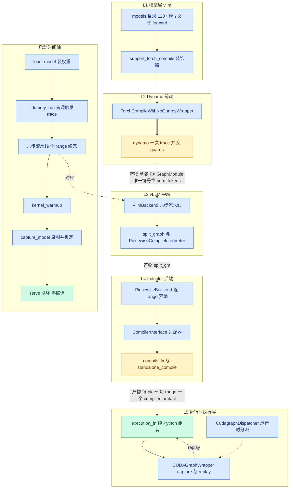
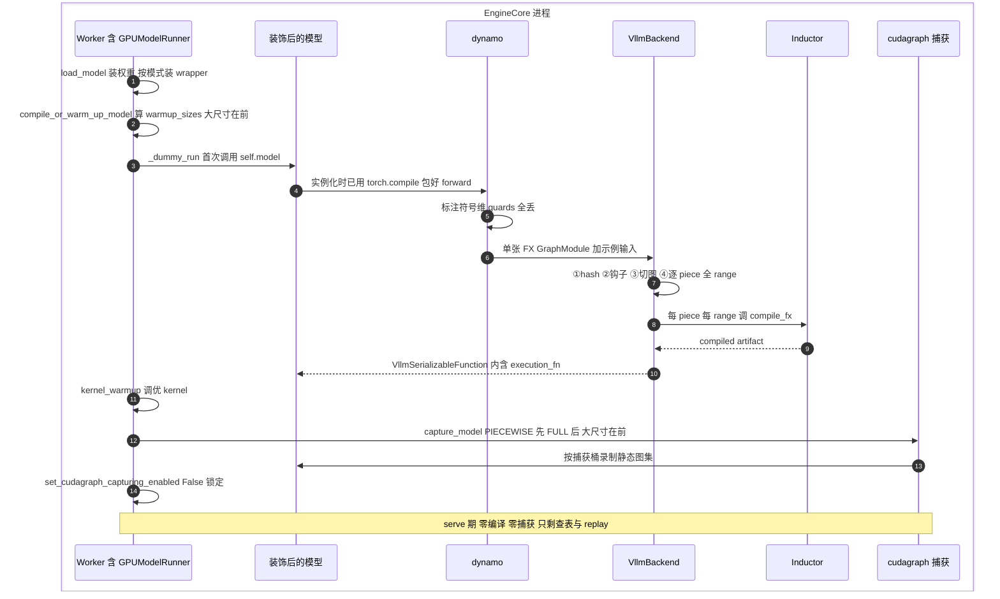

# 第 3 章 vLLM 编译栈全景:一张架构图读懂全书

```text
I   背景:   [1 为何compile] → [2 V1引擎] → [3 编译栈全景]◄==
II  前端:   [4 配置体系] → [5 Dynamo一次捕获]
III 中端:   [6 Piecewise切分] → [7 算子边界与vllm_ir]
IV  后端:   [8 VllmBackend] → [9 逐range编译] → [10 Pass与融合]
V   运行时: [11 代码生成] → [12 CUDA Graph] → [13 缓存与AOT]
VI  收官:   [14 设计哲学] → [15 动手实践]
```

## 3.0 本章俯瞰

前两章回答了"为什么编译"(详见第 1 章)与"编译服务于怎样的运行时"(详见第 2 章)。可当你真正打开 vLLM 源码,面对 compilation/ 目录下的十几个文件、模型目录里几十个带装饰器的类、配置里成串的枚举,一个很实际的问题随之而来:这一切从哪里读起?几十个机制各自行事,它们之间谁先谁后、谁给谁供货、在服务进程的一生中各自醒着多久?答案预告:全部机制可以装进一张五层架构图——模型层、前端、中端、后端、执行层,每层只认一份输入产物、只交一份输出产物;而这一切几乎全部发生在进程启动的那几十秒里,真正对外服务的每一步只剩查表与重放。本章交付三样东西:一张标注产物流向的总览大图、一条"编译发生在什么时候"的启动时间轴、一把把任何机制定位到"编译期还是运行时、图内还是图外、静态还是符号"的坐标系。此后每一章,都能在这张图上找到自己的格子。

先把本章放进整条编译管线:

```text
torch.compile(model)  ◄== 本章:这张图的导览
│
├─ dynamo 一次捕获 ────▶ 整图 FX               ── 第 5 章细讲
│
├─ 切分 split_graph ───▶ submod_0..N            ── 第 6 章
│
├─ 全量预编译(片段 × range)                     ── 第 9 章
│    └─ compile_fx
│         ├─ AOTAutograd(泛函化 + shape 参数化)
│         ├─ 算子边界 / vllm_ir                  ── 第 7 章
│         ├─ post_grad pass 流水线               ── 第 10 章
│         └─ Inductor + 代码生成                 ── 第 10/11 章
│
├─ 造外壳(执行代码 + copy_and_call)            ── 第 8/11 章
│
└─ serve 期:查 range 执行 / CUDA Graph / 缓存    ── 第 12/13 章
```

## 3.1 最小前置知识

- **FX GraphModule(FX 图模块)**:dynamo 把 Python forward 捕获成的图表示,节点是一次次算子调用,节点 meta 里带 **fake tensor(假张量,只含 shape/stride/dtype 元数据不占数据)**。它是 L2 交给 L3 的唯一通货,捕获细节详见第 5 章。
- **backend(编译后端)**:torch.compile 的可插拔参数——任意"接收 FX 图与示例输入、返回可调用对象"的函数都可以。vLLM 的主角 **`VllmBackend`(vLLM 编译后端)** 就是一个 backend,详见第 8 章。
- **`@support_torch_compile`(编译支持装饰器)**:`vllm/compilation/decorators.py` 提供的类装饰器,把模型类挂到一个特殊基类上并声明哪些输入维是符号维;它是 L1 与 L2 之间的接缝,详见第 5 章。
- **CUDA Graph capture/replay(捕获/重放)**:把一段 GPU 工作录成静态图、此后一次调用整段重放;机制动机见第 1 章,运行时细节详见第 12 章。
- **num_tokens(本步总 token 数)**:第 2 章的结论——调度与执行的全部动态性被压缩进这一个整数,它也是编译图唯一的符号维。

## 3.2 设计思想与设计哲学

**分层不是画图习惯,而是产物契约。** 五层中每一层都只向上游要一份明确类型的产物、向下游交一份明确类型的产物:L1 交出"普通 nn.Module 的 forward",L2 交出"单张 FX 图",L3 交出"切分后、可编译子模块已被编译产物替换的 split_gm",L4 交出"每 **piece(片段)** × 每 range 一个 compiled artifact",L5 交出"serve 期每步调用的 callable"。层与层之间不共享内部状态——想理解任何一层,只需读它的输入契约与输出契约。这是 P5(显式优于隐式)在架构层的落点,也是本书敢按层组织章节的前提:后续十二章,不过是把这张图逐格放大。

【哲学时刻】**时间轴比机制清单更重要。** 回扣全书叙事主线:decode 是 CPU/launch bound → 必须消灭 Python 开销 → 代价是编译 → 编译代价是启动时间 → 所以全部编译前置+缓存 → 所以敢丢 guards、敢一次 trace、敢去泛函化。这条链的倒数第二环"全部编译前置"不是某个函数的实现细节,而是整个栈的工期纪律,并被固化成四条不变量,每条都能指认到源码行号:(a) dynamo 只 trace 一次——guards 全丢(`wrapper.py:120-122`(`skip_all_guards_unsafe`)),`set_stance("fail_on_recompile")` 作运行时断言(`vllm/compilation/wrapper.py:195`);(b) 启动期编完一切——`PiecewiseBackend` 在构造函数里就把所有 range 编完(`vllm/compilation/piecewise_backend.py:189-190` 调 `compile_all_ranges`);(c) capture 结束即锁定——`set_cudagraph_capturing_enabled(False)`(`vllm/v1/worker/gpu_model_runner.py:6900`),此后意外捕获直接 raise;(d) serve 路径零编译、零捕获、零 Python 编排。其中 (b) 还有结构性守卫:`monitor_profiling_run`(`vllm/compilation/monitor.py:62-84`)在进入前记录后端编译计数、结束后断言期间无任何新增编译(在 AOT 路径被套用,`decorators.py:570`、`:669`)。不变量不是注释,是 assert——P1(compile once, run forever)与 P2(不变量换性能)因此是可以在行号上逐条指认的工程事实,而非口号。

## 3.3 具体流程(流水线视角)

### 3.3.1 五层分层:一张总览大图

先看全书统一架构语言的总图(图中实线为编译期数据流,虚线为运行时调用流,粗线为本章主线索;右上挂启动时间轴,与 3.3.2 节对应):



逐层看流水线产物句式:

**L1 模型层。** 上游给我模型类定义与权重(`vllm/model_executor/models/*.py`)→ 我用 **`support_torch_compile`(编译支持装饰器)** 在类上声明唯一符号维、把 `TorchCompileWithNoGuardsWrapper` 注入模型基类 → 产出普通 nn.Module forward——表面上什么都没发生,编译被刻意推迟到首次调用。消费该装饰器的模型文件已有 120+ 个(qwen3_next、olmoe、jamba 等)。

**L2 Dynamo 前端。** 上游给我首次 forward 调用(启动期由 `_dummy_run` 发起)→ **`TorchCompileWithNoGuardsWrapper`(无守卫编译包装器)** 在模型实例化时就已经用 `torch.compile(fullgraph=True, dynamic=False, backend=...)` 包好 forward,首次调用触发 dynamo 一次 trace、丢全部 guards → 产出单张 FX GraphModule(唯一符号维 num_tokens),交 backend(详见第 5 章)。

**L3 vLLM 中端。** 上游给我单张 FX 图(`VllmBackend.__call__`)→ 我执行六步流水线(与代码顺序一致,全书统一表述):

1. ① 计算 cache hash(env 因素+config hash+traced_files 文件内容+compiler hash)并定位缓存目录
2. ② configure_post_pass:向 Inductor config 注入两个钩子 pre_grad_custom_pass 与 post_grad_custom_post_pass
3. ③ split_graph:按 splitting_ops 切分 FX 图
4. ④ PiecewiseCompileInterpreter.run:逐 piece 构造 PiecewiseBackend 并把所有 range 一次编完 → 保存 CompilerManager 缓存
5. ⑤ generate_execution_code + compile_execution_fn:生成纯 Python 组装代码并 exec
6. ⑥ 组装 VllmSerializableFunction(必要时包 copy_and_call)返回

产物是 **split_gm(切分图模块)**:attention 类算子所在的 splitting piece 保留源码形态,可编译 piece 的属性已被编译产物替换(直接改写 `self.module.__dict__[target]`)。按官方文档口径,Llama 切分后只有 3 类唯一子图(pre-attention / 每层重复 / post-attention)——已与源码机制核对一致(切分细节详见第 6 章)。

**L4 Inductor 后端。** 上游给我 split_gm 的一个个可编译 piece(`PiecewiseBackend.__init__`)→ 我在构造函数里就把该 piece 的全部 range 一次编完(`compile_all_ranges`),编译请求经 `CompilerManager.compile` 驱动 **`CompilerInterface`(编译器接口)** 的三实现——`InductorAdaptor` 调 `compile_fx`、`InductorStandaloneAdaptor` 走 `standalone_compile`、`EagerAdaptor` 供调试,vLLM 的自定义 pass 经两个钩子注入 → 产出每 piece × 每 range 一个 compiled artifact(适配与缓存细节详见第 8、9 章)。

**L5 运行时执行层。** 上游给我 execution_code 字符串与编译产物(`generate_execution_code` 与 `compile_execution_fn`)→ 我生成纯 Python 的 **execution_fn(执行函数,绕开 FX GraphModule 的解释开销)**;**`CUDAGraphWrapper`(CUDA Graph 包装器)** 在启动期按桶 capture、serve 期 replay;**`CudagraphDispatcher`(图分派器)** 每步按 num_tokens 与 LoRA 状态选模式选桶(`dispatch`)→ 产出 serve 期每步调用的 callable。

### 3.3.2 启动时间轴:编译到底发生在什么时候

五层图回答"谁给谁供货",时间轴回答"何时发生"。编译不在 import 时、不在 serve 期,而是全部挤在启动期的一段严格工序里。这段工序可以排成五个阶段,与上图右上角的时间轴一一对应:

> `load_model` 把权重装进 GPUModelRunner → 权重就位后,按模式决定包装优先级(breakable → FULL(has_full_cudagraphs)→ UBatchWrapper)→ 产出"已包装、未编译"的模型,交 `compile_or_warm_up_model`。

**阶段一,装权重与包装。** 权重就位后模型立即被套上外层 wrapper,但注意此刻"只包不编"——编译被刻意推迟到首次调用。

**阶段二,warmup 推算与首调(编译在此发生)。** `compile_or_warm_up_model` 从 CompilationConfig 拿到 compile_sizes 与 cudagraph_capture_sizes,推算出 warmup_sizes:从 compile_sizes 里减去将被捕获的尺寸,再为捕获尺寸与 warmup 尺寸都不覆盖的每个 compile_range 补上区间末端,最后按大尺寸在前的顺序逐个 `_dummy_run`。每个 `_dummy_run` 伪造一份 num_scheduled_tokens_list,在 `set_forward_context` 内调 `self.model(...)`——**第一个尺寸的首次调用触发 dynamo trace 与 VllmBackend 六步**,全部 range 的 Inductor 编译在这一趟里完成(不变量 b:所有 range 在 `PiecewiseBackend.__init__` 里一次编完);后续尺寸不再编译,只是让运行时按 shape 选中对应 range 的产物热身。

**阶段三,kernel_warmup。** 调优即将被捕获的 kernel,为捕获做准备。

**阶段四,capture_model 录图并锁定。** `get_capture_descs` 产出 PIECEWISE 先、FULL 后、各按 (num_tokens, num_active_loras) 降序的捕获清单——大尺寸先捕,让小尺寸复用图内存池(源码注释明说这一动机);逐清单录制静态图集,最后 `set_cudagraph_capturing_enabled(False)` 锁定、`lock_workspace` 钉死工作区。

**阶段五,serve 循环。** 时间轴收束于 `EngineCore.step` → `execute_model` → 查表分派 → `_model_forward` 里的 `self.model(...)` → replay。此后每步,五层图里只剩 L5 醒着。



### 3.3.3 唯一直接 torch.compile 调用点辨析

读源码时容易困惑:全书主线里,`torch.compile` 到底在哪里被调用?答案是有两处入口、一条主线。主线 **VLLM_COMPILE** 只有一处直接调用,藏在包装器的构造函数里:`TorchCompileWithNoGuardsWrapper.__init__`(`vllm/compilation/wrapper.py:72-160`)在模型实例化时执行——

```python
# vllm/compilation/wrapper.py:148-154 (v0.27.1)
self._compiled_callable = torch.compile(
    compiled_ptr,          # 即模型的 forward
    fullgraph=True,        # 禁止 graph break
    dynamic=False,         # 不自动 dynamic,符号维由装饰器显式声明
    backend=backend,       # VLLM_COMPILE 时为 VllmBackend
    options=options,       # 含 guard_filter_fn 丢 guards
)
```

注意它只"包"不"编":真正触发 dynamo trace 的是首次 forward 调用(`decorators.py:502` 的 `__call__` 判定 `self.compiled` 为 False 才走编译路径)。另一条路 **STOCK_TORCH_COMPILE** 是非主线的对照分支:装饰器名单 `do_not_compile` 含该模式,模型类保持"不自我编译";改由模型执行器在 load_model 末尾直接调用 nn.Module 的 `compile(fullgraph=True, backend=...)`,backend 同样取自下文的 `init_backend` 分发点。它让"原生 torch.compile 直接上生产"成为一条可显式选择的路径,但绕过了 L3 整层,不是本书的主线。

两条路经由同一个分发点 `init_backend`(`vllm/config/compilation.py:1062`)汇入一个 backend:STOCK 与 DYNAMO_TRACE_ONCE 返回后端名字符串(默认原生 Inductor),VLLM_COMPILE 返回 `VllmBackend`。也就是说,STOCK 汇入的是上游原生 Inductor,L3 整层被绕过;主线汇入 VllmBackend,再由它经适配器驱动 Inductor——同一个 torch.compile 机制,两种集成深度,这正是第 1 章"三宗罪"里原生路径不可直接上线的制度化出路(模式语义详见第 4 章)。

### 3.3.4 三条正交轴线:机制的坐标系

五层图是纵向分层,还需要一把横向的尺。全书反复出现三条彼此正交的轴线,任何机制都能被三根坐标钉死:

```text
                    编译期                      运行时
        ┌─────────────────────┬─────────────────────┐
图内    │ 逐 range Inductor 编译│ attention 边界算子   │
        │ fusion pass 区间门控 │ 在图内位置取当步元数据│
        ├─────────────────────┼─────────────────────┤
图外    │ cache hash 建缓存目录│ CudagraphDispatcher │
        │ 生成 execution_code │ 查表选桶并 replay    │
        │ 并 exec             │ lm_head 与采样       │
        └─────────────────────┴─────────────────────┘
 轴3 shape: 静态 = 尺寸桶与单尺寸 Range   符号 = 区间 Range 产物
```

- **轴 1 编译期 vs 运行时**:机制醒着的时段。六步流水线、pass、代码生成全在编译期;dispatch、replay、ForwardContext 注入全在运行时。判据很简单——不变量 (d) 说 serve 期零 Python 编排,于是凡在 serve 路径上的,都只能是"查表+调用"。
- **轴 2 图内 vs 图外**:机制相对编译图边界的位置。图内享受融合与捕获,图外保留控制流自由——lm_head 与采样永远在图外(详见第 2 章),attention 永远在图内边界处:它在 FX 图里是节点,但 PIECEWISE 模式下其所在的 splitting piece 不编译不捕获,运行时经模块级全局加 `set_forward_context` 上下文管理器设置的 ForwardContext 取当步元数据(`vllm/forward_context.py`,"图是静态的、信息是动态的")。
- **轴 3 静态 shape vs 符号 shape**:产物以什么形状知识编译。单尺寸 Range 开 max_autotune 全静态,区间 Range 长出符号维;CudagraphDispatcher 只在静态桶一格里工作。这根轴就是 P7(shape 是推理编译的核心矛盾)的坐标化。

举两个落格的例子:fusion pass = 编译期 × 图内 × 按 range 门控(第 10 章);`CudagraphDispatcher` = 运行时 × 图外 × 静态桶(第 12 章)。三轴正交意味着它们可以独立演进——换一个 pass 不影响运行时,换捕获桶表不影响图内融合,这是 P6(平台与后端可插拔)的几何表达。

### 3.3.5 全书地图:15 章各占哪一格

| 章 | 主题 | 层 | 轴线格子 |
|---|---|---|---|
| 1 | 为何 compile | 横切(动机) | 运行时 × 图外 × decode 账本 |
| 2 | V1 引擎 | L5 的地基 | 运行时 × 图外 |
| 3 | 编译栈全景 | 全部五层 | 坐标系本身 |
| 4 | 配置体系 | 全层入口 | 编译期 × 全局(配置即合同) |
| 5 | Dynamo 一次捕获 | L2 | 编译期 × 图内 × 符号维声明 |
| 6 | Piecewise 切分 | L3 | 编译期 × 图内边界 |
| 7 | 算子边界与 vllm_ir | L1↔L3 | 编译期 × 图内 × 跨图之桥 |
| 8 | VllmBackend | L3→L4 | 编译期 × 全局(六步编排) |
| 9 | 逐 range 编译 | L4 | 编译期 × 图内 × 静态/符号两格 |
| 10 | Pass 与融合 | L4 | 编译期 × 图内 × 按 range 门控 |
| 11 | 代码生成 | L4→L5 | 编译期产物 × 运行时执行 |
| 12 | CUDA Graph | L5 | 运行时 × 图外 × 静态桶 |
| 13 | 缓存与 AOT | L3~L4 横切 | 编译期 × 存储层 |
| 14 | 设计哲学 | 全部 | 全部 |
| 15 | 动手实践 | 全部 | 调试视角 |

### 3.3.6 20 步编号清单:一条 forward 从 Python 调用到 GPU kernel

下面这份编号清单是后续每章的"当前位置"参照,编号全书稳定(1-4 模型层、5-8 dynamo、9-13 中端、14-17 后端、18-20 运行时):

1. 模型类在 models 目录定义,forward 是普通 Python。
2. `@support_torch_compile` 注入包装基类、声明唯一符号维。
3. `load_model` 装权重并按模式与图模式装外层 wrapper。
4. 启动期 `_dummy_run` 发起首次 `self.model(...)` 调用。
5. 包装器 `__call__` 发现未编译,先标注动态维再调编译入口。
6. dynamo 以 fullgraph、dynamic=False 包住的 forward 开始一次 trace。
7. guards 全丢,`fail_on_recompile` 断言此后永不 re-trace。
8. 产出单张 FX GraphModule,作为 backend 入参进入 `VllmBackend.__call__`。
9. ①算 cache hash 四要素并定位缓存目录。
10. ②configure_post_pass 注入 pre_grad_custom_pass 与 post_grad_custom_post_pass 两钩子。
11. ③split_graph 按 splitting_ops 切图。
12. ④PiecewiseCompileInterpreter.run 逐 piece 构造 PiecewiseBackend。
13. 产出 split_gm,可编译子模块属性即将被产物替换。
14. PiecewiseBackend 在构造时登记全部 range 并一次编完。
15. CompilerManager.compile 先查缓存,未命中走 CompilerInterface 适配器。
16. InductorAdaptor 调 compile_fx,AOTAutograd 与 lowering 展开。
17. vLLM pass 经两钩子在 pre/post_grad 处运行,融合发生;产出每 piece × 每 range 一个 artifact。
18. ⑤⑥生成并 exec 纯 Python execution_fn,包成 VllmSerializableFunction 返回。
19. capture_model 按降序清单录静态图集,结束即锁定。
20. serve 期:step → execute_model → dispatch 查表 → replay,kernel 上 GPU。

注意这份清单把编译期(1-18)与运行时(19-20)串在一条线上——它讲的是"一个 forward 的完整一生",不是"serve 期的某一步"。serve 期的每一步只走第 20 步;前 19 步的全部产出,都以查表可及的形式沉淀在第 20 步的周围。

## 3.4 本章小结

- 五层各守一份产物契约:forward → FX 图 → split_gm → artifact → callable。
- 编译全部挤在启动期:dummy run 触发,capture 锁定收尾。
- 全书主线仅一处直接调用 torch.compile:wrapper.py:148。
- 三条正交轴线可定位一切机制:工期、边界、shape。
- 20 步清单是全书通用的当前位置参照。

本机制(全景分层与时间轴)服务于 P1(compile once, run forever)、P2(不变量换性能)与 P5(显式优于隐式),并把 P7 提前钉在坐标系的第三根轴上。下一章(第 4 章)先认识用户可拨动的旋钮:三个正交枚举与 -O 优化级别。它们决定本章时间轴上每一步是否发生、以何种规模发生,是这张全景图的第一组可配置参数。

### 本章源码索引

| 锚点 | 内容 |
|---|---|
| `vllm/v1/worker/gpu_worker.py:435`(`load_model`) | Worker 侧装权重入口 |
| `vllm/v1/worker/gpu_worker.py:679-718`(`compile_or_warm_up_model`) | warmup_sizes 推算与编译触发顺序 |
| `vllm/v1/worker/gpu_worker.py:706-708` | 大尺寸在前的逐个 _dummy_run |
| `vllm/v1/worker/gpu_worker.py:713,717` | kernel_warmup 与 capture_model 调用点 |
| `vllm/v1/worker/gpu_model_runner.py:5303`(`load_model`) | 权重加载与 wrapper 装配 |
| `vllm/v1/worker/gpu_model_runner.py:5435-5445` | STOCK_TORCH_COMPILE 直接 model.compile |
| `vllm/v1/worker/gpu_model_runner.py:5449-5478` | wrapper 优先级:breakable/FULL/UBatch |
| `vllm/v1/worker/gpu_model_runner.py:5830`(`_dummy_run`) | 伪造输入的启动期前向 |
| `vllm/v1/worker/gpu_model_runner.py:5943-5944` | force_eager 判定(is_profile 或 NONE) |
| `vllm/v1/worker/gpu_model_runner.py:6077-6080` | attn metadata 的 for_cudagraph_capture |
| `vllm/v1/worker/gpu_model_runner.py:6145-6156` | set_forward_context 内的首次模型调用 |
| `vllm/v1/worker/gpu_model_runner.py:6814`(`capture_model`) | 录图主流程 |
| `vllm/v1/worker/gpu_model_runner.py:6829-6831` | 大尺寸先捕以复用图内存池的注释 |
| `vllm/v1/worker/gpu_model_runner.py:6876-6884` | 遍历 get_capture_descs 逐组捕获 |
| `vllm/v1/worker/gpu_model_runner.py:6900,6907` | 捕获锁定与 lock_workspace |
| `vllm/v1/worker/gpu_model_runner.py:6968,6920` | `_capture_cudagraphs` 逐组批捕、`_warmup_and_capture` 单描述符预热加捕获 |
| `vllm/v1/worker/gpu_model_runner.py:4166,3977,3903` | serve 期 execute_model→dispatch→self.model |
| `vllm/v1/engine/core.py:584-614`(`step`) | serve 主循环 |
| `vllm/compilation/decorators.py:118,331,502` | 装饰器三件:入口/实现/首调 __call__ |
| `vllm/compilation/decorators.py:390-395` | do_not_compile 三条件(mode∈{NONE,STOCK}/ignore/enable_if) |
| `vllm/compilation/wrapper.py:47,72-160` | 包装器类与构造 |
| `vllm/compilation/wrapper.py:171` | 包装器 `__call__`:首调发现未编译、调编译入口 |
| `vllm/compilation/wrapper.py:120-122,148-154,195` | 丢 guards、torch.compile、fail_on_recompile |
| `vllm/compilation/backends.py:1020`(`VllmBackend.__call__`) | 六步流水线入口 |
| `vllm/compilation/backends.py:1031-1079` | cache hash 四要素与缓存目录 |
| `vllm/compilation/backends.py:934,1171` | configure_post_pass 定义与调用 |
| `vllm/compilation/backends.py:1179,1222,1228` | 切图、逐 piece 预编、保存 CompilerManager |
| `vllm/compilation/backends.py:766` | 编译产物替换 split_gm 子模块属性 |
| `vllm/compilation/backends.py:1279,1287,1295,1328` | 代码生成、exec、VllmSerializableFunction |
| `vllm/compilation/backends.py:264`(`CompilerManager.compile`) | 先缓存后编译的分发 |
| `vllm/compilation/piecewise_backend.py:86,190,245` | PiecewiseBackend 与 compile_all_ranges |
| `vllm/compilation/compiler_interface.py:27,251,449` | 接口与三适配器 |
| `vllm/compilation/compiler_interface.py:492` | InductorAdaptor 内调 compile_fx |
| `vllm/model_executor/models/llama.py:310,334-343` | Llama forward 定义与 @support_torch_compile 样板 |
| `vllm/compilation/codegen.py:131,165` | execution_fn 的生成与编译 |
| `vllm/compilation/cuda_graph.py:145`(`CUDAGraphWrapper`) | capture/replay 包装 |
| `vllm/compilation/monitor.py:62-84` | profiling run 期间零后端编译断言 |
| `vllm/v1/cudagraph_dispatcher.py:15,235,326` | 分派器:dispatch 与 get_capture_descs |
| `vllm/config/compilation.py:1062-1104`(`init_backend`) | 两路 backend 分发点 |

### 参考资料

1. [vLLM design doc — torch.compile](https://docs.vllm.ai/en/latest/design/torch_compile/) — 已与 0.27.1 源码核对一致(piecewise 切分与逐尺寸编译的总体描述与本章锚点相符)
2. [vLLM blog — Introduction to torch.compile and How It Works with vLLM (2025-08-20)](https://vllm.ai/blog/2025-08-20-torch-compile) — 仅作背景叙事
3. [vLLM design doc — Optimization Levels](https://docs.vllm.ai/en/latest/design/optimization_levels/) — 仅作背景叙事(详见第 4 章)
4. [vLLM design doc — CUDA Graphs](https://docs.vllm.ai/en/stable/design/cuda_graphs/) — 已与 0.27.1 源码核对一致(捕获顺序与共享内存池机制)
5. [vLLM design doc — Fusions](https://docs.vllm.ai/en/latest/design/fusions/) — 仅作背景叙事(详见第 10 章)
6. [vLLM design doc — Debug vLLM Compile](https://docs.vllm.ai/en/latest/design/debug_vllm_compile/) — 仅作背景叙事(详见第 15 章)
7. [RFC issue #6378 — A Graph Optimization System in vLLM using torch.compile](https://github.com/vllm-project/vllm/issues/6378) — 仅作背景叙事
8. [PyTorch blog — PyTorch + vLLM](https://pytorch.org/blog/pytorch-vllm-%E2%99%A5%EF%B8%8F/) — 仅作背景叙事
9. [vLLM v0.8.1 设计文档 — torch_compile(历史版)](https://docs.vllm.ai/en/v0.8.1/design/v1/torch_compile.html) — 仅作背景叙事(演进对比用)
