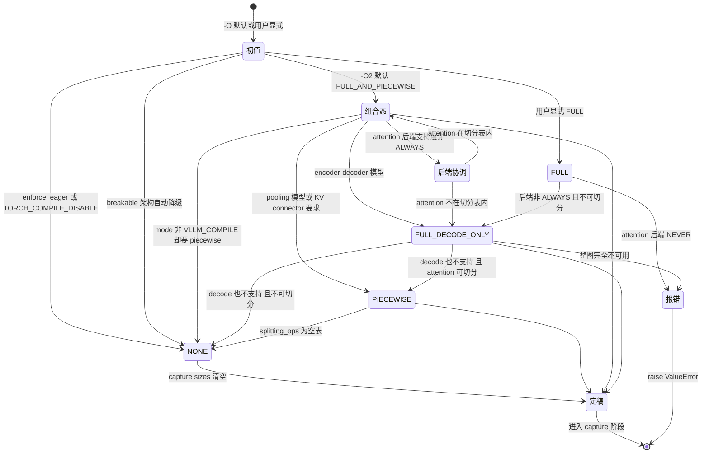
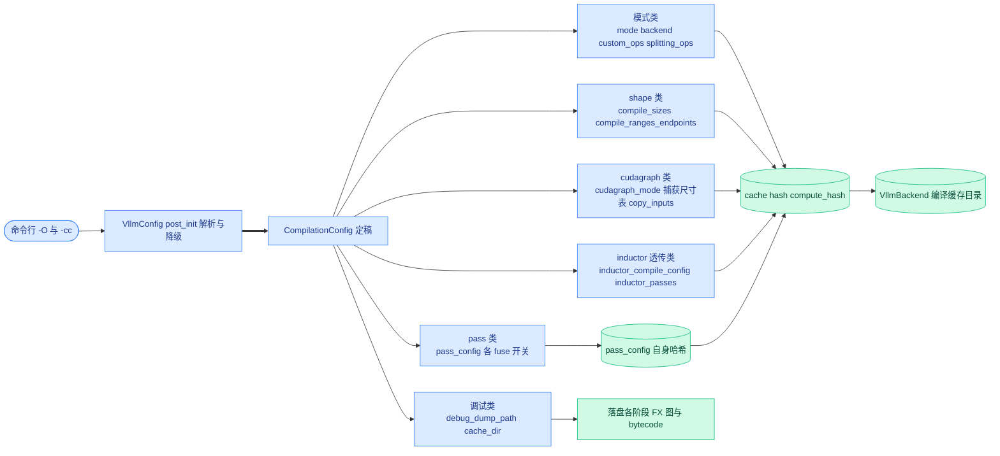

# 第 4 章 配置体系:CompilationMode、CUDAGraphMode 与 -O 优化级别

```text
I   背景:   [1 为何compile] → [2 V1引擎] → [3 编译栈全景]
II  前端:   [4 配置体系]◄== → [5 Dynamo一次捕获]
III 中端:   [6 Piecewise切分] → [7 算子边界与vllm_ir]
IV  后端:   [8 VllmBackend] → [9 逐range编译] → [10 Pass与融合]
V   运行时: [11 代码生成] → [12 CUDA Graph] → [13 缓存与AOT]
VI  收官:   [14 设计哲学] → [15 动手实践]
```

## 4.0 本章俯瞰

一个推理引擎想变快,可用的手段有一大把:把子图编译成融合的 Triton kernel、把整段前向录成一张 GPU 图反复重放、把 norm 和量化揉进同一个 kernel、给常见的 batch 大小各编一份全静态产物……这些手段彼此纠缠——有的互相依赖(分片的 CUDA Graph 必须先有分片的编译),有的互斥(整图捕获容不下某些注意力后端),有的只在特定硬件、特定并行度下成立。用户在启动服务的那一刻,必须能用一两个参数讲清「我愿意用多少启动时间换多少稳态性能」,而不可能先修完一门编译课再上线。

本章回答的问题是:这几十个开关如何被组织成一套普通用户也能安全拨动的配置体系。答案是三层结构:其一,全部编译相关字段收进一个统一容器,任何细粒度开关都能用一份 JSON 精确覆写;其二,在容器之上盖一个面向用户的总开关——优化级别,它只负责「填默认值」,永不覆盖用户显式写下的任何字段;其三,一条顺序固定的解析流水线,加上一条自动降级链,把任意输入收敛成一个无矛盾、可直接执行的最终形态——无论出发点多离谱,结局要么是一个良定义的组合,要么是一句明确的报错。本章也因此是全书的「旋钮总目录」:此后每一章出现的机制,都能在本章找到控制它的那个字段。

## 4.1 最小前置知识

- **VllmConfig**(vLLM 总配置):所有子配置的聚合根,`compilation_config` 是它的一个字段(`vllm/config/vllm.py:377`)。第 3 章五层全景里的每一层,都从这份配置取参数。
- prefill 与 decode 两类批:V1 引擎每步调度的批,要么是纯 decode 批(每条序列只出一个 token),要么是含 prefill 的混合批(详见第 2 章)。本章的核心枚举 **CUDAGraphMode**(CUDA Graph 模式)正是按这两类批建模的。
- CUDA Graph capture/replay:把一段 GPU 工作录制下来,之后一次调用整段重放,是消灭 launch 开销的核心手段(第 1 章;运行时细节详见第 12 章)。
- Inductor config:上游 `torch._inductor.config` 的配置项可经 vLLM 透传进编译(透传机制详见第 9 章)。
- **cache hash**(缓存哈希):VllmBackend 用配置内容计算哈希、定位编译缓存目录(`vllm/compilation/backends.py:1034`,详见第 8、13 章)。因此「哪些字段进哈希」本身就是配置设计的一部分。

## 4.2 设计思想与设计哲学

**三个枚举,三类观众。** 本章的三位主角各自只对一类消费者负责:**OptimizationLevel**(优化级别)对用户负责,用一句话讲清「代价交易」;**CompilationMode**(编译模式)对编译器负责,决定走哪条编译流水线;CUDAGraphMode 对运行时负责,决定录什么图。三者刻意正交:CUDAGraphMode 的 docstring 明说「cudagraph 逻辑与编译逻辑大体正交」(`vllm/config/compilation.py:634-638`)——分片 CUDA Graph 需要分片编译(mode=VLLM_COMPILE 且 splitting_ops 非空),而整图 CUDA Graph 有没有编译都能用。正交性让每一层可以独立推理、独立演进,这是命题 P6(平台与后端可插拔)在配置层的投影:换一个注意力后端、换一个编译 backend,其余旋钮不动。

【哲学时刻】**「配置写组合、运行时见单态」。** V1 的批天然分两类:纯 decode 批与混合批,每类批在任一时刻只会处于一种确定的图模式。于是 vLLM 干脆把「组合配置」建模成两个「单态」的配对:`FULL_AND_PIECEWISE = (FULL, PIECEWISE)`——decode 批用整图、混合批用分片图。运行时通过 `decode_mode()` / `mixed_mode()` 拆出单态,`valid_runtime_modes()`(`vllm/config/compilation.py:92-97`)恒等于 {NONE, PIECEWISE, FULL} 三个单态。第 12 章的分派器因此永远不需要理解「组合」这个概念——降维在配置解析期就完成了。这是命题 P2(不变量换性能)的服务面:把「可能处于组合态」的复杂性挡在 serve 路径之外,运行时只需查表。

【哲学时刻】**-O 是意图声明,不是命令。** 总开关的全部权力只是「填 None」:`_set_config_default` 只在字段仍为 None 时写入默认值,用户显式给出的值永远优先(`vllm/config/vllm.py:811-824`)。更妙的是,默认值本身常常是**门槛函数**(callable)而非静态量——「要不要默认开 norm+quant 融合」被写成一段代码,在解析时刻按模型与硬件现场求值(`vllm/config/vllm.py:131-175`)。这是命题 P5(显式优于隐式)的两面:用户声明 what(我要这个融合),系统决定 how(默认值按环境计算);一旦用户显式表态,系统闭嘴。

**宁可降级,不把矛盾交给运行时。** 解析流水线的最后几步是一条降级链:注意力后端不支持整图就降到组合态,pooling 模型不支持整图就降到分片,切分表为空就把分片图模式降为 NONE。任何不可行的组合,要么被收敛到最近的可行形态并打一条 warning,要么当场 raise——绝不会静默地留一个半残配置等到 serve 期才炸。这同样服务 P2:运行时看到的世界永远良定义。

最后回扣全书叙事主线:decode 是 CPU/launch bound,所以要编译、要图;编译的代价是启动时间,而 -O 的每一级正是这条代价链上的显式刻度——O0 启动最快,O2 性能最好。默认值敢停在 O2,是因为「全部编译前置 + 缓存」(第 13 章)把 O2 的启动代价摊销成一次性的;没有缓存体系兜底,这个默认值就不敢这么激进。

## 4.3 具体流程

### 4.3.1 三个正交枚举:一张身份证,三个视角

```text
用户视角        编译器视角               运行时视角
-O0..-O3  -->  CompilationMode         CUDAGraphMode
 总开关          NONE=0 eager            单态 NONE/PIECEWISE/FULL
 (代价交易)      STOCK_TORCH_COMPILE=1   组合态 = (decode态, mixed态)
                 DYNAMO_TRACE_ONCE=2     FULL_DECODE_ONLY=(FULL,NONE)
                 VLLM_COMPILE=3          FULL_AND_PIECEWISE=(FULL,PIECEWISE)
```

**OptimizationLevel**(`vllm/config/vllm.py:104`)只有四级:O0 无编译无图,即刻起跑;O1 编译 + 分片图 + 基础融合;O2 再加整图与通信融合;O3 目前等同 O2(`vllm/config/vllm.py:115-116` 的 docstring 明说 "Currently the same as -O2s"),没有 O4——总开关的取值空间刻意小,小到用户不需要查文档。

**CompilationMode**(`vllm/config/compilation.py:37`)是编译器视角的「用哪条流水线」:NONE=0 完全 eager;STOCK_TORCH_COMPILE=1 标准 `torch.compile`,一张整图直接交给上游;DYNAMO_TRACE_ONCE=2 只做一次 dynamo trace、丢 guards 后不再重编译(CPU 平台在平台默认值里强制这一档,`vllm/platforms/cpu.py:182`);VLLM_COMPILE=3 走 vLLM 自定义的 VllmBackend——piecewise 切分、逐 range 编译、缓存、自定义 pass,即本书第 6~13 章的全部内容。模式 1/2/3 对应的产物分别在第 3 章五层图里绕过或穿过 L3/L4。

**CUDAGraphMode**(`vllm/config/compilation.py:53`)的核心设计是「具体单态 + 组合配置态」:

```python
# vllm/config/compilation.py:59-69 (v0.27.1)
class CUDAGraphMode(enum.Enum):
    NONE = 0
    PIECEWISE = 1
    FULL = 2
    FULL_DECODE_ONLY = (FULL, NONE)
    FULL_AND_PIECEWISE = (FULL, PIECEWISE)

    def decode_mode(self) -> "CUDAGraphMode":
        return CUDAGraphMode(self.value[0]) if self.separate_routine() else self

    def mixed_mode(self) -> "CUDAGraphMode":
        return CUDAGraphMode(self.value[1]) if self.separate_routine() else self
```

配套的 helper 家族:`separate_routine()` 判断是否组合态,`has_mode()` / `requires_piecewise_compilation()` / `has_full_cudagraphs()` / `has_piecewise_cudagraphs()` 供各处询问语义属性(`vllm/config/compilation.py:71-97`)。流水线句式:CUDAGraphMode 从 VllmConfig 解析期拿到用户值或 -O 默认值(字段定义 `vllm/config/compilation.py:607`)→ 经下文的降级链定稿 → 产出供运行时拆解的单态,decode 批与混合批各取所需(CudagraphDispatcher,详见第 12 章)。

### 4.3.2 -O2 展开全过程:mode 独立解析,其余只填 None

**OptimizationLevel** 作为用户入口,首先在 CLI 层被展开;真正发生在配置期的是两件独立的事。

第一件:**mode 的解析根本不经过 -O 表**。`OPTIMIZATION_LEVEL_00..03` 四张字典(`vllm/config/vllm.py:229-320`)里**不含 mode**,只含 `cudagraph_mode`、`pass_config` 各融合开关、`use_inductor_graph_partition` 与 `kernel_config.enable_flashinfer_autotune`。mode 由一条独立规则在解析顺序中兜底(`vllm/config/vllm.py:1272-1276`):字段仍为 None 时,optimization_level 大于 O0 就写 VLLM_COMPILE,否则写 NONE——这是 -O 体系触碰 mode 的唯一位置。这条规则排在平台默认值注入(`vllm/config/vllm.py:1270`)之后,所以 CPU 平台可以先把自己的 DYNAMO_TRACE_ONCE 写进 mode,兜底逻辑只在 mode 为 None 时才动笔,不会覆盖它。

第二件:**-O 表只填 None**。`_apply_optimization_level_defaults`(`vllm/config/vllm.py:826-853`)递归遍历字典,最终落到:

```python
# vllm/config/vllm.py:819-824 (v0.27.1)
        if getattr(config_obj, key) is None:
            # Some config values are known before initialization and are
            # hard coded.
            # Other values depend on the user given configuration, so they are
            # implemented with lambda functions and decided at run time.
            setattr(config_obj, key, value(self) if callable(value) else value)
```

注意 `value(self) if callable(value)`:O2 表里 `fuse_norm_quant` 的默认值不是布尔,而是函数 `enable_norm_fusion`(`vllm/config/vllm.py:131`)——rms_norm 或 quant_fp8 custom op 处于激活态、或 `ir_op_priority` 非原生实现时才为 True;`fuse_act_quant` 同理(`vllm/config/vllm.py:142`);`fuse_allreduce_rms` 要求 TP>1 且 CUDA 且装有 flashinfer 且算力为 SM90/SM100 家族(`vllm/config/vllm.py:155-175`,ROCm 走 AITER 分支)。至于 `fuse_attn_quant` 与 `enable_sp`/`fuse_gemm_comms`,O2 表里填的是占位常量 `IS_QUANTIZED`/`IS_DENSE`,当前恒为 False(`vllm/config/vllm.py:121-128`)。

四级对照表如下(mode 行标注「独立解析」以示它不在 -O 字典里):

| 字段 | O0 | O1 | O2(默认) | O3 |
|---|---|---|---|---|
| mode(独立解析,:1272-1276) | NONE | VLLM_COMPILE | VLLM_COMPILE | VLLM_COMPILE |
| cudagraph_mode | NONE | PIECEWISE | FULL_AND_PIECEWISE | FULL_AND_PIECEWISE |
| fuse_norm_quant / fuse_act_quant | False | 门槛函数 | 门槛函数 | 门槛函数 |
| fuse_allreduce_rms | False | False | 门槛(TP>1 + SM90/100 + flashinfer) | 同 O2 |
| fuse_attn_quant | False | False | False(占位常量) | 同 O2 |
| enable_sp / fuse_gemm_comms | False | False | False(占位常量) | 同 O2 |
| enable_flashinfer_autotune | False | True | True | True |
| use_inductor_graph_partition | False | False | False | False |

### 4.3.3 解析顺序与自动降级链

上游给我用户构造的 **CompilationConfig**(编译配置,可能大部分字段为 None,来自 `-cc` JSON 或 Python 构造,字段容器定义于 `vllm/config/compilation.py:398`)→ 我按固定顺序执行 `VllmConfig.__post_init__`(定义于 `vllm/config/vllm.py:972`,编译相关段落 :1193-1511)→ 产出一个全部字段定稿、无矛盾的 compilation_config,交给 VllmBackend(第 8 章)。顺序本身是承重墙,压缩为八步:

1. **eager 否决先行**:**enforce_eager**(强制 eager)为 True 时直接 mode=NONE 且 cudagraph_mode=NONE(`vllm/config/vllm.py:1193-1199`);环境变量 `TORCH_COMPILE_DISABLE=1` 再补一刀 mode=NONE(:1201-1206);部分未适配 torch.compile 的架构自动打开 `VLLM_USE_BREAKABLE_CUDAGRAPH`,同样把 mode 打回 NONE(:1211-1241)。
2. **平台默认值**注入(:1270),随后 **mode 兜底**(:1272-1276,见上节)。
3. **custom_ops 基调**:mode≠NONE 且 backend=inductor 时基调为 "none"(让 Inductor 为被禁用的算子生成融合 Triton kernel),否则 "all"(:1285-1292)。
4. **-O 表注入**(:1299-1300,只填 None)。
5. **组合合法性**:cudagraph_mode 需要 piecewise 编译而 mode 不是 VLLM_COMPILE 时,降到 NONE(:1310-1321)。
6. **模型形态降级**:pooling 模型不支持整图 → PIECEWISE(:1375-1382);encoder-decoder → FULL_DECODE_ONLY(:1383-1395);某些 KV connector 的层间异步操作进不了图 → PIECEWISE(:1398-1422);enforce_eager 把 max_cudagraph_capture_size 置 0、capture sizes 清空(:1425-1432)。
7. **尺寸定稿**:`_set_cudagraph_sizes`(:1778)与 `_set_compile_ranges`(:1945),细节见 4.3.5。
8. **切分表定稿**:`set_splitting_ops_for_v1`(:1508 调用,定义于 `vllm/config/compilation.py:1133`),细节见 4.3.4。

其中与注意力后端相关的降级发生在 `resolve_cudagraph_mode_and_sizes`(`vllm/config/compilation.py:1368`):上游给我后端申报的 **AttentionCGSupport**(注意力后端 CUDA Graph 支持度,枚举 ALWAYS=3 / UNIFORM_BATCH=2 / UNIFORM_SINGLE_TOKEN_DECODE=1 / NEVER=0,`vllm/v1/attention/backend.py:606`)→ 我按「混合批是否要整图」「decode 批是否要整图」两级检查降级 → 产出运行时实际生效的 cudagraph_mode。整条链画成状态图:



补充一条与投机解码相关的尺寸规整:`adjust_cudagraph_sizes_for_spec_decode`(`vllm/config/compilation.py:1518`)把全部捕获尺寸向上取整到 `num_speculative_tokens + 1` 的倍数(开了序列并行时还要兼顾 TP 数的倍数),取整后越界的尺寸被剔除。

### 4.3.4 splitting_ops 的三档语义

**splitting_ops**(切分算子表)是「在哪些算子处把 FX 图切开」的名单(切分动作本身详见第 6 章)。它的取值有三个语义层级,上游给我 mode 与 pass_config(`vllm/config/compilation.py:1133`)→ 我按下表归一 → 产出定稿的 splitting_ops,必要时连带降级 cudagraph_mode:

| 输入 | 定稿结果 | 连带影响 |
|---|---|---|
| None(默认) | `_attention_ops` 13 个注意力算子 + `unified_kv_cache_update` + `unified_mla_kv_cache_update`(:1183-1184) | 分片编译与分片图可用 |
| `[]`(空表) | 整图编译,无切分点(:1186-1211) | PIECEWISE→NONE,FULL_AND_PIECEWISE→FULL |
| `fuse_attn_quant=true` 且非 inductor 切分(:1250-1264) | `[]`(attention 要参与融合,不能被隔离) | 有 piecewise 成分时→FULL |
| `enable_sp` 或 `fuse_gemm_comms` 且非 inductor 切分(:1213-1230) | `[]`(序列并行/异步 TP 需要整图) | 有 piecewise 成分时→FULL |
| mode 非 VLLM_COMPILE(:1138-1141) | `[]`(没有切分流水线可走) | — |

`_attention_ops`(`vllm/config/compilation.py:764-778`)以 `namespace::name` 格式列出主力算子 `vllm::unified_attention_with_output`、`vllm::unified_mla_attention_with_output`,以及 mamba_mixer、short_conv、linear_attention、gdn 系列、sparse_attn_indexer、deepseek_v4_attention 等——覆盖全部非标准注意力与混合架构(这些算子为何天然是图的边界,详见第 6、7 章)。附带两个 KV cache 写入算子进切分表,是因为它们带字符串参数、阻碍 Inductor 复用分片图(`vllm/config/compilation.py:1157-1161` 的注释记录了这一权衡)。

### 4.3.5 CompilationConfig 字段全景:六个组,一把哈希

CompilationConfig(`vllm/config/compilation.py:398`)的全部字段按作用分六组。哪些进 cache hash 由 `compute_hash`(`vllm/config/compilation.py:780-811`)决定:默认全部字段进哈希,只有明确排除表里的字段除外——`debug_dump_path`、`cache_dir`、`local_cache_dir`、`traced_files`、两项编译耗时、`static_forward_context`;`pass_config` 与 `dynamic_shapes_config` 不直接进,而是各自调用自己的 compute_hash 后以哈希值进入。**配置即缓存键**:任何影响编译产物的字段必然影响缓存目录,这也是 P1(compile once, run forever)在配置层的落点。

| 组 | 字段 | 进 cache hash |
|---|---|---|
| 模式类 | mode、backend、custom_ops、splitting_ops、ir_enable_torch_wrap、use_inductor_graph_partition | 是 |
| shape 类 | compile_sizes、compile_ranges_endpoints | 是 |
| cudagraph 类 | cudagraph_mode、cudagraph_capture_sizes、max_cudagraph_capture_size、cudagraph_copy_inputs、cudagraph_num_of_warmups、cudagraph_specialize_lora | 是 |
| pass 类 | pass_config(经自身 compute_hash,:218-225) | 单独哈希后进 |
| Inductor 透传类 | inductor_compile_config、inductor_passes | 是 |
| 动态 shape 类 | dynamic_shapes_config(经自身 compute_hash,:386-394) | 单独哈希后进 |
| 调试类 | debug_dump_path、cache_dir | **否**(明确排除) |

两组 shape 字段需要多说一句。**compile_sizes**(精确编译尺寸表,:575)除了整数,还支持字面量 `"cudagraph_capture_sizes"`——「每个图桶尺寸都编一份全静态产物」;**compile_ranges_endpoints**(:580)给出区间端点,`get_compile_ranges`(:1565)把它折成 `[1, e0]、[e0+1, e1]、…、[e_last+1, max_num_batched_tokens]` 的 Range 列表供逐 range 编译(详见第 9 章)。`_set_compile_ranges`(`vllm/config/vllm.py:1945`)除了并入用户端点,还会按各融合的适用域**自动追加**端点——例如开了 fuse_allreduce_rms 就在通信张量尺寸上限处切一刀,使两段 range 各自命中「融合开/关」的 pass(区间门控详见第 10 章)。

cudagraph 组的默认桶由 `_set_cudagraph_sizes` 生成:上游给我 scheduler 的 max_num_seqs、max_num_batched_tokens 与投机解码的 num_speculative_tokens(`vllm/config/vllm.py:1778`)→ 我先算上限 `min(max_num_seqs * (1 + num_speculative_tokens) * 2, 512)` 再与 max_num_batched_tokens 取小(:1831-1837),然后按 `[1, 2, 4] + range(8, 256, 8) + range(256, max+1, 16)` 生成桶并保证 max_num_batched_tokens 在界内必被捕获(:1864-1884)→ 产出定稿的 **cudagraph_capture_sizes**(捕获尺寸表)与 **max_cudagraph_capture_size**(最大捕获尺寸);performance_mode=interactivity 时小批量段加密为逐整数(:1858-1862)。收尾的 `post_init_cudagraph_sizes`(`vllm/config/compilation.py:1106`)展开 compile_sizes 里的字面量,并断言捕获表末位等于 max。`cudagraph_copy_inputs`(:652)只在 PIECEWISE 下生效——调用方无法保证输入缓冲复用时,由编译器拷入内部常驻 buffer。



inductor 透传类值得一提:**inductor_compile_config**(:595)是直接合并进 `torch._inductor.config` 的字典——`__post_init__` 会先注入 `enable_auto_functionalized_v2=False` 等固定项(`vllm/config/compilation.py:914-916`),torch<2.12 时还会按日志级别关闭 size/alignment/scalar 断言以省掉每步约毫秒级的检查开销(:918-935);**inductor_passes**(:599)则把「pass 名 → 函数全限定名」的映射解析成真实可调用对象(:937-952)。debug 组的 **debug_dump_path**(调试转储目录,:461)与 **cache_dir**(缓存目录,:463)只影响本机行为,所以不进哈希(用法详见第 15 章)。

### 4.3.6 CLI 面:一个字母的快捷方式

上游给我原始 argv → 我在 **FlexibleArgumentParser**(弹性参数解析器,`vllm/utils/argparse_utils.py`)里做两类改写 → 产出标准 argparse 能消化的参数表。第一类是 -O 的糖:

```python
# vllm/utils/argparse_utils.py:322-333 (v0.27.1)
            elif arg.startswith("-O") and arg != "-O":
                # allow -O flag to be used without space, e.g. -O3 or -Odecode
                # also handle -O=<optimization_level> here
                optimization_level = arg[3:] if arg[2] == "=" else arg[2:]
                processed_args += ["--optimization-level", optimization_level]
            elif (
                arg == "-O"
                and i + 1 < len(args)
                and args[i + 1] in {"0", "1", "2", "3"}
            ):
                # Convert -O <n> to --optimization-level <n>
                processed_args.append("--optimization-level")
```

`-O3`、`-O=3`、`-O 3` 三种写法都归一到 `--optimization-level 3`(该 flag 注册于 `vllm/engine/arg_utils.py:1613`)。第二类是点路径:`-cc.pass_config.fuse_norm_quant=true` 被 `create_nested_dict` 折成嵌套字典、`recursive_dict_update` 合并,最后重新组装成 JSON 追加回参数表(`vllm/utils/argparse_utils.py:337-427`)——等价于 `-cc '{"pass_config":{"fuse_norm_quant":true}}'`(`-cc` 即 `--compilation-config`,注册于 `vllm/engine/arg_utils.py:1598`)。点路径还支持尾缀 `+` 把逗号分隔值转列表(:399-401);同名键写两次会触发 duplicate 告警(:421-422)。

另有三个常用顶层 flag:`--enforce-eager`(`vllm/engine/arg_utils.py:864`,字段源头 `vllm/config/model.py:235`)等价于 mode=NONE + cudagraph_mode=NONE,并在 worker 侧跳过图捕获(`vllm/v1/worker/gpu_worker.py:716-717` 的 `if not enforce_eager: capture_model()`);`--cudagraph-capture-sizes` 与 `--max-cudagraph-capture-size`(`vllm/engine/arg_utils.py:1537-1543`,字段声明 :451-456)是 -cc 内同名字段的顶层便捷写法。

### 4.3.7 一个完整例子:逐字段推演

```bash
vllm serve MODEL -O2 \
  --compilation-config '{"pass_config": {"fuse_norm_quant": true},
                         "compile_sizes": ["cudagraph_capture_sizes", 512],
                         "cudagraph_capture_sizes": [1, 2, 4, 8]}'
```

推演如下(假设单卡、flash attention 类后端、无投机解码):

1. CLI 层:JSON 被 pydantic 解析成 CompilationConfig;`-O2` 归一为 optimization_level=O2(默认值本就是 O2,`vllm/config/vllm.py:409`)。
2. eager 否决:enforce_eager 为 False,跳过 :1193-1199。
3. mode 兜底(:1272-1276):mode 仍为 None 且 O2>O0 → VLLM_COMPILE。
4. custom_ops 基调(:1285-1292):backend 默认解析为 inductor → 基调 "none"。
5. -O 表注入(:1299-1300,只填 None):cudagraph_mode 为 None → FULL_AND_PIECEWISE;`fuse_norm_quant` **已被用户显式置 true,门槛函数不再求值、更不会被覆盖**;fuse_act_quant 为 None → 按模型现场求值;fuse_allreduce_rms 为 None → 单卡 TP=1 → False。
6. 尺寸定稿(`_set_cudagraph_sizes`,:1845-1935):用户给了 [1,2,4,8],去重排序后全部 ≤ max_num_batched_tokens;max_cudagraph_capture_size 未显式指定,按 `min(max_num_seqs*2, 512)` 算出的候选上限被用户列表的最大值 8 覆盖(:1896-1918)→ 定稿 max=8、sizes=[1,2,4,8]。
7. compile_sizes 展开(`post_init_cudagraph_sizes`,`vllm/config/compilation.py:1106-1131`):字面量 `"cudagraph_capture_sizes"` 展开为 [1,2,4,8],并入显式的 512 → compile_sizes=[1,2,4,8,512];断言 sizes[-1]==max(8==8) 通过。
8. 切分表(:1133):splitting_ops 为 None → 13 个注意力算子 + 两个 KV cache 更新算子。
9. 后端协调(`resolve_cudagraph_mode_and_sizes`,:1368):该后端申报 ALWAYS → FULL_AND_PIECEWISE 保持不变。
10. compute_hash(:780):mode、splitting_ops、compile_sizes、capture sizes、pass_config 哈希……全部进入 cache hash → VllmBackend 据此定位缓存目录(第 8 章)。

运行时的效果:纯 decode 批向上取整到 1/2/4/8 之一,整图重放;混合批走分片图;num_tokens 恰为 1/2/4/8/512 的 forward 命中全静态编译产物,其余尺寸落区间产物(第 9、12 章)。代价也一目了然:超过 8 的 decode 批不再有整图兜底——这是用户用显式配置换启动时间的交易,系统严格照办。

## 4.4 本章小结

- 三个枚举各对一个观众:用户、编译器、运行时。(P5、P6)
- -O 只填 None 默认值,显式配置永不被覆盖。(P5)
- 图模式组合态是 tuple,运行时拆成单态零歧义。(P2)
- 解析顺序固定 + 自动降级链,任意输入收敛或报错。(P2)
- 除调试字段外全部进 cache hash,配置即缓存键。(P1)

本机制集中服务于命题 P5(显式优于隐式)与 P1(compile once, run forever):配置期把一切可能性收敛成一份定稿合同,编译期照合同一次编完,运行时照合同查表重放。下一章(第 5 章)进入前端:dynamo 如何把模型变成一张图,以及 vLLM 为什么敢丢掉全部 guards。本章定稿的 CompilationConfig 将作为 backend 构造参数随图进入流水线,第 5 章从流水线的第一站讲起。

### 本章源码索引

| 锚点 | 内容 |
|---|---|
| vllm/config/vllm.py:104 | OptimizationLevel 枚举(O0~O3) |
| vllm/config/vllm.py:229-320 | OPTIMIZATION_LEVEL_00..03 四张默认值字典 |
| vllm/config/vllm.py:322 | OPTIMIZATION_LEVEL_TO_CONFIG 总映射 |
| vllm/config/vllm.py:409 | optimization_level 字段,默认 O2 |
| vllm/config/vllm.py:811-824 | _set_config_default:只填 None、callable 门槛即时求值 |
| vllm/config/vllm.py:826-853 | _apply_optimization_level_defaults:递归注入 |
| vllm/config/vllm.py:1193-1199 | enforce_eager → mode=NONE + cudagraph_mode=NONE |
| vllm/config/vllm.py:1201-1241 | TORCH_COMPILE_DISABLE 与 breakable cudagraph |
| vllm/config/vllm.py:1272-1276 | mode 独立兜底:level>O0 ⇒ VLLM_COMPILE |
| vllm/config/vllm.py:1285-1292 | custom_ops 基调(mode≠NONE 且 inductor 时 none) |
| vllm/config/vllm.py:1299-1300 | -O 表注入调用点 |
| vllm/config/vllm.py:1310-1321 | piecewise 需 VLLM_COMPILE 否则降 NONE |
| vllm/config/vllm.py:1375-1422 | pooling / encoder-decoder / KV connector 降级 |
| vllm/config/vllm.py:1425-1432 | enforce_eager:max=0 且 sizes=[] |
| vllm/config/vllm.py:1778-1943 | _set_cudagraph_sizes:默认桶与上限 |
| vllm/config/vllm.py:1945-2053 | _set_compile_ranges:端点归并与自动追加点 |
| vllm/config/compilation.py:37 | CompilationMode 枚举 |
| vllm/config/compilation.py:53-103 | CUDAGraphMode:单态 + tuple 组合态 + helper |
| vllm/config/compilation.py:107 | PassConfig:各融合开关与 tunables |
| vllm/config/compilation.py:355 | DynamicShapesConfig |
| vllm/config/compilation.py:398 | CompilationConfig 字段容器 |
| vllm/config/compilation.py:575/580 | compile_sizes(含字面量)/ compile_ranges_endpoints |
| vllm/config/compilation.py:595/599 | inductor_compile_config / inductor_passes |
| vllm/config/compilation.py:607-652 | cudagraph_mode / capture_sizes / copy_inputs 字段 |
| vllm/config/compilation.py:764-778 | _attention_ops 13 个切分算子 |
| vllm/config/compilation.py:780-811 | compute_hash:排除表与嵌套哈希 |
| vllm/config/compilation.py:1106-1131 | post_init_cudagraph_sizes:字面量展开与末位断言 |
| vllm/config/compilation.py:1133-1248 | set_splitting_ops_for_v1:三档语义与连带降级 |
| vllm/config/compilation.py:1368-1516 | resolve_cudagraph_mode_and_sizes:后端支持度降级链 |
| vllm/config/compilation.py:1518-1563 | adjust_cudagraph_sizes_for_spec_decode |
| vllm/config/compilation.py:1565-1570 | get_compile_ranges:end点折 Range |
| vllm/engine/arg_utils.py:451-456 | 顶层 capture sizes 字段声明 |
| vllm/engine/arg_utils.py:669 | compilation_config 字段声明 |
| vllm/engine/arg_utils.py:1537-1543 | --cudagraph-capture-sizes / --max-cudagraph-capture-size |
| vllm/engine/arg_utils.py:1598/1613/864 | -cc / --optimization-level / --enforce-eager |
| vllm/utils/argparse_utils.py:322-333 | -O 三种写法展开 |
| vllm/utils/argparse_utils.py:337-427 | 点路径折嵌套字典并组装回 JSON |
| vllm/platforms/cpu.py:182 | CPU 平台强制 DYNAMO_TRACE_ONCE |
| vllm/v1/attention/backend.py:606-620 | AttentionCGSupport 四档支持度 |
| vllm/v1/worker/gpu_worker.py:716-717 | 非 enforce_eager 才 capture_model |

### 参考资料

1. [vLLM design doc — Optimization Levels](https://docs.vllm.ai/en/latest/design/optimization_levels/) — 已与 0.27.1 源码核对一致
2. [vLLM design doc — torch.compile](https://docs.vllm.ai/en/latest/design/torch_compile/) — 已与 0.27.1 源码核对一致
3. [vLLM design doc — CUDA Graphs](https://docs.vllm.ai/en/stable/design/cuda_graphs/) — 已与 0.27.1 源码核对一致
4. [vLLM design doc — Fusions](https://docs.vllm.ai/en/latest/design/fusions/) — 仅作背景叙事(融合机制详见第 10 章)
5. [vLLM design doc — Debug vLLM Compile](https://docs.vllm.ai/en/latest/design/debug_vllm_compile/) — 仅作背景叙事(详见第 15 章)
6. [vLLM blog — Introduction to torch.compile and How It Works with vLLM (2025-08-20)](https://vllm.ai/blog/2025-08-20-torch-compile) — 仅作背景叙事
7. [RFC issue #6378 — A Graph Optimization System in vLLM using torch.compile](https://github.com/vllm-project/vllm/issues/6378) — 仅作背景叙事
8. [PyTorch blog — PyTorch + vLLM](https://pytorch.org/blog/pytorch-vllm-%E2%99%A5%EF%B8%8F/) — 仅作背景叙事
9. [vLLM v0.8.1 设计文档 — torch_compile(历史版)](https://docs.vllm.ai/en/v0.8.1/design/v1/torch_compile.html) — 仅作背景叙事(演进对比:当时尚无 -O 体系,cudagraph_capture_sizes 等散落在顶层参数)
