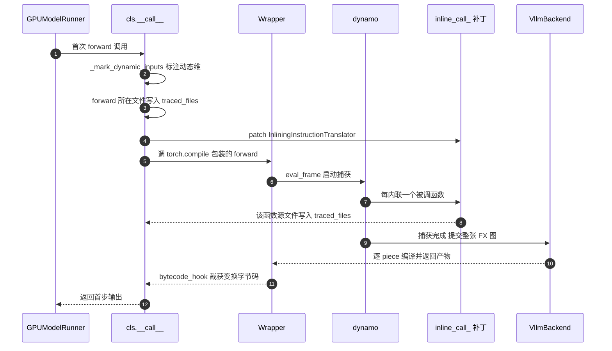
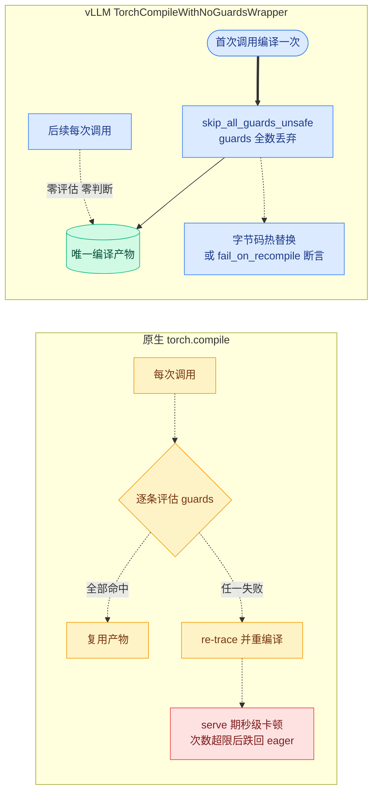

# 第 5 章 Dynamo 前端:@support_torch_compile 与「一次捕获」哲学

```text
I   背景:   [1 为何compile] → [2 V1引擎] → [3 编译栈全景]
II  前端:   [4 配置体系] → [5 Dynamo一次捕获]◄==
III 中端:   [6 Piecewise切分] → [7 算子边界与vllm_ir]
IV  后端:   [8 VllmBackend] → [9 逐range编译] → [10 Pass与融合]
V   运行时: [11 代码生成] → [12 CUDA Graph] → [13 缓存与AOT]
VI  收官:   [14 设计哲学] → [15 动手实践]
```

## 5.0 本章俯瞰

「把模型编译一次,然后永远复用」听起来理所当然,做起来却和一个机制正面相撞:torch.compile 的安全带。原生设计中,每次调用都要先核对一批前提——输入的形状、dtype、设备、Python 全局状态是否都和捕获时一致——全部一致才复用编译产物,否则当场重新捕获、重新编译。这套机制为训练循环而生:那里形状几乎不变,检查很便宜,保险很值。但推理服务里每步的 token 数都在跳,如果每个新数值都可能触发一次以秒计的重新编译,而且发生在 serve 期,服务等于不可用。本章回答的问题是:vLLM 凭什么敢把这条安全带整条拆掉,承诺整个服务生命周期只捕获一次、只编译一次?答案由三件东西共同构成:一个把模型类改造成「自我编译模块」的装饰器;一套把形状信息全部显式化的标注机制,让动态性不靠猜、靠声明;以及三个互补的机关——拆掉安全带、把编译产物直接焊进函数字节码、让任何试图重新捕获的行为当场报错。三者合起来,把「一次捕获」从美好愿望变成了被运行时断言保护的不变量。

## 5.1 最小前置知识

- dynamo 与 FX 图:dynamo 逐字节码解释执行 Python,把可符号化的计算录成一张 FX **GraphModule**(FX 图模块);**fullgraph**(全图模式,`fullgraph=True`)禁止中途 graph break,捕获必须一次成功(第 3 章)。
- **guard(守卫条件)**:dynamo 捕获时记录的断言集合(张量的 shape/dtype/device、Python 值等);下次调用先逐条评估,全过才复用产物,任一失败触发 re-trace。第 1 章已用它解释过 recompile 之罪。
- dynamic shape 与符号维:`torch._dynamo.mark_dynamic`(标注动态维)把某一维变成符号 SymInt;符号分 **BACKED**(有界,可能被 0/1 特化)与 **UNBACKED**(无界,保证不加 guard)两种,详见 5.3.3 与第 9 章。
- CompilationConfig.mode:四档编译模式决定本章机制是否激活——NONE 与 STOCK_TORCH_COMPILE 两档下装饰器整体旁路([第 4 章](04-配置体系与优化级别.md))。
- **ForwardContext**(前向上下文):位于 `vllm/forward_context.py` 的模块级全局状态,经 **set_forward_context** 上下文管理器设置、`get_forward_context()` 读取(`vllm/forward_context.py:196-209`,详见第 2 章);本章用它解释 encoder-decoder 的旁路。

## 5.2 设计思想与设计哲学

vLLM 对自己的运行时有一个原生 torch.compile 不具备的观察:在服务生命周期内,**计算结构是不变量**。权重冻结、控制流固定、每层调用的算子集合固定,唯一变化的量是一个整数——本步的 token 数,而它已经被区间编译与尺寸桶全覆盖(第 4、9 章)。原生 guards 买到的是「任意输入下的正确性」,一个无限承诺,所以必须每次调用都付钱;vLLM 只需要「推理输入下的正确性」,一个有限承诺——而有限承诺可以由别的东西背书。

【哲学时刻】**丢 guard 是命题 P2(不变量换性能)最激进的一次兑换。** 评估 guards 是每步都付的 Python 开销,recompile 是不可控的秒级尾延迟;换出的不变量是「合法输入中不存在任何一个会要求第二次 trace」。注意这不是赌运气:三道防线把「不会发生」变成「发生了就当场爆炸」——其一,guards 全数丢弃,连评估的通道都拆掉;其二,默认路径用字节码热替换把 dynamo 整个请出运行时,第二次 trace 在结构上无处发生;其三,调试路径用 `set_stance("fail_on_recompile")` 把 re-trace 变成运行时断言。配合「启动期编完一切」(monitor 断言 profiling run 零编译,`vllm/compilation/monitor.py:63`),正确性的兜底从「每次检查」移到了「一次性证明 + 永久断言」。这正是叙事主线的完整体现:decode 是 CPU/launch bound,所以要消灭 Python 开销;guards 评估与 eval-frame 机制都是 Python 开销;编译的代价是启动时间,所以全部前置、全部缓存,于是敢丢、敢只 trace 一次。

【设计品味】**「类型即配置」是命题 P5(显式优于隐式)在前端的落点。** 哪一维是动态的,不看运行时数据、不靠 dynamo 自动推断,而是写在 `forward` 的类型注解里:注解为 `torch.Tensor` / `torch.Tensor | None` / **IntermediateTensors**(中间张量字典,Pipeline Parallel 的层间载体)的参数,第 0 维即动态。代码即文档,签名即契约。与之配套的是 `torch.compile(..., dynamic=False)`——关掉自动动态化,动态性唯一的来源就是显式标注。这也是命题 P7(shape 是推理编译的核心矛盾)的正面回应:既然 shape 是矛盾本体,矛盾就必须显式声明、集中管理,而不是散落在运行时的猜测里。

## 5.3 具体流程

### 5.3.1 一台手术:装饰器对模型类做了什么

上游给我模型类 cls(`models/*.py` 里的 nn.Module 子类,L1 层的产物)→ 我改写它的 `__bases__`、`__init__`、`__call__` 三个部件 → 产出一个「自我编译」的类:运行时入口是 **cls.__call__**(`vllm/compilation/decorators.py:502`,安装于 :719),编译能力来自注入的基类。

**@support_torch_compile**(支持 torch.compile 装饰器,`decorators.py:118`,重载签名 :85-115)的第一步是把 **TorchCompileWithNoGuardsWrapper**(无守卫编译包装器,`vllm/compilation/wrapper.py:47`)追加进基类元组:

```python
# vllm/compilation/decorators.py:340-351 (v0.27.1)
    if TorchCompileWithNoGuardsWrapper in cls.__bases__:
        # support decorating multiple times
        return cls
    # take care of method resolution order
    # make sure super().__init__ is called on the base class
    #  other than TorchCompileWithNoGuardsWrapper
    cls.__bases__ = cls.__bases__ + (TorchCompileWithNoGuardsWrapper,)

    old_init = cls.__init__

    setattr(cls, IGNORE_COMPILE_KEY, False)
```

这一步有两个讲究:**幂等**——重复装饰直接返回,不叠基类;**MRO 友好**——追加到元组末尾,模型原有的继承链(`super().__init__` 走向)完全不受干扰。同时把 **IGNORE_COMPILE_KEY**(编译忽略标记,`"_ignore_compile_vllm"`,`decorators.py:48`)置 False;若某子类不想继承父类的编译行为,用 **ignore_torch_compile**(`decorators.py:58`)把它置 True 即可——装饰器体系因此对继承开放。

第二步包装 `__init__`(`decorators.py:353-412`):上游给我构造参数(含可选的 vllm_config,缺省从当前上下文取)→ 我先调用原 `__init__` 建好模块 → 再捕获 `self.vllm_config` 与 `compilation_config`,计算 **do_not_compile**(是否跳过编译)→ 最后调用 `TorchCompileWithNoGuardsWrapper.__init__`(`decorators.py:406`),由它构造 VllmBackend 并发起 `torch.compile`。do_not_compile 为 True 的条件只有三个(`decorators.py:390-395`):mode 属于 {NONE, STOCK_TORCH_COMPILE}(前者不编译,后者由上层 model runner 统一处理)、类被 ignore、**enable_if**(条件启用回调,`VllmConfig → bool`)返回 False。

第三步安装 `cls.__call__` 作为运行时入口。注意一个结构性选择:vLLM 不让 `torch.compile` 包住整个模型调用——被 compile 的只是 `self.forward`(`wrapper.py:127` 的 `compiled_ptr`);`cls.__call__` 始终是 vLLM 自己的分诊台,编译与否、走哪条路,由 vLLM 说了算。

### 5.3.2 类型即配置:动态维从哪里来

上游给我 `cls.forward` 的 `inspect.signature`(`decorators.py:206`)→ **cls_decorator_helper**(装饰器助手,:201)在未显式给参时按注解推断 → 产出 **dynamic_arg_dims**(动态维表)交给 `_support_torch_compile`(:239)。推断规则(:211-219):参数注解属于 {`torch.Tensor`, `torch.Tensor | None`, `torch.FloatTensor`, `torch.FloatTensor | None`, `IntermediateTensors`, `IntermediateTensors | None`} 时,该参数第 0 维动态。若推断结果为空且用户也没显式给,直接 raise(:227-231)——**要编译,就必须声明动态维**,没有默认全静态这条歧路。

显式给参时的完整参数面如下——前四行决定动态维,后两行是编译开关,与推断结果形成清晰的对照:

| 参数 | 形态 | 效果 |
|---|---|---|
| `dynamic_arg_dims={"x": 0}` | int | x 的第 0 维动态 |
| `dynamic_arg_dims={"x": [0, 1]}` | list[int] | 多个维度动态 |
| `dynamic_arg_dims={"x": {0: "b"}}` | dict[int, str] | 维度到 **shape_id**(形状标识)的映射;UNBACKED 下同 id 的维度共享同一个符号,需 torch≥2.11(`decorators.py:36`) |
| `mark_unbacked_dims={"x": 0}` | dict[str, int\|list[int]] | 强制该维 UNBACKED,避免 dummy 输入被 0/1 特化(视觉 encoder 常用) |
| `enable_if=...` | Callable | 按运行时配置决定编译与否(如 `should_torch_compile_mm_encoder`,`decorators.py:53`) |
| `is_encoder=True` | bool | 编译区间上限用 MAX_INT32 而非 max_num_batched_tokens(encoder 输入形状不可预测) |

### 5.3.3 第一次调用(上):分诊与标注

第一次 forward 的全景如下,随后三小节逐段展开:



`cls.__call__` 先做四条快速分诊(`decorators.py:502-520`):`do_not_compile` 或 `torch.compiler.is_compiling()`(已在某次编译内部,如 TPU 在 runner 层编译)→ 直接 `forward`;**ForwardContext** 携带 `skip_compiled` → 旁路(enc-dec 模型首过形状类型多变,捕获不了单图);`aot_compiled_fn` 已就绪(典型为从磁盘加载)→ 直接调用(第 13 章);`self.compiled` 已置位 → 走 `TorchCompileWithNoGuardsWrapper.__call__` 快路径(:576-581)。四条都不中,才是首次编译路径。

上游给我绑定后的实参(`inspect.signature(mod.__class__.forward).bind`,`decorators.py:448-450`)→ **_mark_dynamic_inputs**(标注动态输入,:414)按归一化后的 dynamic_arg_dims(:453-460,把 int/list/dict 统一成 dict[int, str|None])逐参数标注 → 产出带符号维的输入张量,交给 dynamo。标注动作由 **DynamicShapesConfig**(动态 shape 配置,`vllm/config/compilation.py:355`)的 `type` 字段决定分叉(:417-446):

- **BACKED**(默认,:358):走 `torch._dynamo.mark_dynamic(arg, dims)`,维度变成有界符号,shape_id 被忽略——`{0: "b"}` 此时等价于 `0`;
- **UNBACKED**:走 **mark_unbacked**(标注无界符号维,`torch._dynamo.decorators.mark_unbacked(arg, dim, hint_override=arg.size()[dim], shape_id=shape_id)`),符号无界、保证不加 guard;**hint_override**(提示覆写)把当前具体尺寸作为提示传给 fake tensor 传播,让符号化不牺牲数据无关推理的精度;同 shape_id 的维度共享同一符号,`input_ids` 与 `positions` 因此被识别为同一个 token 数。

此外 `mark_unbacked_dims` 表无视 ds_type 单独生效(:487-500),负维下标会被 `arg.ndim + d` 归一(:470);参数类型只接受 Tensor 与 IntermediateTensors,其余 raise(:481-485)。两态之外还有实验性的第三种 **BACKED_SIZE_OBLIVIOUS**(尺寸无关的有界符号,`config/compilation.py:349-351`):符号名义上有界、对待方式上视同无界,首编路径会据此打开 `torch.fx.experimental` 的 `backed_size_oblivious` 开关(`decorators.py:631-633`)——介于「有界可特化」与「无界不加 guard」之间的一条中间道路,设计动机与 guard dropping 一节同源。

### 5.3.4 第一次调用(下):把源码文件记进缓存键

上游给我 `original_code_object()`(`cls.forward` 的原始 code 对象,`decorators.py:592`,实现于 `wrapper.py:206-208`)→ 我把它的 `co_filename` 先记入 `traced_files`(:604),再劫持 dynamo 的内联入口,把每个被内联函数的文件也记入 → 产出 **traced_files**(被 trace 的源文件集),进入编译缓存 key。

```python
# vllm/compilation/decorators.py:610-615 (v0.27.1)
        inline_call = InliningInstructionTranslator.inline_call_

        def patched_inline_call(self_: Any) -> Any:
            code = self_.f_code
            self.compilation_config.traced_files.add(code.co_filename)
            return inline_call(self_)
```

dynamo 遇到函数调用时由 **InliningInstructionTranslator.inline_call_** 执行内联;vLLM 用 `unittest.mock.patch` 把它包一层(:643-646),凡被内联者的源文件全部进集合——模型的、attention backend 的、任何被 trace 穿过的 Python 文件。关键设计在缓存侧(第 8、13 章):进哈希的是这些文件的**内容**而非路径——改一行模型代码,内容变了,cache hash 变了,缓存自动失效重编;文件没动,缓存秒载。AOT 加载路径同样复用这个集合做校验:`_verify_source_unchanged`(`decorators.py:265-281`)逐文件比对磁盘内容与序列化时记录的校验和,不一致直接拒绝加载。源与缓存的联动,靠的就是这份劫持来的清单。

### 5.3.5 丢掉安全带:guard_filter_fn 三态

上游给我 mode 与 DynamicShapesConfig(`wrapper.py:83-103`)→ 我在 `torch.compile` 的 options 里安装 **guard_filter_fn**(guard 过滤函数,:105-125)→ 产出 dynamo 生成的 guard 列表被过滤后落盘,默认为空。

```python
# vllm/compilation/wrapper.py:105-125 (v0.27.1)
        if mode != CompilationMode.STOCK_TORCH_COMPILE:
            # Drop all the guards.
            if self.evaluate_guards:
                # ... 前置断言:必须 VLLM_USE_BYTECODE_HOOK=0 且非 UNBACKED
                options["guard_filter_fn"] = lambda x: [
                    entry.guard_type == "SHAPE_ENV" for entry in x
                ]
            else:
                if hasattr(torch.compiler, "skip_all_guards_unsafe"):
                    options["guard_filter_fn"] = torch.compiler.skip_all_guards_unsafe
                else:
                    # Equivalent fallback for older PyTorch: skip all guards
                    options["guard_filter_fn"] = lambda x: [False for _ in x]
```

三态语义:STOCK_TORCH_COMPILE 档不动 guards(交给上游语义);**evaluate_guards**(调试开关,`config/compilation.py:368`)为 True 时只保留 **SHAPE_ENV** 类 guard——用于在 tlparse 里观察动态 shape 断言、并在 recompile 发生时暴露它,该模式要求 `VLLM_USE_BYTECODE_HOOK=0` 且与 UNBACKED 互斥(UNBACKED 根本不产生 guard,:108-114);生产默认态则是 **skip_all_guards_unsafe**(不安全地跳过全部 guards,torch≥2.10 提供),旧版 torch 用逐条置 False 的等价兜底。guards 的命运对比如下:



```text
# 原生 torch.compile 保留的 guards(示意图,非真实 dump)
[ TENSOR_MATCH  input_ids   dtype=int64  device=cuda ]
[ TENSOR_MATCH  positions   dtype=int64  device=cuda ]
[ SHAPE_ENV     s0 >= 2                  ← 0/1 特化  ]
[ ...           数十条,每次调用逐条求值 ...           ]
        │  vLLM: guard_filter_fn = skip_all_guards_unsafe
        ▼
[ ]  ← 空列表:零求值、零分支、零 recompile 通道
     正确性不再由 guards 背书,改由不变量背书(5.2)
```

同一处还有两个收尾动作。其一,BACKED 的 0/1 特化坑:dynamo 对有界符号默认特化 0/1/≥2(`config/compilation.py:339-342`),于是 guard 里会出现 `s0 >= 2` 这类断言;evaluate_guards 调试模式下,num_tokens=1 的 decode 批会让它必挂。修复在 `vllm/compilation/backends.py:1240-1257`:BACKED + evaluate_guards 时,把 shape env 里 `var_to_range` 下界为 2 的符号统一放宽为 0——把这条本来必失败的 guard 摘掉。其二,既然 guards 反正要丢,C++ 符号 shape guard 的编译也一并关掉省编译时间(`enable_cpp_symbolic_shape_guards=False`,`decorators.py:621-624`)。最终发起的编译是 `torch.compile(compiled_ptr, fullgraph=True, dynamic=False, backend=backend, options=options)`(`wrapper.py:148-154`):**fullgraph** 保证一次捕获必须完整,**dynamic=False** 保证 dynamo 不做自动动态化——动态性唯一的入口是 5.3.3 的显式标注。

### 5.3.6 第二次调用起:热替换与断言

首次编译后的调用走向由 **VLLM_USE_BYTECODE_HOOK**(bytecode 钩子开关,默认 1,`vllm/envs.py:766-767`)决定。

默认 hook 路径:`wrapper.__init__` 已用 `torch._dynamo.convert_frame.register_bytecode_hook` 注册 **bytecode_hook**(字节码钩子,`wrapper.py:156-159`)。首次调用先 `remove_from_cache` 强制全新编译(:182);dynamo 完成变换时回调钩子,`bytecode_hook`(:210-264)核对 frame 归属后把变换后的字节码存进 `self._compiled_bytecode`(:228)。此后每次调用走 **_dispatch_to_compiled_code**(分派到编译代码,:273):进入时把 `cls.forward.__code__` 换成变换字节码、退出时换回(:284-290)。这合法的原因写在 docstring 里——dynamo 保证变换后的字节码与原字节码有完全相同的参数、cell 与 free 变量。**效果是 dynamo 的 eval-frame 机制整体退场**:serve 热路径上没有 guard 评估、没有缓存查找、没有帧转换,只剩一次裸的代码对象替换。此时完整的运行时调用链收敛为:`cls.__call__`(:576 快路径)→ `TorchCompileWithNoGuardsWrapper.__call__` → `_dispatch_to_compiled_code` 换码 → 变换字节码直接执行并落入编译产物——两级 Python 入口、零 dynamo、零编译,这正是 L5 运行时执行层「零 Python 编排」承诺的前端半边(另一半在第 11、12 章)。钩子还顺带做两件事:用 **depyf** 反编译变换字节码落盘为 `transformed_code.py` 供调试(:232-248,详见第 15 章);若 cudagraph 开启且变换字节码的 `co_names` 含 `"update"`(意味着 forward 里变异了 nn.Module buffers,在图捕获下会造成静默错误),当场 raise(:250-264)——又一道把隐患挡在启动期的断言。

非 hook 路径(为调试或旧 torch 保留):每次调用包在 `_compilation_context`(:26-44,临时把 dynamo cache_size_limit 抬到 2048、accumulated 到 8192,qwen2_5_vl 这类模型需要)里,且从第二次调用起、当 evaluate_guards 开启时,用 `torch.compiler.set_stance("fail_on_recompile")` 包住(:192-197)——**set_stance**(设置编译姿态)让任何 re-trace 直接抛错,把「永不重新捕获」升级为运行时断言。另有 `reset_compile_wrapper`(`wrapper.py:293`)为 elastic EP 场景把整套编译状态归零重走。

### 5.3.7 推演:LlamaModel 的一次捕获与反事实

`LlamaModel` 的装饰是全仓最典型的样板(`vllm/model_executor/models/llama.py:334-343`):四个输入参数显式给出 `{0: "b"}`——input_ids、positions、intermediate_tensors、inputs_embeds 的第 0 维动态,且共享 shape_id "b";对应 `forward` 签名(:400-407)注解本就可推断出同样的集合,显式写出的增量只在 shape_id。推演默认配置(BACKED + hook 开)下的首次调用:第一步,`_mark_dynamic_inputs` 把四个张量的第 0 维标为有界符号,权重与其余维度保持静态;第二步,dynamo 以 fullgraph 捕获,得到唯一符号维是 num_tokens 的单张 FX GraphModule(L2 的产物,详见第 3 章),交 VllmBackend 走六步流水线(第 8 章);第三步,guards 全数丢弃,变换字节码被钩子截获;此后 serve 期每个 num_tokens——1 也好、4096 也好——都复用同一份入口,由第 9 章的区间产物与第 12 章的图分派兜住。

反事实:若 guards 不丢,链路会怎样?native `dynamic=False` 下 shape 全静态特化,guard 里是具体尺寸断言;num_tokens 从 7 变 8,guard 失败 → re-trace → VllmBackend 六步流水线整体重跑,每个 piece × 每个 range 重新编译,秒级卡顿落在 serve 期;而 decode 的 num_tokens 序列几乎每步不同,recompile 风暴直到撞上 dynamo 默认 cache_size_limit(上游默认仅 8)才停——之后静默跌回 eager,性能消失且无报错。即便改用 `dynamic=True` 的自动动态化,首次仍按静态捕获、见到变化才升级为符号,升级本身又是一次 recompile,外加 0/1 特化让 num_tokens=1 自成一份产物。结论:vLLM 的答案不是「更聪明的 guards」,而是把动态性前置声明、把 guards 通道整个拆掉、再用断言保证没有人能偷偷把它装回去。

## 5.4 本章小结

- 装饰器三步手术:注入基类、包构造、装入口。(P5,详见第 14 章对 P4 边界的澄清)
- 动态维写进类型注解,代码即配置契约。(P5、P7)
- guards 全丢:评估与 recompile 通道一并拆除。(P2)
- 字节码热替换让 dynamo 彻底退场。(P1)
- traced_files 按文件内容联动缓存,改码即失效。(P1)

本机制集中服务于命题 P2(不变量换性能):用「计算结构不变」这一推理侧不变量,换掉了每步的 guard 评估与 recompile 尾延迟;P1 与 P5 是它的两翼。下一章(第 6 章)进入中端:一张完整的 FX 图如何被 attention 边界切成 pieces。本章捕获的单张图正是切分的输入,而「敢把 attention 留在图外」的底气,正是本章建立的一次捕获不变量。

### 本章源码索引

| 锚点 | 内容 |
|---|---|
| vllm/compilation/decorators.py:48 | IGNORE_COMPILE_KEY = "_ignore_compile_vllm" |
| vllm/compilation/decorators.py:58 | ignore_torch_compile:子类免编译 |
| vllm/compilation/decorators.py:36 | _SUPPORTS_SHAPE_ID(torch≥2.11 才有 shape_id) |
| vllm/compilation/decorators.py:85-125 | support_torch_compile 重载与实现 |
| vllm/compilation/decorators.py:201-231 | cls_decorator_helper:类型注解推断动态维 |
| vllm/compilation/decorators.py:211-219 | 注解白名单:Tensor/FloatTensor/IntermediateTensors |
| vllm/compilation/decorators.py:331 | _support_torch_compile 主流程 |
| vllm/compilation/decorators.py:340-351 | 基类注入(幂等 + MRO 友好) |
| vllm/compilation/decorators.py:353-412 | 包装 __init__:捕获 vllm_config、算 do_not_compile |
| vllm/compilation/decorators.py:414-500 | _mark_dynamic_inputs:BACKED/UNBACKED 标注 |
| vllm/compilation/decorators.py:502-520 | cls.__call__ 四条快速分诊路径(第 4 条在 :576-581) |
| vllm/compilation/decorators.py:585-604 | 首编路径:标注 + forward 文件入 traced_files |
| vllm/compilation/decorators.py:610-615 | inline_call_ 劫持:内联文件入 traced_files |
| vllm/compilation/decorators.py:621-682 | 关 C++ guard 编译 + 三组 config patch + AOT/JIT 分叉 |
| vllm/compilation/decorators.py:719 | cls.__call__ 安装点 |
| vllm/compilation/decorators.py:265-281 | _verify_source_unchanged:AOT 加载时校验源文件 |
| vllm/compilation/wrapper.py:26-44 | _compilation_context:cache 上限 2048/8192 |
| vllm/compilation/wrapper.py:72-160 | TorchCompileWithNoGuardsWrapper.__init__ |
| vllm/compilation/wrapper.py:105-125 | guard_filter_fn 三态 |
| vllm/compilation/wrapper.py:148-154 | torch.compile(fullgraph=True, dynamic=False) |
| vllm/compilation/wrapper.py:171-201 | __call__:hook 与非 hook 两路 |
| vllm/compilation/wrapper.py:210-264 | bytecode_hook:捕获 + depyf 落盘 + update 检查 |
| vllm/compilation/wrapper.py:273-290 | _dispatch_to_compiled_code:forward.__code__ 热替换 |
| vllm/compilation/wrapper.py:293-346 | reset_compile_wrapper:elastic EP 重置 |
| vllm/config/compilation.py:334-351 | DynamicShapesType:BACKED/UNBACKED/SIZE_OBLIVIOUS |
| vllm/config/compilation.py:355-394 | DynamicShapesConfig:type/evaluate_guards/32bit |
| vllm/compilation/backends.py:1240-1257 | BACKED 下界 2→0 放宽(evaluate_guards 调试) |
| vllm/compilation/monitor.py:63-80 | monitor_profiling_run:断言零编译 |
| vllm/forward_context.py:196-209 | ForwardContext 模块级全局与 get_forward_context |
| vllm/envs.py:766-767 | VLLM_USE_BYTECODE_HOOK 默认 1 |
| vllm/model_executor/models/llama.py:334-343 | LlamaModel 装饰(dynamic_arg_dims 显式 shape_id) |
| vllm/model_executor/models/llama.py:400-407 | LlamaModel.forward 签名 |

### 参考资料

1. [vLLM design doc — torch.compile(Dynamic shapes & guard dropping 一节)](https://docs.vllm.ai/en/latest/design/torch_compile/) — 已与 0.27.1 源码核对一致(BACKED/UNBACKED/SIZE_OBLIVIOUS 与 guard_filter_fn 语义)
2. [vLLM design doc — Optimization Levels](https://docs.vllm.ai/en/latest/design/optimization_levels/) — 已与 0.27.1 源码核对一致(mode 四档,详见第 4 章)
3. [vLLM design doc — Debug vLLM Compile](https://docs.vllm.ai/en/latest/design/debug_vllm_compile/) — 已与 0.27.1 源码核对一致(transformed_code.py、tlparse,详见第 15 章)
4. [vLLM blog — Introduction to torch.compile and How It Works with vLLM (2025-08-20)](https://vllm.ai/blog/2025-08-20-torch-compile) — 仅作背景叙事
5. [PyTorch blog — PyTorch + vLLM](https://pytorch.org/blog/pytorch-vllm-%E2%99%A5%EF%B8%8F/) — 仅作背景叙事(skip_all_guards_unsafe 与 bytecode hook 的上游协同)
6. [RFC issue #6378 — A Graph Optimization System in vLLM using torch.compile](https://github.com/vllm-project/vllm/issues/6378) — 仅作背景叙事
7. [vLLM v0.8.1 设计文档 — torch_compile(历史版)](https://docs.vllm.ai/en/v0.8.1/design/v1/torch_compile.html) — 仅作背景叙事(演进对比:早期尚无类型推断与 bytecode hook)
