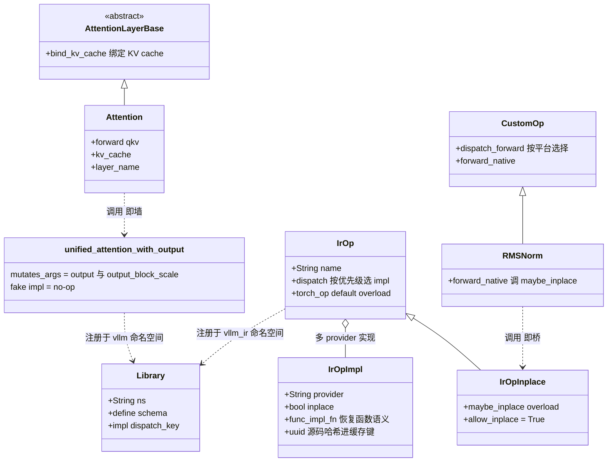

# 第 7 章 自定义算子边界:unified_attention、vllm_ir 与 activation donation

```text
I   背景:   [1 为何compile] → [2 V1引擎] → [3 编译栈全景]
II  前端:   [4 配置体系] → [5 Dynamo一次捕获]
III 中端:   [6 Piecewise切分] → [7 算子边界与vllm_ir]◄==
IV  后端:   [8 VllmBackend] → [9 逐range编译] → [10 Pass与融合]
V   运行时: [11 代码生成] → [12 CUDA Graph] → [13 缓存与AOT]
VI  收官:   [14 设计哲学] → [15 动手实践]
```

## 7.0 本章俯瞰

第 6 章我们把注意力算子当成了切图的边界,但一直没有追问:编译器到底被允许"看见"多少个算子的内部?一个推理引擎里有几百个算子,为什么有的算子千方百计把自己对编译器隐藏起来,有的算子却专门为编译器而设计?这条边界画在哪里、依据什么画,直接决定了融合能做多大、CUDA Graph 能捕到多深、decode 每一步要付多少 Python 开销——这正是本章要回答的问题。答案预告:vLLM 把自定义算子分成两种相反的命运,注意力这类算子被封装成编译器无法看穿的"墙",而归一化这类适合融合的算子被设计成一种专门的中间表示,充当连接模型代码与 Inductor 融合能力的"桥";在墙与桥之间,还有一套"激活捐赠"机制,用编译期的推理证明换掉运行时的防御性数据拷贝。

回顾全书的叙事主线:decode 是 CPU/launch bound → 必须消灭 Python 开销 → 代价是编译 → 编译代价是启动时间 → 所以全部编译前置并缓存(详见第 1 章)。本章的每一个机制都长在这条因果链上:直注册算子省掉的是每次调用的一层 dispatch、把 reshape 挪出算子省掉的是图外区的 Python 张量操作、删掉防御性拷贝省掉的是每次前向的显存带宽。单看每一处都只是微秒级的小钱,但 decode 每秒要跑几十步、每步几十层,小钱乘以频率就是可观测的时延。

值得先建立一个直觉:墙与桥不是两种技术,而是同一枚硬币的两面。墙说"这里编译器不必懂",桥说"这里编译器必须懂"。一个健康的编译栈两者都需要——全是墙则融合无从谈起,全是桥则编译器要理解整个世界。vLLM 的算子设计,本质上就是在逐个算子地回答"这道边界应该画在哪里"。

先把本章放进整条编译管线:

```text
torch.compile(model)
│
├─ dynamo 一次捕获(自定义算子随图入册)──▶ 整图 FX
│
├─ 切分 ─▶ submod_0..N
│
├─ 全量预编译(片段 × range)
│    └─ compile_fx
│         ├─ AOTAutograd ◄== 本章上半场:墙与桥在此受考验
│         │    ├─ 泛函化:mutating op → auto_functionalized
│         │    └─ IrOp 拒收 ATen 分解 → 整块语义活过 AOT
│         ├─ pass 流水线 ◄== 本章下半场
│         │    ├─ VllmIRLowering:整块 IrOp 在使用处内联展开
│         │    └─ UnsafeCloneElimination:donation 删防御性拷贝
│         └─ Inductor
│
├─ 造外壳
└─ serve 期:查 range 执行
```

## 7.1 最小前置知识

1. **custom op(自定义算子)与 schema(算子签名)**:通过 `torch.library` 注册进 torch dispatch 体系的算子。注册时用 **`mutates_args`(可变参数声明)** 在 schema 中显式声明哪些参数会被就地写入——这是 functionalization 判断副作用的唯一依据;再用 **fake impl(假实现)** 告诉 dynamo/Inductor 该算子输出的 shape 与 dtype,而不暴露真实计算。
2. **functionalization(泛函化)**:AOTAutograd 把含副作用的图改写为纯函数等价形态的变换,in-place 算子被转成 **`auto_functionalized`(自动泛函化形态)**,并对被写的输入插入防御性 clone 以保住原值(详见第 10 章)。
3. FX 图与 `call_function` 节点:dynamo 捕获产物的基本单元,每个节点是一次算子调用,自定义算子在 FX 图中就是普通的 `call_function` 节点(详见第 3、6 章)。
4. **`splitting_ops`(切分算子表)** 与 piece:attention 类算子所在的切分点片段不进 Inductor,以源码内联方式执行(详见第 6 章)。
5. **`ForwardContext`(前向上下文)** 与 **`attn_metadata`(注意力元数据)**:model runner 在每步前向经 set_forward_context 上下文管理器写入模块级全局状态的运行时元数据,编译期不可见(详见第 2 章)。

## 7.2 设计思想与设计哲学

### 为什么 attention 必须是墙

attention 是 LLM 推理中最不适合被编译器理解的算子。它读写的 KV cache 是模型执行器持有的跨层状态;它依赖的 `attn_metadata`(query_start_loc、seq_lens 等变长信息)根本不是张量,每步都变;它的实现有 FlashAttention、FlashInfer、Triton、MLA 等数十种后端 kernel,各自有不同的限制与调优空间。若让 dynamo trace 进任何一处,guards 会爆炸、recompile 不可控、后端可插拔性荡然无存。所以 vLLM 的选择是:把整件事注册成一个 **opaque custom op(不透明自定义算子)**——schema 之内一切可见,schema 之外一行不可见。dynamo 拿到 fake impl 就满意离开,Inductor 把它当原子节点处理,切分器(第 6 章)拿它当切图的锚。

墙的代价同样明显:op 是 Inductor 融合的硬边界,墙内的代码永远得不到融合机会。于是 vLLM 又造了第二种算子——**`vllm_ir`(vLLM 自定义 IR 命名空间,`Library("vllm_ir", "FRAGMENT")`)下的 transparent IR op(透明 IR 算子)**:rms_norm 这类"适合融合、且融合收益大"的算子,以整块节点的形态活在 FX 图里,等 pattern matcher(第 10 章)与 lowering pass 处理,最终必然被替换为某个具体实现。墙拒绝分解,桥等待分解。

【哲学时刻】这正是命题 **P3「custom op 既是墙也是桥」** 的完整落点:墙保护的是"编译器不必理解、也不该理解的复杂性"(后端 kernel、KV cache、运行时元数据);桥引入的是"编译器应该理解的融合机会"。判断一个算子该走哪条路的依据不是技术可行性,而是业务判断——这个算子的内部是否存在跨实现的公共模式?attention 没有(各家 kernel 连抽象都不同),rms_norm 有(加减、归一化、量化可以首尾相接)。第 14 章会把它上升为"边界的艺术"。

【哲学时刻】本章第二个哲学落点是 **activation donation(激活捐赠)**——命题 **P2「不变量换性能」** 的教科书案例。泛函化世界的规则是"谁可能被就地写,谁就先拷贝一份",这是用运行时拷贝买正确性,而且是不分青红皂白地买。vLLM 反过来问:如果编译期能**证明**某个激活在这次就地写之后再无人使用,那么它的旧内容就是死数据,拷贝纯属浪费——可以把缓冲区"捐"给输出。于是正确性从"每次运行都付钱"变成了"编译期一次性证明"。回扣叙事主线:正因为 vLLM 敢一次 trace、敢把全部编译前置(详见第 5 章),编译期才拥有整张图的完整视野,这种证明才成为可能——**一次性捕获买来了全局别名信息,全局别名信息又买走了运行时拷贝**。

第三个设计基调是"图静态、信息动态"。`attn_metadata`、KV cache、slot mapping 这些每步都变的信息一律不进图,统一在运行时从 `ForwardContext`(`vllm/forward_context.py` 的模块级全局,经上下文管理器设置)读取;图里只有静态的算子拓扑。这既绕开了变长元数据引发的 shape 特化问题(命题 P7 的一个侧面),也让同一份编译产物可以服务任意 batch 组合。

## 7.3 具体流程(流水线视角)

### 7.3.1 墙:unified_attention_with_output 的六个设计决定

> **上游给我**:L1 模型层的 `Attention.forward`(`vllm/model_executor/layers/attention/attention.py:488`,输入:QKV projection 产出的 query/key/value 张量)→ **我做**:分配输出缓冲、整理输入、调用统一的注意力算子 → **产出**:dynamo FX 图中的一个 `call_function` 节点,流向 L3 的 `split_graph`(`vllm/compilation/backends.py:1179`)成为切分锚点(详见第 6 章)。

这个算子名为 **`unified_attention_with_output`(统一注意力算子)**,它的注册只有六行(`attention.py:862-867`),却浓缩了六个环环相扣的设计决定。要看懂它们共同服务的东西,先回顾一个两难:第 5 章拍板整模型一次 trace、一条路径打天下,attention 因此**必须在图里**;而 7.2 刚说明它又是全模型**最不可编译**的算子。两难的唯一出路,是造一个容器把 attention 整个装进去——对外(编译世界)它伪装成乖巧的普通算子:"我吃这些张量、写那个张量,形状都在 schema 里";对内(运行世界)它保留全部自由:"实现是哪家 kernel、元数据是什么,编译器管不着"。**六个设计,就是这份入住合同的六条条款——每一条都在解决"attention 想住进编译世界必须满足的一个条件";它不是六个功能,是六道逐条的过关手续。**打个比方,这个容器是一只集装箱:货物(各家 attention kernel、变长元数据、KV cache 副作用)奇形怪状,货船与吊车(Inductor、CUDA Graph、dynamo)只认标准箱体,六个设计就是把货物装进箱子的六条 packing rules。看得再高一层,这六条不是并列的,而是三对各管一摊:**b 与 f 造墙**(编译器看见什么、看不见什么),**a 与 e 驯服副作用**(诚实声明谁被写、把副作用顺序翻译成数据流),**c 与 d 清零过路费**(不多付一次 dispatch、不多包一层 Python)。后文六段,全是这三对条款的逐条展开:

**a. 输出由调用方分配后传入。** `output = torch.empty(...)` 在 `Attention.forward` 里分配(`attention.py:531`),再作为参数传进 op(`:554` 直接函数调用,或 `:574` 经 `torch.ops.vllm.*`);注册时声明 `mutates_args=["output", "output_block_scale"]`(`:865`)。收益有三层:图内零分配(Inductor 不必为它做内存规划)、schema 如实声明副作用(functionalization 有据可依)、CUDA Graph 的静态 buffer 语义天然满足——输出地址每次都一样,capture/replay(详见第 12 章)直接可用。

**b. fake impl 是彻底的 no-op。** `unified_attention_with_output_fake`(`attention.py:849-859`)只返回 None,不做任何模拟——输出的 shape 由调用方传入的 `output` 张量天然携带,无需推断。dynamo 在 trace 时对 op 内部"零窥视",这正是墙的全部含义:编译器只需要知道"这里有一个算子,吃这些张量,写那个张量"。

**c. reshape 刻意移到 op 外。** 源码注释写得很直白(`attention.py:534-535`):"We do this outside the custom op to minimize the CPU overheads from the non-CUDA-graph regions."——reshape 是纯元数据操作,放进 op 内会被算作 op 调用的一部分而失去被 Inductor 免费消化或被 CUDA Graph 捕获的机会,留在图外区的 Python 里又太贵;挪到 op 边界上,让它以 `aten.view` 节点进图,是最优落点。

```python
# vllm/model_executor/layers/attention/attention.py:531-541 (v0.27.1)
        output = torch.empty(output_shape, dtype=output_dtype, device=query.device)
        hidden_size = output_shape[-1]
        # Reshape the query, key, and value tensors.
        # NOTE(woosuk): We do this outside the custom op to minimize the
        # CPU overheads from the non-CUDA-graph regions.
        query = query.view(-1, self.num_heads, self.head_size)
        output = output.view(-1, self.num_heads, self.head_size_v)
        if key is not None:
            key = key.view(-1, self.num_kv_heads, self.head_size)
        if value is not None:
            value = value.view(-1, self.num_kv_heads, self.head_size_v)
```

**d. 用 direct_register_custom_op 绕过包装开销。** vLLM 没有用官方推荐的 `torch.library.custom_op`,而是用自写的 **`direct_register_custom_op`(直注册自定义算子)**(`vllm/utils/torch_utils.py:901`):其 docstring(`:911-913`)明确说 `torch.library.custom_op` "can have significant overhead because it needs to consider complicated dispatching logic"。它用 `infer_schema` 推 schema 后直接三连注册——`lib.define` + `lib.impl` + `lib._register_fake`(`torch_utils.py:933-939`),目标库是模块级的 `Library("vllm", "FRAGMENT")`(`:898`)。产物是一个正规 torch 算子:在 FX 图里是普通 `call_function` 节点,运行时没有额外的 Python 包装层。

> **上游给我**:op 名、Python 实现函数、`mutates_args`、`fake_impl`(来自 `attention.py:862-867` 的注册调用)→ **我做**:`infer_schema` 推 schema,`define`/`impl`/`_register_fake` 三连直注册(`torch_utils.py:933-939`)→ **产出**:`vllm` 命名空间下的正规 torch 算子,同时供 dynamo trace(fake)与运行时(eager impl)使用。

**e. 人造数据依赖保证 KV 写与 attention 的图内顺序。** KV cache 的写入被拆成独立的 `unified_kv_cache_update`(`attention.py:775`),它返回 `key.new_empty(0)`(`:798`)——一个零元素张量,唯一目的是作为 `kv_cache_dummy_dep` 传入 attention op(`:560`),在 FX 图里连出一条边。没有这条边,torch.compile 完全有权重排两个互不知晓的节点;有了它,顺序成为图拓扑的一部分。这是用最小的 schema 内手段解决"副作用排序"问题的精妙工程 hack。

```python
# vllm/model_executor/layers/attention/attention.py:775-798 (v0.27.1,节选)
def unified_kv_cache_update(key, value, layer_name) -> torch.Tensor:
    """
    Returns a dummy that is passed to unified_attention to signal a side effect and
    the data dependency between them to ensure torch.compile preserves ordering.
    """
    layer_name = _resolve_layer_name(layer_name)
    _, attn_layer, kv_cache, layer_slot_mapping = get_attention_context(layer_name)
    if layer_slot_mapping is not None:
        attn_layer.impl.do_kv_cache_update(   # 真实副作用:写 KV cache
            attn_layer, key, value, kv_cache, layer_slot_mapping)
    return key.new_empty(0)                   # 零元素张量,纯为制造数据依赖
```

**f. 运行时从 ForwardContext 取动态信息。** 真实实现(`attention.py:817-846`)顶着两个装饰器:`@eager_break_during_capture`(配合可断捕获的 CUDA Graph 模式,让本 op 在捕获期成为 eager 断点)与 `@maybe_transfer_kv_layer`(PD 分离部署下按需传输 KV)。函数体内先经 `get_attention_context(layer_name)`(`:732`)从 `ForwardContext` 解出 attn_metadata、层实例与 KV cache 张量,再调 `impl.forward(..., output=output)`(`:836-846`)。图是静态的,信息是动态的——层名是图内常量,内容每步经 `ForwardContext` 的模块级全局状态送达。

六条条款至此集齐。三对分工,缺哪一对都有具体的坏法:缺造墙的一对,墙会漏(trace 进实现即 guards 爆炸、元数据进图即每步重编译);缺驯服副作用的一对,墙会错(replay 读写悬空指针、KV 重排后静默读到旧值);缺清零过路费的一对,墙会贵(每次调用多付一层 Python 税)。三对合起来,才是完整的"墙"——墙不是一刀切完就完:墙上的门(输入输出张量)、门的规格(schema)、墙内墙外的通信(ForwardContext)、货物的摆放(外部分配/外提 reshape),每一处都要重新设计一遍。最后把这颗算子的完整生命线串起来:

```text
【示意图】unified_attention_with_output 的完整生命线
模型代码一行调用 (attention.py:554)
   → FX 图里一个 call_function 节点 (dynamo 零窥视,b)
   → 第 6 章切分锚:命中 splitting_ops 名单,自成一区 (splitting piece,不进 Inductor)
   → 两侧的可编译 piece 各自走 Inductor;它自己以源码执行
   → 运行时:节点携带层名常量 → get_attention_context 从 ForwardContext
     解出当步的 attn_metadata/KV cache → 调真实后端 kernel (f)
   → KV 写节点经 new_empty(0) 接力棒锁死在它前面 (e)
```

一句话收束:`unified_attention_with_output` 的用途,是把"全模型最不可编译的算子"合法地装进"一次捕获的编译世界"——六个设计不是六个功能,而是这份入住合同的六条条款:两条造墙、两条驯服副作用、两条清零过路费;缺任何一条,墙要么漏(重编译/重排错误),要么贵(多付 Python 税)。

### 7.3.2 桥:vllm_ir 与 IrOp

> **上游给我**:L1 模型层用 `@register_op(allow_inplace=True)` 装饰的 native 实现(如 `vllm/ir/ops/layernorm.py:43` 的 `fused_add_rms_norm`;同文件 `:9` 的 `rms_norm` 未开 allow_inplace)→ **我做**:推断 schema、注册 torch 算子、登记多实现 → **产出**:`IrOp` 对象与 `torch.ops.vllm_ir.*` 算子(`vllm/ir/op.py:219`、`:521`),供模型层调用、供编译 pass 识别与替换。

先把合同摆上桌,与 7.3.1 对照着读:**墙的合同,是把"最不可编译的算子"装进编译世界,代价是永远得不到融合;桥的合同,是把"最适合融合的算子"以"整块、可替换、可插拔"的形态送进编译世界,让手写 kernel 的质量与编译器融合的能力在同一张图里会师。**墙的这份代价恰恰落在最疼的地方:第 1 章 1.3.4 实测表里 AllReduce+RMSNorm 最高 +15%、SiLU+Quant 最高 +8% 的收益,全部来自小算子与邻居的融合——rms_norm 若也做成墙,两侧融合区被拦腰切断,等于白白扔掉第 10 章的存在意义。而它不必做成墙的理由,7.2 已给出业务判断:rms_norm 内部存在跨实现的公共模式(归一化、残差加减、量化,全是可首尾相接的规则算术),该让编译器接手。打个比方:墙是整箱吊走、永不拆箱的集装箱;`vllm_ir` 算子是带标准榫头的预制板——整块进场、后期替换、边缘能与两侧现浇部分浇筑成一体,"融合"之名即由此而来。

**`IrOp`(IR 算子)** 是这条桥的桥墩(`vllm/ir/op.py:155`)。注册流程 `register_op` 做了四件关键的事:用 `infer_schema` 从 native 函数签名推 schema;`lib.define` 进 `vllm_ir_torch_lib = Library("vllm_ir", "FRAGMENT")`;以 `CompositeExplicitAutograd` dispatch key 注册实现——源码注释点明要害:"CompositeExplicitAutograd is not decomposed by ATen IR normalization in AOTAutograd",即**故意不被 ATen 归一化分解**,在 FX 图中保持为整块节点;最后 `_register_fake` 并解析出 `torch_op`。对比墙:墙是"没有分解可谈",桥是"有分解而拒收"——拒收是为了把融合决策权留在 vLLM 自己的 pass 手里(第 10 章)。

IrOp 还有几处为推理场景量身定制的机关:

- **激活按参数名约定识别**。以 "x" 开头的参数默认视为激活,据此算出 `activation_indices`——donation 机制全靠这份清单。
- **provider 优先级 dispatch**。**`provider`(实现提供者)** 是同一算子的一种实现(native 永远存在,平台可再注册 Triton/厂商实现)。`dispatch(*args)`(`vllm/ir/op.py:327`)按 `_priority_impls` 顺序做 `supports_args` 检查后返回选中的 `IrOpImpl`,函数 docstring 直接标注 "THIS FUNCTION IS ON THE HOT PATH"。优先级由 `set_default`(进程级,worker 启动期)与 `set_priority`(作用域上下文管理器)设定——命题 P6「平台与后端可插拔」在这里落成两行代码。
- **maybe_inplace overload**。**`IrOpInplace`(可就地 IR 算子)** 在注册时额外生成一个 **`maybe_inplace`(或就地 overload)**:它用与 default 完全相同的签名,只是 schema 里 `mutates_args=op.activations`,并直接调 `impl.impl_fn` 而非 `func_impl_fn`——不走 clone。语义约定:调用方用 maybe_inplace 就是在向编译器声明"这些激活我不要了"。
- **IrOpImpl 与函数语义保险**。**`IrOpImpl`(IR 算子实现)** 记录 provider、是否 inplace;其 `func_impl_fn` 在以函数式(default)方式调用一个 inplace 实现时,先把激活 clone 一份再交给实现——用一次拷贝恢复函数语义。它的 `uuid` 把实现源文件内容哈希进缓存键,由 lowering pass 统一汇入(见下),实现源码一改缓存自动失效(命题 P1)。
- **eager 快捷通道**。`_ENABLE_TORCH_WRAP` 关闭时,`IrOp.__call__` 绕过 torch dispatch 直调 `_inner_call`——给不用 Inductor 的平台省掉 eager 模式的 dispatch 开销。

模型侧的使用是平淡的一行:`RMSNorm.forward_native` 里 `ir.ops.fused_add_rms_norm.maybe_inplace(x, residual, weight, eps, variance_size_override)`(`vllm/model_executor/layers/layernorm.py:88`)。maybe_inplace 这件机关的注册与直调,一段伪代码看全:

```text
【伪代码】maybe_inplace overload 的注册与直调(vllm/ir/op.py:514-539 之意)
注册(与 default 同签名,schema 声明激活可写):
  schema = infer_schema(native 实现签名, mutates_args = op.activations)
  vllm_ir_torch_lib.define("op.maybe_inplace" + schema)
  vllm_ir_torch_lib.impl(..., dispatch_key = "CompositeExplicitAutograd")
  # fake 注册与 torch_ops 解析同 default,略
直调 _inner_call(*args):
  impl = op.dispatch(*args)        # 按 provider 优先级选实现
  return impl.impl_fn(*args)       # 就地实现直接用,不 clone
```

下图标出两类算子在类体系中的关系:左半是墙(`AttentionLayerBase` → `Attention` → 注册进 torch `Library` 的 opaque op),右半是桥(`CustomOp` 派生的模型层(如 `RMSNorm`)调用 `IrOp` 家族与多 provider 实现),二者共享同一个 torch 注册底座。



### 7.3.3 activation donation:用编译期证明换运行时拷贝

donation 的流水线横跨 pre-grad 与 post-grad 两个钩子(钩子注入详见第 8 章六步流水线第②步 `configure_post_pass`,`vllm/compilation/backends.py:934`)。一个激活张量(以 `x` 为例)的完整旅程如下。

**第一站:pre-grad 的 `VllmIRInplaceFunctionalizationPass`**(`vllm/compilation/passes/ir/inplace_functionalization.py:21`,挂载点见第 8 章工序②)。

> **上游给我**:dynamo 捕获的、含 `vllm_ir.*.maybe_inplace` 节点的 FX 图(运行于 AOTAutograd 之前)→ **我做**:对每个 maybe_inplace 节点做三件事——(a)按节点顺序断言激活输入没有任何 later users,违反即抛错并解释"激活已捐赠、内存可能被输出复用";(b)若激活是图输入,记入 `pass_context.donated_input_ids`;(c)把 `node.target` 改写为 default overload → **产出**:一张正确泛函化的图 + 一份 **`donated_input_ids`(已捐赠输入编号集)**,经 PassContext 跨阶段传递。

**第二站:AOTAutograd**(torch 侧)。图此刻已是纯函数形态(maybe_inplace 已改写为 default),AOTAutograd 照常做泛函化与微分拆分——vLLM 不碰它的内部。

**第三站:post-grad 的 `VllmIRLoweringPass`**(`vllm/compilation/passes/ir/lowering_pass.py:25`)。

> **上游给我**:泛函化的 post-grad FX 图(仍含整块 `vllm_ir` 节点)→ **我做**:注册覆盖全部 IR op 的 `CallFunctionVarArgs` 图模式;按 fake 参数调 `ir_op.dispatch` 选实现并记录 `selected_impls`,再 `replace_by_example(ir_op_impl.func_impl_fn, ..., run_functional_passes=False)` 内联实现 → **产出**:只剩具体实现的图。若选中的是 inplace 实现,`func_impl_fn` 会 trace 出"先 clone 激活、再就地写 clone"的防御性代码——这正是下一站要删的对象;`uuid` 把全部 IR op 的优先级与实现源码哈希并入 Inductor 缓存键。

**第四站:`UnsafeCloneEliminationPass`**(`vllm/compilation/passes/ir/clone_elimination.py:72`)。

> **上游给我**:lowering 后的图 + `donated_input_ids` → **我做**:遍历幸存的 `aten.clone.default` 节点,依次过三道守卫——clone 必须保持 layout;对 clone 的写入做 schema `is_write` 单写分析(恰好一次写);"原值在 mutation 之后不再被使用",且原值若是图输入则必须在捐赠名单里 → **产出**:删除冗余 clone、就地实现直写捐赠缓冲的图,流向 `FixFunctionalizationPass` 按 post_cleanup → ir_lowering → clone_elimination → post_cleanup → fix_functionalization 的固定序收尾。

"unsafe"之名是诚实的:docstring(`:74-81`)写明该 pass **不做别名分析**,只为已知 vLLM 图形态保证正确,不承诺一般图上的可靠性——这是 vLLM 用边界清晰的不变量(图形态受控、provider 行为受控)换取激进取舍的又一例(命题 P2)。以 `fused_add_rms_norm(x, residual, weight, eps)` 为例,前后对照如下(示意图,非真实 dump):

```text
【donation 前】泛函化世界——先 clone 再就地写(示意图,非真实 dump)
  %x_cl = call_function[aten.clone.default](%x)         # 防御性拷贝 1
  %r_cl = call_function[aten.clone.default](%residual)  # 防御性拷贝 2
  %kern = call_function[triton_fused_add_rms_norm_](%x_cl, %r_cl, %w, %eps)
  #       ↑ 就地写 %x_cl 与 %r_cl,原 %x %residual 得以保全
  return (%x_cl, %r_cl)
  ── defensive clone 数 2 · 每层 2 份 hidden 大小的额外显存流量

【donation 后】已证明 %x 与 %residual 无后继使用者(示意图)
  %kern = call_function[triton_fused_add_rms_norm_](%x, %residual, %w, %eps)
  #       ↑ 就地写回捐赠缓冲,输出直接复用输入内存
  return (%x, %residual)
  ── defensive clone 数 0 · 零额外流量,等价手工 fused kernel + 复用
```

一张图看清这段旅程:

```mermaid
flowchart LR
  classDef vllm fill:#DBEAFE,stroke:#3B82F6,color:#1E3A8A
  classDef torch fill:#FEF3C7,stroke:#F59E0B,color:#78350F
  classDef artifact fill:#D1FAE5,stroke:#10B981,color:#064E3B
  classDef ext fill:#E5E7EB,stroke:#6B7280,color:#374151
  classDef danger fill:#FEE2E2,stroke:#EF4444,color:#7F1D1D

  A([模型层调用 maybe_inplace<br/>声明激活可捐]):::vllm ==> B[pre-grad pass<br/>VllmIRInplaceFunctionalizationPass]:::vllm
  B --> C{激活在该 op 后<br/>还有使用者吗}:::vllm
  C -- 有 --> D[编译期报错<br/>donation 不成立]:::danger
  C -- 没有 --> E[记录 donated_input_ids<br/>改写为 default overload]:::vllm
  E --> F[AOTAutograd<br/>标准泛函化]:::torch
  F --> G[VllmIRLoweringPass<br/>dispatch 选 inplace impl<br/>func_impl_fn 插入 clone]:::vllm
  G --> H[UnsafeCloneEliminationPass<br/>三道守卫后删 clone]:::vllm
  H --> I[FixFunctionalizationPass<br/>固定序收尾]:::vllm
  I --> J([Inductor 代码生成<br/>inplace 内核直写捐赠缓冲]):::artifact
  J -.-> K([serve 期 replay<br/>零拷贝零 Python 编排]):::ext
```



### 7.3.4 与上游的边界:env_override 的红补丁与 FALLBACK_ALLOW_LIST

> **上游给我**:import vllm 的第一刻(进程初始化)→ **我做**:`vllm/env_override.py` 设置若干环境变量,并对 Inductor/dynamo 内部打一组版本受控的 monkey-patch → **产出**:一个对 vLLM 用法"恰好可用"的上游运行时,补丁随 import 常驻整个进程。

vLLM 与 PyTorch 的边界不只画在算子上,还画在运行时补丁上。把全书对上游的侵入方式排成一列,会发现它们明确分成**红白两级**。**白的一级是配置钩子**:走上游公开承诺的扩展点,不碰任何内部函数——7.3.1 的 d 已示范过一例,direct_register_custom_op 只用 torch.library 的公开原语(lib.define、lib.impl、lib._register_fake)自组装注册;第 8 章将看到的两个 Inductor config 键同属此列。**红的一级是 monkey-patch**:替换上游模块的内部函数,torch 一升级就可能碎,本节的 env_override.py 就是红的一级的集中营——它从 import vllm 的第一刻就开始工作。补丁栈逐条清点,每条一句话说清"补什么、对应哪个上游 PR、何时可移除":

- `memory_plan_reuse`:torch 2.9 的 PythonWrapperCodegen 内存规划在多 piece 输出场景出错,补丁换掉它;上游修复见 pytorch#165514。
- `get_graph_partition_signature`:修 Inductor 分区与 attention-nvfp4 量化融合的冲突;上游修复见 pytorch#165815。
- `Scheduler.should_partition`:专为 `unified_attention_with_output` 这类带 in-place mutation 的 splitting op 绕开 Inductor 的 `origin_node` 断言,让 vLLM 自己的分区函数说了算。
- `get_raw_stream`:compile_sizes>1 时 Inductor autotune 调用了未定义的 get_raw_stream();仅打在 torch 2.9.0/2.9.1(vllm issue #30905)。
- `GraphCaptureOutput.get_runtime_env`:torch<2.12 的 AOT 路径漏收 builtins,transformers 代码触发 "Missing required external references";镜像上游 pytorch#177558,torch≥2.12 成为最低支持版即可移除。
- `FxGraphCachePickler.dumps`:torch 2.10 序列化非标准布局张量(如 blocked-layout 预打包权重)时缓存失败;上游 mainline 已修(pytorch#176557),这是给 2.10 用户的薄回填,弃用 2.10 后移除。

与本章最相关的是 **`FALLBACK_ALLOW_LIST`(fallback 白名单)** 的 fast-path 补丁,三句话讲完。第一句,慢路径的代价:当 Inductor 遇到没有注册 lowering 的自定义算子(如 `vllm::all_reduce`),若其 base_name 不在白名单里,`GraphLowering.call_function` 会走慢路径,对整个输入 IR 树做代价高昂的字符串化日志——对深层 TP/MoE 图这能吃掉数分钟编译时间。第二句,代理对象恒真:补丁把白名单换成一层的代理集合,让所有 `vllm::`、`vllm_aiter::` 前缀的算子在成员判断里恒真,一律送上 fast-path。第三句,其余照旧:代理只劫持成员判断这一件事,add、迭代、其余成员判断仍委托原集合——最小的补丁面,恰好只修"贵"的那一步(补丁栈与代理的锚点均见章末索引)。

【哲学时刻】命题 **P4「最小侵入上游」** 在这里体现为一种张力中的纪律:补丁是现实(上游发版节奏跟不上 vLLM 需求),但每个补丁都被版本条件圈死、附上上游 PR 号与移除条件——侵入是待偿还的债,不是资产。PyTorch 官方博客已经提到 guard dropping、custom-op 的 CUDA Graph 分区等能力正在上游化:墙与桥的语义一旦被上游接纳,vLLM 侧的补丁与私有机制就能逐个退役。

### 7.3.5 墙与桥:对照总结

| 维度 | opaque custom op(墙) | transparent IR op(桥) |
|---|---|---|
| 一句话 | 集装箱:整箱吊走,永不拆箱 | 预制板:整块进场,后期替换,边缘可浇筑 |
| 对编译器 | 全不可见(schema 之内才可见) | 可见但整块(终被内联替换,内容全部参与编译) |
| 代表 | `unified_attention_with_output` | `vllm_ir::fused_add_rms_norm` |
| 注册 | `direct_register_custom_op` → `Library("vllm")` | `register_op` → `Library("vllm_ir")` |
| 编译期命运 | 不进 Inductor,作为 splitting point 切图(第 6 章) | 整块节点存活到 post-grad,必被 lowering 替换 |
| fake impl | no-op,dynamo 零窥视 | 默认路由到 native 实现 |
| dispatch key | 平台 dispatch key(如 CUDA) | `CompositeExplicitAutograd`,拒收 ATen 分解 |
| 可变参数 | `mutates_args=["output", ...]`,输出由调用方分配 | `maybe_inplace` overload,`mutates_args=activations` |
| 实现选择 | 静态:构建期选定 attention backend | 动态:`dispatch` 按 provider 优先级 + `supports_args` |
| 服务于 | CUDA Graph 静态语义、后端可插拔 | pattern 融合、activation donation、平台实现可插拔 |

一句话收束:`vllm_ir`/IrOp 的用途,是把"最适合融合的算子"以整块、可替换、可插拔的中间形态送进编译世界——它不是又一种算子注册方式,而是与墙互补的另一半边界设计:**墙说"这里编译器不必懂",桥说"这里编译器必须懂,但要按我的节奏懂"。**

## 7.4 本章小结

- 注意力算子注册为不透明 custom op,墙内对编译器不可见
- 输出调用方分配加 mutates_args,图内零分配、cudagraph 友好
- 零元素张量人造数据依赖,锁死 KV 写与 attention 的顺序
- 六条设计三对分工:造墙(零窥视/ForwardContext)、驯服副作用(外部分配/人造依赖)、清零过路费(reshape 外提/直注册)
- vllm_ir 算子拒收 ATen 分解,整块存活直到 lowering 替换
- activation donation 用编译期证明删掉运行时防御性 clone

本机制整体服务于命题 P3(custom op 既是墙也是桥)、P2(不变量换性能)与 P6(平台可插拔),并为第 10 章的融合流水线提供了可匹配的整块节点。

下一章(第 8 章)登上总指挥台:VllmBackend 如何把切好的 pieces 逐个送进 Inductor。本章反复出现的 pre-grad/post-grad 两个钩子,将在那里看到它们被注入与编排的完整六步流水线。

### 本章源码索引

| 锚点 | 内容 |
|---|---|
| `vllm/model_executor/layers/attention/attention.py:488`(`Attention.forward`) | 墙的调用侧:分配 output、reshape 外提、调用 op |
| `vllm/model_executor/layers/attention/attention.py:531`(`torch.empty`) | 输出由调用方分配 |
| `vllm/model_executor/layers/attention/attention.py:534-535` | reshape 移出 op 的 CPU 开销注释 |
| `vllm/model_executor/layers/attention/attention.py:775`(`unified_kv_cache_update`) | 返回 `key.new_empty(0)`(`:798`)制造数据依赖 |
| `vllm/model_executor/layers/attention/attention.py:817-846`(`unified_attention_with_output`) | 真实实现:`@eager_break_during_capture` + `get_attention_context` |
| `vllm/model_executor/layers/attention/attention.py:849-859`(`..._fake`) | no-op fake impl |
| `vllm/model_executor/layers/attention/attention.py:862-867` | 注册:`mutates_args=["output","output_block_scale"]` |
| `vllm/utils/torch_utils.py:901`(`direct_register_custom_op`) | 绕过 `torch.library.custom_op` 的 dispatch 开销 |
| `vllm/ir/op.py:21`(`vllm_ir_torch_lib`) | `Library("vllm_ir","FRAGMENT")` |
| `vllm/ir/op.py:155`(`IrOp`) | schema 推断、注册、拒收分解(`:222`);激活参数名约定(`:179-185`)与 `activation_indices`(`:192`) |
| `vllm/ir/op.py:327`(`dispatch`) | provider 优先级选择(hot path) |
| `vllm/ir/op.py:415`/`:429` | `set_default`(进程级)/`set_priority`(作用域)设定 provider 优先级 |
| `vllm/ir/op.py:50`/`:368` | `_ENABLE_TORCH_WRAP` 关闭时 `__call__` 绕过 dispatch 直调(eager 快捷通道) |
| `vllm/ir/op.py:481/500`(`IrOpInplace`/`IrOpInplaceOverload`) | `maybe_inplace` overload(`:515-517`,无 clone `:536-539`) |
| `vllm/ir/op.py:542`(`IrOpImpl`) | `func_impl_fn`(`:650`)恢复函数语义;`uuid`(`:638`) |
| `vllm/ir/ops/layernorm.py:9/43` | `rms_norm` / `fused_add_rms_norm` |
| `vllm/model_executor/layers/layernorm.py:88` | 模型侧调用 `maybe_inplace` |
| `vllm/compilation/backends.py:934`(`configure_post_pass`) | pre-grad 钩子注入(`:939`) |
| `vllm/compilation/passes/ir/inplace_functionalization.py:21` | donation 证明与 donated_input_ids(`:68-90`) |
| `vllm/compilation/passes/ir/lowering_pass.py:25`(`VllmIRLoweringPass`) | 模式注册(`:38-41`)、`lower_matched_op`(`:43`)与 selected_impls(`:54-55`)、`replace_by_example`(`:67-69`)、`uuid`(`:115`) |
| `vllm/compilation/passes/ir/clone_elimination.py:72`(`UnsafeCloneEliminationPass`) | 三道守卫与 clone 删除:layout 保持(`:19-36`)、单写分析(`:39-69`)、死值与捐赠名单(`:120-144`);docstring 自白不做别名分析(`:74-81`) |
| `vllm/compilation/passes/pass_manager.py:123-138` | post-grad 固定执行顺序 |
| `vllm/compilation/passes/inductor_pass.py:29-37` | `PassContext.donated_input_ids` |
| `vllm/__init__.py:14` | import vllm 即执行 env_override |
| `vllm/env_override.py:130`/`:198`/`:360`/`:468`/`:582`/`:606` | 红补丁栈:`memory_plan_reuse`(pytorch#165514)、`get_graph_partition_signature`(pytorch#165815)、`should_partition`(`:443` 经 `_update_scheduler_patched` 注入)、`get_raw_stream`(issue #30905,仅 torch 2.9.0/2.9.1)、`get_runtime_env`(pytorch#177558,torch≥2.12 可移除)、`dumps`(pytorch#176557,弃用 2.10 后移除) |
| `vllm/env_override.py:793-858`(`FALLBACK_ALLOW_LIST`) | `vllm::*/vllm_aiter::*` fast-path 代理(代理类 `:796`、恒真判断 `:804-807`、委托原集合 `:815-825`) |

### 参考资料

1. [vLLM design doc — torch.compile](https://docs.vllm.ai/en/latest/design/torch_compile/) — 已与 0.27.1 源码核对一致
2. [vLLM design doc — fusions](https://docs.vllm.ai/en/latest/design/fusions/) — 已与 0.27.1 源码核对一致
3. [vLLM blog (2025-08-20) Introduction to torch.compile and How It Works with vLLM](https://vllm.ai/blog/2025-08-20-torch-compile) — 仅作背景叙事
4. [vLLM design doc — cuda_graphs](https://docs.vllm.ai/en/stable/design/cuda_graphs/) — 仅作背景叙事
5. [vLLM design doc — optimization_levels](https://docs.vllm.ai/en/latest/design/optimization_levels/) — 仅作背景叙事
6. [vLLM design doc — debug_vllm_compile](https://docs.vllm.ai/en/latest/design/debug_vllm_compile/) — 仅作背景叙事
7. [RFC issue #6378 A Graph Optimization System in vLLM using torch.compile](https://github.com/vllm-project/vllm/issues/6378) — 仅作背景叙事
8. [PyTorch blog — PyTorch + vLLM](https://pytorch.org/blog/pytorch-vllm-%E2%99%A5%EF%B8%8F/) — 仅作背景叙事(上游化趋势)
9. [v0.8.1 历史 torch_compile 设计文档](https://docs.vllm.ai/en/v0.8.1/design/v1/torch_compile.html) — 仅作背景叙事(演进对比)
