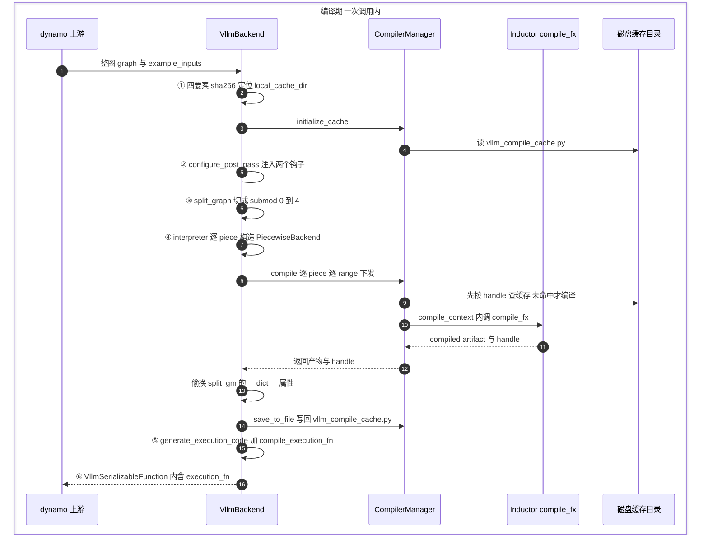

# 第 8 章 VllmBackend:编译流水线的总指挥

```text
I   背景:   [1 为何compile] → [2 V1引擎] → [3 编译栈全景]
II  前端:   [4 配置体系] → [5 Dynamo一次捕获]
III 中端:   [6 Piecewise切分] → [7 算子边界与vllm_ir]
IV  后端:   [8 VllmBackend]◄== → [9 逐range编译] → [10 Pass与融合]
V   运行时: [11 代码生成] → [12 CUDA Graph] → [13 缓存与AOT]
VI  收官:   [14 设计哲学] → [15 动手实践]
```

## 8.0 本章俯瞰

前七章各自造好了武器:第 5 章换来了"一张图"(dynamo 只 trace 一次的整模型 FX 图),第 6 章造好了"切分刀",第 7 章铸了"墙与桥"连同两件 pass 行李,第 4 章备好了配置。本章是总装车间:一个叫 `VllmBackend` 的函数把这些武器按固定顺序上膛,把上游递来的那张图,加工成启动后即可直接对外服务的 callable。

先看清总指挥的处境。torch.compile 的世界里,backend 只是一个满足"接收图与示例输入、返回 callable"协议的函数——dynamo 把整张图连同首次调用的真实输入塞给它,然后**转身走开,再也不会回来**。这意味着切分、逐段逐尺寸的编译、缓存读写、执行代码生成、返回值组装,全部要在这**一次调用**里完成;也意味着没有任何外部力量会再来管顺序与纪律——顺序与纪律必须内建在这一个函数里。它给出的答案是六道工序,依次回答六个问题:这次的成果凭什么复用(①缓存身份)、我的 pass 在人家流水线的哪一刻上场(②钩子)、图在哪里切(③切分)、编多少怎么编(④全量预编译)、产物怎么变成可执行的形状(⑤⑥执行代码与组装)。

六道工序与前七章成果的装配关系:

| 上游交来的武器 | 用在哪道工序 |
|---|---|
| 第 5 章:一次捕获的整图 + traced_files 源文件清单 | 整图是③的输入;清单是①的身份要素 |
| 第 7 章:donation 前置证明 + 第 10 章整列融合 pass | ②把它们挂进 Inductor 的时刻表 |
| 第 6 章:切分算法 + `__dict__` 偷换接缝 | ③落刀;④用接缝把产物放回原位 |
| 第 9 章:sizes/ranges 逐尺寸机制 | ④在每个 piece 内部运转 |
| 第 11 章:代码生成 | ⑤产出执行函数 |
| 第 12 章:静态地址世界 / 第 13 章:缓存树 | ⑥的翻译与①的目录是它们的地基 |

读完本章,你应当能不看任何细节,说出"一张图进来、一个 callable 出去,中间六步各做了什么、为什么只做一次"。

先把本章放进整条编译管线:

```text
torch.compile(model) ◄== 本章:VllmBackend 即这条管线的总编排
│
├─ 工序① 发身份证:四要素 sha256,凭它复用整套产物
├─ 工序② 布置内线:pre_grad / post_grad 两个钩子
├─ 工序③ 落刀:split_graph ─▶ submod_0..N
├─ 工序④ 全量预编译(片段 × range):AOT → pass → Inductor
├─ 工序⑤⑥ 造外壳:执行代码 + copy_and_call
│    └─ 宪兵:只此一次,serve 期再触发编译即报警
└─ serve 期:查 range 执行
```

## 8.1 最小前置知识

- **torch.compile backend 协议**:任意"接收 `(graph, example_inputs)`、返回 callable"的函数即可充当 dynamo 的编译后端(详见第 3、5 章)。本章主角 `VllmBackend` 实现的就是这个协议的 `__call__`。
- **fake tensor 与 `example_value`**:只携带 shape/stride/dtype 元数据、不占数据的张量;dynamo 在每个 FX 节点的 `node.meta["example_value"]` 里存好它,是编译期的通货(详见第 6 章)。
- **`inductor_compile_config`**:CompilationConfig 里会被透传给 Inductor 的 dict 字段(详见第 4 章)。第②步的全部工作就是往这份 dict 里写两个键。
- **Inductor `compile_fx` 流水线**:上游 Inductor 的主编译 API,内部串起 AOTAutograd、post-grad pass、lowering 与 codegen(详见第 9 章)。
- **四条不变量**:第 3 章确立的工期纪律,尤其 (a) dynamo 只 trace 一次与 (b) 启动期编完一切——本章是把这两条落进代码的那个函数。

## 8.2 设计思想与设计哲学

**总指挥是一次性脚本,不是常驻服务。** `VllmBackend`(`vllm/compilation/backends.py:805`)的全部工作发生在 `__call__`(`backends.py:1020`)这一次调用里;类属性 `_called` 进门时断言为 False、出门时置 True——**一个实例只被 dynamo 调一次**。这不是防御式编程的姿态,而是与不变量 (a) 的对偶:dynamo 承诺只 trace 一次,backend 承诺只编译一次,两份承诺互相锁定。回扣全书主线:decode 是 CPU/launch bound → 必须消灭 Python 开销 → 代价是编译 → 编译代价是启动时间 → 所以全部编译前置+缓存 → 所以敢丢 guards、敢一次 trace。这条链最后一环的"敢"字,落实处就是这个断言:既然一切已前置,运行期再进这个函数必是 bug,不如直接炸。多模型场景(backbone 与 eagle_head 各一张图)不复用实例,而是各拿独立实例、各占一个缓存前缀(`set_model_tag`,`backends.py:785`)。

【哲学时刻·P6】**同一条流水线,只换底座。** vLLM 自己不写编译器,它驱动编译器;"被驱动的编译器"被抽象成 `CompilerInterface`(编译器接口,`vllm/compilation/compiler_interface.py:27`)——收图与 range、交 callable 与缓存句柄(handle)的四方法契约。`make_compiler`(`backends.py:96`)按配置分发:standalone 版与标准版 Inductor、不编译的 eager、以及按平台 qualname 解析的第三方编译器。**六道工序对底下是哪个编译器一无所知——换底座不换指挥**,命题 P6 在这里不是配置项,而是类型边界。

【哲学时刻·P4】**对上游的侵入,恰好两个钩子。** vLLM 要往 Inductor 里放自己的图变换,却只占用两个官方 config 键;塞的是不可 pickle 的 pass 对象,便顺手用 `_cache_config_ignore_prefix` 把它们挡在上游缓存 key 之外。对照第 7 章的 `env_override.py`:那里是成叠的私有 API monkey-patch。侵入由此分出两级:**配置钩子是白的**(上游公开承诺的扩展点),**私有 API 补丁是红的**(升级即碎)。本章仍有一处红——为做同构子图去重,`CompilerManager` 不得不劫持 `autograd_cache_key`(`backends.py:329-350`)——红补丁是"上游还没给钩子"的症状,而非设计偏好;P4 是对两种颜色的清醒记账。

## 8.3 具体流程(流水线视角)

### 8.3.1 全景:一张图的六道工序

> **上游给我**:dynamo 经 `TorchCompileWithNoGuardsWrapper` 递来的单张 FX GraphModule(唯一符号维 num_tokens)与 `example_inputs`(首次 `_dummy_run` 的真实张量)→ **我做**:按六道工序加工 → **产出**:一个可直接服务 serve 的 **`VllmSerializableFunction`(可序列化函数,`vllm/compilation/caching.py:166`)**,经 dynamo 原路返回。

六道工序,每道回答一个问题、交出一份中间产物:

| 工序 | 回答的问题 | 交出什么 |
|---|---|---|
| ① 缓存身份 | 这次的成果凭什么被下次复用? | 一个目录路径(这次编译的全部家当住这里) |
| ② 布置内线 | 我的 pass 在 Inductor 流水线哪一刻上场? | 一份带两个钩子的 inductor config |
| ③ 切分 | 图在哪里切开、切开意味着什么? | 调度壳 + 待编译清单 |
| ④ 全量预编译 | 编多少、怎么编、编完放哪? | 每个 piece 的全部尺寸产物,已放回原位 |
| ⑤ 执行代码 | 产物怎么串成一个可执行函数? | runtime_callable |
| ⑥ 组装 | 怎么让它可序列化、可被捕获? | 最终 callable |



六道工序的共同目的只有一句话:**把几十秒的编译变成启动期一次性付清的账**,让 serve 期只剩查表与 replay。下面逐道展开——每道先说它为什么必须存在,再说它怎么做,最后说它把什么交给下一道。

### 8.3.2 工序①:发身份证——这次编译凭什么被复用

> **上游给我**:vllm_config 与 traced_files 清单(第 5 章劫持 dynamo 内联记下的源文件集)→ **我做**:四要素各算一个 hash,拼成 sha256 取 10 位 → **产出**:缓存目录路径,交 CompilerManager 初始化。

**为什么必须有它**:编译的代价是几十秒的启动时间,唯一出路是"编一次、永远复用"——而复用的前提是"这次编译"有一个唯一且正确的身份。身份错了有两种下场:该命中的没命中(白白重编,启动变慢),不该命中的命中了(改动没生效,serve 期跑旧代码)。所以这道工序的全部艺术在于**选对身份的构成**。

**怎么做**:身份 = 四类要素的哈希——环境变量因素、vllm 配置、编译器自身、以及 traced_files 里**每个源文件的完整内容**。前三个回答"在什么环境下编",第四个回答"编的是哪份代码":路径不变但内容变了一行,hash 就变,旧目录自动作废。这是"代码即缓存 key"的彻底版,也是第 5 章那份劫持来的文件清单兑现价值的地方——没有它,身份就只能退化为"模型名"这种粗糙的锚。产物目录长这样:

```text
VLLM_CACHE_ROOT/torch_compile_cache/<hash10>/rank_<rank>_<dp>/<prefix>/
├── vllm_compile_cache.py   (Range, graph_index, compiler) → handle 的映射表
├── computation_graph.py    切分后整图的转储(调试与 AOT 校验)
├── transformed_code.py     变换后字节码的 depyf 产物
└── cache_key_factors.json  四要素的原始值
```

**交给下一道什么**:一棵已初始化的缓存树。工序④的一切读写都落在这棵树上;第 13 章的 AOT 加载,载的也是它。(缓存的三个总开关与 ngram 投测强制关缓存等细节,见源码索引。)

### 8.3.3 工序②:布置内线——两个钩子把手术排进 Inductor 时刻表

> **上游给我**:从用户配置 deepcopy 而来的 inductor_config dict → **我做**:写入恰好两个钩子键 → **产出**:完整的 inductor config,随工序④的每次编译请求下发。

**为什么必须有它**:第 7 章铸好的两件行李——donation 的前置证明(`VllmIRInplaceFunctionalizationPass`)和第 10 章整列融合 pass 的编排器(`PostGradPassManager`)——不能自己找时机运行,它们的手术各有一个**唯一合法的时刻**:捐赠证明必须抢在泛函化之前(maybe_inplace 的声明一旦被防御性 clone 淹没就无从证明),融合与 lowering 必须在泛函化之后、代码生成之前。这两个时刻都在 Inductor 流水线内部,所以必须"进人家的时刻表"。

**怎么做**:Inductor 官方预留了两个 config 键,恰好对准这两个时刻——不改装机器,不改一行上游源码,侵入面压缩到两个键:

```python
# vllm/compilation/backends.py:934-953 (v0.27.1,节选)
def configure_post_pass(self) -> None:
    self.inductor_config["pre_grad_custom_pass"] = VllmIRInplaceFunctionalizationPass(...)
    # pass 对象不可 pickle,挡在上游缓存 key 之外
    ignore = inductor_config._cache_config_ignore_prefix + ["pre_grad_custom_pass"]
    self.inductor_config["_cache_config_ignore_prefix"] = ignore
    self.pass_manager.configure(self.vllm_config)   # post_grad 钩子挂整个 manager
```


配套的卫生工作有三件:config 是 deepcopy 的(携带 pass 对象的 dict 与用户配置脱钩)、`_cache_config_ignore_prefix` 把不可 pickle 的 pass 挡在上游缓存 key 外、钩子位本身可由平台改挂(`current_platform.pass_key`)。

**交给下一道什么**:一份弹药已装填的 config。工序④每次调 compile_fx 都带着它——②是④的后勤。

### 8.3.4 工序③:落刀——把整图变成可独立编译的 pieces

> **上游给我**:整图 graph 与切分表(第 4 章)→ **我做**:调用第 6 章的切分算法 → **产出**:`split_gm`(调度壳)与 SplitItem 清单(标记哪件留源码、哪件待编译)。

**为什么必须有它**:第 6 章已用三个理由论证(attention 是 Inductor 写不出的手写 kernel、cudagraph 需要可控的捕获边界、缓存粒度从整图细化到子图),总指挥在此不重新论证——它只做一件事:**在正确的位置调用这把刀**。

**怎么做**:默认走第 6 章的 FX 级切分;配置 `use_inductor_graph_partition` 时把切分表置空、同一刀改由 Inductor 的 scheduler 在 codegen 期落——同一决策的两种落法(P6 的注脚)。对 2 层 Llama,产出五个 piece:submod_0/2/4 待编译,submod_1/3(attention 所在)留源码执行。

**交给下一道什么**:一份清单。工序④按清单逐件处理,不碰留源码的那些。

### 8.3.5 工序④:全量预编译——"启动期编完一切"的执行点

> **上游给我**:split_gm 与 fake_args(真实输入逐个替换为对应 placeholder 的 example_value)→ **我做**:逐 piece 构造 PiecewiseBackend、全部尺寸区间一次编完 → **产出**:每个可编译 piece 的全部产物,已放回 split_gm 原位;缓存落盘回工序①的目录树。

**为什么必须有它**:不变量 (b)"启动期编完一切"的承诺,前几章说了很多遍,**兑现成动作的就是这一道**。serve 期零编译,意味着此刻必须把该 piece 未来可能遇到的每一个尺寸区间都编出来——少编一个,serve 期就会有一次"新形状"落在产物覆盖之外。

**怎么做**,三层递进:

1. **让 fake 值沿图流动**(PiecewiseCompileInterpreter):每个待编译 piece 在被构造时,必须知道自己的输入实参长什么样——哪些位置是张量、哪些是 SymInt。这只能靠"跑一遍假前向"在每个子模块处现场拿到;静态遍历做不到。其中 SymInt 出现的位置,正是唯一活维 num_tokens 进入每个片段的口子(第 9 章 sizes/ranges 机制的挂点)。
2. **每个 piece 一个 PiecewiseBackend,构造即 `compile_all_ranges`**:所有 range 在此刻一次编完——"启动期编完一切"在片段层的字面执行。
3. **一切编译请求经 CompilerManager 中转**(`backends.py:124`):它是 L3 通向 L4 的唯一桥梁,做三件事——**先 load 后 compile**(凭 (Range, graph_index, compiler) 三元组查缓存,命中即返,不进编译路径);**同构子图去重**(只差节点名的同构图得到同一个 key,已编过立即中断复用——32 层 Llama 的同构 piece 因此只编一次);**底座分发**(经 `CompilerInterface` 把请求交给 Inductor 或平台编译器,六道工序对此一无所知,P6)。

编译完成后,interpreter 用第 6 章埋好的接缝——`split_gm.__dict__[submod_name] = 编译产物`——**在图一个节点不动的前提下把产物放回原位**。

**交给下一道什么**:一个"看起来还是 FX 图、实际每个子模块已是编译产物"的 split_gm。⑤要做的只是给它造一个执行外壳。

### 8.3.6 工序⑤⑥:造外壳——从"能算的产物"到"能 serve 的 callable"

> **上游给我**:被偷换的 split_gm 与 example_inputs → **我做⑤**:生成纯 Python 组装代码并 exec 成函数;**我做⑥**:封装为可序列化对象、必要时包一层输入翻译 → **产出**:最终 callable,经 dynamo 返回 serve 路径。

**为什么必须有它**:工序④的产物是一堆"各自能算"的函数,serve 需要的是一个"零 Python 编排"的整体入口;而且这个入口还要满足两个下游要求——能被序列化落盘(第 13 章重启秒起)、能被 CUDA Graph 捕获(第 12 章整图重放)。

**怎么做**:⑤`generate_execution_code` 为调度壳生成一段纯 Python 组装代码(把 piece 们的输入输出按图接线,细节是第 11 章的主题),`exec` 成函数。取产物用的是第 6 章埋的第二个接缝:`getattr(split_gm, name)` 先查 `__dict__`(④放的产物)再回退 `_modules`(原图)——天然拿到产物。⑥组装 `VllmSerializableFunction`,内含 FX 图、执行代码、产物名单与常量,可 pickle 落盘。

⑥还有一件小而关键的事:**当 cudagraph 开启时,先包一层 `copy_and_call`**——把符号维输入(第一维是当步 num_tokens)拷进一块**地址永久固定**的常驻静态 buffer,再调编译产物。为什么必须拷?因为编译产物与后续被捕获的 CUDA Graph 都认死地址,张量换地方图就作废。这一层包装是**符号维世界与静态地址世界之间的翻译官**——第 12 章整章就站在这块 buffer 上。

**交给下游什么**:一个 callable,经 dynamo 原路返回给包装器,最终被 `capture_model` 录进静态图集。至此编译侧收口:全书从第 5 章"敢一次捕获"到本章"一次编完",机器造好了;接下来两章下潜工序④内部的逐尺寸机制与 pass 流水线,第 11-13 章则分别展开⑤⑥造出的外壳、捕获与缓存。

### 8.3.7 主例:2 层 Llama 的六道工序产物演进

延续第 6 章 2 层 Llama 的 5-piece 图,六道工序上产物的完整一生:

| 工序 | 输入产物(类型) | 加工 | 输出产物(类型 + 去向) |
|---|---|---|---|
| ① | VllmConfig 与 traced_files 清单(配置/文件) | 四要素 sha256 取 10 位 | local_cache_dir(路径;交 CompilerManager) |
| ② | inductor_config dict(deepcopy) | 写入两个钩子键 | 带 vLLM pass 的 config(dict,随④每次 compile 下发) |
| ③ | 整图 graph(FX GraphModule) | split_graph 落刀 | split_gm + 5 个 SplitItem(交④) |
| ④ | split_gm + fake_args(fake tensor) | 逐 piece 构造 PiecewiseBackend、全 range 编完 | submod_0/2/4 的 `__dict__` 属性被产物+cudagraph 包装替换;vllm_compile_cache.py 落盘 |
| ⑤ | 被偷换的 split_gm(GraphModule) | generate_execution_code + exec | runtime_callable(Python 函数) |
| ⑥ | runtime_callable + example_inputs | 组装/包 copy_and_call | VllmSerializableFunction(callable;经 dynamo 返回 serve 路径) |

### 8.3.8 宪兵:让"只此一次"成为纪律

总指挥的另一面是宪兵——六道工序的顺序与"只发生一次"不是靠自觉,而是靠三道守卫与一套账本。三道守卫:其一,`assert not self._called`——一个实例一次调用,违反即崩;其二,`monitor_profiling_run` 在 profiling run 前后断言编译计数零增量——不变量 (b) 的守卫,启动后期任何悄悄发生的编译都在此现形;其三,capture 结束即锁定,锁定期内任何捕获尝试直接 RuntimeError——不变量 (c) 的哨兵。

守卫的能量来自 **`compilation_counter`(`vllm/compilation/counter.py:58` 的单例)**:16 个字段把全书每一种编译事件各记一笔(见过的图、切出的 piece、Inductor 编译次数、cudagraph 捕获数……),六道工序沿途埋点。它的 `expect(**deltas)` 上下文管理器进出各克隆一份、断言差值——vLLM 的编译测试普遍用它声明"这段代码应当触发恰好 N 次编译",**把性能承诺写成可回归验证的断言**。

## 8.4 本章小结

- 六道工序:身份、内线、落刀、全量预编译、执行代码、组装——一张图进,一个 callable 出。(P1)
- 一个实例只调一次:断言与计数器双保险。(P2)
- CompilerManager 持 (Range, graph, compiler) 缓存键,同构去重,先 load 后 compile。(P1)
- 编译器经接口四路可插拔,流水线不改一行。(P6)
- 对上游只占两个钩子,红白两级侵入分开记账。(P4)

本章机制集中服务于 P1(compile once, run forever)与 P2(不变量换性能):六道工序把全部编译压进一次调用,断言与计数器保证它真的只有一次;P4 与 P6 分别回答了"怎么碰上游"与"怎么换底座"。下一章(第 9 章)下潜到工序④内部:sizes 与 ranges 双机制如何驱动 Inductor。④里那句"把所有 range 一次编完",正是下一章要逐行兑现的承诺。

### 本章源码索引

| 锚点 | 内容 |
|---|---|
| `vllm/compilation/backends.py:59-94`(`make_copy_and_call`) | 符号输入拷入常驻静态 buffer 的闭包(工序⑥的翻译官) |
| `vllm/compilation/backends.py:96-122`(`make_compiler`) | 四路编译器分发(P6) |
| `vllm/compilation/backends.py:124-404`(`CompilerManager`) | 编译管理器:缓存键 `:140`、compile_context `:149-161`、pprint/ast 读写 `:191,215-221`、先 load 后 compile 与 StopCompiling 去重 `:263-399`(`:329-362`)、同构同 hash `:346` |
| `vllm/compilation/backends.py:329-350` | 劫持 autograd_cache_key(红补丁,注释自述待上游暴露) |
| `vllm/compilation/backends.py:785-802`(`set_model_tag`) | 多模型各持实例的标签上下文 |
| `vllm/compilation/backends.py:805-870`(`VllmBackend`) | 总指挥类与 `__init__`(pass_manager :851、deepcopy :868) |
| `vllm/compilation/backends.py:934-971`(`configure_post_pass`) | 工序②:两钩子注入与 ignore_prefix |
| `vllm/compilation/backends.py:973,1027`(`_log_compilation_config`) | tlparse artifact vllm_compilation_config |
| `vllm/compilation/backends.py:1020-1339`(`__call__`) | 六道工序全部 |
| `vllm/compilation/backends.py:1031-1079` | 工序①:四要素 hash 与目录树 |
| `vllm/compilation/backends.py:1085-1101` | ngram 强制关缓存;initialize_cache |
| `vllm/compilation/backends.py:1149-1164` | num_graphs_seen 与 Dynamo 时长报告 |
| `vllm/compilation/backends.py:1168,1274` | assert not self._called 与置位 |
| `vllm/compilation/backends.py:1173-1228` | 工序③④:Inductor 分区旁路、split_graph、清单、fake_args、interpreter、save_to_file |
| `vllm/compilation/backends.py:1240-1272` | BACKED 0/1 区间修正;computation_graph.py 转储 |
| `vllm/compilation/backends.py:1279-1326` | 工序⑤⑥:codegen、getattr 取产物、sym_tensor_indices 与 copy_and_call |
| `vllm/compilation/compiler_interface.py:27-114`(`CompilerInterface`) | compile/load/compute_hash/initialize_cache 契约 |
| `vllm/compilation/compiler_interface.py:193-207`(`is_compile_cache_enabled`) | 缓存三开关 |
| `vllm/compilation/monitor.py:62-104` | profiling run 零编译断言;capture 哨兵 |
| `vllm/compilation/counter.py:13-55` | 16 个计数器字段与 expect 差值断言 |
| `vllm/compilation/piecewise_backend.py:189-190`(`compile_all_ranges`) | 构造即全量预编译(不变量 b 的执行点) |
| `vllm/compilation/passes/pass_manager.py:91`(`PostGradPassManager`) | 挂在 post_grad 钩子的编排器 |
| `vllm/compilation/caching.py:166`(`VllmSerializableFunction`) | 返回值封装 |
| `vllm/platforms/interface.py:177,248` | pass_key 默认值与平台编译器 qualname |

### 参考资料

1. [vLLM design doc — torch.compile](https://docs.vllm.ai/en/latest/design/torch_compile/) — 已与 0.27.1 源码核对一致(自定义 backend 与 piecewise 编排的总体描述与本章锚点相符)
2. [vLLM blog — Introduction to torch.compile and How It Works with vLLM (2025-08-20)](https://vllm.ai/blog/2025-08-20-torch-compile) — 仅作背景叙事
3. [vLLM design doc — Optimization Levels](https://docs.vllm.ai/en/latest/design/optimization_levels/) — 已与 0.27.1 源码核对一致(cudagraph_copy_inputs 等 config 字段,详见第 4 章)
4. [vLLM design doc — CUDA Graphs](https://docs.vllm.ai/en/stable/design/cuda_graphs/) — 已与 0.27.1 源码核对一致(静态输入 buffer 与 copy 的动机,详见第 12 章)
5. [vLLM design doc — Debug vLLM Compile](https://docs.vllm.ai/en/latest/design/debug_vllm_compile/) — 已与 0.27.1 源码核对一致(vllm_compilation_config 与 computation_graph.py 转储)
6. [vLLM design doc — Fusions](https://docs.vllm.ai/en/latest/design/fusions/) — 仅作背景叙事(两钩子挂载的 pass 详见第 10 章)
7. [RFC issue #6378 — A Graph Optimization System in vLLM using torch.compile](https://github.com/vllm-project/vllm/issues/6378) — 仅作背景叙事
8. [PyTorch blog — PyTorch + vLLM](https://pytorch.org/blog/pytorch-vllm-%E2%99%A5%EF%B8%8F/) — 仅作背景叙事
9. [vLLM v0.8.1 设计文档 — torch_compile(历史版)](https://docs.vllm.ai/en/v0.8.1/design/v1/torch_compile.html) — 仅作背景叙事(演进对比:早期 vllm backend 已具备切分+逐尺寸编译雏形,CompilerManager 与两钩子注入为后来演进)
