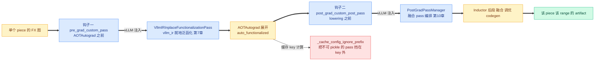

# 第 8 章 VllmBackend:编译流水线的总指挥

```text
I   背景:   [1 为何compile] → [2 V1引擎] → [3 编译栈全景]
II  前端:   [4 配置体系] → [5 Dynamo一次捕获]
III 中端:   [6 Piecewise切分] → [7 算子边界与vllm_ir]
IV  后端:   [8 VllmBackend]◄== → [9 逐range编译] → [10 Pass与融合]
V   运行时: [11 代码生成] → [12 CUDA Graph] → [13 缓存与AOT]
VI  收官:   [14 设计哲学] → [15 动手实践]
```

## 8.0 本章俯瞰

第 6 章结束时,切分机制已经能把一张整图拆成一个个片段;但回到代码入口,会发现一个朴素的事实:torch.compile 只认识一个函数——所谓 backend,不过是一个"接收图与示例输入、返回可调用对象"的函数。dynamo 把整个模型压成的单张图、连同首次调用的真实输入,一起塞给这个函数,然后转身走开,再也不会回来。那么这一刻之后,切分、逐段逐尺寸的编译、缓存查找与落盘、生成执行代码、组装返回值——这些散落在第 6、9、10、11 章的机制,由谁按什么顺序调度?谁保证这一切只发生一次、发生完就再也不发生?答案预告:全部机制被编排在一个只被允许调用一次的函数里,它按固定六步加工上游递来的图,把几十秒的编译收敛成一份启动后即可直接对外服务的东西;本章逐步展开这六步,并认识它脚下那层可插拔的编译器抽象。读完你应能对照行号把这六步完整走一遍,并说清每一步为何都必须在启动期一次做完。

## 8.1 最小前置知识

- **torch.compile backend 协议**:任意"接收 `(graph, example_inputs)`、返回 callable"的函数即可充当 dynamo 的编译后端;vLLM 在包装器构造时把它传给 `torch.compile`(详见第 3、5 章)。本章主角 `VllmBackend` 实现的就是这个协议的 `__call__`。
- **fake tensor 与 `example_value`**:只携带 shape/stride/dtype 元数据、不占数据的张量;dynamo 在每个 FX 节点的 `node.meta["example_value"]` 里存好它,是编译期的通货(详见第 6 章)。
- **`inductor_compile_config`**:CompilationConfig 里那个会被透传给 Inductor 的 dict 字段(详见第 4 章)。本章第②步的全部工作就是往这份 dict 里写两个键。
- **Inductor `compile_fx` 流水线**:上游 Inductor 的主编译 API,内部串起 AOTAutograd、post-grad pass、lowering 与 codegen;两个自定义钩子就挂在这条流水线的固定位置(详见第 9 章)。
- **四条不变量**:第 3 章确立的工期纪律,尤其 (a) dynamo 只 trace 一次与 (b) 启动期编完一切——本章讲的正是把这两条落进代码的那个函数。

## 8.2 设计思想与设计哲学

**总指挥是一次性脚本,不是常驻服务。** `VllmBackend`(`vllm/compilation/backends.py:805`)的类 docstring 自述职责:切图、交给 piecewise 后端、把 pass 管理器挂进 Inductor config——全部发生在 `__call__`(`backends.py:1020`)这一次调用里。类属性 `_called` 初值为 False(`:819`),调用中途 `assert not self._called`(`:1168`)、结束时置 True(`:1274`):**一个 backend 实例只被 dynamo 调一次**。这不是防御式编程的姿态,而是与不变量 (a) 的对偶——dynamo 承诺只 trace 一次,backend 承诺只编译一次,两份承诺互相锁定。多模型场景(backbone 与 eagle_head 各一张图)不是复用实例,而是经 **`set_model_tag`(模型标签上下文管理器,`backends.py:785`)** 各拿一个独立实例、各占一个缓存 prefix(`:845`)。回扣全书叙事主线:decode 是 CPU/launch bound → 必须消灭 Python 开销 → 代价是编译 → 编译代价是启动时间 → 所以全部编译前置+缓存 → 所以敢丢 guards、敢一次 trace、敢去泛函化。这条链的最后一环"敢"字,落实处就是这个 assert:既然一切已前置,运行期再进这个函数就一定是 bug,不如直接炸。

【哲学时刻·P6】**同一条流水线,只换底座。** vLLM 自己不写编译器,它驱动编译器;而"被驱动的编译器"被抽象成 **`CompilerInterface`(编译器接口,`vllm/compilation/compiler_interface.py:27`)**——四个方法的契约:`compile` 收图与 range、交 callable 与 **handle(缓存句柄)**;`load` 凭 handle 直接取产物;`compute_hash` 贡献编译器自身的缓存因子;`initialize_cache` 让编译器把自家缓存重定向到 vLLM 的目录树下。`make_compiler`(`backends.py:96`)按配置四路分发:inductor 且开 `VLLM_USE_STANDALONE_COMPILE` 走 `InductorStandaloneAdaptor`、默认走 `InductorAdaptor`、调试用 `EagerAdaptor`、其余按平台 qualname 解析出第三方编译器。六步流水线对底下是哪个编译器一无所知——换底座不换指挥,命题 P6(平台与后端可插拔)在这里不是配置项,而是类型边界。

【哲学时刻·P4】**对上游的侵入,恰好两个钩子。** vLLM 要往 Inductor 里塞自己的图变换,却只占用两个官方 config 键:`pre_grad_custom_pass` 与 `post_grad_custom_post_pass`(注入逻辑见 8.3.4)。塞进去的还是不可 pickle 的 pass 对象,于是顺手设 `_cache_config_ignore_prefix` 把它们挡在 AOTAutograd 缓存 key 之外——上游的缓存语义不被污染。对照第 7 章的 `env_override.py`:那里是成叠的私有 API monkey-patch。侵入由此分出两级:**配置钩子是白的**(上游公开承诺的扩展点,升级兼容),**私有 API 补丁是红的**(升级即碎,能不用就不用)。有趣的是本章仍有一处红:`CompilerManager.compile` 为做同构子图去重,不得不 monkey-patch `torch._functorch._aot_autograd.autograd_cache.autograd_cache_key`(`backends.py:329-350`),源码注释自己写道"torch does not easily expose the cache_key function…in the future torch should expose"——红补丁是"上游还没给钩子"的症状,而非设计偏好,P4(最小侵入上游)是对两种颜色的清醒记账。

## 8.3 具体流程(流水线视角)

### 8.3.1 入口契约:一次调用,一张图,一个 callable

> **上游给我**:dynamo 经 `TorchCompileWithNoGuardsWrapper` 递来的单张 FX GraphModule(唯一符号维 num_tokens)与 `example_inputs`(首次 `_dummy_run` 的真实张量)→ **我做**:按六步流水线加工 → **产出**:一个可直接服务 serve 的 callable,**`VllmSerializableFunction`(可序列化函数,`vllm/compilation/caching.py:166`)**,经 dynamo 原路返回给包装器。

入口签名是 `__call__(self, graph, example_inputs)`(`backends.py:1020`),装饰器 `@dynamo_timed("vllm_backend")` 让这段耗时进入 torch 的结构化 trace;开头先 `_log_compilation_config`(`:973`)把整份编译配置作为名为 `vllm_compilation_config` 的 artifact 落进 tlparse 时间线(`:1027`),供 `TORCH_COMPILE_DEBUG` 产物对账(详见第 15 章)。随后的六步与第 3 章的全书统一表述完全一致(本章是其定义章):

1. ① 计算 cache hash(env 因素+config hash+traced_files 文件内容+compiler hash)并定位缓存目录(backends.py:1031-1079)
2. ② configure_post_pass:向 Inductor config 注入两个钩子 pre_grad_custom_pass 与 post_grad_custom_post_pass(backends.py:1171, 定义于 :934)
3. ③ split_graph:按 splitting_ops 切分 FX 图(backends.py:1179)
4. ④ PiecewiseCompileInterpreter.run:逐 piece 构造 PiecewiseBackend 并把所有 range 一次编完(backends.py:1222)→ 保存 CompilerManager 缓存(:1228)
5. ⑤ generate_execution_code + compile_execution_fn:生成纯 Python 组装代码并 exec(backends.py:1279-1289)
6. ⑥ 组装 VllmSerializableFunction(必要时包 copy_and_call)返回(:1291-1339)


### 8.3.2 第①步:cache hash——把"这次编译"钉进目录树

> **上游给我**:`vllm_config` 与 `compilation_config.traced_files`(dynamo trace 时劫持 inline 记下的源文件清单,详见第 5 章)→ **我做**:四类要素各算一个 hash——env 因素(`envs.compile_factors()`,`:1031`)、config hash(`vllm_config.compute_hash()`,`:1034`)、compiler hash(`compiler_manager.compute_hash()`,`:1035`)、traced_files 里每个源文件的**完整内容**(`:1036-1055`),再拼成 sha256 取前 10 位(`:1066`)→ **产出**:`local_cache_dir` 路径(`:1067-1079`),交 `CompilerManager.initialize_cache`(`:1099`)。

要点有三。其一,hash 输入不止文件路径清单,还逐个读入每个源文件的**完整内容**(`:1048-1051`)——模型代码改一个字符,目录就换,缓存自动失效,这是"代码即缓存 key"的彻底版;算完立刻 `traced_files.clear()`(`:1057`),清单是一次性消费品。其二,目录树按下例组织(prefix 区分 backbone/eagle_head 等多个部件,`initialize_cache` 的 docstring `:166-179` 明说各 prefix 共享同一份 base 目录):

```text
VLLM_CACHE_ROOT/torch_compile_cache/<hash10>/rank_<rank>_<dp>/<prefix>/
├── vllm_compile_cache.py   (Range, graph_index, compiler) → handle
├── computation_graph.py    切分后整图的 print_readable 转储
├── transformed_code.py     dynamo 变换后 bytecode 的 depyf 产物
└── cache_key_factors.json  四要素的原始值(best-effort,:1121-1134)
```

其三,缓存的开关不在本步而在 `is_compile_cache_enabled`(`compiler_interface.py:193-207`):`VLLM_DISABLE_COMPILE_CACHE`、`torch._inductor.config.force_disable_caches`、config 里的 `force_disable_caches` 任一为真即全关;ngram GPU 投机解码会额外强制关缓存(`:1085-1089`)。本步还顺手完成一处计时:从 `monitor.py:14` 的全局 `torch_compile_start_time`(由 `monitor_torch_compile` 在 torch.compile 开始时写入,`monitor.py:29`)读出 Dynamo 字节码变换耗时并打点(`:1150-1164`)——六步流水线的第一步就同时是可观测性的第一步。

### 8.3.3 第②步:configure_post_pass——两个钩子的最小侵入

> **上游给我**:`self.inductor_config`(在 `__init__` 里从 `compilation_config.inductor_compile_config` **deepcopy** 而来,`:868`,动机是让携带 pass 对象的 dict 与用户配置彻底脱钩)→ **我做**:往 dict 写入恰好两个钩子键 → **产出**:一份完整的 additional inductor config,随第④步的每次编译请求下发(`CompilerManager.compile` 的 `additional_inductor_config` 形参,`:268`)。

```python
# vllm/compilation/backends.py:934-953 (v0.27.1,节选)
def configure_post_pass(self) -> None:
    pre_grad_pass_key = "pre_grad_custom_pass"
    assert self.pass_key != pre_grad_pass_key
    self.inductor_config[pre_grad_pass_key] = VllmIRInplaceFunctionalizationPass(
        self.vllm_config
    )
    # Make sure pre_grad_custom_pass is not pickled
    # as part of AOTAutograd built-in cache key
    import torch._inductor.config as inductor_config
    ignore = inductor_config._cache_config_ignore_prefix + [pre_grad_pass_key]
    self.inductor_config["_cache_config_ignore_prefix"] = ignore
    # Configure the (nominally post-grad) pass manager
    self.pass_manager.configure(self.vllm_config)
```

两个钩子各挂一样东西。**`pre_grad_custom_pass`(前置自定义 pass 钩子)** 在 AOTAutograd 之前运行,挂的是 `VllmIRInplaceFunctionalizationPass`——把 vllm_ir 算子就地泛函化,让"可融合算子"能被后续流水线正确处理(详见第 7 章);**`post_grad_custom_post_pass`(后置自定义 post pass 钩子)** 在 AOTAutograd 之后、lowering 之前运行,挂的是整个 **`PostGradPassManager`(后置 pass 管理器,`vllm/compilation/passes/pass_manager.py:91`)**——vLLM 全部融合 pass 的编排器(详见第 10 章)。后者挂的键名来自 `current_platform.pass_key`(`platforms/interface.py:177`,默认值即 `"post_grad_custom_post_pass"`),平台可以改挂别的钩子位。`_cache_config_ignore_prefix`(`:948-950`)把 pre_grad 键追加进 Inductor 的"缓存 key 忽略前缀":pass 对象不可 pickle,若进 key 会直接污染 AOTAutograd 缓存——一行配置,保住上游缓存语义。若用户本就在 `inductor_compile_config` 里配过单个 pass,`:957-970` 会把它 fold 进 pass manager 并拒绝 PostGradPassManager 直接驻留在用户配置里(`:958-961` raise)。

两个钩子在 Inductor 流水线上的位置如下图——vLLM 对 Inductor 的全部图变换诉求,收敛为这条流水线上的两个注入点:



### 8.3.4 第③④步:切分与逐 piece 全量预编译(详见第 6 章)

③:配置 `use_inductor_graph_partition` 时把 `fx_split_ops` 置空、改由 Inductor 分区(`:1173-1177`),否则用 `splitting_ops`;`split_graph`(`:1179`)落刀。④:`submod_names_to_compile` 只收非 splitting 子图(`:1201-1206`),真实输入被逐个替换为对应 placeholder 的 `example_value` fake(`:1213-1216`),`PiecewiseCompileInterpreter(...).run(*fake_args)`(`:1222`)逐 piece 构造 PiecewiseBackend——其构造函数里 `compile_all_ranges()`(`piecewise_backend.py:189-190`)把该 piece 的所有 range 一次编完,这正是不变量 (b) 的执行点;编完 `save_to_file`(`:1228`)。本章不重讲切分与解释器,只讲它们脚下那层抽象——总指挥的军火库。

**`CompilerManager`(编译管理器,`backends.py:124`)** 在 `VllmBackend.__init__` 里被创建(`:859-861`),是 L3 通向 L4 的唯一桥梁。它的 `cache` 是个 dict,键为 `(Range, graph_index, compiler_name)` 三元组(`:140`),值是 `{"graph_handle": handle, "cache_key": cache_key}`(`:370-373`)。序列化不用 JSON 而用 `pprint.pformat` 写成 Python 文件、`ast.literal_eval` 读回(`:191`、`:215-221`)——docstring 说得直白:键里有 int,而 JSON 不支持 int 作键(`:134-136`),写成 Python 文件顺手还让人工检查成为可能。`compile`(`:263`)的次序是:**先 `load`**(`:286`,凭三元组键查 handle,`:223-261`),命中即返(不再进入编译路径);未命中才进入 `compile_context`(`:149-161`)——`pass_context(compile_range)` 把当前 range 塞进全局上下文,让每个 pass 知道自己在为哪个尺寸区间编译(第 10 章 range gating 的地基),`use_inductor_graph_partition` 时再叠 `inductor_partition_rule_context`。真正的编译经 `compiler.compile(...)` 下发给适配器(`:353-358`),期间被 8.2 提到的那枚红补丁包住:劫持 `autograd_cache_key`,若算出的 key 已在 `loaded_artifacts` 内存表里,立刻 `raise StopCompiling()`(`:338`,异常类 `:402`)中断编译、直接复用内存产物(`:360-362`)——同构子图连磁盘 IO 都省掉;配合 `autograd_cache_normalize_inputs=True`(`:346`),只差节点名的同构图会得到同一个 key。底座选择即 `make_compiler`:

```python
# vllm/compilation/backends.py:101-121 (v0.27.1,节选)
if compilation_config.backend == "inductor":
    if envs.VLLM_USE_STANDALONE_COMPILE and hasattr(
        torch._inductor, "standalone_compile"
    ):
        return InductorStandaloneAdaptor(...)   # torch>=2.8 完整缓存路径
    else:
        return InductorAdaptor()                # compile_fx 主路径
elif compilation_config.backend == "eager":
    return EagerAdaptor()                       # 不编译,调试用
else:
    compiler = resolve_obj_by_qualname(
        current_platform.get_compile_backend())()   # 平台自定义编译器
```

四个分支对应四种命运:standalone 走 `torch._inductor.standalone_compile`(缓存更完整,详见第 9 章)、默认走 `compile_fx`、eager 完全不编译、第四路把 qualname 交给平台——**六步流水线一行不改,底座从 Inductor 换成任何东西**。这就是 8.2 那个【哲学时刻·P6】的代码形状。

### 8.3.5 第⑤⑥步:从 split_gm 到 serve 期 callable

> **上游给我**:已被偷换的 `split_gm`(`__dict__` 里是 PiecewiseBackend,`_modules` 里是原 FX 子图)→ **我做⑤**:`generate_execution_code(self.split_gm)`(`:1279`)生成纯 Python 组装代码,`compile_execution_fn`(`:1287`)把代码 exec 成函数 → **产出**:`runtime_callable`(execution_fn,`codegen.py:165`,详见第 11 章)。

取产物那三行是个精巧的接缝:`submod_callables = {name: getattr(self.split_gm, name) ...}`(`:1283-1286`)。源码注释(`:1280-1282`)明说:getattr 先查 `__dict__`(第 6 章解释器放进去的编译产物)、再回退 `_modules`(原图)——于是拿到的天然是产物。⑤之前还有两件杂务:BACKED 动态 shape 下把 shape env 中 lower==2 的区间放宽到 0(`:1240-1257`),否则 evaluate_guards 会因 torch 对 0/1 的特化而永远失败;`computation_graph.py` 落盘整图 `print_readable`(`:1259-1272`),给调试与 AOT 装载留一份"图仍在"的证据(详见第 13 章)。

> **上游给我**:⑤的 `runtime_callable`(Python 函数)与 `example_inputs`(真实张量清单)→ **我做⑥**:普通路径直接把 `runtime_callable` 装进 `VllmSerializableFunction`(`:1295-1305`,内含 FX 图、execution_code、submod 名单与常量,可 pickle 落盘);当 `cudagraph_copy_inputs` 为真且 cudagraph_mode 非 NONE 时,先从 fake_args 找出所有维度带符号的输入张量(`sym_tensor_indices`,`:1312-1317`),再包一层 copy_and_call(`:1322-1326`)→ **产出**:第 0 节所说的 callable,经 dynamo 返回,最终被 `capture_model` 录进静态图集(详见第 12 章)。

```python
# vllm/compilation/backends.py:78-91 (v0.27.1,节选)
def copy_and_call(*args: Any) -> Any:
    list_args = list(args)
    for i, index in enumerate(sym_tensor_indices):
        runtime_tensor = list_args[index]
        runtime_shape = runtime_tensor.shape[0]
        if input_buffers[i] is None:            # 惰性初始化常驻静态 buffer
            input_buffers[i] = runtime_tensor.clone()
        static_tensor = input_buffers[i][:runtime_shape]
        static_tensor.copy_(runtime_tensor)     # 运行时张量拷进静态前缀
        list_args[index] = static_tensor
    return callable_fn(*list_args)
```

`make_copy_and_call`(`:59-94`)返回的闭包干一件事:把符号 shape 的输入(第一维是当步 num_tokens)拷进一块**地址永久固定**的常驻 buffer,再调编译产物。调用侧直接用首调输入 clone 出初值 buffer(`:1322-1326`),注释假设首调拿到的就是最大尺寸(`:1319-1321`)。为什么必须拷?因为编译产物与后续被捕获的 CUDA Graph 都认死地址——张量换地方,图就作废。这就是给第 12 章埋的线:静态输入 buffer 是符号维世界与静态图世界之间的翻译官。

### 8.3.6 主例:2 层 Llama 的六步产物演进表

延续第 6 章 2 层 Llama 的 5-piece 图(submod_0/2/4 可编译,submod_1/3 是 splitting piece),六步流水线上产物的完整一生:

| 步 | 输入产物(类型) | 加工 | 输出产物(类型 + 去向) |
|---|---|---|---|
| ① | VllmConfig 与 traced_files 清单(配置/文件) | 四要素 sha256 取 10 位 | local_cache_dir(路径,`:1077`;交 `initialize_cache` `:1099`) |
| ② | inductor_config dict(deepcopy,`:868`) | 写入两个钩子键 | 带 vLLM pass 的 inductor config(dict,随④每次 compile 下发) |
| ③ | 整图 graph(FX GraphModule,dynamo) | split_graph 落刀 | split_gm + 5 个 SplitItem(`:1179`,交④) |
| ④ | split_gm + fake_args(fake tensor,`:1213`) | 逐 piece 构造 PiecewiseBackend、全 range 编完 | submod_0/2/4 的 `__dict__` 属性被产物+cudagraph 包装替换(`:766`);vllm_compile_cache.py 落盘(`:1228`) |
| ⑤ | 被偷换的 split_gm(GraphModule) | generate_execution_code + exec | runtime_callable(Python 函数,`:1287`) |
| ⑥ | runtime_callable + example_inputs | 组装/包 copy_and_call | VllmSerializableFunction(callable,`caching.py:166`;经 dynamo 返回 serve 路径) |

### 8.3.7 不变量守卫:断言、哨兵与十六个计数器

总指挥的另一面是宪兵。三道守卫把"只此一次"变成可执行的纪律:**其一**,`assert not self._called`(`:1168`)——一个实例一次调用,违反即崩;**其二**,`monitor_profiling_run`(`monitor.py:62-84`)在 profiling run 前后断言 `num_backend_compilations` 零增量(`:75-80`)——不变量 (b) 的守卫,启动后期任何悄悄发生的编译都会在这里现形;**其三**,`validate_cudagraph_capturing_enabled`(`monitor.py:90-99`)配合 `set_cudagraph_capturing_enabled(False)`(capture 结束即调用,详见第 3 章)——不变量 (c) 的运行时哨兵,锁定期内任何捕获尝试直接 RuntimeError。

这些守卫的能量来自 **`compilation_counter`(编译计数器,`vllm/compilation/counter.py:58` 的单例)**:一个 dataclass,恰好 16 个字段(`:13-41`),从 `num_models_seen`、`num_graphs_seen`、`num_piecewise_graphs_seen` 到 `num_backend_compilations`、`num_inductor_compiles`、`num_cudagraph_captured`、`num_cache_entries_updated`、`num_aot_*` 三兄弟、`stock_torch_compile_count`,把全书每一种编译事件各记一笔。六步流水线沿途埋点:进 `__call__` 记 `num_graphs_seen`(`:1149`),切完记 `num_piecewise_graphs_seen`(`:1201`),每 piece 进 Manager 记 `num_backend_compilations`(`:280`),解释器偷换一个记 `num_piecewise_capturable_graphs_seen`(`:774`)。它的 `expect(**deltas)` 上下文管理器(`:46-55`)进出各 clone 一份、断言差值——vLLM 的编译测试普遍用它声明"这段代码应当触发恰好 N 次编译",把性能承诺写成可回归验证的断言。

## 8.4 本章小结

- 六步流水线:hash、钩子、切分、预编译、codegen、组装。(P1)
- 一个实例只调一次:assert 与计数器双保险。(P2)
- CompilerManager 持 (Range,graph,compiler) 缓存键。(P1)
- 编译器经接口四路可插拔,流水线不改一行。(P6)
- 对上游只占两个钩子,红白两级侵入分开记账。(P4)

本章机制集中服务于 P1(compile once, run forever)与 P2(不变量换性能):六步把全部编译压进一次调用,断言与计数器保证它真的只有一次;P4 与 P6 则分别回答了"怎么碰上游"与"怎么换底座"。下一章(第 9 章)下潜到单个 piece 内部:sizes 与 ranges 双机制如何驱动 Inductor,以及那一叠 monkey-patch 各自补的是什么。④步里那句"把所有 range 一次编完",正是下一章要逐行兑现的承诺。

### 本章源码索引

| 锚点 | 内容 |
|---|---|
| `vllm/compilation/backends.py:59-94`(`make_copy_and_call`) | 符号输入拷入常驻静态 buffer 的闭包 |
| `vllm/compilation/backends.py:96-122`(`make_compiler`) | 四路编译器分发(P6) |
| `vllm/compilation/backends.py:124-404`(`CompilerManager`) | 编译管理器:缓存/装载/编译 |
| `vllm/compilation/backends.py:140` | cache dict 键 (Range, graph_index, compiler_name) |
| `vllm/compilation/backends.py:149-161`(`compile_context`) | pass_context(compile_range) 与分区规则上下文 |
| `vllm/compilation/backends.py:191,215-221` | vllm_compile_cache.py 的 ast.literal_eval 读写 |
| `vllm/compilation/backends.py:263-399`(`compile`) | 先 load 后 compile;StopCompiling 去重 :329-362 |
| `vllm/compilation/backends.py:346` | autograd_cache_normalize_inputs=True 同构同 hash |
| `vllm/compilation/backends.py:370-374` | 缓存条目 {graph_handle, cache_key} 与计数 |
| `vllm/compilation/backends.py:633-684`(`wrap_with_cudagraph_if_needed`) | PIECEWISE 包装与首末图选项(详见第 6 章) |
| `vllm/compilation/backends.py:785-802`(`set_model_tag`) | 多模型各持实例的标签上下文 |
| `vllm/compilation/backends.py:805`(`VllmBackend`) | 总指挥类;docstring :806-815 |
| `vllm/compilation/backends.py:833-870`(`__init__`) | pass_manager :851、pass_key :854、deepcopy :868 |
| `vllm/compilation/backends.py:934-971`(`configure_post_pass`) | 两钩子注入与 ignore_prefix |
| `vllm/compilation/backends.py:973,1027`(`_log_compilation_config`) | tlparse artifact vllm_compilation_config |
| `vllm/compilation/backends.py:1020-1339`(`__call__`) | 六步流水线全部 |
| `vllm/compilation/backends.py:1031-1079` | 四要素 hash 与目录树 |
| `vllm/compilation/backends.py:1085-1101` | ngram 强制关缓存;initialize_cache |
| `vllm/compilation/backends.py:1149-1164` | num_graphs_seen 与 Dynamo 时长报告 |
| `vllm/compilation/backends.py:1168,1274` | assert not self._called 与置位 |
| `vllm/compilation/backends.py:1173-1179` | Inductor 分区旁路与 split_graph 调用 |
| `vllm/compilation/backends.py:1201-1228` | 清单、fake_args、interpreter、save_to_file |
| `vllm/compilation/backends.py:1240-1272` | BACKED 0/1 区间修正;computation_graph.py 转储 |
| `vllm/compilation/backends.py:1279-1305` | codegen 与 getattr 取产物、直接返回路径 |
| `vllm/compilation/backends.py:1312-1326` | sym_tensor_indices 与 make_copy_and_call 调用 |
| `vllm/compilation/compiler_interface.py:27-114`(`CompilerInterface`) | compile/load/compute_hash/initialize_cache 契约 |
| `vllm/compilation/compiler_interface.py:193-207`(`is_compile_cache_enabled`) | 缓存三开关 |
| `vllm/compilation/monitor.py:14,29`(`torch_compile_start_time`) | Dynamo 计时全局 |
| `vllm/compilation/monitor.py:62-84`(`monitor_profiling_run`) | profiling run 零编译断言 |
| `vllm/compilation/monitor.py:87-104` | capture 开关与哨兵 |
| `vllm/compilation/counter.py:13-41` | 16 个计数器字段 |
| `vllm/compilation/counter.py:46-55`(`expect`) | 差值断言上下文管理器 |
| `vllm/compilation/piecewise_backend.py:189-190`(`compile_all_ranges`) | 构造即全量预编译(不变量 b) |
| `vllm/compilation/passes/pass_manager.py:91`(`PostGradPassManager`) | 挂在 post_grad 钩子的编排器 |
| `vllm/compilation/caching.py:166`(`VllmSerializableFunction`) | 返回值封装 |
| `vllm/platforms/interface.py:177,248` | pass_key 默认值与平台编译器 qualname |

### 参考资料

1. [vLLM design doc — torch.compile](https://docs.vllm.ai/en/latest/design/torch_compile/) — 已与 0.27.1 源码核对一致(自定义 backend 与 piecewise 编排的总体描述与本章锚点相符)
2. [vLLM blog — Introduction to torch.compile and How It Works with vLLM (2025-08-20)](https://vllm.ai/blog/2025-08-20-torch-compile) — 仅作背景叙事
3. [vLLM design doc — Optimization Levels](https://docs.vllm.ai/en/latest/design/optimization_levels/) — 已与 0.27.1 源码核对一致(cudagraph_copy_inputs 等 config 字段,详见第 4 章)
4. [vLLM design doc — CUDA Graphs](https://docs.vllm.ai/en/stable/design/cuda_graphs/) — 已与 0.27.1 源码核对一致(静态输入 buffer 与 copy 的动机,详见第 12 章)
5. [vLLM design doc — Debug vLLM Compile](https://docs.vllm.ai/en/latest/design/debug_vllm_compile/) — 已与 0.27.1 源码核对一致(vllm_compilation_config 与 computation_graph.py 转储)
6. [vLLM design doc — Fusions](https://docs.vllm.ai/en/latest/design/fusions/) — 仅作背景叙事(两钩子挂载的 pass 详见第 10 章)
7. [RFC issue #6378 — A Graph Optimization System in vLLM using torch.compile](https://github.com/vllm-project/vllm/issues/6378) — 仅作背景叙事
8. [PyTorch blog — PyTorch + vLLM](https://pytorch.org/blog/pytorch-vllm-%E2%99%A5%EF%B8%8F/) — 仅作背景叙事
9. [vLLM v0.8.1 设计文档 — torch_compile(历史版)](https://docs.vllm.ai/en/v0.8.1/design/v1/torch_compile.html) — 仅作背景叙事(演进对比:早期 vllm backend 已具备切分+逐尺寸编译雏形,CompilerManager 与两钩子注入为后来演进)
