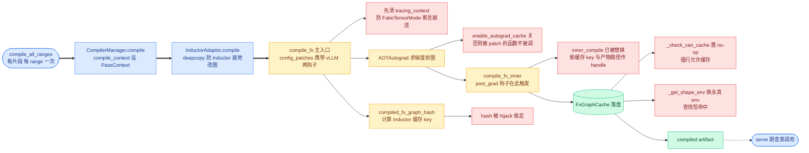
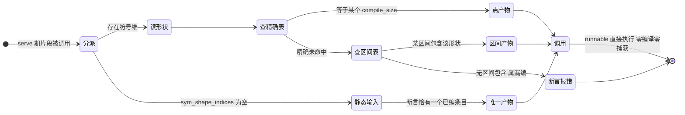

# 第 9 章 逐 range 编译:PiecewiseBackend 与 Inductor 的对接

```text
I   背景:   [1 为何compile] → [2 V1引擎] → [3 编译栈全景]
II  前端:   [4 配置体系] → [5 Dynamo一次捕获]
III 中端:   [6 Piecewise切分] → [7 算子边界与vllm_ir]
IV  后端:   [8 VllmBackend] → [9 逐range编译]◄== → [10 Pass与融合]
V   运行时: [11 代码生成] → [12 CUDA Graph] → [13 缓存与AOT]
VI  收官:   [14 设计哲学] → [15 动手实践]
```

## 9.0 本章俯瞰

第 6 章结尾,每个可编译片段都被偷换成了一个「片段后端」对象,当时只承诺它会编译,没有说怎么编。本章把镜头推到最近:每个片段的图里,除了一个随每步批大小变化的维度之外,一切形状都已定死。这个唯一的变量把编译器逼进两难——按固定大小编,形状可以写死进生成的 kernel,调优器还能针对这一个形状穷举出最好的配置,但服务期的批大小千姿百态,不可能每个都编一份;按可变大小编,一份产物什么批都能吃,却要在每个 kernel 里背着运行时的边界计算与掩码,更无法针对性调优。vLLM 的答案是两套策略并用:把少数高频尺寸各编一份形状写死的产物,把其余所有可能收进少数几个区间、每个区间编一份符号产物,启动时全部编完,运行时按到来批的大小查表取用——第 3 章五层全景里的第四层(L4)由此合拢。但这套「一个片段编多份」的做法,与上游 Inductor「一次 trace 配一次编译」的隐含假设正面冲突:缓存查找、缓存 key 的计算、fake tensor 的一致性检查,全都假设编译发生在 dynamo 的上下文之内。本章后半部分就是这场冲突的完整清单,以及 vLLM 垫在中间的适配层——一叠每一条都有存在理由的运行时补丁,和一个正在把补丁偿还成「正门」的上游新入口。

## 9.1 最小前置知识

- **PiecewiseBackend**(片段后端)与 **sym_shape_indices**(符号维下标表):第 6 章里 `PiecewiseCompileInterpreter` 为每个可编译片段构造它,并记下该片段输入中所有 SymInt 实参的位置(`vllm/compilation/backends.py:746-748`);它「主要处理静态形状的编译与按运行时形状分派」(`vllm/compilation/piecewise_backend.py:86`,详见第 6 章)。
- **compile_sizes**(精确编译尺寸表)与 **compile_ranges_endpoints**(区间端点表):`CompilationConfig` 的两个 shape 字段,前者除整数外支持字面量 `"cudagraph_capture_sizes"`,后者被折成区间列表(字段定义 `vllm/config/compilation.py:575` 与 `:580`,语义详见第 4 章)。
- **compile_fx**:torch 上游 Inductor 的主入口 `torch._inductor.compile_fx.compile_fx`——AOTAutograd 求梯度前图、post-grad 自定义 pass、Triton 代码生成、FxGraphCache 落盘都发生在它内部。
- **monkey-patch**(运行时补丁):在运行时临时替换另一个库内部函数的技术,本章使用 `unittest.mock.patch` 的上下文管理器精确包裹 Inductor 内部函数,退出时自动还原。
- **max_autotune**(最大自动调优)与 **coordinate_descent_tuning**(坐标下降调优):Inductor 的两个编译期搜索开关,对候选 Triton kernel 配置做穷举与迭代搜索,用编译时间换 kernel 性能。

## 9.2 设计思想与设计哲学

**两套 shape 策略,分工而不是二选一。** 第 4 章的两张 shape 表在本章各就其位:**compile_sizes** 的每个整数 n 折成一个单点区间,产出「全静态产物」——每个自由 SymInt 都被替换成常量 n,整张图没有任何符号维度;**compile_ranges_endpoints** 折出的区间各产出一份「符号产物」——一份产物覆盖 `[start, end]` 内的所有取值。两类条目最终住进同一个字典,运行时精确优先、区间兜底。注意「互斥」这个词在本章有两个不同落点:类的一对互斥模式是「编译模式(有图无产物)vs 预编译模式(无图有产物)」(`piecewise_backend.py:108-116` 的 docstring,分别服务冷启动与温启动);而两套 shape 策略是并存互补的。真正互斥的是每个运行时形状只落到一份产物上——这是查表的前提。

【哲学时刻·P7】**shape 是推理编译的核心矛盾,vLLM 用「按需多份」正面消化它。** 全静态产物的价值不只是省几个运行时判断:N 写死后,循环边界、掩码、展开系数全部在编译期折叠,更重要的是 **max_autotune** 的搜索空间从「对所有可能形状都还行」坍缩为「对这一个形状最优」,穷举一次、终生受益(P1)。而它天生只为 cudagraph 捕获尺寸而生:捕获桶(`cudagraph_capture_sizes`)是一小把固定值,恰是静态产物的理想服务对象(第 12 章的整图捕获正落在这批产物上)。区间产物则是诚实的兜底:承认无法为无穷多形状各编一份,于是编一份「对这个区间内所有形状都正确且不差」的符号产物。回扣全书叙事主线:decode 是 CPU/launch bound → 必须消灭 Python 开销 → 代价是编译 → 编译代价是启动时间 → 所以全部编译前置 + 缓存。双机制把「编译量」从「随形状数无限膨胀」压到「每片段 × (几个点 + 几个区间)」,启动时间才能被第 13 章的缓存体系彻底摊销;`PiecewiseBackend.__init__` 把所有 range 一次编完,则是全书不变量 b(启动期编完一切)在片段层的执行——serve 期的 `__call__` 只剩查表与调用。

【哲学时刻·P4/P6】**补丁是债,正门是偿还。** 下半章的主角 **InductorAdaptor**(Inductor 适配器)是一叠对 torch 内部函数的 monkey-patch:每一条都对应「上游的一个隐含假设」与「vLLM 的一种用法」之间的裂缝,缺一条就崩。这不是工程洁癖问题,而是命题 P4(最小侵入上游)的现实代价——不改 torch 一行代码,就要在运行时把它的内部行为掰弯到恰好可用,并随 torch 版本漂移持续维护。**InductorStandaloneAdaptor**(standalone 适配器)走的是另一条路:把「dynamo 之外使用 Inductor」这个需求推回上游,换来 torch≥2.8 的 **standalone_compile** 正门——同样的编译,不需要那叠补丁。命题 P6(平台与后端可插拔)则体现在更外一层:两者都实现同一个 **CompilerInterface**(编译器接口)抽象,与 **EagerAdaptor**(eager 适配器)和平台自定义后端平起平坐,`backend` 字段一换,本章整套机制可整体替换。

## 9.3 具体流程(流水线视角)

本章处在第 8 章六步流水线第④步的内部:`PiecewiseCompileInterpreter.run`(`backends.py:1222`)逐片段构造 PiecewiseBackend,构造函数里就把所有 range 编完,随后第⑤步的代码生成直接引用这些产物。

### 9.3.1 两张表长成一本 range_entries 字典

> **上游给我**:定稿的 compilation_config(compile_sizes 与 compile_ranges_endpoints,`vllm/config/compilation.py:575`/`:580`)→ **我做**:`PiecewiseBackend.__init__` 把两表折进统一字典(`piecewise_backend.py:137-184`)→ **产出**:`range_entries: dict[Range, RangeEntry]`,键为 **Range**(尺寸区间,双闭区间,`vllm/config/utils.py:387`),值为 **RangeEntry**(区间条目,`:80`,携带 compile_range、compiled、runnable 三字段)。

区间侧,`get_compile_ranges`(`vllm/config/compilation.py:1565`)把端点表折成 `[1, e0]、[e0+1, e1]、…、[e_{last-1}+1, e_last]`——端点表由 `VllmConfig._set_compile_ranges`(`vllm/config/vllm.py:1945`)计算生成,其中必含调度上限 `max_num_batched_tokens`(`:1953-1955`),因此折出的区间无缝覆盖从 1 到调度上限的每一个整数。尺寸侧,每个整数 n 折成 `Range(n, n)`(`:174-179`);字符串 `"cudagraph_capture_sizes"` 在 `:167-172` 被显式拒绝——它本应在配置解析期的 `post_init_cudagraph_sizes`(`vllm/config/compilation.py:1106-1131`)展开成捕获桶整数,走到编译期还见到字符串说明配置管线断裂,不如当场报错。这个函数还顺带把 None 归一成空表,保证 PiecewiseBackend 拿到的永远是 list:默认(用户未配置)compile_sizes 为空,只有区间产物;要给捕获桶各编一份静态产物,须显式写字面量。两个特例:encoder 编译把末区间的 end 拉到 `2**31-1`(`:138-149`,帧数不受 max_num_batched_tokens 约束);构造参数 graph 与 compiled_runnables 恰提供一个(`:118-120` 断言),对应 9.2 说的互斥两模式。

```text
【示意图】同一片段的两本账(设 max_num_batched_tokens = 8192)
配置: compile_sizes = [1, 2, 4, 8]   compile_ranges_endpoints = [8, 512, 8192]

  compile_sizes 逐个折成单点 Range        get_compile_ranges 折成区间
  ───────────────────────────────        ───────────────────────────────
  Range(1,1)  全静态 n=1                 Range(1,8)     符号 1<=s0<=8
  Range(2,2)  全静态 n=2                 Range(9,512)   符号 9<=s0<=512
  Range(4,4)  全静态 n=4                 Range(513,8192) 符号 513<=s0<=8192
  Range(8,8)  全静态 n=8
        │  两类条目合并进同一本 range_entries 字典  │
        ▼
  查表顺序: 先精确 → 再包含(线性扫区间表)
  命中点产物 → 全静态 artifact(开 max_autotune)
  命中区间   → 符号 artifact(默认启发式配置)
  都未命中   → AssertionError 属启动期漏编
```

### 9.3.2 compile_all_ranges:不变量 b 的落地

> **上游给我**:片段 FX 图(来自 interpreter 的构造调用,`backends.py:742-764`)与 range_entries → **我做**:**compile_all_ranges**(`piecewise_backend.py:245-277`)逐条目编译 → **产出**:每个条目一个 runnable,serve 期只被 `__call__` 查表调用(`:358-380`)。

关键分岔在每个条目的 example inputs 怎么造。单尺寸条目走 **create_concrete_args**(`:37-76`):遍历片段的 placeholder,把每个自由 SymInt 替换成常量 size——`concretize`(`:47-52`)对 SymInt 的符号表达式做代入,表达式中所有自由符号一律绑到 size;张量则用 `as_strided` 重建(`:68-72`)。区间条目走 `get_fake_args_from_graph`(`:26-34`),直接取 placeholder meta 里的 example_value,符号维保持 SymInt。两种输入随后汇入同一次调用:`compiler_manager.compile(self.graph, args_list, self.vllm_backend.inductor_config, …, compile_range=…)`(`:266-275`)——编译的始终是同一张片段图,变的只是输入的 concretize 程度。

```python
# vllm/compilation/piecewise_backend.py:61-75 (v0.27.1)
            val = node.meta["example_value"]
            if isinstance(val, torch.SymInt):
                args.append(concretize(val))          # 符号 → 常量 size
            elif isinstance(val, torch.Tensor):
                new_shape = tuple(concretize(d) for d in val.shape)
                new_strides = tuple(concretize(s) for s in val.stride())
                new_storage_offset = concretize(val.storage_offset())
                needed_size = compute_required_storage_length(
                    new_shape, new_strides, new_storage_offset
                )
                t = torch.empty(needed_size, dtype=val.dtype, device=val.device)
                t = t.as_strided(new_shape, new_strides, new_storage_offset)
                args.append(t)
```

为什么必须 `as_strided` 而不是简单 `empty(new_shape)`:切片后的激活、转置视图这类非连续输入,其 stride 与 storage_offset 也是编译器要看的「形状」;不逐维保真,Inductor 推导出的访存布局就与真实运行不一致,静态优化的前提被悄悄破坏。这是命题 P5(显式优于隐式)的一个毫米级体现:连「怎么放」都显式重放,而不是让编译器猜。

### 9.3.3 set_inductor_config:好钢用在刀刃上

> **上游给我**:compile_range 与当前 config 字典 → **我做**:**set_inductor_config**(`vllm/compilation/compiler_interface.py:753-760`)只对单尺寸 range 打开两个搜索开关 → **产出**:current_config 里的 max_autotune 与 coordinate_descent_tuning,去向 `compile_fx` 的 `config_patches` 参数。

```python
# vllm/compilation/compiler_interface.py:753-760 (v0.27.1)
def set_inductor_config(config: dict[str, Any], compile_range: Range) -> None:
    if compile_range.is_single_size():
        # for a specific batch size, tuning triton kernel parameters
        # can be beneficial
        config["max_autotune"] = envs.VLLM_ENABLE_INDUCTOR_MAX_AUTOTUNE
        config["coordinate_descent_tuning"] = (
            envs.VLLM_ENABLE_INDUCTOR_COORDINATE_DESCENT_TUNING
        )
```

两个 env(`envs.py:1899-1906`)默认都是 1,所以「调不调优」的真正开关是 range 的形状,而不是环境变量。区间产物不值得调优:同一份 kernel 要服务 `[9, 512]` 的每一个取值,编译期面对的不是单一形状,穷举出的「最优配置」对区间内其他形状可能更糟,只能退回启发式默认。静态产物恰好相反:N 写死后搜索空间小而确定,一次穷举终身复用。看同一片段的 rms_norm 在两种产物里的样子:

```text
【示意图】同一 rms_norm kernel 在两种产物中的签名(非真实 dump)
全静态产物(Range(8,8),max_autotune 已开)
  def rms_norm_kernel(x_ptr, w_ptr, out_ptr,
                      N: tl.constexpr = 8,         # N 编死 编译期折叠
                      BLOCK: tl.constexpr = 8):    # 调优器为 N=8 实测选出
      # 循环边界常量 掩码可整体省略 无运行时分支
符号区间产物(Range(9,512))
  def rms_norm_kernel(x_ptr, w_ptr, out_ptr,
                      n,                           # num_tokens 运行时标量
                      BLOCK: tl.constexpr = 128):  # 启发式默认 须掩码
      # 每次调用按 n 现算边界与掩码
```

设某片段只含 rms_norm 与 MLP,`compile_sizes=[1,2,4,8]` 会为它编出 4 个全静态产物(每个的 BLOCK 配置都可能不同)外加各区间产物;decode 批经第 12 章的桶填充落到 1/2/4/8 之一时,踩中的正是调优过的那几份。

### 9.3.4 CompilerManager:缓存、去重与编译上下文

> **上游给我**:graph、args_list、inductor_config(即 `vllm_backend.inductor_config`,`backends.py:868` 从 `inductor_compile_config` deepcopy 而来,并已被第②步 `configure_post_pass`(`:934`)注入 pre_grad_custom_pass 与 post_grad_custom_post_pass 两钩子,详见第 8 章)、compile_range、graph_index → **我做**:**CompilerManager**(编译管理器)的 `compile`(`backends.py:263-399`)先查盘上缓存(`:286`),未命中则在 **compile_context**(`:149-161`)里调用适配器 → **产出**:runnable 与 handle,写入 `cache[(compile_range, graph_index, compiler.name)]`(`:370`)并最终落盘 `vllm_compile_cache.py`(详见第 13 章)。

compile_context 干两件事:`pass_context(compile_range)`(`vllm/compilation/passes/inductor_pass.py:44`)把当前 range 装进模块级 PassContext,`use_inductor_graph_partition` 开启时再叠一层 `inductor_partition_rule_context`。于是**同一个片段在不同 range 下可以走到不同的 pass 集与不同的缓存 key**——range 与 pass 的联动在此埋点,展开见第 10 章。另一个编译期优化是内存去重:patch 掉 `autograd_cache_key`(`:328-350`)偷取 cache key,若该 key 已在 `loaded_artifacts` 里,抛 **StopCompiling** 提前退出、直接复用内存中的既有产物(`:360-362`)——同构片段(名字不同、结构相同,`autograd_cache_normalize_inputs=True` 把它们归一)免掉整段磁盘 IO,这是第 6 章「3 类唯一子图」承诺的兑现处之一。

### 9.3.5 选哪个适配器:make_compiler

`make_compiler`(`backends.py:96`)按 backend 字段分派:`"inductor"` 且 `VLLM_USE_STANDALONE_COMPILE`(默认 1,`envs.py:168`)且本版 torch 存在 `standalone_compile` 符号 → InductorStandaloneAdaptor;否则 InductorAdaptor(docstring 自述「version 2.5, 2.6, 2.7」);`"eager"` → EagerAdaptor;其余经 `resolve_obj_by_qualname` 解析平台自定义后端(`:114-121`)——P6 的可插拔在此落地。

### 9.3.6 InductorAdaptor:一叠每条都必须存在的补丁

> **上游给我**:graph(片段 FX 图)、example_inputs(静态或符号)、current_config → **我做**:`InductorAdaptor.compile`(`compiler_interface.py:482-658`)以一叠 patch 包住一次 `compile_fx` 调用 → **产出**:compiled artifact 与 handle `(hash_str, file_path)`(`:658`),去向 CompilerManager 的缓存表。

对接的主句只有一行:`compile_fx(graph, example_inputs, inner_compile=hijacked_compile_fx_inner, config_patches=current_config)`(`:637-642`)。current_config 就是第 8 章注入两钩子后的 inductor_config——vLLM 的 pass 经 `config_patches` 流进 Inductor,post_grad 钩子在 post-grad 阶段被调用(详见第 10 章)。补丁栈逐条过:

| # | 补丁 | 锚点 | 为什么必须有 |
|---|---|---|---|
| 1 | **AlwaysHitShapeEnv**(永真 shape 环境)替换 `FxGraphCache._get_shape_env` 与 `AOTAutogradCache._get_shape_env` | `:558-587` | 正常 torch.compile 每次编译都在 dynamo 字节码编译的上下文内进行,shape env 由该上下文提供;vLLM dynamo 只跑一次、Inductor 却按 shape 编多次,编译搬出上下文后没有 shape env 可给,guard 式缓存查找必然 miss。永真 env 令 `evaluate_guards_expression` 恒 True、`produce_guards_expression` 恒空串、`var_to_hint_override` 为空表(`:142-156`),查找恒命中。docstring 自白这些方法 "obtained by trial-and-error" |
| 2 | `_check_can_cache` 置 no-op | `:549-556` | Inductor 拒绝缓存「dynamo 上下文之外编译的图」以及「含 high-order op 的图」;vLLM 两种图都偏要缓存 |
| 3 | **hijack_compiled_fx_graph_hash** 与 **hijacked_compile_fx_inner** | `:517-547` | torch 不暴露「只算缓存 key」的公共 API。前者包住 key 计算偷取返回值;后者作为 `inner_compile` 混进编译流水线,从产物偷 `_fx_graph_cache_key` 与 `co_filename`(不在 base_cache_dir 下时翻 closure 找,`:524-539`)。偷来的 hash 就是 handle,温启动 `load`(`:660-727`)凭它直接 `FxGraphCache._lookup_graph`(`:698-700`) |
| 4 | `copy.deepcopy(graph)` | `:507` | compile_fx 会就地改图(pytorch#138980);同一张片段图要按多个 range 编多次,不深拷则第二遍编的是被改过的图 |
| 5 | 清 `torch._guards._TLS.tracing_context` | `:628-635` | interpreter 运行在 dynamo tracing context 之下,其中的 FakeTensorMode 与片段 fake 来自不同 mode;compile_fx 的 `detect_fake_mode` 断言全部 mode 一致,直接炸(pytorch#176562 同族)。清掉,让 compile_fx 自建 |
| 6 | autograd cache 与远程缓存全关 | `:606-618` | 这些缓存开着时,被 patch 的函数根本不会被调用、hash 拿不到——缓存开且 hash 为 None 会直接 RuntimeError 并建议删 `~/.cache/vllm/torch_compile_cache`(`:645-654`)。源码注释自白:standalone 适配器修好了这个问题 |
| 7 | `metrics_context` | `:598`,定义 `:729-750` | torch 的公共 API 本不该依赖手工设置内部 metrics 上下文,但 vLLM 依赖的非公共 API 偏偏依赖;只好代为设置 |

另有一条编译期外的安排:`initialize_cache`(`:463-480`)把 `TORCHINDUCTOR_CACHE_DIR` 与 `TRITON_CACHE_DIR` 重定向到 base_cache_dir 的两个子目录——整个编译缓存自包含,拷目录即携缓存(详见第 13 章)。



```python
# vllm/compilation/compiler_interface.py:606-642 (v0.27.1,节选)
            stack.enter_context(
                torch._inductor.config.patch(fx_graph_remote_cache=False)
            )
            stack.enter_context(
                torch._functorch.config.patch(enable_autograd_cache=False)
            )
            # ...此处省略 清 tracing_context 与其余 patch...
            compiled_graph = compile_fx(
                graph,
                example_inputs,
                inner_compile=hijacked_compile_fx_inner,
                config_patches=current_config,
            )
```

### 9.3.7 InductorStandaloneAdaptor:正门与偿还

> **上游给我**:同上 → **我做**:**InductorStandaloneAdaptor.compile**(`compiler_interface.py:280-414`)调用 `standalone_compile(graph, example_inputs, dynamic_shapes=…, options={"config_patches": current_config})`(`:375-376`)→ **产出**:compiled artifact 与 handle `(key, path)`,产物 save 到 `cache_dir/key`(`:390-414`)。

torch≥2.8 可用、`VLLM_USE_STANDALONE_COMPILE` 默认开,因此这是今天的默认路径。**standalone_compile** 本来就是为「脱离 dynamo 使用 Inductor」设计的官方入口:同样的编译,不再需要那叠补丁——缓存 key 自己算、序列化自己管,`load`(`:416-446`)用 `CompiledArtifact.load` 按路径直取。shape 策略映射为 `dynamic_shapes` 参数:单尺寸 range 用 `"from_example_inputs"`(把 example inputs 当静态形状),区间用 `"from_graph"`(从图的 SymInt 推出符号形状)(`:296-299`)。正门之内仍剩两处针对性 patch:其一,torch<2.12 且 `VLLM_ENABLE_PREGRAD_PASSES=0` 时把 `_recursive_pre_grad_passes` 换成恒等(`:330-341`)——Inductor 的 pre-grad pass 对 vLLM 毫无作用,却即使缓存命中也要耗 O(1s),torch 2.12 已修(pytorch#174502);其二,`from_example_inputs` 会新建 FakeTensorMode,与 create_concrete_args 造出的输入 fake 的 mode 不一致触发断言,于是 patch 它复用输入自带的 mode(`:343-373`,pytorch#176562)。另有 torch<2.10 时对 `CompiledArtifact.save` 的原子写回填(pytorch#162432,`:210-248`),防并发编译写坏缓存文件。可见「正门」也非一日建成——补丁数量从七条降到两三条,债在持续偿还。

### 9.3.8 运行时:查表,只有查表

> **上游给我**:serve 期每步的片段实参(符号维位置上是一个具体 int)→ **我做**:`__call__`(`piecewise_backend.py:358-380`)取 `runtime_shape = args[sym_shape_indices[0]]`(`:360`),交 **_find_range_for_shape**(`:343-356`)→ **产出**:`range_entry.runnable(*args)` 的直接调用。

_find_range_for_shape 先查精确:`runtime_shape in compile_sizes` 命中则取单点条目;否则线性扫 compile_ranges 找包含它的区间;都落空返回 None,由 `__call__` 的断言报错——报错文案直说「out of considered ranges」,即启动期漏编或配置漏配,而非运行时该去现编。输入全静态的片段(sym_shape_indices 为空)则要求恰好一个已编译条目(`:366-373`)。每条路径上的第二条断言(`:375-379`)把不变量 b 变成运行时契约:「所有 range 应在 __init__ 里编完」;更外层,warmup 结束后才激活的 JIT monitor 会把 serve 期任何内核编译变成告警或报错(`vllm/utils/jit_monitor.py:129`)——不变量 d 的守门人。



三个收尾件。**EagerAdaptor**(`:796-810`)返回原图、handle 为 None——不编译,用于把「问题是否由编译引入」从流水线里干净地摘出去(调试详见第 15 章)。**trigger_inductor_lazy_init**(`:768-793`)在 warmup 末尾被调用(`vllm/v1/worker/gpu_worker.py:827-830`,紧跟其后才激活 JIT monitor):Inductor 若干进程级惰性初始化含 CUDA 同步,若 warmup 全程命中盘上缓存、没有真正编译,这些初始化会漏触发、推迟到 serve 期第一次缓存未命中时才炸——主动前置,是「启动期编完一切」的补丁。**to_bytes**(`piecewise_backend.py:209-243`)与 **load_all_ranges**(`:319-341`)服务温启动与 AOT 产物:前者在 `bundled_autograd_cache` 上下文里逐条目 serialize,后者把缓存里的 compiled_runnables 按 `str(Range)` 键包成 wrapper 并一次装载完毕——与 compile_all_ranges 完全对称,机制详见第 13 章。

## 9.4 本章小结

- 尺寸点与区间双策略并存,精确优先、区间兜底。(P7)
- __init__ 编完所有 range,serve 期只剩查表调用。(P1、P2)
- 只有单尺寸 range 才开 max_autotune,好钢用在刀刃上。(P7)
- 七条补丁条条有存在理由,都是对上游假设的修正。(P4)
- standalone_compile 是正门,补丁的债正在逐条偿还。(P4、P6)

本机制集中服务于命题 P7(shape 是推理编译的核心矛盾)与 P4(最小侵入上游):双机制把核心矛盾拆成「少数点全静态、其余区间符号」的可负担组合;适配器层则展示了最小侵入的另一面——不 fork 上游的代价是维护一叠精确的补丁,并把需求推回上游换成正门。本章只把 pre_grad_custom_pass 与 post_grad_custom_post_pass 两个钩子经 config_patches 递进了 Inductor,还没打开后者;下一章(第 10 章)打开 post_grad_custom_post_pass 这个钩子:PostGradPassManager 的固定序与模式匹配融合。

### 本章源码索引

| 锚点 | 内容 |
|---|---|
| `vllm/compilation/piecewise_backend.py:26`(`get_fake_args_from_graph`) | 区间条目输入:直接取 placeholder 的 example_value |
| `vllm/compilation/piecewise_backend.py:37-76`(`create_concrete_args`) | 单尺寸条目输入:SymInt 全替换为 size;as_strided 保真重建 fake |
| `vllm/compilation/piecewise_backend.py:80`(`RangeEntry`) | 区间条目:compile_range / compiled / runnable |
| `vllm/compilation/piecewise_backend.py:86`(`PiecewiseBackend`) | 片段后端;互斥两模式断言 :108-120 |
| `vllm/compilation/piecewise_backend.py:137-149` | 取 compile_ranges;encoder 末区间拉到 2**31-1 |
| `vllm/compilation/piecewise_backend.py:165-184` | compile_sizes 折 Range;字符串拒绝 :167-172 |
| `vllm/compilation/piecewise_backend.py:194-207`(`get_compiled_graph_wrapper`) | 温启动包装:按 returns_tuple 解包 |
| `vllm/compilation/piecewise_backend.py:209-243`(`to_bytes`) | 逐条目 serialize(bundled_autograd_cache 上下文) |
| `vllm/compilation/piecewise_backend.py:245-277`(`compile_all_ranges`) | 一次编完所有 range;分岔 :259-264;调用 :266-275 |
| `vllm/compilation/piecewise_backend.py:319-341`(`load_all_ranges`) | 温启动对称路径 |
| `vllm/compilation/piecewise_backend.py:343-356`(`_find_range_for_shape`) | 先精确后包含 |
| `vllm/compilation/piecewise_backend.py:358-380`(`__call__`) | runtime_shape 取自 sym_shape_indices[0];双重断言 |
| `vllm/compilation/compiler_interface.py:117-156`(`AlwaysHitShapeEnv`) | 永真 shape env;docstring 讲 dynamo 一次/Inductor 多次的裂缝 |
| `vllm/compilation/compiler_interface.py:251-446`(`InductorStandaloneAdaptor`) | 正门:dynamic_shapes 分岔 :296-299;pre-grad patch :330-341;FakeTensorMode patch :343-373;调用 :375-376 |
| `vllm/compilation/compiler_interface.py:463-480`(`InductorAdaptor.initialize_cache`) | TORCHINDUCTOR/TRITON_CACHE_DIR 重定向进 base_cache_dir |
| `vllm/compilation/compiler_interface.py:482-658`(`InductorAdaptor.compile`) | 补丁栈与 compile_fx 对接(:637-642);hash 缺失报错 :645-654 |
| `vllm/compilation/compiler_interface.py:660-727`(`InductorAdaptor.load`) | 凭 hash 直查 FxGraphCache;f(list)->tuple 转 f(*args) |
| `vllm/compilation/compiler_interface.py:753-760`(`set_inductor_config`) | 仅单尺寸 range 开 max_autotune/coordinate_descent_tuning |
| `vllm/compilation/compiler_interface.py:768-793`(`trigger_inductor_lazy_init`) | warmup 前置 Inductor 惰性初始化 |
| `vllm/compilation/compiler_interface.py:796-810`(`EagerAdaptor`) | 返回原图不编译,调试隔离 |
| `vllm/compilation/backends.py:96`(`make_compiler`) | 适配器选择:standalone 优先,backend 可插拔 |
| `vllm/compilation/backends.py:149-161`(`compile_context`) | pass_context(compile_range) + 可选分区规则上下文 |
| `vllm/compilation/backends.py:263-399`(`CompilerManager.compile`) | 盘缓存 → compile_context → 去重 → 落缓存 |
| `vllm/compilation/passes/inductor_pass.py:44`(`pass_context`) | PassContext 装 compile_range(range 与 pass 联动) |
| `vllm/config/compilation.py:575`/`:580` | compile_sizes / compile_ranges_endpoints 字段 |
| `vllm/config/compilation.py:1106-1131`(`post_init_cudagraph_sizes`) | 字面量展开;None 归一为空表 |
| `vllm/config/compilation.py:1565`(`get_compile_ranges`) | 端点折区间:[1,e0],[e0+1,e1],…,[e_{last-1}+1,e_last];端点表由 VllmConfig._set_compile_ranges 生成且含 max |
| `vllm/config/vllm.py:1945-2053`(`_set_compile_ranges`) | 计算 compile_ranges_endpoints:首端点即 max_num_batched_tokens(:1953-1955) |
| `vllm/config/utils.py:387`(`Range`) | 双闭区间;is_single_size :396;__contains__ :399 |
| `vllm/envs.py:168`/`:1899-1906` | VLLM_USE_STANDALONE_COMPILE 与两个 autotune env 默认值 |
| `vllm/v1/worker/gpu_worker.py:827-830` | warmup 末尾触发 lazy_init,随后激活 JIT monitor |
| `vllm/utils/jit_monitor.py:129` | serve 期内核编译 → 告警或 RuntimeError |

### 参考资料

1. [vLLM design doc — torch.compile](https://docs.vllm.ai/en/latest/design/torch_compile/) — 已与 0.27.1 源码核对一致(compile sizes / ranges 双机制与优先级口径)
2. [vLLM design doc — Optimization Levels](https://docs.vllm.ai/en/latest/design/optimization_levels/) — 已与 0.27.1 源码核对一致(shape 字段语义,详见第 4 章)
3. [vLLM design doc — CUDA Graphs](https://docs.vllm.ai/en/stable/design/cuda_graphs/) — 已与 0.27.1 源码核对一致(捕获尺寸与静态产物的对应,详见第 12 章)
4. [vLLM blog — Introduction to torch.compile and How It Works with vLLM (2025-08-20)](https://vllm.ai/blog/2025-08-20-torch-compile) — 仅作背景叙事
5. [vLLM design doc — Debug vLLM Compile](https://docs.vllm.ai/en/latest/design/debug_vllm_compile/) — 仅作背景叙事(调参排障入口,详见第 15 章)
6. [RFC issue #6378 — A Graph Optimization System in vLLM using torch.compile](https://github.com/vllm-project/vllm/issues/6378) — 仅作背景叙事
7. [PyTorch blog — PyTorch + vLLM](https://pytorch.org/blog/pytorch-vllm-%E2%99%A5%EF%B8%8F/) — 仅作背景叙事(上游协作背景)
8. [vLLM v0.8.1 设计文档 — torch_compile(历史版)](https://docs.vllm.ai/en/v0.8.1/design/v1/torch_compile.html) — 仅作背景叙事(演进对比:补丁栈的早期形态)
