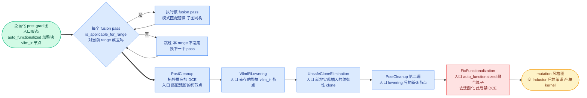

# 第 10 章 图变换流水线:PostGradPassManager 与自定义 fusion

```text
I   背景:   [1 为何compile] → [2 V1引擎] → [3 编译栈全景]
II  前端:   [4 配置体系] → [5 Dynamo一次捕获]
III 中端:   [6 Piecewise切分] → [7 算子边界与vllm_ir]
IV  后端:   [8 VllmBackend] → [9 逐range编译] → [10 Pass与融合]◄==
V   运行时: [11 代码生成] → [12 CUDA Graph] → [13 缓存与AOT]
VI  收官:   [14 设计哲学] → [15 动手实践]
```

## 10.0 本章俯瞰

第 9 章结束时,每个 piece 的图都已经随着一个编译区间被送进了 Inductor。但 Inductor 是通用编译器,它并不知道 vLLM 手里握着一批为推理场景精心调校过的融合算子——归一化接量化、激活接量化、注意力输出接量化……这些"手工作坊级"的组合优化,通用编译器永远不会替你做。那么问题来了:vLLM 到底是怎么在 Inductor 的地盘里夹带私货的?它自己写的这些图变换,又如何保证不与 Inductor 的缓存系统打架?答案预告:vLLM 在 Inductor 留出的一个钩子上挂了一个小管理器,它按一条写死的固定顺序运行:先用模式匹配把相邻算子换成单个手写融合算子(哪些融合启用,由当前编译的 token 数区间决定),再把没被替换掉的中间表示算子落地成具体实现,最后故意"破坏"图的纯函数形态以消灭多余的防御性拷贝;而这条流水线上每个成员的身份,就是它自己源码的哈希值——代码一改,缓存自动失效,不需要任何人记得去升版本号。

这一切的底层动机仍是全书的叙事主线:decode 是 CPU/launch bound → 必须消灭 Python 开销 → 代价是编译 → 编译代价是启动时间 → 所以全部编译前置并缓存。融合在这条链上是"一鱼两吃"的买卖:它既减少 kernel 数量( fewer launch,直接缓解 CPU bound),又砍掉中间张量的显存往返(归一化、量化这类算子是带宽瓶颈,少读写一次就是实打实的时延)。而所有这些模式匹配、区间门控、去泛函化的复杂分析都发生在启动期,serve 期一步都不用再付钱。

## 10.1 最小前置知识

1. **`post_grad_custom_post_pass`(后置自定义 pass 钩子)**:Inductor config 的一个键,允许在 AOTAutograd 之后、Inductor 后端编译之前对 FX 图做任意变换。vLLM 在 VllmBackend 六步流水线的第②步 `configure_post_pass` 里把整个 pass 管理器注入此键(`vllm/compilation/backends.py:1171` 调用,定义于 `:934`),详见第 8 章。
2. **`PassContext`(pass 上下文)与 `compile_range`(编译区间)**:一个线程级全局状态,由 `CompilerManager.compile_context`(`backends.py:150`,`with pass_context(compile_range)` 在 `:154`)在每次 Inductor 编译前设置,携带当前编译的 token 数区间与 `donated_input_ids`,详见第 9 章。
3. **`auto_functionalized`(自动泛函化形态)**:AOTAutograd 把 in-place 算子改写成的纯函数等价形态——返回一个元组,各被改写的参数经 `operator.getitem` 取回。本章所有 fusion 的"替换侧"都写成这个形态,详见第 7 章。
4. **vllm_ir 算子**:`Library("vllm_ir","FRAGMENT")` 注册的透明 IR 算子(如 `rms_norm`),拒绝 ATen 分解、以整块节点存活到 post-grad,是本章 pattern 的锚点,详见第 7 章。
5. **Inductor 代码缓存与 pass uuid**:torch 的 custom graph pass 机制要求每个挂进 config 的 pass 提供 **uuid(身份哈希)**,它会参与 Inductor FxGraphCache 的缓存键——uuid 一变,对应缓存自动失效。

## 10.2 设计思想与设计哲学

### 为什么全部跑在泛函化图上

**`PostGradPassManager`(后置 pass 管理器)** 的 docstring(`vllm/compilation/passes/pass_manager.py:98-103`)最后一句点破设计:"This way, all passes operate on a functionalized graph"——所有 pass 都运行在泛函化图上。这不是巧合而是前提:纯函数图上每个节点是值语义、每个值只有唯一定义,pattern 匹配退化为简单的子图同构,不需要做别名分析;副作用被 `auto_functionalized` 显式化后,"删一个节点"是否安全可以被死代码消除(DCE)机械地判定;替换产物同样写成 `auto_functionalized`,又天然与 Inductor 的后续处理兼容。一句话:泛函化让自定义 pass 变得**可组合、可分析**——任何一个 fusion pass 的加入与移除,都不需要重审其余 pass 的正确性。

### 为什么 FixFunctionalization 故意去泛函化、且必须最后跑

既然泛函化这么好,为什么最后又要亲手拆掉它?因为 `auto_functionalized` 是"买正确性"的形态:每次调用都要为被改写的输入克隆一份新缓冲,以保住原值。而 Inductor 的代码生成消费 **mutation 风格(就地改写风格)** 的图——直接对输入张量就地写,零克隆。于是 **`FixFunctionalizationPass`(修复泛函化 pass)**(`vllm/compilation/passes/utility/fix_functionalization.py:19`)用一条长长的 if/elif 链(`:48-232`)把特定融合算子**去泛函化(defunctionalization)**回 in-place 调用。代价写在 docstring 里(`:22-24`):此 pass 之后**绝不能再跑 DCE**——去泛函化后,in-place 节点的返回值常被丢弃,"看似 dead"的节点其实承载着真正的计算。这就是固定序把它钉在最后一步的原因:它是流水线的终点,也是分析能力的终点。

【哲学时刻】这里是命题 **P2「不变量换性能」** 与 **P5「显式优于隐式」** 的双重落点。去泛函化换掉的是每个融合算子每次调用的一份隐藏缓冲拷贝——decode 每秒几十步、每步几十层,这份"小钱"乘以频率就是可观的显存带宽;而它赖以成立的不变量("FixFunctionalization 之后没有任何 pass 再碰这张图")不是靠全局分析保证的,而是靠固定序结构**显式**写死的。顺带回扣叙事主线的最后半句:正因为编译全部前置、图形态全程受控(详见第 5 章),vLLM 才**敢去泛函化**——这份激进的正确性赌注,只在"图只编一次、形态可枚举"的世界里是安全的。

【哲学时刻·P5】pass 的身份 = pass 的内容。**`InductorPass`(vLLM pass 基类)** 的 `uuid`(`vllm/compilation/passes/inductor_pass.py:72-79`)默认是 `hash_source(self)`(`:81-97`):对 pass 类做 `inspect.getsource` 后取 sha256(`_hash_source_cached`,`:57-63`,经 `functools.cache` 每类型只算一次)。改一行 pass 源码,uuid 即变,Inductor 缓存自动失效——**不需要版本号,不需要 changelog,身份即内容**。这是 P5 在工程上最漂亮的闭环:缓存失效的正确性不再依赖人的纪律,而是依赖物理规律(哈希)。

【哲学时刻·P7】**range gating(区间门控)**:shape 是推理编译的核心矛盾,而最优融合组合恰恰随 shape 演变——同一份子图,小 batch decode 是带宽瓶颈,融合收益巨大;大 batch prefill 是计算瓶颈,拆成两个各自调优的 kernel 反而更快。vLLM 的答案是让每个 pass 自己声明适用区间(详见 10.3.3),同一个 piece 在不同 range 下跑**不同的 pass 集**,产出**不同的编译产物**。P7 在这里不是被"解决"了,而是被明码标价、分区经营了。

## 10.3 具体流程(流水线视角)

### 10.3.1 固定序:PostGradPassManager 的六拍

> **上游给我**:泛函化的 post-grad FX 图(AOTAutograd 产物,经 Inductor `post_grad_custom_post_pass` 钩子送达,注入点 `backends.py:971`,调用链见第 8 章第②步)→ **我做**:按固定序执行配置的 pass 列表(fusion 为主,range 门控)与四个固定 pass → **产出**:mutation 风格、可直接消费的 FX 图,继续流入 Inductor 的 post-grad lowering 与代码生成。

`PostGradPassManager`(`vllm/compilation/passes/pass_manager.py:91`)的 `__call__`(`:109-141`)是一条不可重排的传送带:

```python
# vllm/compilation/passes/pass_manager.py:113-141 (v0.27.1,节选)
        compile_range = get_pass_context().compile_range
        for pass_ in self.passes:                     # ① 配置的 pass(fusion 为主)
            if pass_.is_applicable_for_range(compile_range):
                pass_(graph)                          #    逐个按区间门控
            else:
                logger.debug("Skipping %s with compile range %s", ...)
        self.post_cleanup(graph)     # ② PostCleanup:先清理,免得死 IR op 被 lowering
        self.ir_lowering(graph)      # ③ VllmIRLowering:DCE 能正确处理 mutating ops
        self.clone_elimination(graph)  # ④ UnsafeCloneElimination
        self.post_cleanup(graph)     # ⑤ PostCleanup(lowering 之后再清一次)
        self.fix_functionalization(graph)  # ⑥ 永远最后
        VllmPatternMatcherPass.log_match_summary()   # 全局命中统计
```

其中 ②③④⑤ 的先后是两处源码注释明说的:第一遍 `post_cleanup` 在 IR lowering **之前**,"clean up fusion artifacts and make sure no dead IR ops are lowered"(`:121-122`);而 `ir_lowering` 在 DCE **之前**,"so DCE can clean up lowered ops. DCE handles mutating ops correctly as well"(`:126-127`)。**`PostCleanupPass`(清理 pass)**(`vllm/compilation/passes/utility/post_cleanup.py:8`)做两件事:torch 的 `stable_topological_sort` + `graph.eliminate_dead_code()`——模式匹配不保证产出拓扑有序的图,也不保证不留死节点。③④ 两步即第 7 章详述的 `VllmIRLoweringPass` 与 `UnsafeCloneEliminationPass`(activation donation 的后半程),本章不重复。



`configure`(`pass_manager.py:143-224`)负责"配置的 fusion passes"这一段:按 `pass_config` 各开关与平台门控的导入(`:21-57`,ROCm/aiter、CUDA 类、XPU 各自的 import 块)组装 `self.passes` 列表,并实例化四个固定 pass(`:221-224`)。列表顺序是刻意设计的:更特异的 pattern 先跑——`RocmAiterTritonAddRMSNormPadFusionPass` 排在 AR+RMS 之前,因为两者都消费 `fused_add_rms_norm`(`:169-172`);`AllReduceFusionPass` 排在 `RMSNormReshapeFusionPass` 之前,让 AR+RMS 先匹配、再由 reshape 前移把剩余 RMSNorm 暴露给 RMS+Quant(`:174-183`);`SplitCoalescingPass` 与 `ScatterSplitReplacementPass` 成对地排在 QkNormRopeKvCache 与 RopeKVCache 之前(`SplitCoalescingPass` 还单独排在 QKNormRoPE 之前,`:197-219`),先把 split/getitem 的碎片收拢,RoPE 系 pattern 才匹配得上。此外,用户经 `inductor_compile_config` 传入的 `post_grad_custom_post_pass` 若非管理器本身,会被 `add`(`:226-228`)追加到列表尾部、`FixFunctionalization` 之前(`backends.py:955-969`)——自定义 pass 与内置 pass 走同一条门控循环、同一个固定序。

### 10.3.2 身份即内容:uuid 如何进 Inductor 缓存键

> **上游给我**:pass 实例自身(类源码,来自 `passes/` 下各 .py 文件)→ **我做**:对类源码、pass 配置、固定 pass、编译区间逐层哈希 → **产出**:一个 sha256 字符串,经 `backends.py:971` 挂进 Inductor config,成为 FxGraphCache 缓存键的一部分(缓存全貌见第 13 章)。

单 pass 层面,`InductorPass.uuid` 就是 `sha256(inspect.getsource(pass类))`。融合 pass 还会扩面:`VllmFusionPatternMatcherPass.uuid`(`vllm_inductor_pass.py:319-323`)把**所有已注册 pattern 类**的类型一并哈希——新增一个 pattern 等于改了 pass 的内容,缓存照样失效。管理层再兜一层:`PostGradPassManager.uuid`(`pass_manager.py:230-252`)按 `pass_config.compute_hash()` + 列表中每个 pass 的 uuid + 四个固定 pass 的 uuid(post_cleanup 计两次)+ `str(compile_range)` 组字典后取 sha256。把 compile_range 也纳入的注释写得很直白(`:248-249`):确保 Inductor 为新的动态编译区间重新编译。这正是第 9 章"逐 range 编译"在缓存键上的收口:**range 决定了 pass 集,pass 集与 range 一起决定了身份**。顺带一提,`backends.py:865-867` 的注释解释了为什么管理器不能放进 CompilationConfig 序列化——uuid 必须每次执行而非静态携带,这也算 P1(compile once, run forever)对缓存键"活性"的要求。

### 10.3.3 range 门控:P7 的分区经营

> **上游给我**:当前编译区间 `compile_range`(`PassContext.compile_range`,由 `CompilerManager.compile_context` 设置,`backends.py:150`/`:309`)→ **我做**:`is_applicable_for_range` 判定该 pass 是否参与本次编译 → **产出**:一份"本 range 生效"的 pass 子集,并(经 uuid)间接决定一条独立缓存条目。

**`is_applicable_for_range`(区间适用门控)**(`inductor_pass.py:110-111`)默认恒 True,少数 pass 覆写它做分区经营:

- **`RopeKVCacheFusionPass`**(`fusion/rope_kvcache_fusion.py:461-465`):`return compile_range.end <= self.max_token_num`。源码注释道明理由:该融合对小 batch decode 收益最大;大 batch(prefill)是 compute bound,拆成两个分别调优的 kernel 反而更好。
- `QkNormRopeKvCacheFusionPass`(`qk_norm_rope_kvcache_fusion.py:488`)与 `AllReduceFusionPass`(`allreduce_rms_fusion.py:1134`,ROCm 版 `:1636`)是同一判据的变体,后者还叠加了 disabled 状态检查。
- **`SequenceParallelismPass`**(`sequence_parallelism.py:592-618`)方向相反:`compile_range.start >= self.min_token_num`——序列并行只有 batch 够大、通信开销被摊薄才划算;同时断言整图编译(`use_inductor_graph_partition or not splitting_ops`),因为 allgather/reduce-scatter 融合不能跨 piece 边界。`AsyncTPPass`(`collective_fusion.py:976-983`)是同样的整图断言。
- 一个反向案例是 `AddRMSNormFusionPass`(`add_rms_fusion.py:140`,pattern `:17`):它不看 range,只在 Transformers modeling backend 下启用(`pass_manager.py:146-167`),把 HF 风格的 add+norm 规整成 vllm_ir 节点,好让后续 fusion 有锚可匹配。

回扣第 9 章:同一个 piece 会被多个 range 各编一份,而不同 range 过的门控不同、uuid 不同,**自然落进不同的缓存条目**——门控与缓存在这里互为表里。

### 10.3.4 模式匹配框架:一套让"匹配侧"与"替换侧"同源的表达法

> **上游给我**:**pattern(模式)**与 **replacement(替换体)**两个 tracing 闭包 + 示例输入(来自 `VllmPatternReplacement` 子类,`vllm_inductor_pass.py:197-249`)→ **我做**:在 fake mode 下把两侧各 trace 成 FX 子图,交 torch 的 `register_replacement` 建成匹配规则 → **产出**:注册进 `PatternMatcherPass` 的规则集,`__call__`(`:332-335`)时 `pm_pass.apply(graph)` 一次性完成全图匹配替换,命中数累入全局 **match_table(命中统计表)**。

**`VllmPatternReplacement`(模式替换对)** 是抽象基类:pattern/replacement 是 property 闭包(源码注释解释这是受 bound method tracing 限制的妥协,`:207-209`),`get_inputs` 提供示例张量,一组 `empty_bf16`/`empty_fp32` 等静态 helper(`:230-249`)把设备绑定到当前平台 `device_type`——平台可插拔(P6)在 pattern 层就生效了。**`VllmFusionPatternMatcherPass`(融合模式匹配 pass 基类)**(`:296-335`,继承 **`VllmPatternMatcherPass`(模式匹配 pass 基类)**,`:95-190`)的 `register` 与 `_trace_fn` 是框架核心:

```python
# vllm/compilation/passes/vllm_inductor_pass.py:308-317、:325-330 (v0.27.1,节选)
    @enable_fake_mode
    def register(self, pr: VllmPatternReplacement) -> None:
        pm.register_replacement(
            pr.pattern, pr.replacement,   # 待匹配 / 融合后子图的 tracing 闭包
            pr.get_inputs(),              # 示例输入(fake mode 下不落真实显存)
            self._trace_fn, self.pm_pass,
        )

    @staticmethod
    def _trace_fn(*args, **kwargs) -> fx.GraphModule:
        gm = pm.fwd_only(*args, **kwargs)   # 只 trace 前向,忽略 autograd
        _fx_view_to_reshape(gm)             # view 统一改写成 reshape
        _remove_noop_permutes(gm)           # 删掉恒等 permute
        return gm
```

**`enable_fake_mode`(伪张量模式装饰器)**(`inductor_pass.py:133-146`)用 `tracing(None)` + `unset_fake_temporarily()` + `FakeTensorMode()` 包住注册过程——pattern 与 replacement 是"闭包式"的普通 Python 函数,在**没有一张真实张量**的环境里被 trace 成图,示例输入只是形状载体。`_trace_fn` 的两步净化很关键:真实编译图里 view 已被统一为 reshape、恒等 permute 已被删除,pattern 若保持"教科书形态"就永远匹配不上(框架另备 `fold_consecutive_reshapes`,`:258-282`,折叠 `reshape(a,b).reshape(c,d)` 链)。

匹配的"词汇表"由 **`MatcherCustomOp`(双模式匹配算子)**(`matcher_utils.py:52-83`)提供:构造时 `self.forward = self.forward_custom if enabled else self.forward_native`(`:59`)。`forward_custom` 产**融合后的 custom op 形态**(`_C.*` 算子,经 `auto_functionalized`),`forward_native` 产**未融合的 aten 序列**。同一个 matcher 对象被 pattern 与 replacement 两侧共用——匹配侧(图里实际出现的形态)与替换侧(融合形态)同源,不会两处手写各自漂移;而 `enabled` 由算子自己按平台/配置判断(`MatcherQuantFP8`,`:307`,按 `QuantKey` 查表分发到 `_C.static_scaled_fp8_quant`、`_C.per_token_group_fp8_quant` 等;`MatcherSiluAndMul`,`:458`)。框架的可观测性同样齐备:`match_table` 是类级 `defaultdict(int)`(`vllm_inductor_pass.py:104`),`__call__` 累加(`:335`),`log_match_summary`(`:120-123`)在管理器末尾汇总,`get_match_table`(`:90-92`)供外部快照——第 15 章调试直接复用;`dump_patterns`(`:125-190`)在开启 `debug_dump_path` 时用 torch 的 `PatternPrettyPrinter` 把每个 pattern 反向导出成可读的 `patterns.<PassName>.<i>.py`。每个 pass 经 **`time_and_log`(计时与转储装饰器)**(`:60-72`)包装:before/after 各 dump 一次图(`dump_graph` 用 `lazy_format_graph_code`,让 depyf 接管输出)。

### 10.3.5 fusion 清单速览

下表是 `configure` 可能启用的主要 pass(平台/`pass_config` 开关门控;收益一句话,不展开):

| Pass(锚点) | pattern → 替换 | 收益 |
|---|---|---|
| `AddRMSNormFusionPass`(`add_rms_fusion.py:140`) | HF 风格 add+norm → `vllm_ir.fused_add_rms_norm` | 给后续 fusion 造锚(仅 Transformers backend) |
| `RMSNormReshapeFusionPass`(`add_rms_fusion.py:152`) | 输出 reshape 前移过 RMSNorm | 把剩余 norm 暴露给 RMS+Quant |
| `RMSNormQuantFusionPass`(`rms_quant_fusion.py:613`) | rms/fused_add_rms_norm × static/per-token/group quant → `_C.*` 融合算子 | 归一化+量化单次读写显存(见 10.3.6) |
| `ActivationQuantFusionPass`(`act_quant_fusion.py:283`) | silu_and_mul + FP8/NVFP4/block quant | 激活+量化合一 |
| `AttnQuantFusionPass` / `MLAAttnQuantFusionPass`(`attn_quant_fusion.py:362` / `mla_attn_quant_fusion.py:574`) | 注意力输出 + quant | 量化并入 attention 边界 |
| `QKNormRoPEFusionPass`(`qk_norm_rope_fusion.py:197`) | Q/K RMSNorm+RoPE → `fused_qk_norm_rope` | QK 预处理一次完成 |
| `QkNormRopeKvCacheFusionPass`(`qk_norm_rope_kvcache_fusion.py:415`,门控 `:488`) | QK norm+RoPE+KV 写+quant | attention 前整段合并 |
| `RopeKVCacheFusionPass`(`rope_kvcache_fusion.py:412`,门控 `:461`) | RoPE+KV cache 写入 | decode 专用(小 range) |
| `MLARoPEKVCacheCatFusionPass`(`mla_rope_kvcache_cat_fusion.py:240`) | MLA RoPE+KV cat | MLA 吸收式路径 |
| `AllReduceFusionPass`(`allreduce_rms_fusion.py:992`,门控 `:1134`) | allreduce+norm(+quant) | TP 通信与 norm 重叠 |
| `SequenceParallelismPass`(`sequence_parallelism.py:498`,门控 `:592`) | allgather/reduce-scatter+norm/quant | 大 batch 通信摊薄 |
| `AsyncTPPass`(`collective_fusion.py:900`,断言 `:976`) | GEMM+collective | 异步 TP,要求整图编译 |
| `RocmAiter*` 家族(`rocm_aiter_fusion.py` 等) | 上述各族的 aiter 版 | ROCm 专用 kernel(P6) |

### 10.3.6 精讲:RMSNorm + per-token-group FP8 quant 全链路

以 `RMSNormGroupQuantPattern`(`rms_quant_fusion.py:395`)为例,走完从 pattern 定义到单 kernel 的全程。

**第一步:注册网格。** `RMSNormQuantFusionPass.__init__`(`:619-671`)在 `@enable_fake_mode` 下批量构造 pattern:ε ∈ {1e-5, 1e-6} × group_size ∈ {128, 64} × col_major × e8m0 × tma_aligned 的全组合,加上 static/dynamic-per-token 四族,一次注册数十个 pattern;fused_add 族刻意先注册,"as the latter is a subset of the former"(`:627-628`)——先匹配更特异的,防止子集形态把融合机会吃掉。

**第二步:pattern 闭包。** 待匹配子图就是模型里真实出现的形态:

```python
# vllm/compilation/passes/fusion/rms_quant_fusion.py:423-449 (v0.27.1,节选)
        def pattern(input, weight, scale):
            result_rms = vllm.ir.ops.rms_norm(input, weight, self.epsilon)
            result = torch.empty(result_rms.shape, device=result_rms.device,
                                 dtype=self.quant_matcher.quant_key.dtype)
            fp8_min, fp8_max = get_fp8_min_max()
            _, result, scale = auto_functionalized(
                self.quant_matcher.QUANT_OP,   # _C.per_token_group_fp8_quant
                input=result_rms, output_q=result, output_s=scale,
                group_size=..., eps=1e-10, fp8_min=fp8_min, fp8_max=fp8_max,
            )
            return result, scale
```

```text
【pattern:待匹配的子图】归一化与量化是两个节点(示意图,非真实 dump)
   input ──┐
   weight ─┴─► vllm_ir.rms_norm(x, w, eps)
                    │  result_rms —— bf16 中间张量,整份写显存再读回
                    ▼
              auto_functionalized(_C.per_token_group_fp8_quant)
                    │
                    ▼  result(fp8) + scale(f32)

【replacement:替换后的子图】合并为一个融合节点
   input ──┐
   weight ─┴─► auto_functionalized(_C.rms_norm_per_block_quant)
   scale ──┘         │
                    ▼  result(fp8) + scale(f32) —— 中间值只活在寄存器里
```

**第三步:前置清障与匹配。** 匹配能否发生,先看图够不够"干净":**`NoOpEliminationPass`(无操作消除 pass)**(`utility/noop_elimination.py:18`)的 docstring 明言 "It is required for RMSNorm-quant fusion to work properly"——`apply_fp8_linear` 会多塞一个 2D 情形下冗余的 reshape,不删掉 pattern 就对不上。该 pass 折叠 reshape 链、删恒等 reshape/slice、化简 slice_scatter,维度比较用 `statically_known_true`(`:124`)以支持 SymInt。随后 `patterns.apply(graph)` 逐模式匹配;命中后还要过 **extra_check(额外校验)** `_rms_input_weight_dtype_match`(`rms_quant_fusion.py:47-60`)——匹配是结构性的,dtype 这类"值级"约束靠回调兜底,防止混合精度下误融合。

**第四步:兜底与收尾。** 没被任何 pattern 命中的 `vllm_ir.rms_norm`(比如某层后接的不是量化而是别的算子),由 `VllmIRLoweringPass` 按第 7 章的方式 dispatch 选实现并内联;两遍 `PostCleanup` 清掉替换留下的死节点;最后 `FixFunctionalization` 的 if/elif 链(`fix_functionalization.py:48-232`)覆盖 `rotary_embedding`、`fused_add_rms_norm` 与其 `_static_fp8_quant` 变体、`rms_norm` 族、`silu_and_mul[_quant]`、`fused_qk_norm_rope`、`fused_rope_*` 等,把命中的 `auto_functionalized` 节点经 `defunctionalize`(`:257`)还原成 in-place 调用、把 getitem 用户直接改接到被写参数;未列入链的算子保持 `auto_functionalized` 形态,交给 Inductor 自带的 reinplacing 兜底——源码注释(`:90-94`)也坦承理想方案是上游的 auto_functionalization_v2(P4 的张力)。至此图交给 Inductor:两个(或三个)memory-bound kernel 合一,归一化结果不再落地显存。这类"custom passes"的实测收益,vLLM 博客给出 SiLU+Quant 融合最高 +8%(Llama-3.1-405B FP8,8×MI300;仅作背景叙事,数字以原文为准)。

## 10.4 本章小结

- 固定序六拍:门控 fusion → 清 → lowering → 去 clone → 再清 → 去泛函化
- 全部 pass 跑在泛函化图上:可组合、可分析
- FixFunctionalization 最后跑,其后禁 DCE,in-place 看似 dead
- pass 身份 = 源码 sha256,改代码即自动失效 Inductor 缓存
- range 门控按 shape 区间选 pass 集,同 piece 多份缓存

本机制整体服务于命题 P5(身份与顺序全部显式)、P7(按 range 分区经营 shape 矛盾),并落实 P2(去泛函化的不变量换零拷贝)与 P3(vllm_ir 桥在此被消费成融合)。

下一章(第 11 章)看编译的最后一道工序:如何把切好的 pieces 组装成一份可读、可 pickle 的运行时代码。本章产出的融合后编译产物,将在那里被逐 piece 串成 serve 期直接调用的 execution_fn。

### 本章源码索引

| 锚点 | 内容 |
|---|---|
| `vllm/compilation/passes/pass_manager.py:91`(`PostGradPassManager`) | 固定序管理器,挂在 post_grad 钩子 |
| `vllm/compilation/passes/pass_manager.py:98-103`(docstring) | "all passes operate on a functionalized graph" |
| `vllm/compilation/passes/pass_manager.py:109-141`(`__call__`) | 六拍固定序 + range 门控循环 |
| `vllm/compilation/passes/pass_manager.py:143-224`(`configure`) | 平台门控导入(`:21-57`)与刻意的 pass 顺序(`:169-183`、`:197-219`) |
| `vllm/compilation/passes/pass_manager.py:230-252`(`uuid`) | pass_config hash + 全 pass uuid + str(compile_range) |
| `vllm/compilation/passes/inductor_pass.py:29-54`(`PassContext`) | compile_range + donated_input_ids 的线程级上下文 |
| `vllm/compilation/passes/inductor_pass.py:57-97` | `_hash_source_cached`/`hash_source`:sha256(源码) |
| `vllm/compilation/passes/inductor_pass.py:110-111`(`is_applicable_for_range`) | 默认 True 的区间门控 |
| `vllm/compilation/passes/inductor_pass.py:133-146`(`enable_fake_mode`) | 无真实张量的 pattern trace |
| `vllm/compilation/passes/vllm_inductor_pass.py:60-79`(`time_and_log`) | before/after dump + 耗时日志 |
| `vllm/compilation/passes/vllm_inductor_pass.py:95-190`(`VllmPatternMatcherPass`) | match_table(`:104`)、log_match_summary(`:120`)、dump_patterns(`:125`) |
| `vllm/compilation/passes/vllm_inductor_pass.py:197-249`(`VllmPatternReplacement`) | pattern/replacement 闭包 + 平台绑定 helpers |
| `vllm/compilation/passes/vllm_inductor_pass.py:296-335`(`VllmFusionPatternMatcherPass`) | register(`:308`)、uuid(`:319`)、_trace_fn(`:325`)、__call__(`:332`) |
| `vllm/compilation/passes/fusion/rms_quant_fusion.py:613-671`(`RMSNormQuantFusionPass`) | 注册网格:ε × group × col_major × e8m0 × tma_aligned |
| `vllm/compilation/passes/fusion/rms_quant_fusion.py:395`(`RMSNormGroupQuantPattern`) | 本章主例(pattern `:423-449`) |
| `vllm/compilation/passes/fusion/rms_quant_fusion.py:47-60` | extra_check dtype 匹配 |
| `vllm/compilation/passes/fusion/matcher_utils.py:52-83`(`MatcherCustomOp`) | 双模式:`:59` 按 enabled 选 forward |
| `vllm/compilation/passes/utility/noop_elimination.py:18`(`NoOpEliminationPass`) | RMSNorm-quant fusion 的前置清障;SymInt 支持(`:124`) |
| `vllm/compilation/passes/utility/post_cleanup.py:8`(`PostCleanupPass`) | stable_topological_sort + DCE |
| `vllm/compilation/passes/utility/fix_functionalization.py:19`(`FixFunctionalizationPass`) | 去泛函化;docstring 禁 DCE(`:22-24`);链 `:48-232`;`defunctionalize`(`:257`) |
| `vllm/compilation/passes/fusion/rope_kvcache_fusion.py:461-465` | `compile_range.end <= max_token_num`(decode 专用) |
| `vllm/compilation/passes/fusion/sequence_parallelism.py:592-618` | `start >= min_token_num` + 整图断言 |
| `vllm/compilation/passes/fusion/collective_fusion.py:976-983` | AsyncTPPass 整图断言 |
| `vllm/compilation/passes/fusion/allreduce_rms_fusion.py:1134`、`qk_norm_rope_kvcache_fusion.py:488` | 同型 end 上限门控 |
| `vllm/compilation/passes/fusion/add_rms_fusion.py:140`(`AddRMSNormFusionPass`) | 仅 Transformers backend 的 norm 规整 |
| `vllm/compilation/backends.py:934`(`configure_post_pass`) | 钩子注入(`:939` pre-grad、`:971` pass_manager) |
| `vllm/compilation/backends.py:150-154`(`compile_context`) | pass_context(compile_range) 的设置点 |

### 参考资料

1. [vLLM design doc — torch.compile](https://docs.vllm.ai/en/latest/design/torch_compile/) — 已与 0.27.1 源码核对一致
2. [vLLM design doc — fusions](https://docs.vllm.ai/en/latest/design/fusions/) — 已与 0.27.1 源码核对一致
3. [vLLM design doc — optimization_levels](https://docs.vllm.ai/en/latest/design/optimization_levels/) — 已与 0.27.1 源码核对一致
4. [vLLM design doc — debug_vllm_compile](https://docs.vllm.ai/en/latest/design/debug_vllm_compile/) — 已与 0.27.1 源码核对一致(pattern 转储与 match table 用法)
5. [vLLM blog (2025-08-20) Introduction to torch.compile and How It Works with vLLM](https://vllm.ai/blog/2025-08-20-torch-compile) — 仅作背景叙事(SiLU+Quant up to 8%,Llama-3.1-405B FP8 8×MI300)
6. [RFC issue #6378 A Graph Optimization System in vLLM using torch.compile](https://github.com/vllm-project/vllm/issues/6378) — 仅作背景叙事
7. [PyTorch blog — PyTorch + vLLM](https://pytorch.org/blog/pytorch-vllm-%E2%99%A5%EF%B8%8F/) — 仅作背景叙事(上游化趋势)
8. [vLLM design doc — cuda_graphs](https://docs.vllm.ai/en/stable/design/cuda_graphs/) — 仅作背景叙事
9. [v0.8.1 历史 torch_compile 设计文档](https://docs.vllm.ai/en/v0.8.1/design/v1/torch_compile.html) — 仅作背景叙事(演进对比)
