# 第 11 章 代码生成:execution_fn、liveness 与可序列化产物

```text
I   背景:   [1 为何compile] → [2 V1引擎] → [3 编译栈全景]
II  前端:   [4 配置体系] → [5 Dynamo一次捕获]
III 中端:   [6 Piecewise切分] → [7 算子边界与vllm_ir]
IV  后端:   [8 VllmBackend] → [9 逐range编译] → [10 Pass与融合]
V   运行时: [11 代码生成]◄== → [12 CUDA Graph] → [13 缓存与AOT]
VI  收官:   [14 设计哲学] → [15 动手实践]
```

## 11.0 本章俯瞰

第 9 章结束时,流水线手里有了一张特殊的图:每个可编译片段都已被偷换成编译产物,attention 所在的片段保持原样。但若就此收工,serve 期每一步仍要靠 FX 的模块调用机器去驱动这张图——每调一个子模块都要经过一次完整的模块调用协议,还要按名字做属性查找;而 decode 的步长是微秒量级,这些固定开销恰恰是全书立志消灭的对象。本章讲编译的最后一道工序:不再"解释"这张图,而是把它整体编译成一段纯 Python 源码,交给解释器执行,并把这段源码连同图、常量表、子模块清单一起打包成可落盘的形态。答案预告:这样做一举换来三件事——出问题时工程师能直接读到运行中的真相源、整个产物可以整体序列化以支撑下次启动免编译、拼接层的 Python 开销被压到"一行一次函数调用";此外,源码里显式写下的释放语句还把中间显存的回收时机从运行时的偶然变成了编译期的决定。

## 11.1 最小前置知识

- **split_gm**(拼接图):`split_graph` 产出的 FX GraphModule,子模块命名 `submod_0..N`;可编译片段的属性已被 `PiecewiseCompileInterpreter` 偷换成编译产物,splitting piece 仍是普通 GraphModule(详见第 6 章)。
- **nn.Module.__call__ 开销**(模块调用协议开销):FX GraphModule 执行 `call_module` 节点要过完整的模块调用协议(hook 检查、属性查找等)。每步几十次调用累积成可观的 CPU 时间,是本章要消灭的对象。
- **liveness 分析**(活性分析):编译器经典前置分析,回答"每个值活到哪条语句为止"。本章用它决定在生成源码的哪个位置插入 `del`。
- **exec 与 functools.partial**:Python 内建。`exec` 把源码字符串编译成字节码并放进给定命名空间;`partial` 给函数预绑定关键字参数。两者拼出"源码即函数"的最低成本路径。
- **GraphPickler**(FX 图序列化器):torch 提供的 FX 专用 pickler,能把 GraphModule 连同节点 meta 一起序列化;vLLM 在其上叠加定制 reducer。缓存目录布局详见第 13 章。

## 11.2 设计思想与设计哲学

为什么不直接把 FX GraphModule 交给运行时,而要生成源码?三个理由,逐一展开。

**理由一:可读——源码就是运行时的真相源。** serve 期出问题(某个片段没命中缓存、某个输入形状不对、某个融合没生效)时,工程师拿到的是一段与实际执行完全一致的 Python:每一行对应图中一个节点,读代码就是在读正在执行的程序。dynamo 的产物要靠反编译工具才能看懂,而这里的产物本身就是源码。这是 P5(显式优于隐式)最直接的落点:"图怎么被执行"不再隐含在 FX 机器的语义里,而是被显式写成了文本。

**理由二:可 pickle——产物能整体落盘。** GraphModule 携带代码对象与闭包,普通 pickle 存不下;GraphPickler 补齐了这条路。vLLM 把源码字符串、常量表、子模块名清单与 FX 图一并装进 **VllmSerializableFunction**(可序列化函数),整体序列化成一份 bytes——冷启动编译一次,此后每次启动直接加载(详见第 13 章)。两个动机在同一个形态上合流:字符串既是给人读的,也是给盘存的。

**理由三:零 FX 解释开销——splitting piece 以源码内联。** attention 片段不进 Inductor(详见第 6 章),若按 FX 机器执行,每步都要为它付一次 `call_module` 的完整协议;生成源码时,它被递归展开成普通的函数定义,attention 调用在最终源码里就是一行 Python。已编译片段同样只经一次列表下标取用。拼接层从"解释一张图"降为"顺序执行几十行代码"。

**del 与显存生命周期。** 生成的源码还顺手解决了一个 FX 时代没人负责的问题:中间激活的释放时机。FX 执行会把所有中间值持有到整图执行结束;生成源码后,每个中间值是局部变量,liveness 分析在它最后一次被消费的语句之后立刻写入 `del`——片段之间传递的真实张量,其显存归还时刻在编译期就已写死,不依赖 GC 的性情,也不依赖运行时的缓存策略。

【哲学时刻】**P1/P5:产物形态上的"显式"与"只编一次"。** 回扣全书叙事主线:decode 是 CPU/launch bound → 必须消灭 Python 开销 → 代价是编译 → 编译代价是启动时间 → 所以全部编译前置+缓存。本章是这条链的末端收口:拼接开销在编译期一次性付清(P2:用编译期的一次决定换运行时的零决策),产物是一段源码加一份清单,serve 期只剩顺序执行。而 **StandaloneCompiledArtifacts**(独立编译产物仓,`vllm/compilation/caching.py:37`)把 P1(compile once, run forever)再推进一步:每个片段×每个 shape 的产物 bytes 先算 **sha256** 再入库,哈希已存在就直接复用(`caching.py:59-83`)——同构 transformer 层切出的同构片段字节完全相同,一个 32 层模型的 per-layer 片段只编一次、只存一份(与第 6 章"Llama 全模型只有 3 类唯一子图"的口径一致)。这就是**内容寻址**(content-addressed):产物的身份由内容决定,不由名字或位置决定。P5 的"显式"在此落到产物形态——去重不靠聪明的猜测,靠把内容哈希写成存储键。

## 11.3 具体流程(流水线视角)

本章对应 VllmBackend.\_\_call\_\_ 六步流水线的第⑤⑥步(详见第 8 章):⑤ generate_execution_code + compile_execution_fn(`backends.py:1279-1289`),⑥ 组装 VllmSerializableFunction(必要时包 copy_and_call)(`backends.py:1291-1339`)。

```mermaid
flowchart LR
    classDef vllm fill:#DBEAFE,stroke:#3B82F6,color:#1E3A8A
    classDef torch fill:#FEF3C7,stroke:#F59E0B,color:#78350F
    classDef artifact fill:#D1FAE5,stroke:#10B981,color:#064E3B
    classDef ext fill:#E5E7EB,stroke:#6B7280,color:#374151
    classDef danger fill:#FEE2E2,stroke:#EF4444,color:#7F1D1D

    SG[split_gm 拼接图<br/>FX GraphModule 子模块已偷换]:::torch
    GC[generate_execution_code<br/>liveness 分析加逐节点生成]:::vllm
    CODE[execution_code 源码字符串<br/>连同 submod_names 与 consts]:::artifact
    SC[submod_callables<br/>getattr 先查 __dict__ 再查 _modules]:::vllm
    CE[compile_execution_fn<br/>exec 执行加 partial 绑定]:::vllm
    RC[runtime_callable<br/>partial 包装的 execution_fn]:::artifact
    CAC[make_copy_and_call<br/>符号 shape 输入拷入静态 buffer]:::vllm
    VF[VllmSerializableFunction<br/>optimized_call 就位]:::vllm
    PB[(pickle bytes<br/>GraphPickler 加定制 reducer)]:::artifact
    DS[deserialize_compile_artifacts]:::vllm
    LAZY[常规路径<br/>惰性重跑 VllmBackend]:::vllm
    MEGA[mega-AOT 路径<br/>StandaloneCompiledArtifacts 重建]:::vllm
    SERVE([serve 期 optimized_call 顺序执行]):::vllm

    SG ==> GC ==> CODE ==> CE ==> RC
    SG ==> SC ==> CE
    RC ==> CAC ==> VF
    CODE -- 源码与清单随包 --> VF
    VF ==> PB ==> DS
    DS --> LAZY
    DS --> MEGA
    LAZY -.-> SERVE
    MEGA -.-> SERVE
    CAC -.-> SERVE
```



### 11.3.1 第⑤步前半:generate_execution_code

> **上游给我**:split_gm(拼接图 FX GraphModule,可编译子模块属性已被偷换,来源 `vllm/compilation/backends.py:1279`;偷换发生于 `backends.py:766`,详见第 6 章)→ **我做**:两遍式扫描——先做 liveness 预计算,再沿节点线性序逐节点生成语句 → **产出**:`(execution_code, submod_names, consts)` 三元组(`vllm/compilation/codegen.py:130-161`),去向 `backends.py:1287-1289` 的 compile_execution_fn。

**generate_execution_code_with_name**(`codegen.py:21-127`)是生成器本体。第一遍是 liveness 预计算:对每个产出值的节点,取其全部使用者中位置最靠后者,记入 `del_after[最后消费者位置]`;最后消费者是 output 节点的值不安排删除——return 语句负责收尾(`codegen.py:42-55`)。第二遍沿节点线性序逐节点 emit,每个节点处理完后查自己是否是某些值的最后消费者,是则立刻追加一行删除语句,且名字先排序、`i < len(nodes) - 2` 不成立(已贴近图尾)时不再 emit(`codegen.py:114-117`):

```python
# vllm/compilation/codegen.py:42-55 与 :114-117 (v0.27.1,节选)
    del_after: dict[int, list[str]] = {}  # position -> names to delete
    for node in nodes:
        if node.op == "output":
            continue
        users = list(node.users.keys())
        ...  # 无使用者的节点跳过(略)
        last_user = max(users, key=lambda u: node_order[u])
        if last_user.op == "output":  # return 负责收尾
            continue
        del_after.setdefault(node_order[last_user], []).append(node.name)
    ...
    if i in del_after and i < len(nodes) - 2:  # Emit del after last use
        names = sorted(del_after[i])
        lines.append(f"    del {', '.join(names)}")
```

四类节点各有归宿。**placeholder** 成为函数参数(`codegen.py:61-62`)。**call_module** 走双分支(`codegen.py:64-90`):先 `getattr(split_gm, target)` 取子模块——若取到的仍是普通 `torch.fx.GraphModule`,说明它是没被偷换的 splitting piece,递归调用生成器(`with_submod=False`)把它展开成函数定义 `__vllm_inlined_submods__N`,拼接在整个源码最前面(`codegen.py:78-87、:124`);否则(取到的已是 PiecewiseBackend 或其 cudagraph 包装)emit 位置化引用 `__vllm_submods__[idx]`(`codegen.py:89`)。这个 isinstance 判定本身就是"是否已编译"的探针:interpreter 只偷换编译清单内的子模块,留在 `_modules` 里的必然是 splitting piece。**call_function** 中 `operator.getitem` 被改写为下标表达式 `x[i]`(`codegen.py:93-97`),其余算子按全名调用(`codegen.py:99-104`)。**output** emit return(`codegen.py:106-109`)。

参数对象的改写由 **\_node\_ref**(`codegen.py:207-235`)负责:FX Node 换成变量名;list/tuple/dict 递归展开;int/float/bool/str/bytes/None 直接 repr;**其余非原始常量**(torch.device、DTensor placement 等)外提到 **\_\_vllm\_consts\_\_** 常量表、按下标引用,并按 `id()` 而非 repr 去重(`codegen.py:228-235`)——不赌任何对象的 repr 能被 eval 回来;注释同时要求这些对象必须可 pickle,否则会连累整个产物落盘。最终 `generate_execution_code` 在源码前补上 `import torch\nimport operator\n` 两个 import(`codegen.py:161`)。

### 11.3.2 第⑤步后半:compile_execution_fn

> **上游给我**:execution_code 源码字符串、submod_names、consts(来源 `backends.py:1279`)与 submod_callables(名字→可调用对象的映射,来源 `backends.py:1283-1286`)→ **我做**:exec 执行源码,再以 partial 绑定子模块表 → **产出**:runtime_callable(partial 对象),去向 `backends.py:1287-1289` 之后的第⑥步组装。

submod_callables 的收集只有一行字典推导,却承重:`getattr(self.split_gm, name)` 对每个子模块名取值,而 FX 的属性查找**先查 `__dict__` 再回退 `_modules`**(源码注释 `backends.py:1280-1282`)——于是已编译片段取到的是 interpreter 塞进 `__dict__` 的 PiecewiseBackend,splitting piece 取到的是 `_modules` 里的原图。compile_execution_fn(`codegen.py:164-204`)随后把源码变成函数:

```python
# vllm/compilation/codegen.py:193-204 (v0.27.1,节选,注释从略)
    namespace: dict[str, Any] = {}
    if consts is not None:
        namespace["__vllm_consts__"] = consts
    exec(code, namespace)  # noqa: S102
    fn = namespace["execution_fn"]
    submods_list = [submod_callables.get(name) for name in submod_names]
    return partial(fn, __vllm_submods__=submods_list)
```

三个细节。其一,`__vllm_consts__` 作为命名空间全局注入,顶层函数与所有内联函数共享同一张常量表。其二,`submod_names` 收集**全部** call_module 目标(含 splitting piece)以保下标稳定;生成代码只对已编译片段读 `__vllm_submods__[idx]`,splitting 片段的槽位从不被读——`.get()` 让 mega-AOT 重建路径(那里只有编译产物)以 None 占位,两条路径下标完全一致(注释 `codegen.py:198-202`)。其三,源码同时经 `trace_structured` 以 **vllm_execution_code** 之名登记为 artifact(`codegen.py:185-192`),可在 torch.compile 的调试产物里直接查看到这段代码(详见第 15 章)。

### 11.3.3 第⑥步:VllmSerializableFunction 与 copy_and_call

> **上游给我**:runtime_callable、graph_to_serialize、example_inputs 等(来源 `backends.py:1287-1289`)→ **我做**:按 cudagraph 配置决定是否再包一层输入拷贝,然后装进 VllmSerializableFunction → **产出**:VllmSerializableFunction 实例,去向:作为编译结果返回给 dynamo 装饰的 forward,serve 期每步被调用。

无拷贝分支(`backends.py:1291-1305`)直接把 runtime_callable 当 optimized_call 装箱。当 `backends.py:1291-1294` 的早退条件不成立(`cudagraph_mode != NONE` 且 `cudagraph_copy_inputs` 开启)时,先计算 **sym_tensor_indices**——example fake 输入里 shape 含符号维(FakeTensor)的下标;权重与静态 buffer 形状具体,不会入选(`backends.py:1307-1317`)——再用 **make_copy_and_call**(`backends.py:59-93`)包一层:**copy_and_call**(拷贝后调用)每次调用把运行时张量拷入常驻静态 buffer(`input_buffers[i][:runtime_shape].copy_(runtime_tensor)`,`backends.py:88-89`),再把静态 buffer 换进实参表去调用产物;buffer 首次调用惰性 clone 出最大尺寸(`backends.py:84-86`;主路径直接以 example_inputs 的克隆初始化,`backends.py:1322-1326`)。这一层为第 12 章埋线:CUDA Graph 重放要求输入地址不变,把动态 shape 输入拷进常驻 buffer,图内地址即稳定;前缀切片让同一个 buffer 服务不同的 num_tokens。

### 11.3.4 落盘:定制 reducer 与无情的剥离

> **上游给我**:VllmSerializableFunction 实例(来源 `backends.py:1295-1305 / :1328-1339`)→ **我做**:剥掉一切不可 pickle 或不必要的字段,FX 图与输入分别经 GraphPickler 序列化 → **产出**:一份 pickle bytes,去向:编译缓存目录(详见第 13 章)。

VllmSerializableFunction(`caching.py:166-408`)持有的字段在 `__init__`(`caching.py:178-214`)一目了然:graph_module(FX 图)、example_inputs、prefix、optimized_call(即 runtime_callable 或 copy_and_call)、sym_tensor_indices、execution_code、submod_names、consts、aot_autograd_config,外加从首个 SymInt 输入"偷"出来的 **shape_env**(`caching.py:210-214`)——反序列化后若要重跑编译,符号约束全靠它。运行时入口 `__call__` 只有一行:转发 optimized_call(`caching.py:216-217`)——serve 路径零额外逻辑。

序列化分两层。**serialize_graph_module**(`caching.py:219-242`)在 GraphPickler 的 reducer 上加两条定制:sympy Function 走 torch 的 `_torch_unpickler` 按名字重建(`caching.py:228-233`);FakeTensorMode 直接降为 None(`caching.py:234-235`);配合 **patch_pytree_map_over_slice**(`caching.py:154-163`)临时把 slice 注册为 pytree 节点。**serialize_compile_artifacts**(`caching.py:251-297`)则做剥离:pop 掉 optimized_call、shape_env、vllm_backend、_fake_mode 四个运行时字段(`caching.py:255-259`);剥掉所有节点的 source_fn_stack 与 nn_module_stack meta(`caching.py:260-267`);example_inputs 里的张量全数挪到 meta device(`caching.py:269-283`)——落盘只要 shape 元数据(make_copy_and_call 的 buffer 尺寸),不要真实数据。最后若开启 mega 模式,追加 collect_standalone_compile_artifacts(`backends.py:872`)收集的逐片段产物:每个 PiecewiseBackend 经 **to_bytes**(`piecewise_backend.py:209-243`)以 `bundled_autograd_cache=True` 序列化各 range 的 runnable,再由 StandaloneCompiledArtifacts.insert 按 sha256 入库(`caching.py:59-83`,计数器只在出现新哈希时递增——去重效果可观测)。mega 模式落盘的图特意选"未被偷换"的原图(`backends.py:1275-1277`),因为重建时产物由 artifact store 提供。

### 11.3.5 反序列化:两条重建路

> **上游给我**:pickle bytes(来源缓存目录)→ **我做**:deserialize_compile_artifacts 判路——常规路径惰性重跑编译,mega 路径零编译重建 → **产出**:可立即服务的 VllmSerializableFunction,去向:替代本次启动的整条编译流水线。

**常规路径**(`caching.py:344-373`)把 graph_module 反序列化并 recompile,optimized_call 是一个惰性闭包:首次被调用时才在 `tracing(TracingContext(fake_mode))` 里新建 VllmBackend 重跑整条六步流水线(`caching.py:360-369`)——惰性是必须的,缓存目录的计算依赖 traced_files,而它要等源码校验完成后才就绪(注释 `caching.py:349-353`);`finalize_loading`(`caching.py:375-401`)则给温启动提供了急切装载的入口。**mega-AOT 路径**(`caching.py:319-342` → **reconstruct_serializable_fn_from_mega_artifact**,`caching.py:411-562`)不跑任何编译:load_all 以 ThreadPoolExecutor 并行反序列化全部产物(`caching.py:119-140`);逐子模块以 `graph=None, compiled_runnables=...` 构造 PiecewiseBackend(`caching.py:500-509`),复用 wrap_with_cudagraph_if_needed 包上捕获包装(`caching.py:513-519`);再对落盘的 execution_code **重跑 compile_execution_fn** 得到 runtime_callable(`caching.py:528-534`),必要时重挂 make_copy_and_call(`caching.py:543-553`)。docstring 明说这是 PiecewiseCompileInterpreter 的镜像流程(`caching.py:429-437`)——同一段组装逻辑,一处从 FX 图出发、一处从缓存产物出发。mega 模式要求 standalone 编译开启(`backends.py:97-99`)。

### 11.3.6 手推主例:2 层 5-piece 模型的 execution_fn

取第 6 章 6.3.5 的 2 层 5-piece 模型(残差传递从简),按 11.3.1 的规则手推生成的完整源码:

```python
# 【示意图 · 依 codegen 规则手推,非真实 dump】2 层 5-piece 的 execution_fn
import torch
import operator

def __vllm_inlined_submods__1(q_rope, k_rope, v):            # splitting piece 递归内联
    attn_output = torch.empty_like(q_rope)                   # 空分配节点
    torch.ops.vllm.unified_attention_with_output(            # attention 就是一行 Python
        attn_output, q_rope, k_rope, v, "layer.0", 0.05)
    return attn_output

def __vllm_inlined_submods__3(q1_rope, k1_rope, v1):         # 第二层,同构但独立内联
    ...                                                      # 与 __vllm_inlined_submods__1 相同

def execution_fn(hidden_states, positions, *, __vllm_submods__):   # 参数表 = placeholder
    submod_0_out = __vllm_submods__[0](hidden_states, positions)   # 已编译片段,位置化引用
    q_rope = submod_0_out[0]                                 # operator.getitem → 下标
    k_rope = submod_0_out[1]
    v = submod_0_out[2]
    del submod_0_out                                         # 元组的最后消费者是第三个下标行
    attn_output = __vllm_inlined_submods__1(q_rope, k_rope, v)     # 直接函数调用,零 FX 机器
    del k_rope, q_rope, v                                    # sorted 排序后的 del
    submod_2_out = __vllm_submods__[2](attn_output)
    del attn_output
    q1_rope = submod_2_out[0]
    k1_rope = submod_2_out[1]
    v1 = submod_2_out[2]
    del submod_2_out
    attn_output_1 = __vllm_inlined_submods__3(q1_rope, k1_rope, v1)
    del k1_rope, q1_rope, v1
    hidden_states_out = __vllm_submods__[4](attn_output_1)   # 此处不 del:已是倒数第二节点
    return hidden_states_out                                 # 消费者是 output,return 收尾
```

逐段读。**参数表**就是顶层图的 placeholder 序列,`__vllm_submods__` 是 keyword-only 参数,由 partial 绑定。**第一行调用**是位置化的已编译片段:没有属性查找,没有模块调用协议,只有一次下标取用加一次调用。**内联 attention 行**是 splitting piece 被递归展开的结果——两层各自内联成独立函数(下标 1 与 3 稳定),函数体内 attention 调用是一行普通的算子调用。**del 行**出现的位置各有序列:`del submod_0_out` 紧跟第三个下标行(元组的最后消费者);`del k_rope, q_rope, v` 跟在 attention 调用后,且名字按字典序排列(k 在 q 前)——这正是 `sorted()` 的痕迹;而 `attn_output_1` 之后**没有** del,因为消费它的调用已是倒数第二个节点,`i < len(nodes) - 2` 不成立。**return** 收走最终值,被 output 消费的值一律不安排删除。

```text
【示意图】顶层拼接图的 liveness 落点(2 层 5-piece,位置=节点序号)
位置 语句                                    本行语句后的 del
--------------------------------------------------------------
0-1  hidden_states, positions  ← placeholder,进参数表
2    submod_0_out = __vllm_submods__[0](...)
3-5  q_rope/k_rope/v = submod_0_out[0..2]   5 后 del submod_0_out
6    attn_output = __vllm_inlined_submods__1(...)  del k_rope,q_rope,v
7    submod_2_out = __vllm_submods__[2](...)       del attn_output
11   attn_output_1 = __vllm_inlined_submods__3(...)  del k1_rope,q1_rope,v1
12   hidden_states_out = __vllm_submods__[4](...)  不 del:已近图尾
13   return hidden_states_out                      不 del:output 消费
```

对照真实规则再核一遍:每段激活在最后一次消费后立即归还显存;同构的第二层没有任何特殊待遇——这正是产物可按片段内容寻址去重的前提:源码结构相同、产物 bytes 相同、sha256 相同,一份存储服务所有层。

## 11.4 本章小结

- 三理由:可读、可 pickle、零 FX 解释开销。(P5、P1)
- liveness 把中间显存释放写进源码语义。(P2)
- splitting piece 递归内联,attention 就是一行。(P3、P2)
- 非原始常量外提 \_\_vllm\_consts\_\_,按 id() 去重。(P5)
- 产物按 sha256 内容寻址,同构层只存一份。(P1)
- 反序列化两路:惰性重跑与 mega-AOT 零编译。(P1)

本机制集中服务于 P1(compile once, run forever)与 P5(显式优于隐式):拼接逻辑在编译期一次性变成可读、可 pickle、可去重的源码产物,serve 期只剩顺序执行与查表。下一章(第 12 章)进入运行时:这些产物如何被 CUDA Graph 捕获、重放,并按 batch 桶分派。本章埋下的 copy_and_call 常驻 buffer 与 sym_tensor_indices,正是捕获与重放得以成立的第一块地基。

### 本章源码索引

| 锚点 | 内容 |
|---|---|
| `vllm/compilation/codegen.py:21-127`(`generate_execution_code_with_name`) | 生成器本体:liveness + 逐节点 emit + 递归内联 |
| `vllm/compilation/codegen.py:42-55` | liveness 预计算:del_after 按最后消费者位置记账 |
| `vllm/compilation/codegen.py:64-90`(`call_module` 分支) | 普通 GraphModule → 递归内联 :78-87;已编译 → `__vllm_submods__[idx]` :89 |
| `vllm/compilation/codegen.py:93-97` | operator.getitem → 下标表达式 |
| `vllm/compilation/codegen.py:114-117` | del 的 emit:sorted + 图尾保护 `i < len(nodes)-2` |
| `vllm/compilation/codegen.py:130-161`(`generate_execution_code`) | 入口:前置 import torch/operator,返回三元组 |
| `vllm/compilation/codegen.py:164-204`(`compile_execution_fn`) | exec :196;partial 绑定 :203-204;.get None 占位 :198-202 |
| `vllm/compilation/codegen.py:185-192` | vllm_execution_code 登记为 artifact(tlparse 可见) |
| `vllm/compilation/codegen.py:207-235`(`_node_ref`) | 非原始常量外提 \_\_vllm\_consts\_\_,按 id() 去重 :228-235 |
| `vllm/compilation/backends.py:59-93`(`make_copy_and_call`) | copy_and_call:静态 buffer 前缀切片拷贝 :88-89,惰性 clone :84-86 |
| `vllm/compilation/backends.py:97-99` | mega-AOT 依赖 standalone 编译的断言 |
| `vllm/compilation/backends.py:872`(`collect_standalone_compile_artifacts`) | 逐 PiecewiseBackend 收集 to_bytes 产物 |
| `vllm/compilation/backends.py:1275-1277` | graph_to_serialize:mega 模式选未偷换的原图 |
| `vllm/compilation/backends.py:1279-1289` | 六步第⑤步:generate_execution_code + compile_execution_fn |
| `vllm/compilation/backends.py:1280-1286` | getattr 先查 \_\_dict\_\_ 再查 \_modules 的 submod_callables |
| `vllm/compilation/backends.py:1291-1305` | 第⑥步无拷贝分支 |
| `vllm/compilation/backends.py:1307-1317` | sym_tensor_indices:含符号维 FakeTensor 的下标 |
| `vllm/compilation/backends.py:1322-1339` | 第⑥步 copy_and_call 分支与最终装箱 |
| `vllm/compilation/caching.py:37-151`(`StandaloneCompiledArtifacts`) | 两级间接 + sha256 内容寻址;insert :59-83;load_all :119-140 |
| `vllm/compilation/caching.py:154-163`(`patch_pytree_map_over_slice`) | 序列化期间注册 slice 为 pytree 节点 |
| `vllm/compilation/caching.py:166-408`(`VllmSerializableFunction`) | 字段 :178-214;偷 shape_env :210-214;\_\_call\_\_ :216-217 |
| `vllm/compilation/caching.py:219-242`(`serialize_graph_module`) | GraphPickler 定制 reducer:sympy \_torch_unpickler、FakeTensorMode→None |
| `vllm/compilation/caching.py:251-297`(`serialize_compile_artifacts`) | 剥运行时字段 :255-259;剥 meta :260-267;张量挪 meta device :269-283 |
| `vllm/compilation/caching.py:299-373`(`deserialize_compile_artifacts`) | 常规路径惰性闭包 :360-369;traced_files 就绪注释 :349-353 |
| `vllm/compilation/caching.py:375-401`(`finalize_loading`) | 温启动急切装载 |
| `vllm/compilation/caching.py:411-562`(`reconstruct_serializable_fn_from_mega_artifact`) | PiecewiseBackend(graph=None) :500-509;重 exec :528-534;重挂 copy :543-553 |
| `vllm/compilation/piecewise_backend.py:209-243`(`to_bytes`) | bundled_autograd_cache 下逐 range 序列化 runnable |

### 参考资料

1. [vLLM design doc — torch.compile](https://docs.vllm.ai/en/latest/design/torch_compile/) — 仅作背景叙事(piecewise 拼接与缓存动机的官方口径)
2. [vLLM blog — Introduction to torch.compile and How It Works with vLLM (2025-08-20)](https://vllm.ai/blog/2025-08-20-torch-compile) — 仅作背景叙事
3. [vLLM design doc — Optimization Levels](https://docs.vllm.ai/en/latest/design/optimization_levels/) — 仅作背景叙事(cudagraph 与编译组合,详见第 4 章)
4. [vLLM design doc — CUDA Graphs](https://docs.vllm.ai/en/stable/design/cuda_graphs/) — 仅作背景叙事(copy_and_call 为捕获铺路,详见第 12 章)
5. [vLLM design doc — Debug vLLM Compile](https://docs.vllm.ai/en/latest/design/debug_vllm_compile/) — 仅作背景叙事(vllm_execution_code artifact 的查看入口,详见第 15 章)
6. [RFC issue #6378 — A Graph Optimization System in vLLM using torch.compile](https://github.com/vllm-project/vllm/issues/6378) — 仅作背景叙事
7. [PyTorch blog — PyTorch + vLLM](https://pytorch.org/blog/pytorch-vllm-%E2%99%A5%EF%B8%8F/) — 仅作背景叙事
8. [vLLM v0.8.1 设计文档 — torch_compile(历史版)](https://docs.vllm.ai/en/v0.8.1/design/v1/torch_compile.html) — 仅作背景叙事(演进对比:早期尚无源码级拼接产物)
