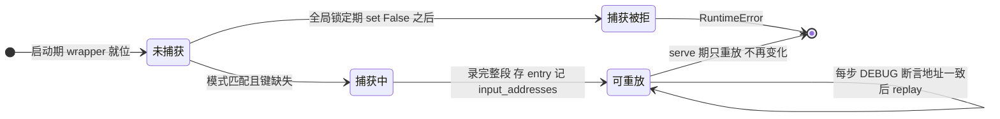
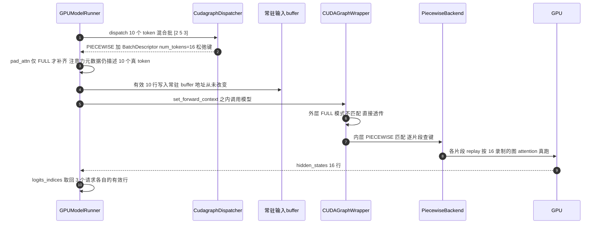

# 第 12 章 CUDA Graph:capture/replay、FULL vs PIECEWISE 与运行时分派

```text
I   背景:   [1 为何compile] → [2 V1引擎] → [3 编译栈全景]
II  前端:   [4 配置体系] → [5 Dynamo一次捕获]
III 中端:   [6 Piecewise切分] → [7 算子边界与vllm_ir]
IV  后端:   [8 VllmBackend] → [9 逐range编译] → [10 Pass与融合]
V   运行时: [11 代码生成] → [12 CUDA Graph]◄== → [13 缓存与AOT]
VI  收官:   [14 设计哲学] → [15 动手实践]
```

## 12.0 本章俯瞰

到上一章为止,serve 期每步执行的已经是一段几十行的纯 Python 源码,按位置取用预编译产物——看起来开销已被压到地板。但 decode 的步长只有几百微秒,这段 Python 里仍有几十次函数调用、每次 Triton kernel 一次 launch 提交,CPU 侧的解释与驱动侧的提交成本仍然与程序长度成正比。本章要回答的问题是:能不能让"执行一段固定程序"的成本与程序长度**无关**?答案预告:在启动期,把"每个批尺寸档位上整段 forward 会发生的全部 GPU 工作"各录制成一卷回放带;serve 期每一步只做三件事——查一次表选带、把本步数据写进录制时就钉死的显存地址、播放一次。录制有一条铁律:图内读写过的每块显存地址,重放时必须原样有效。第 2 章的常驻 buffer、第 7 章 attention 由调用方分配输出、第 11 章的 copy_and_call,三笔账在这里一并兑现。本章讲清三件事:录制与重放的地址纪律和内存账本;整图与分片两种录制粒度如何在一个进程里嵌套共存;每步批到来时,分派器如何用一张桶表在毫秒不花的时间里选出本步该走哪条路。

先把本章放进整条编译管线:

```text
torch.compile(model)
│
├─ dynamo 一次捕获 ─▶ 整图 FX
├─ 切分 ─▶ submod_0..N
├─ 全量预编译(片段 × range;捕获桶即「尺寸点」)▶ 静态产物
├─ 造外壳
│
└─ serve 期 ◄== 本章
     ├─ warmup:eager 空跑几轮,惰性初始化落定
     ├─ capture:按捕获档位逐尺寸录下静态图
     ├─ replay:查桶 → 一次 replay 提交整段
     └─ 常驻 buffer / copy_and_call,保证地址纪律
```

## 12.1 最小前置知识

- **CUDA Graph 的 capture 与 replay(捕获/重放)**:把一段 GPU 工作流录制成图,replay 时一次调用把整段提交给驱动,省掉逐 kernel 的 launch 开销(第 1、2 章)。本章反复用它的隐含契约:图是一串**地址**的序列,不是一串值的序列。
- **graph pool(图内存池)**:torch 为 CUDA Graph 分配中间显存的专用池;同一池内的多张图可以复用彼此的地址段。vLLM 用平台级全局单例池让所有图共享一本内存账(12.3.1)。
- **cudagraph_mode(图模式)与组合态拆解**:配置态有 NONE/PIECEWISE/FULL/FULL_DECODE_ONLY/FULL_AND_PIECEWISE 五种,后两种是"组合态",运行时经 `decode_mode()`/`mixed_mode()` 拆成单态使用——配置写组合、运行时见单态(详见第 4 章)。
- **cudagraph_capture_sizes(捕获尺寸表)**:预录制图的一把固定 token 数档位,如 [1,2,4]+8..256(步长 8)+..max(步长 16);与 compile_sizes 的包含关系详见第 4、9 章。
- **copy_and_call(拷贝后调用)**:把符号 shape 的运行时输入拷进地址固定的常驻 buffer 再调用编译产物(第 11 章);`cudagraph_copy_inputs` 默认关闭,默认路径的地址稳定由 model runner 的常驻 buffer 保证(第 2 章)。

## 12.2 设计思想与设计哲学

**决定一:分派是图外的单一事实源,wrapper 只管盲信。** "哪些图合法、本步用哪张图"这个决策,被完整地关在一个独立对象 **`CudagraphDispatcher`(图分派器,`vllm/v1/cudagraph_dispatcher.py:15`)** 里;它的 docstring 明说 dispatcher 里的键集合是"运行时可分派图的唯一事实源",wrapper 从 ForwardContext 拿到模式与键后"blindly trust"地执行 capture 或 replay。决策与执行彻底分离,serve 路径上没有任何一处需要重新推理"我现在能不能用图"。这是 P5(显式优于隐式)在运行时的落点,也是 P2 的服务面:复杂性被挡在图外。

**决定二:两种录制粒度是互补的保单,靠"模式精确匹配、不匹配透传"嵌套共存。** PIECEWISE 保混合批(attention 留在图外,经 ForwardContext 读当步元数据,第 2、6 章);FULL 保纯 decode 批(整段一张图,launch 开销最小,但要求 attention 后端支持整图捕获)。v1 默认的 FULL_AND_PIECEWISE 同时持有两套图:FULL wrapper 包在模型最外层,PIECEWISE wrapper 包在每个片段外——两层 wrapper 各绑定一个运行时单态,运行时按 ForwardContext 里的 `cudagraph_runtime_mode` 精确比对,匹配者干活,不匹配者原样透传。第 4 章"组合态拆成两个运行时单态"的伏笔在此收口。尤其值得品味的是:FULL 模式**刻意在 FX 图之外**捕获、同时保留 piecewise 结构(`vllm/config/compilation.py:1147-1155` 的 NOTE,PR #20059)——这样当运行时批超出捕获尺寸上限、整图用不上时,分片图那条路仍然完整存在,继续压低 CPU 开销。

**决定三:地址纪律是全书的总账,在本章结账。** capture 要求"输入必须在捕获时的地址、输出地址也被钉住、图内零分配"。零分配不是本章新发明:第 2 章的常驻 buffer 与持久 batch 保证了输入地址永不变;第 7 章 `unified_attention_with_output` 由调用方分配输出,使图内最大的动态分配消失;第 11 章 execution_fn 的 liveness 分析把中间显存的释放写成源码语义。CUDA Graph 是这三项投资的验收者——任何一处违反,录下的图在重放时读到的是野地址。

【哲学时刻·P2】**不变量换性能,在 L5 层兑现为四条换四项。** 四条 L5 层的运行时不变量:输入地址不变(第 2 章)、图内零分配(第 7、11 章)、capture 结束即全局锁定(`gpu_model_runner.py:6900`,不变量 c)、启动期把所有档位的图全部录完(不变量 b 的捕获面)。换来四项性能:每步零拷贝编排、每 piece 零 launch 提交(一次 replay 顶掉几十次)、零运行时决策(查一张桶表)、零意外捕获(锁定后任何捕获尝试直接 RuntimeError,`vllm/compilation/monitor.py:90-99`)。回扣全书主线:decode 是 CPU/launch bound → 消灭 Python 开销 → 代价是编译与录制 → 这笔代价在启动期一次付清 → serve 期只剩查表与播放——P1(compile once, run forever)在 GPU 侧的镜像,可以叫"capture once, replay forever"。

## 12.3 具体流程(流水线视角)

本章处在五层模型的 **L5 运行时执行层**:上游给我 execution_fn 与逐 piece 编译产物(第 11 章)→ 我在启动期把它们连同 attention 与全部 launch 录成静态图集 → 产出 serve 期每步"查表 + 拷贝 + replay"的执行形态。

### 12.3.1 capture 的地址契约与共享内存池

capture 期间,PyTorch 把流上发生的 kernel 调用连同其指针参数录进 `torch.cuda.CUDAGraph`;replay 是把这串调用原样重放——**输入必须还在捕获时的地址(数据可以变,地址不能变),输出地址也被钉住,图内发生的任何分配都从图内存池支出、由图持有**。因此图内零分配是硬要求:图内若 `torch.empty` 一个新张量,池会为它保留一段显存且每次 replay 复用,轻则浪费、重则地址漂移直接算错。

内存账本的关键设计是共享:**`CUDAGraphWrapper`(CUDA Graph 包装器,`vllm/compilation/cuda_graph.py:145`)** 在构造时取 `current_platform.get_global_graph_pool()`(平台接口惰性创建的单例)——全部 wrapper 实例(整图、每个片段、推测解码的 drafter)共用同一个池。同池的图之间可以交错复用地址段:大尺寸图先录、小尺寸图复用其释放的段,这正是捕获按尺寸降序进行的动机。capture 前还有一笔登记:`set_graph_pool_id(self.graph_pool)`(`cuda_graph.py:304`)把当前池告诉 pynccl allocator,捕获期内遇到 NCCL symmetric memory 分配时可临时走出该池、完毕再回来,保证录制合法。

输出的账单独记:`weak_ref_tensors`(弱引用张量)把输出张量的强引用降级,让池中的输出段在消费者放手后立即可被复用。它**只对一段 forward 的最后一张图安全**——中间图的输出还要被后续图消费,地址必须钉住;末图的输出此后无人再以图的身份引用(`cuda_graph.py:325-332` 注释)。这就是第 6 章埋下的 **`weak_ref_output`(弱引用输出)**=is_last_graph 选项的含义。

### 12.3.2 运行时包装:三分诊与一次重放

> **上游给我**:runnable(被包装的可调用对象——整图路径是模型本身,分片路径是 PiecewiseBackend)、vllm_config、runtime_mode、cudagraph_options(来源:模型加载期的 `load_model` 与编译期的 `wrap_with_cudagraph_if_needed`)→ **我做**:每次调用按运行时上下文选透传/capture/replay → **产出**:serve 期 callable;捕获结果存进 `concrete_cudagraph_entries` 字典。

图的键是 **`BatchDescriptor`(批描述符)**(`vllm/forward_context.py:29-58`),一个冻结 dataclass,字段刻意最少:`num_tokens`(补齐后的 token 数)、`num_reqs`(可为 None,分片图不关心请求数)、`uniform`(是否等长批)、`has_lora` 与 `num_active_loras`(LoRA 状态)。每个键对应一个 **`CUDAGraphEntry`**(图条目,`cuda_graph.py:127-135`):cudagraph 本体、输出(弱引用)、以及 `input_addresses`——捕获时逐实参记录的 `data_ptr` 列表,专为调试期的地址断言服务。**`CUDAGraphOptions`**(`:138-142`)三个开关:`debug_log_enable`(是否打捕获日志)、`gc_disable`(捕获期屏蔽 gc 与 empty_cache)、`weak_ref_output`。

wrapper 的 docstring 有一段值得整段读懂的声明(`cuda_graph.py:161-167`):**它不持有静态输入 buffer,也不负责把运行时输入拷进去**——那是 model runner(常驻 buffer)或 make_copy_and_call(可选开关)的职责,因为 wrapper 不对输入的动态 shape 做任何假设,以此换取与编译逻辑的正交。类上还有一个 `__getattr__` 把属性访问透传给 runnable(`:211`),让包装后的模型在外界看来仍是原模型。

`__call__` 的分支结构是嵌套共存的全部机制,值得逐行读:

```python
# vllm/compilation/cuda_graph.py:233-256 (v0.27.1,节选,注释为中译)
    def __call__(self, *args, **kwargs):
        if not is_forward_context_available():
            # 无 ForwardContext = 不在正常推理路径(如视觉编码器),直跑底层函数
            return self.runnable(*args, **kwargs)
        forward_context = get_forward_context()
        batch_descriptor = forward_context.batch_descriptor
        cudagraph_runtime_mode = forward_context.cudagraph_runtime_mode
        if (
            cudagraph_runtime_mode == CUDAGraphMode.NONE
            or cudagraph_runtime_mode != self.runtime_mode
        ):
            # NONE=profile/warmup/本步不用图;模式不匹配即透传,嵌套仍正确分派
            return self.runnable(*args, **kwargs)
        assert batch_descriptor is not None  # :257 起按键查表 缺则捕获有则重放
```

`ForwardContext`(`vllm/forward_context.py:131`)里的 **`cudagraph_runtime_mode`(运行时图模式)** 与 `batch_descriptor` 两字段由 `execute_model` 在 `set_forward_context` 里注入(第 2 章)。四个分支:无上下文 → 透传(encoder 旁路);模式为 NONE → 透传(profile/warmup/本步不用图);模式与本 wrapper 绑定的单态不同 → 透传(嵌套时让正确的 wrapper 接手);匹配 → 按键查表,键不存在则捕获、存在则重放。

捕获分支是四分诊里唯一"干活"的一支,节奏是"先清场、再录制、录制完记账"。进门先过全局闸门 validate_cudagraph_capturing_enabled——锁定期内直接 RuntimeError,不变量 c 的哨兵;然后记录输入地址、构造空图,清场做三件事:屏蔽 gc 与 empty_cache(gc_disable 时把 `gc.collect` 与 `empty_cache` patch 成 no-op——分片模式下一次 forward 要捕获几十张小图,逐图跑 gc 会让捕获慢到不可接受,因此只让首图跑)、登记 graph pool 给 pynccl 协作、同步 offloader 的权重搬运流(录制必须从干净的水位开始)。清场完毕进入录制窗口:在 `torch.cuda.graph` 上下文里把 runnable 原样执行一遍,连 offloader 的图内收尾一起录;若开了 weak_ref_output,出口处把输出张量降级为弱引用——这一步只对一段 forward 的最后一张图安全,理由 12.3.1 已述。

```text
【示意】capture 分支的节奏(伪代码)
validate_cudagraph_capturing_enabled()            # 闸门:锁定期直接 RuntimeError
记录输入地址,构造空图                             # 记入 entry.input_addresses
with ExitStack[gc 屏蔽, graph pool 登记, offloader 同步]:
    with torch.cuda.graph(cudagraph, pool, stream):
        output = runnable(*args)                   # 整段录进图
        offloader.join_after_forward()             # 搬运流收尾一并录
        if weak_ref_output: output = weak_ref_tensors(output)
```

重放分支(`:346-361`)是全书最短的执行路径之一:`VLLM_LOGGING_LEVEL=DEBUG` 时先断言本次实参的 `data_ptr` 列表与捕获时逐位相同,然后 `entry.cudagraph.replay()` 一次提交整段,返回缓存的弱引用输出。类的收尾件:`_all_instances` 弱引用集合加 `clear_all_graphs`(`:170-176`),供 ROCm 上引擎关闭时提前释放图,避免延迟析构报 HSA fault。

一张图从生到死的状态如下:



### 12.3.3 两层 wrapper 的嵌套:FULL 在外,PIECEWISE 在内

两层的安装时机一早一晚。外层在模型加载时装:`load_model` 末尾,`cudagraph_mode.has_full_cudagraphs()` 且未开 ubatching 时,`self.model = CUDAGraphWrapper(self.model, self.vllm_config, runtime_mode=CUDAGraphMode.FULL)`(`gpu_model_runner.py:5463-5469`);更早的分支里,启用了 breakable cudagraph 则改装 `BreakableCUDAGraphWrapper`(12.3.7),开 ubatching 则装 UBatchWrapper。内层在编译期装:第 6 章的 `wrap_with_cudagraph_if_needed` 给每个可编译片段包上 `runtime_mode=PIECEWISE` 的同款 wrapper,选项为 `debug_log_enable=首图、gc_disable=非首图、weak_ref_output=末图`——可编译片段从此同时是"编译单元"与"捕获单元"。

```text
【示意图】两层 CUDAGraphWrapper 的嵌套包裹 (v0.27.1)
_model_forward 调用的 self.model
└─ CUDAGraphWrapper  runtime_mode=FULL     ← load_model :5467 安装
   └─ execution_fn   第 11 章生成的拼接源码
      ├─ submod_0 = CUDAGraphWrapper PIECEWISE   ← backends.py:633 包装
      │    └─ PiecewiseBackend → 全静态产物 Range(16,16)
      ├─ attention 内联函数  eager 经 ForwardContext 取当步元数据
      ├─ submod_2 = CUDAGraphWrapper PIECEWISE
      └─ submod_4 = CUDAGraphWrapper PIECEWISE   weak_ref_output
运行时按 cudagraph_runtime_mode 三选一:
  FULL      外层 replay 一整张图 内层全体透传 Python 不再执行
  PIECEWISE 外层透传 内层各 replay 各的图 attention 每次 eager
  NONE      两层全透传 片段产物按 range 查表直接调用
```

嵌套的工作方式读一遍就懂:FULL 捕获时,上下文里的模式是 FULL,外层匹配、内层全部透传,于是整段 forward(连同每个片段的产物 kernel 与 eager attention)被录进**一张**图;FULL 重放时,内层 wrapper 的 Python 一行都不会执行。PIECEWISE 捕获时模式是 PIECEWISE,外层透传、内层逐片段各录各的,attention 夹在片段图之间每次真跑。两种图集并存于同一进程,由每步的分派结果选用。

### 12.3.4 捕获时序:启动期一次录完,录完即锁死

> **上游给我**:解析定稿的 cudagraph_mode 与捕获尺寸表(第 4 章降级链)→ **我做**:按注意力后端支持度协调出最终模式,预生成全部合法键,再按清单逐档位录制 → **产出**:两张键集合(dispatch 的分派依据)与一份捕获清单,清单耗尽即全局锁定。

时序叙事分三幕:warmup 为什么必要、capture 窗口里发生什么、录完如何收死。时序上先回扣第 3 章的启动时间轴——初始化注意力后端时按其支持度协调出最终模式并预生成全部合法键,编译全部完成后才轮到 `capture_model`(`gpu_model_runner.py:6814`)。

**第一幕:warmup 为什么必要。** 每个描述符先做若干次无图 dummy run(次数由 `cudagraph_num_of_warmups` 决定,非 eager 模式强制恰为一次):上下文模式给 NONE,全部 wrapper 透传,模型以普通方式执行。这一步不是浪费:各后端要在这几跑里完成惰性初始化、工作区定型、autotune 落定——这些一次性副作用若发生在录制窗口内,会被当成 kernel 序列录进图,重放时重复执行甚至地址漂移。warmup 后立即 synchronize,把可能用到的辅助流收齐,录制才能从干净的水位开始。

**第二幕:capture 窗口。** 收齐后以目标模式执行**一次** capturing run,该捕获的 wrapper 在这一拍录图(12.3.2 的第四分支)。整个窗口外面包着 `_freeze_gc` 上下文:`gc.collect` 一次后 `gc.freeze` 冻结既有对象——捕获期 gc 的移动语义会撕裂录制,除非 `VLLM_ENABLE_CUDAGRAPH_GC` 显式打开。录什么、按什么顺序录,由 dispatcher 的 `get_capture_descs()` 清单决定:**PIECEWISE 先、FULL 后;各模式内按 (num_tokens, num_active_loras) 降序**——大图先录,小图复用其释放的池内地址段,这正是 12.3.1 共享 graph pool 的动机所在。逐描述符之间再同步一次,tqdm 进度条上的 "Capturing CUDA graphs (decode, FULL)" 即来自此。

**第三幕:结束即锁定。** 全部录完,`set_cudagraph_capturing_enabled(False)` 全局锁死——此后任何代码路径再想捕获,`validate_cudagraph_capturing_enabled` 直接 RuntimeError,这就是不变量 c;`lock_workspace()` 再钉死工作区尺寸;前后空闲显存之差即图集显存占用,随 "Graph capturing finished in %.0f secs, took %.2f GiB" 一并打出。锁定的哲学与第 8 章"一个实例只调一次"同源:既然一切已前置,serve 期再进捕获分支必是 bug,不如直接炸。

### 12.3.5 CudagraphDispatcher:一张桶表与两种键

> **上游给我**:本步 num_tokens、是否等长 decode 批、LoRA 状态、本步允许/禁止的模式(来源 `execute_model` 的批次判定)→ **我做**:查桶表算补齐尺寸,构造 BatchDescriptor,先试 FULL 精确键、再试 PIECEWISE 松弛键 → **产出**:(runtime_mode, batch_descriptor) 二元组,经 `set_forward_context` 交给 wrapper 层。

**bucket padding(桶填充)** 的核心是一张启动期预计算的数组 `_compute_bs_to_padded_graph_size`(`v1/cudagraph_dispatcher.py:72-109`),把"任意 batch size 该补齐到哪个档位"变成运行期一次数组下标查询。构造逻辑一句话:捕获档位把数轴切成一段段左闭右开的区间,区间内的 bs 一律向上取整到右端档位,档位本身映到自身——运行期零计算、零分支。

```text
【示意图】桶填充表(设捕获档位 1 2 4 8 16 24 … max)
bs:      1  2  3  4  5  6  7  8  9 10 … 16 17 …
padded:  1  2  4  4  8  8  8  8 16 16 … 16 24 …
```

同一函数里还有一条启动期校验:compile_sizes 中每个不超过上限的尺寸,经桶填充后必须仍是自身,违反即 ValueError 并提示 "Use values from cudagraph_capture_sizes"——保证第 9 章为档位编的全静态产物恰好对应本节为同档位录的图,**编译表与捕获表严格对齐**。LoRA 维度同理按"值得区分的档位数"而非"可能取值数"增长:`_get_lora_cases` 无 LoRA 时只录 [0] 一档;开 `cudagraph_specialize_lora` 时录 [0]、2 的幂(至 max_loras)与 max_loras+1 各档,分派时 bisect 向上取整到已录档位;否则只录 [max_loras+1] 一档,分派时直接以它查键。

两种键的松紧是本章分派语义的枢纽,值得升格成一张表(`initialize_cudagraph_keys` 生成,混合批键对每个档位 × LoRA 档构造):

| | 松弛键(PIECEWISE) | 精确键(FULL) |
|---|---|---|
| 键形态 | num_reqs=None、uniform=False | num_reqs 与 uniform 原样编码进键 |
| 为什么 | 分片图的 kernel 只依赖 token 总数,不关心这些 token 属于几个请求 | 源码注释道明:"FA3 的 scheduler_metadata 计算依赖 num_reqs"——请求数错了,注意力调度就错 |
| decode 专用补充 | — | 组合态下(`separate_routine()`,如 FULL_AND_PIECEWISE)另补一组 FULL 键:uniform=True 且 num_reqs=min(padded//query_len, max_num_seqs),档位裁剪到 [uniform_decode_query_len, query_len×max_num_seqs] 区间——等长 decode 批的请求数被精确编码进键 |

松弛换的是键的复用率,精确换的是调度的正确性——键的松紧不是风格选择,而是被 attention 后端的信息需求决定的。

`dispatch` 先过旁路条件:键未初始化、模式为 NONE、num_tokens 超过 `max_cudagraph_capture_size`、允许模式集只剩 NONE——任一命中即返回 `(NONE, BatchDescriptor(num_tokens))`;调用侧还会把 profile run、force_eager 压成 `valid_modes={NONE}`,把 cascade attention 与 encoder-decoder 首步压成 `invalid_modes={FULL}`(这两类批 FA 的整图捕获不安全)。然后按"先 FULL 后 PIECEWISE"的顺序查键:FULL 查原键,未中则把键松弛成 `num_reqs=None, uniform=False` 再查 PIECEWISE。顺序本身就是优先级——能走整图就不走分片。

### 12.3.6 serve 一步:从 [2,5,3] 到 replay

续演第 2 章的主例:3 个请求各调度 2/5/3 个 token,展平共 10 个;另设一组对照——纯 decode 批 10 个请求各 1 个 token(总数也是 10)。两条路的分水岭在 `_is_uniform_decode`(`gpu_model_runner.py:3912-3930`):后者 `max_num_scheduled_tokens == 1 == uniform_decode_query_len` 且总数吻合,是等长 decode 批;前者不是。



混合批这条路逐站看:dispatch 查桶表,10 落在 (8,16] 区间,补齐到 16;松弛键 (16, None, False, False, 0) 命中 PIECEWISE 键集,返回 PIECEWISE。model runner 随后以补齐数走后续准备:`_preprocess` 按 16 切片常驻 buffer(`gpu_model_runner.py:4401-4403`)——有效 10 行是本步数据,行 10..15 是上一轮残留;投机解码开启时这些行可能是 -1 占位,`clamp_(min=0)` 保证嵌入查表不越界;而 `pad_attn = cudagraph_mode == FULL` 为假,注意力元数据**不**补齐,仍精确描述 3 个请求 10 个 token——attention 是图外算子,经 ForwardContext 拿到的是真元数据,padding 行算出的垃圾无人消费。进入 `set_forward_context(num_tokens=16, cudagraph_runtime_mode=PIECEWISE, batch_descriptor=…)` 后,外层 FULL wrapper 模式不匹配透传,execution_fn 顺序执行,每个片段的内层 wrapper 查到键 (16, None, False, …) 命中,DEBUG 级先断言输入地址与捕获一致,再各自 replay——每个片段一次提交,attention 两次真跑。输出 16 行 hidden_states,图外按 `logits_indices`([1,6,9],第 2 章)取回各请求最后一行算 lm_head。

等长 decode 批这条路更短:dispatch 判定 uniform,构造精确键 (16, 16, True, False, 0)——`num_reqs=min(16//1, max_num_seqs)=16`,补齐出的 6 个"假请求"被显式编码进键。它直接命中 FULL 键集,返回 FULL。此时 `pad_attn` 为真,注意力元数据也补齐到 16 个请求:块表的补齐行被填 `NULL_BLOCK_ID`(保留的空块,`gpu_model_runner.py:2338-2340`),假请求的 KV 读写指向空块,浪费一点算力换取形状完全静态。执行时外层 FULL wrapper 匹配,一次 replay 提交整段 forward——内层 PIECEWISE wrapper 的 Python 一行不执行,几十个片段的 launch 被压成一次。

还有第三条路:若 num_tokens 超过 `max_cudagraph_capture_size`,dispatch 返回 NONE——**免补齐**,两层 wrapper 全透传,片段产物按第 9 章的 range 查表直接调用(区间符号产物天然覆盖任意大小)。这正是 12.2 所说"FULL 刻意保留 piecewise 结构"的用途:捕获上限之外的批,仍有编译产物兜底,CPU 开销低于纯 eager。

### 12.3.7 替代路线速览

**breakable cudagraph(可断捕获)。** 解决的问题:若干架构尚未接入 torch.compile 管线,但同样需要消 launch 开销——这条路线完全绕开 torch.compile,单一 capture 上下文驱动整个 forward。怎么做:遇到用 **`eager_break_during_capture`** 装饰的算子(attention、kv-cache custom op)时,结束当前捕获段、以弱引用实参 eager 执行该算子、把 callable 记录进段表、再开新段;捕获产物是一个混合列表——各段的 `CUDAGraph.replay` 与各 eager callable——**replay 就是按序执行**(模块 docstring 自述灵感来自 sglang#19102)。代价是两条硬约束:被装饰算子必须写调用方传入的 out= buffer,新分配的返回值地址每次漂移,会断掉后续段;装饰器必须放最外层,否则像 PD 分离的 `maybe_transfer_kv_layer` 这类宿主副作用会被录进图、重放时挂死。与标准 wrapper 相比,它与 CUDAGraphWrapper 同一套分派契约,但接受任意非 NONE 模式,且每个描述符只跑一次 gc 而非每段一次。何时选它:开关 `VLLM_USE_BREAKABLE_CUDAGRAPH` 默认关,对 DeepseekV4、KimiK3、MiniMaxM3Sparse 等未接入 torch.compile 的架构自动打开,并顺带把 compilation mode 压回 NONE。

**use_inductor_graph_partition(Inductor 侧分区)。** 解决的问题:第 6 章的切分发生在 vLLM 的 FX 层,切分算法与包装安装两套逻辑都要自己维护;这条路线把"在哪里切"整个外包给 Inductor。怎么做:编译期经 `inductor_partition_rule_context` 把 `torch._inductor.config.custom_should_partition_ops` 设为 splitting_ops,于是 Inductor 调度器在 codegen 阶段、在全部图 pass 与融合**之后**按这些算子分区(docstring 自述的正是这个时机);配套注册 `set_customized_partition_wrappers`,让**每个 Inductor 分区**自动获得与 12.3.3 同款的静态图 wrapper(PIECEWISE 模式,0 号分区打日志、非 0 禁 gc、末分区弱引用输出)。代价:切分被推迟到全部 pass 与融合之后才发生,vLLM 对"图在 pass 阶段长什么样"与"最终在哪里切"不再有一体的控制;换来的是少维护一套切分逻辑。何时选它:配置项打开即切换;此时 `wrap_with_cudagraph_if_needed` 主动让位原样返回,包装职责整体移交 Inductor 分区——同一种捕获机制,两处安装点。

### 12.3.8 统计与日志:让 padding 的浪费可见

补齐不是免费的:10 补到 16,本步 GPU 多算 60% 的行。**`CUDAGraphStat`** 把这笔账记成四个字段——num_unpadded_tokens、num_padded_tokens、num_paddings、runtime_mode——每步在批次判定处采样一次;**`CUDAGraphLogging`** 再聚合成一张 markdown 指标表,四字段加观测次数共五列,按观测频次降序排列,表头附当前模式与捕获档位,开法是 CLI 的 `--cudagraph-metrics`,由 metrics logger 周期性打出。读这张表能直接回答"我的档位配得合不合身":若大量步从 9/10/11 补到 16,就该把档位加密到步长 4。DEBUG 级的 replay 地址断言(12.3.2)则是另一半可观测性——静态地址这条不变量一旦被违反,不是性能劣化而是算错,所以用断言而非指标来守。

## 12.4 本章小结

- capture 录地址不录值:输入拷入固定地址,输出被钉住。(P2)
- 全部图共享平台级 graph pool,大图先录小图复用段。(P2)
- 两层 wrapper 靠运行时单态精确匹配,不匹配即透传。(P5)
- dispatcher 一张桶表加两种键,FULL 精确、PIECEWISE 松弛。(P7)
- 录完即全局锁死,serve 期零捕获零决策零分配。(P1、P2)

本机制集中服务于 P2(不变量换性能)——第 2、7、11 章攒下的三条静态化投资在此兑换成"每步一次查表一次 replay";同时是 P1 在 GPU 侧的镜像与 P7 的收口:shape 矛盾最终被压缩成一张有限档位的桶表。下一章(第 13 章)补上最后一块拼图:这些编译与捕获产物如何落盘缓存,让第二次启动秒级就绪。编译有 FxGraphCache 与 handle,捕获虽无法持久化,但缓存的产物能让重捕获前的编译全部归零。

### 本章源码索引

| 锚点 | 内容 |
|---|---|
| `vllm/compilation/cuda_graph.py:32-37`(`CUDAGraphStat`) | 每步 padding 统计的四字段 |
| `vllm/compilation/cuda_graph.py:40-124`(`CUDAGraphLogging`) | 聚合 markdown 指标表,按频次降序 |
| `vllm/compilation/cuda_graph.py:127-135`(`CUDAGraphEntry`) | 图条目:cudagraph/output/input_addresses |
| `vllm/compilation/cuda_graph.py:138-142`(`CUDAGraphOptions`) | debug_log_enable/gc_disable/weak_ref_output |
| `vllm/compilation/cuda_graph.py:145`(`CUDAGraphWrapper`) | 按 BatchDescriptor 键控的 capture/replay 包装 |
| `vllm/compilation/cuda_graph.py:161-167` | docstring:wrapper 不持有静态输入 buffer |
| `vllm/compilation/cuda_graph.py:170-176` | `_all_instances` 弱引用集与 clear_all_graphs |
| `vllm/compilation/cuda_graph.py:200` | 取平台全局 graph pool |
| `vllm/compilation/cuda_graph.py:211`(`__getattr__`) | 属性透传给 runnable |
| `vllm/compilation/cuda_graph.py:233-263`(`__call__`) | 四分支:无上下文/NONE/模式不匹配/匹配 |
| `vllm/compilation/cuda_graph.py:265-344`(capture) | 校验 :277;地址记录 :279;gc patch :286-301;池登记 :304;录制 :313;弱引用 :325-332 |
| `vllm/compilation/cuda_graph.py:346-361`(replay) | DEBUG 地址断言后一次 replay,返回弱引用输出 |
| `vllm/forward_context.py:29-58`(`BatchDescriptor`) | 图的键:num_tokens/num_reqs/uniform/LoRA 两字段 |
| `vllm/forward_context.py:131-149`(`ForwardContext`) | cudagraph_runtime_mode 与 batch_descriptor 字段 |
| `vllm/forward_context.py:312-316` | 便捷路径:有 num_tokens 即构造默认描述符 |
| `vllm/v1/cudagraph_dispatcher.py:15`(`CudagraphDispatcher`) | 分派器:键集合是"运行时可分派图的唯一事实源"(docstring :23-24) |
| `vllm/v1/cudagraph_dispatcher.py:72-109`(`_compute_bs_to_padded_graph_size`) | 桶填充表;compile_sizes 不被 padding 改变的校验 :93-109 |
| `vllm/v1/cudagraph_dispatcher.py:111-130`(`_get_lora_cases`) | LoRA 捕获档:[0] / [0]+2 的幂与 max_loras+1 / [max_loras+1] |
| `vllm/v1/cudagraph_dispatcher.py:132-156`(`_create_padded_batch_descriptor`) | FULL 等长批的 num_reqs 编码 :143-148 |
| `vllm/v1/cudagraph_dispatcher.py:166-233`(`initialize_cudagraph_keys`) | 松弛键给 PIECEWISE :201-202;FA3 精确键注释 :199-200;decode FULL 键 :207-231 |
| `vllm/v1/cudagraph_dispatcher.py:235-324`(`dispatch`) | 旁路 :274-281;LoRA bisect :283-300;先 FULL 后 PIECEWISE :307-318 |
| `vllm/v1/cudagraph_dispatcher.py:326-350`(`get_capture_descs`) | PIECEWISE 先 FULL 后,各按 (num_tokens, num_active_loras) 降序 |
| `vllm/v1/worker/gpu_model_runner.py:3562-3564` | 投机解码开启时 input_ids clamp min 0 防查表越界 |
| `vllm/v1/worker/gpu_model_runner.py:2338-2340` | 块表补齐行填 NULL_BLOCK_ID,假请求指向空块 |
| `vllm/v1/worker/gpu_model_runner.py:3912-3930`(`_is_uniform_decode`) | 等长 decode 批判定 |
| `vllm/v1/worker/gpu_model_runner.py:3932-4044`(`_determine_batch_execution_and_padding`) | 分派编排:force_eager/cascade/encoder 压制 :3977-3989;SP 补齐 :3975;CUDAGraphStat 每步采样 :4029-4036;DP 协同 :4001-4027 |
| `vllm/v1/worker/gpu_model_runner.py:6558-6562` | ROCm 引擎关闭时 clear_all_graphs 提前释放图,避免延迟析构报 HSA fault |
| `vllm/v1/worker/gpu_model_runner.py:4265-4299` | execute_model 里的分派调用与补齐数落地 |
| `vllm/v1/worker/gpu_model_runner.py:4318` | `pad_attn = cudagraph_mode == FULL`:元数据仅 FULL 补齐 |
| `vllm/v1/worker/gpu_model_runner.py:4378-4392`(`_build_attention_metadata` 调用) | FULL 传补齐值,PIECEWISE 传 None |
| `vllm/v1/worker/gpu_model_runner.py:4432-4456` | set_forward_context 包住 _model_forward |
| `vllm/v1/worker/gpu_model_runner.py:5449-5478`(`load_model`) | 外层安装:breakable :5452 / FULL :5463-5469 / UBatch :5470 |
| `vllm/v1/worker/gpu_model_runner.py:6538-6548`(`_freeze_gc`) | 捕获期 gc.freeze,受 VLLM_ENABLE_CUDAGRAPH_GC 控制 |
| `vllm/v1/worker/gpu_model_runner.py:6814-6918`(`capture_model`) | 闸门 :6832;降序捕获 :6876-6885;锁定 :6900;lock_workspace :6907 |
| `vllm/v1/worker/gpu_model_runner.py:6829-6831` | 注释:大尺寸先捕,小尺寸复用池段 |
| `vllm/v1/worker/gpu_model_runner.py:6920-6966`(`_warmup_and_capture`) | 无图 warmup(NONE)→ synchronize → capturing run |
| `vllm/v1/worker/gpu_model_runner.py:6968-7018`(`_capture_cudagraphs`) | tqdm 逐描述符;ubatch 阈值条件 :7001-7010 |
| `vllm/v1/worker/gpu_model_runner.py:7115`/`:7200-7202` | 按注意力后端协调模式后初始化分派键(`_check_and_update_cudagraph_mode` 定义 `:7161`) |
| `vllm/compilation/backends.py:633-684`(`wrap_with_cudagraph_if_needed`) | 内层 PIECEWISE 包装与首末图选项(详见第 6 章) |
| `vllm/compilation/monitor.py:87-105` | 捕获闸门:validate/set_cudagraph_capturing_enabled |
| `vllm/compilation/partition_rules.py:41-74`(`inductor_partition_rule_context`) | 设 custom_should_partition_ops 交 Inductor 分区 |
| `vllm/compilation/decorators.py:724-780`(`maybe_use_cudagraph_partition_wrapper`) | 每个 Inductor 分区自动包同款 wrapper |
| `vllm/compilation/breakable_cudagraph.py:59-117`(`eager_break_during_capture`) | 断点装饰器:断段→eager→记录→新段;约束 :70-81 |
| `vllm/compilation/breakable_cudagraph.py:125-230`(`BreakableCUDAGraphCapture`) | 段表 capture 上下文;replay=按序执行 :212-214 |
| `vllm/compilation/breakable_cudagraph.py:246`(`BreakableCUDAGraphWrapper`) | 接受任意非 NONE 模式 :310-324;每描述符一次 gc :368-376 |
| `vllm/config/compilation.py:53-103`(`CUDAGraphMode`) | 组合态与 decode_mode/mixed_mode 拆解 |
| `vllm/config/compilation.py:607-659` | cudagraph_mode/cudagraph_num_of_warmups/cudagraph_copy_inputs 字段 |
| `vllm/config/compilation.py:1147-1155` | NOTE:FULL 在 FX 图外捕获但保留 piecewise 结构(PR #20059) |
| `vllm/config/compilation.py:1368`(`resolve_cudagraph_mode_and_sizes`) | 按注意力后端支持度降级(详见第 4 章) |
| `vllm/config/vllm.py:1211-1241` | breakable 对未接入 torch.compile 的架构自动启用并压 mode=NONE |
| `vllm/config/vllm.py:1432` | 非 eager 强制 cudagraph_num_of_warmups=1 |
| `vllm/platforms/interface.py:1152-1159`(`get_global_graph_pool`) | 平台级单例图内存池 |
| `vllm/distributed/device_communicators/pynccl_allocator.py:63-65,169-198` | set_graph_pool_id:捕获期 NCCL 分配进出池管理 |
| `vllm/engine/arg_utils.py:1438` | `--cudagraph-metrics` 开关 |
| `vllm/v1/metrics/loggers.py:119-123` | CUDAGraphLogging 装配 |

### 参考资料

1. [vLLM design doc — CUDA Graphs](https://docs.vllm.ai/en/stable/design/cuda_graphs/) — 已与 0.27.1 源码核对一致(静态 buffer 语义、捕获尺寸与桶填充)
2. [vLLM design doc — torch.compile](https://docs.vllm.ai/en/latest/design/torch_compile/) — 已与 0.27.1 源码核对一致(piecewise 捕获与编译的正交关系、config/compilation.py:1147-1155 注释口径)
3. [vLLM design doc — Optimization Levels](https://docs.vllm.ai/en/latest/design/optimization_levels/) — 已与 0.27.1 源码核对一致(cudagraph_mode 组合态,详见第 4 章)
4. [vLLM blog — Introduction to torch.compile and How It Works with vLLM(2025-08-20)](https://vllm.ai/blog/2025-08-20-torch-compile) — 仅作背景叙事
5. [RFC issue #6378 — A Graph Optimization System in vLLM using torch.compile](https://github.com/vllm-project/vllm/issues/6378) — 仅作背景叙事
6. [PyTorch blog — PyTorch + vLLM](https://pytorch.org/blog/pytorch-vllm-%E2%99%A5%EF%B8%8F/) — 仅作背景叙事
7. [vLLM v0.8.1 设计文档 — torch_compile(历史版)](https://docs.vllm.ai/en/v0.8.1/design/v1/torch_compile.html) — 仅作背景叙事(早期单 wrapper 捕获与今日两层嵌套的演进对比)
