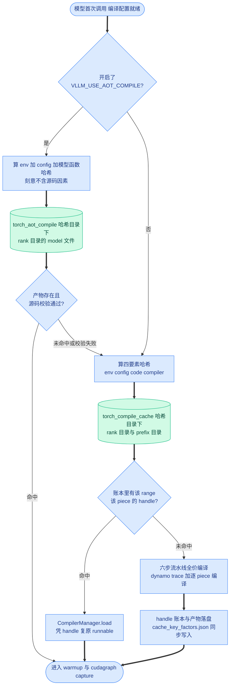
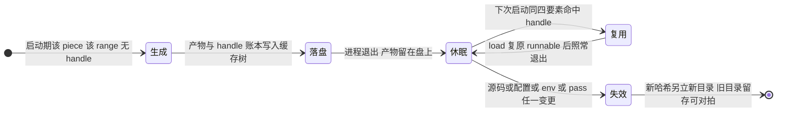

# 第 13 章 编译缓存与 AOT:compile-once 的工程闭环

```text
I   背景:   [1 为何compile] → [2 V1引擎] → [3 编译栈全景]
II  前端:   [4 配置体系] → [5 Dynamo一次捕获]
III 中端:   [6 Piecewise切分] → [7 算子边界与vllm_ir]
IV  后端:   [8 VllmBackend] → [9 逐range编译] → [10 Pass与融合]
V   运行时: [11 代码生成] → [12 CUDA Graph] → [13 缓存与AOT]◄==
VI  收官:   [14 设计哲学] → [15 动手实践]
```

## 13.0 本章俯瞰

前两章把产物送进了 serve 期:execution_fn 顺序执行、CUDA Graph 捕获重放。但回头翻启动日志,真正扎眼的是那几十秒到几分钟的编译时间——第 9 章说过,每个片段要乘上若干尺寸点与区间,一个多层模型动辄上百次 Inductor 编译。如果每次重启服务、每扩容一台新机器都要原价重付这笔钱,"用启动时间换运行时性能"的买卖在运维眼里就要打问号:线上系统天天滚动发布,故障恢复分秒必争,编译不能是每次启动的固定节目。问题于是变成:这次启动辛苦编出来的东西,能不能原封不动地留给下一次启动用?答案预告:vLLM 把全部产物组织进一棵以"身份哈希"命名的目录树——环境、配置、模型源码、编译器四类要素各算一个哈希,拼起来就是目录名;启动时先算哈希、查目录,命中就直接从盘上复原产物,未命中才编译并落盘;目录里还留着一份"为什么是这个哈希"的清单文件,让任何一次命中或失配都可解释。在此之上另有一条更激进的前置编译路线,把整个编译函数整体序列化成一个文件,连"重新组装"这一步都省掉。

## 13.1 最小前置知识

- **cache hash(缓存哈希)**:第 8 章六步流水线第①步,`VllmBackend.__call__` 开头算的四要素哈希(env+config+code+compiler,`vllm/compilation/backends.py:1031-1055`),决定缓存目录名。本章把它从"六步之一"展开成主角。
- **handle(缓存句柄)**:第 9 章编译时由适配器产出、`CompilerManager` 存入账本的二元组——inductor 路线为 `(hash_str, file_path)`(`backends.py:370-373`,standalone 为 `(key, path)`),`load` 凭它免编译直取产物。
- **`VllmSerializableFunction`(可序列化函数)**:第 11 章产物的最终封装,内含 FX 图、execution_code 与常量表,可整体 pickle(`vllm/compilation/caching.py:166`)。
- **`traced_files`(被 trace 的源文件集)**:第 5 章 dynamo inline 劫持记下的源文件清单(`vllm/compilation/decorators.py:604-615`),其**文件内容**进入本章的 code hash。
- **`compilation_counter`(编译计数器)**:`vllm/compilation/counter.py:13-41` 的 16 字段单例,冷/热启动的对拍全靠它读数。

## 13.2 设计思想与设计哲学

**缓存是编译代价的摊销器,它改写的是 compile once 的计量单位。** 回扣全书叙事主线:decode 是 CPU/launch bound → 必须消灭 Python 开销 → 代价是编译 → 编译代价是启动时间 → 所以全部编译前置+缓存。前面各章兑现到"启动期编完一切"(不变量 b),但"编完"的成果若随进程消亡,每次启动都是一次全价重付;缓存把这批成果从进程内存搬到盘上,把"一次"的计量单位从**每次进程**变成**每台机器**——第二次启动开始,启动时间里编译那一项归零,只剩装载。第 12 章的 capture/replay 保证 serve 期零编译,本章保证启动期**也只有第一次**贵。

【哲学时刻·P1/P5】**身份即内容:整个缓存体系没有一个版本号。** 把三处机制并排看:pass 的 uuid 是其源码的 sha256(第 10 章,`vllm/compilation/passes/inductor_pass.py:72-79`);片段产物的存储键是其 bytes 的 sha256(第 11 章,`StandaloneCompiledArtifacts.insert`,`caching.py:59-83`);缓存目录名是四要素拼串的 sha256 前 10 位(`backends.py:1066`)。三层键全部由**内容**构成,而非"版本号+时间戳+changelog"。版本号方案的一切毛病在这里天然不存在:忘了 bump 版本号导致新旧产物混用、bump 了但内容没变导致无谓重编——内容寻址把失效的正确性从"人的纪律"降格为"物理规律"。而 P5(显式优于隐式)的落点是 **`cache_key_factors.json`(缓存键因素清单文件)**:命中与未命中永远**可解释**——目录里躺着四要素的原始值,失配时把新旧两份 json 一 diff,立刻知道是哪个因素变了。一个不写文档的系统,把解释性写进了产物本身。

**自包含,可迁移;但只到单机为止。** 目录树不只装 vLLM 自己的账本,还把 Inductor 与 Triton 的缓存一并收编进来(两个环境变量重定向,见 13.3.1)——于是"拷一个目录"就是整机迁移的全部操作。代价同样显式:没有远程缓存(`fx_graph_remote_cache=False`,`compiler_interface.py:500`),多机部署各冷各的;运维手法是先在一台预热、再拷目录分发。跨 rank 稳定性则由哈希设计保证:`CUDA_VISIBLE_DEVICES`、`LOCAL_RANK` 这类每 rank 必不同的变量被排除在哈希之外,各 rank 算出同一个目录名(`envs.py:2131-2261`)。

## 13.3 具体流程(流水线视角)

本章处在六步流水线第①步(cache hash 定目录)与第④步(`CompilerManager.compile` 先 load 后 compile,详见第 8、9 章)的延长线上,外加一条旁路(AOT)。

### 13.3.1 缓存目录的解剖:一棵自包含的树

> **上游给我**:四要素哈希(env_hash/config_hash/code_hash/compiler_hash,`backends.py:1031-1055`)→ **我做**:拼 `hash_key = sha256(str(factors))[:10]` 并逐级派生目录(`:1063-1079`),交 `CompilerManager.initialize_cache`(`:1099-1101`)解析旧账、重定向 Inductor/Triton 缓存(`compiler_interface.py:463-480`)→ **产出**:一棵自包含目录树,产物与账本都落在里面。

```text
$VLLM_CACHE_ROOT/torch_compile_cache/<hash10>/    ← 默认 ~/.cache/vllm
├── cache_key_factors.json   四要素原始值(调试用,best-effort 写入)
└── rank_<rank>_<dp>/        本 rank 专属;多 prefix 共享下面两个目录
    ├── inductor_cache/      TORCHINDUCTOR_CACHE_DIR 重定向至此
    ├── triton_cache/        TRITON_CACHE_DIR 重定向至此
    └── <prefix>/            backbone / eagle_head 各占一份
        ├── vllm_compile_cache.py  (Range,graph_idx,compiler)→handle 账本
        ├── computation_graph.py   切分后整图 print_readable 转储
        └── transformed_code.py    dynamo 变换后 bytecode 的 depyf 转储(见下注)
```

```python
# vllm/compilation/backends.py:1063-1079 (v0.27.1,节选)
factors = [env_hash, config_hash, code_hash, compiler_hash]
# Use SHA-256 for cache key hashing to be consistent across
# compute_hash functions. Truncate for a short cache dir name.
hash_key = hashlib.sha256(str(factors).encode()).hexdigest()[:10]
cache_dir = os.path.join(envs.VLLM_CACHE_ROOT, "torch_compile_cache", hash_key)
...
rank = vllm_config.parallel_config.rank
dp_rank = vllm_config.parallel_config.data_parallel_index
local_cache_dir = os.path.join(cache_dir, f"rank_{rank}_{dp_rank}", self.prefix)
```

账本与产物的分工值得细看。**`vllm_compile_cache.py`(编译管理缓存文件)** 是 `CompilerManager.cache` 的盘上形态:键 `(Range, graph_index, compiler_name)`、值 `{"graph_handle": handle, "cache_key": cache_key}`(`backends.py:370-373`)。序列化刻意不用 JSON 而用 `pprint.pformat` 写成 Python 文件、`ast.literal_eval` 读回(`:191`、`:215-221`)——docstring 自述原因:键里有 int,JSON 不支持 int 作键(`:134-136`);写成 Python 文件还顺手让"打开看看"成为合法的调试手段(P5)。**Inductor/Triton 两层缓存**则被整体搬进树里:

```python
# vllm/compilation/compiler_interface.py:472-480 (v0.27.1)
# set flags so that Inductor and Triton store their cache
# in the cache_dir, then users only need to copy the cache_dir
# to another machine to reuse the cache.
inductor_cache = os.path.join(self.base_cache_dir, "inductor_cache")
os.makedirs(inductor_cache, exist_ok=True)
os.environ["TORCHINDUCTOR_CACHE_DIR"] = inductor_cache
triton_cache = os.path.join(self.base_cache_dir, "triton_cache")
os.makedirs(triton_cache, exist_ok=True)
os.environ["TRITON_CACHE_DIR"] = triton_cache
```

注意 `base_cache_dir = cache_dir[:-len(prefix)]`(`:468`):两个缓存目录挂在 rank 目录下而非 prefix 目录下,backbone 与 eagle_head 各自的账本分开、底层编译产物共享——多 prefix 共用一份 base 目录,这正是 `initialize_cache` docstring 写明的组织约定(`backends.py:176-178`)。对 InductorAdaptor 这层重定向就是它的全部缓存初始化;InductorStandaloneAdaptor 的产物则直接以 `cache_dir/key` 文件落在 prefix 目录里(`compiler_interface.py:390-414`)。目录树里唯一名不副实的是 `transformed_code.py`:0.27.1 里它实际写在 `debug_dump_path` 调试目录下(`wrapper.py:232`,须显式配置才生成),`initialize_cache` 的 docstring 仍把它列在缓存目录里——历史遗留的账面差异。

### 13.3.2 四要素逐项解剖:两个实战问题的标准答案

> **上游给我**:vLLM 环境变量注册表(`vllm/envs.py`)、`vllm_config`、`traced_files` 清单、编译器自身状态 → **我做**:四类要素各折叠成一个哈希 → **产出**:`factors` 列表,以及 best-effort 落盘的 `cache_key_factors.json`(`backends.py:1121-1134`)。

**env_hash:哈希几乎全部,白名单只放行少数。** **`compile_factors`(编译环境因素函数,`envs.py:2131`)** 的策略是"先收全部、再剔白名单":遍历所有注册的 vLLM 环境变量,跳过 `ignored_factors` 集合(`:2137-2215`,共 71 项)里的条目,其余全部 `normalize_value` 后进入字典;最后再把 9 个 Ray 的 `RAY_EXPERIMENTAL_NOSET_*` 设备可见性开关显式补进哈希(`:2236-2259`)——它们决定 Ray 是否替各 worker 重写设备可见性,且取值对各 rank 相同,不会撕裂跨 rank 一致性。白名单收录的是"确定不影响编译产物"的类别:路径与位置类(**`VLLM_CACHE_ROOT`**、`VLLM_CONFIG_ROOT`、`LD_LIBRARY_PATH`——注释写明:目录搬家不该让缓存全部作废)、日志类(`VLLM_LOGGING_LEVEL` 等)、媒体与超时类、S3 密钥、`CUDA_VISIBLE_DEVICES` 与 `LOCAL_RANK`(每 rank 不同,进哈希会撕碎跨 rank 一致性)。这是一个"宁可错杀"的设计:白名单外任何一个 env 变值,缓存就换目录——错杀的代价只是多编一次,漏放的代价是**悄悄用了不该复用的旧产物**,两害相权取其轻(P2 的变体:用可感知的失效换不可感知的错误)。

**config_hash** 是 `vllm_config.compute_hash()`(`backends.py:1034`),把模型、并行、调度、kv cache 等整套配置折叠成一个哈希——换 max_num_batched_tokens、换 TP 度,目录即变。**code_hash** 逐文件读入 `traced_files` 里每个源文件的**完整内容**(`:1042-1055`,只跳过 `<string>` 这类 exec 生成的动态代码),路径与内容拼接后取 sha256;算完立刻 `traced_files.clear()`(`:1057`)——清单是一次性消费品。**compiler_hash** 来自 `get_inductor_factors`(`compiler_interface.py:170-190`):`CacheBase.get_system()`(系统与硬件因素)+ `torch_key()`(torch 版本)+ Inductor 与 functorch 两份 `save_config_portable()`——torch 升级、换 GPU 型号、改 Inductor 配置,任何一个都会让目录换名。

于是两个经典问题有了标准答案。**"我只改了一行模型代码,缓存怎么就失效了?"**——因为 code_hash 哈希的是文件**内容**,不是路径清单:在 modeling 文件里加一行注释,dynamo 下次 trace 仍会 inline 到它,该文件内容一变,code_hash 即变,`factors` 变,目录名变(`:1063-1066`)。旧目录不会被删,新目录在旁边另立。**"我什么都没改,缓存怎么也失效了?"**——四要素里除了 code 都可能在你看不见的地方变:部署脚本新设了一个白名单外的 env、torch 或驱动升级动了 compiler_hash 里的 system 因素、配置文件某个字段默认值随版本变化。验证办法不用猜:diff 新旧两个目录的 `cache_key_factors.json`(`:1121-1134` 写入的是 env 原始值与三个哈希),哪个因素变了一目了然——这就是 13.2 说的"解释性写进产物本身"。

最后是**一个例外**:ngram GPU 投机解码强制关缓存(`:1084-1089`),源码 TODO 注释直言"ngram gpu kernel 会造成缓存错误"——正确性未修好之前,先让这条路径每次老实重编。

### 13.3.3 载入路径:凭 handle 复原,不进 Inductor

> **上游给我**:handle 二元组(从 `vllm_compile_cache.py` 经 `ast.literal_eval` 查到,`backends.py:223-261`)→ **我做**:按适配器分路复原 → **产出**:可直接调用的 runnable,填进 `PiecewiseBackend` 的温启动模式(第 9 章)。

`CompilerManager.load`(`backends.py:223-261`)先查键:三元组键不在账本里返回 None;账本条目解析失败(旧版本格式)**静默忽略并返回 None**(`:245-248`,注释:缓存过期就该重新生成)。命中后按编译器分两路。**InductorAdaptor.load**(`compiler_interface.py:660-727`):patch `FxGraphCache._get_shape_env` 换成永真的 **AlwaysHitShapeEnv**(第 9 章那叠补丁里的第 1 条,装载时同样必须),再 `FxGraphCache._lookup_graph(hash_str, example_inputs, True, None, CompiledFxGraphConstantsWithGm(graph))`(`:698-700`)直接从 Inductor 自己的缓存目录(已重定向进我们的树)复原产物;查找失败时断言的报错文案直说"请删缓存目录重试"(`:701-704`)。**InductorStandaloneAdaptor.load**(`:416-446`)更简单:`torch._inductor.CompiledArtifact.load(path=...)`(`:428-430`)按路径直取文件——正门路线连缓存查找的补丁都不需要。

再往上一层是 `VllmSerializableFunction` 的复原(第 11 章 11.3.5 的延续)。**常规路径**反序列化出 FX 图后不急着重跑:`optimized_call` 是个惰性闭包,首次调用才新建 `VllmBackend` 把六步流水线重走一遍(`caching.py:360-369`)——dynamo 不再 trace(图已在),每个 piece 走到 `CompilerManager.compile` 时全部命中盘上 handle,**秒级**就绪;`finalize_loading`(`:375-401`)给温启动提供急切装载的入口(AOT 路线用它,见 13.3.4)。**mega 路径**则连六步都不跑:`StandaloneCompiledArtifacts.load_all`(`:119-140`)用 `ThreadPoolExecutor` 并行反序列化全部产物 bytes(`:133`),按第 11 章的镜像流程零编译重建。



### 13.3.4 AOT 路线:把整个编译函数 pickle 落盘

> **上游给我**:编译完成的模型类实例(`decorators.py` 的 `__call__` 尾声)→ **我做**:调用产物自带的 `save_compiled_function` 方法(`:705`)把 `VllmSerializableFunction` 连同产物整体 pickle → **产出**:`torch_aot_compile/<hash>/rank_<rank>_<dp>/model` 单文件,下次启动直接装载。

先把三级"省钱梯度"摆清楚,才知道 AOT 省的是哪一级。**无缓存**:dynamo trace + 六步流水线 + 每 piece×range 一次 Inductor 编译,全价。**常规缓存**(默认):dynamo trace 与六步照跑,但第④步的每次编译被 `load` 替代,Inductor 不再进——秒级。**AOT**(`VLLM_USE_AOT_COMPILE`,默认关,`envs.py:114`):连 dynamo trace 都省,`torch.compiler.load_compiled_function` 直接装载编译函数(`decorators.py:299`)。三级递进,每一级砍掉上一级剩下的最大头。

AOT 的目录键与四要素**不同**:`aot_compile_hash_factors`(`caching.py:565-581`)只含 env_hash、config_hash(mega 模式追加 Inductor 因素),再拼上 `_model_hash_key`——sha256(vllm 版本 + forward 的 qualname + 首行号,`decorators.py:255-262`)。**刻意不含 code hash**,源码注释写明原因(`:529-535`):算目录时 dynamo 还没跑,根本不知道会 trace 哪些源文件。源码漂移的检测被推迟到装载时:**`_verify_source_unchanged`(源码未变校验,`decorators.py:265-281`)** 对序列化产物里存下的 inline 源码**重新哈希、与磁盘现状比对**,不一致直接 RuntimeError 回退全价重编。装载链的其余三步(`_try_load_aot_compiled_fn`,`:284-328`):`disable_guard_check`(非 evaluate_guards 模式下关掉装载函数的 guard 检查,`:303-305`——guards 本就该全丢,详见第 5 章)、`finalize_loading` 急切复原各 piece(`:308-309`,此时 traced_files 已被校验步骤填好,缓存目录可算)、损坏容错(EOFError 报"缓存文件损坏"后警告重编,`:316-325`;`VLLM_FORCE_AOT_LOAD` 则把失败升级为异常,`:326-327`,供 CI 验证 AOT 真的命中)。

保存侧有一个值得抄走的工程细节——**原子写**:

```python
# vllm/compilation/decorators.py:701-706 (v0.27.1,节选)
os.makedirs(self._aot_cache_dir, exist_ok=True)
# File saving should be atomic, so we will save to a temporary location
# first. Should be upstreamed to PyTorch 2.12 as well.
tmp_file = f"{self._aot_compilation_path}.{os.getpid()}.tmp"
self.aot_compiled_fn.save_compiled_function(tmp_file)
os.replace(tmp_file, self._aot_compilation_path)
```

先写带 pid 后缀的临时文件、再 `os.replace` 原子改名:多进程并发写同一目录不会留下半截文件;进程中途被杀,盘上最多多一个无害的 .tmp——"读者永远只会看到完整或不存在,看不到一半"(源码注释还自嘲这该修到 torch 上游去,P4 的又一笔账)。**`VLLM_USE_MEGA_AOT_ARTIFACT`(巨型 AOT 产物开关,默认关)** 是 AOT 内部的取舍:常规 artifact 只序列化 FX 图与源码,小而依赖装载时重跑六步(各 piece 命中缓存);mega 把 `StandaloneCompiledArtifacts` 的全部产物 bytes 随包携带(`caching.py:288-296`),体积换零编译,要求 torch≥2.10 且 standalone 编译开启(第 11 章 11.3.5)。AOT 目录下同样强设 `TORCHINDUCTOR_CACHE_DIR`(`decorators.py:552-558`,注释解释为何不用 setdefault:torch 可能在 import 期已填了 /tmp 默认值)。



### 13.3.5 边界与现状

**开关**:`is_compile_cache_enabled`(`compiler_interface.py:193-207`)是三个否定条件的与——**`VLLM_DISABLE_COMPILE_CACHE`**(排查缓存问题时的总闸)、`torch._inductor.config.force_disable_caches`(上游全局关缓存)、用户编译配置里的 `force_disable_caches`。关掉后一切照编,只是不落盘不装载。**没有远程缓存**:`fx_graph_remote_cache=False` 在 InductorAdaptor 里是硬编码(`:500`),vLLM 不做 S3/共享存储层的缓存分发——多机部署的现状是各冷各的,自包含目录树的"拷目录迁移"是唯一的分发手段(官方文档的跨机复用叙事即指此,详见参考资料 1)。**损坏的官方处置**有三处口径:InductorAdaptor 拿不到缓存哈希时的 RuntimeError 直接建议"删 `~/.cache/vllm/torch_compile_cache` 重试"(`:645-654`);standalone 路线产物不可序列化时的报错建议 `VLLM_DISABLE_COMPILE_CACHE=1` 绕过(`:400-411`);AOT 装载失败默认警告后回退重编(`decorators.py:315-328`)。共同姿态:**缓存坏了永远不是故障,重编一次就是修复**——因为身份即内容,重编产物与丢失的产物哈希必然一致。

### 13.3.6 主例:冷热两次启动对拍,与两个失效实验

同一模型、同一机器,两次启动的日志与计数器对照(日志文案均出自源码):

| 观察 | 冷启动(无缓存) | 热启动(命中缓存) |
|---|---|---|
| `Dynamo bytecode transform time: X s`(`backends.py:1155-1158`) | 出现,秒级 | 出现(常规缓存仍要 trace) |
| `Compiling a graph for compile range ... takes X s`(`:391-397`) | 每个 range 一条 | 无 |
| `Cache the graph of compile range ... for later use`(`:378-381`) | 出现 | 无 |
| `Directly load the compiled graph(s) ... took X s`(`:292-297`) | 无 | 每个 range 一条,通常 <1s |
| `num_backend_compilations`(进 manager 次数,`:280`) | >0 | 仍 >0(装载也经过 compile 入口) |
| `num_inductor_compiles`(真编译,`compiler_interface.py:289,491`) | >0 | **=0** |
| `num_cache_entries_updated`(`:374`) | >0 | =0 |
| `num_compiled_artifacts_loaded`(standalone 装载,`compiler_interface.py:431`) | =0 | >0 |

两个可复现的失效实验(为第 15 章动手实践埋线):

1. **code_hash 实验**:启动一次确认目录生成;在模型源码文件里加一行注释再启动——`ls ~/.cache/vllm/torch_compile_cache/` 出现新的 10 位哈希目录,`diff` 新旧目录的 `cache_key_factors.json`,只有 `code_hash` 一项不同。
2. **env_hash 实验**:设一个**在哈希里**的环境变量再启动,如 `VLLM_PP_LAYER_PARTITION="1,1"`(注册于 `envs.py:854`,不在白名单)——新目录出现,`env` 原始因素里能找到它。反过来设 `VLLM_LOGGING_LEVEL=DEBUG`(白名单 `:2169` 在列)——目录**不变**。一正一反,白名单的边界用实验摸清。

## 13.4 本章小结

- 四要素哈希即目录名:源码、env、config、编译器任何变化自动失效。(P1、P5)
- handle 账本让 piece 级复原免进 Inductor,秒级温启动。(P1)
- 缓存树自包含:两个 cache dir 重定向,拷目录即整机迁移。(P5)
- AOT 连 trace 都省:整体 pickle 加源码校验加原子写。(P1、P2)
- 无远程缓存,多机各冷各的;缓存损坏重编即修复。

本章机制集中服务于 P1(compile once, run forever)——缓存把"一次"的计量单位从每次进程拉长到每台机器,AOT 再拉到"连 trace 都免";P5(显式优于隐式)则贯穿在内容寻址的键与可 diff 的 `cache_key_factors.json` 里。下一章(第 14 章)把全书各章的机制收拢成七条设计哲学命题。本章的身份即内容、宁可错杀的白名单、损坏即重编,都是那七条命题最干净的例证。

### 本章源码索引

| 锚点 | 内容 |
|---|---|
| `vllm/compilation/backends.py:1031-1057` | 四要素:env/config/compiler/code 哈希与 traced_files.clear |
| `vllm/compilation/backends.py:1058-1079` | hash_key[:10]、cache_dir 与 local_cache_dir 派生 |
| `vllm/compilation/backends.py:1081-1101` | disable_cache 三来源+ngram 例外;initialize_cache 调用 |
| `vllm/compilation/backends.py:1121-1134` | cache_key_factors.json best-effort 写入 |
| `vllm/compilation/backends.py:163-214`(`CompilerManager.initialize_cache`) | 目录组织 docstring;ast.literal_eval 装载;parse_key |
| `vllm/compilation/backends.py:215-222`(`save_to_file`) | pprint 落盘 handle 账本(不用 JSON 的原因 :134-136) |
| `vllm/compilation/backends.py:223-261`(`load`) | 键缺失/过期→None;compiler.load;loaded_artifacts |
| `vllm/compilation/backends.py:280-297` | num_backend_compilations;热装载日志 took %.3f s |
| `vllm/compilation/backends.py:369-397` | 缓存条目写入、num_cache_entries_updated、冷编译日志 |
| `vllm/compilation/backends.py:1259-1272` | computation_graph.py 转储(整图 print_readable) |
| `vllm/envs.py:2131-2261`(`compile_factors`) | 全量哈希+71 项 ignored_factors 白名单+Ray 变量 |
| `vllm/envs.py:34,114-117,151` | VLLM_CACHE_ROOT 默认值与 AOT/缓存开关默认值 |
| `vllm/compilation/compiler_interface.py:170-190`(`get_inductor_factors`) | system+torch_key+两份 save_config_portable |
| `vllm/compilation/compiler_interface.py:193-207`(`is_compile_cache_enabled`) | 缓存三开关 |
| `vllm/compilation/compiler_interface.py:399-413` | standalone 产物落盘与不可序列化报错 |
| `vllm/compilation/compiler_interface.py:416-446`(`InductorStandaloneAdaptor.load`) | CompiledArtifact.load+tuple 解包 |
| `vllm/compilation/compiler_interface.py:463-480`(`InductorAdaptor.initialize_cache`) | base_cache_dir;两 cache dir 重定向;拷目录迁移注释 |
| `vllm/compilation/compiler_interface.py:660-727`(`InductorAdaptor.load`) | AlwaysHitShapeEnv+FxGraphCache._lookup_graph |
| `vllm/compilation/compiler_interface.py:645-654` | 哈希缺失报错:删 ~/.cache/vllm/torch_compile_cache |
| `vllm/compilation/caching.py:37-151`(`StandaloneCompiledArtifacts`) | sha256 两级去重;load_all 线程池 :119-140 |
| `vllm/compilation/caching.py:288-296` | mega 模式随包携带 standalone 产物 |
| `vllm/compilation/caching.py:299-373`(`deserialize_compile_artifacts`) | 常规路径惰性重跑 :360-369;mega 零编译 :319-342 |
| `vllm/compilation/caching.py:375-401`(`finalize_loading`) | 温启动急切装载 |
| `vllm/compilation/caching.py:565-581`(`aot_compile_hash_factors`) | AOT 目录键:不含 code hash |
| `vllm/compilation/decorators.py:255-262`(`_model_hash_key`) | sha256(vllm 版本+qualname+首行号) |
| `vllm/compilation/decorators.py:265-281`(`_verify_source_unchanged`) | 装载时重哈希 inline 源码比对 |
| `vllm/compilation/decorators.py:284-328`(`_try_load_aot_compiled_fn`) | load/verify/disable_guard_check/finalize/容错 |
| `vllm/compilation/decorators.py:525-574` | AOT 目录派生;TORCHINDUCTOR_CACHE_DIR 强设 :552-558 |
| `vllm/compilation/decorators.py:688-717`(`save_aot_compiled_function`) | tmp+os.replace 原子写 :701-706 |
| `vllm/compilation/counter.py:13-41` | 冷热对拍所用全部计数器 |
| `vllm/compilation/wrapper.py:232` | transformed_code.py 转储(落 debug_dump_path 调试目录) |

### 参考资料

1. [vLLM design doc — torch.compile](https://docs.vllm.ai/en/latest/design/torch_compile/) — 已与 0.27.1 源码核对一致(Compilation Cache 一节:全部编译在 serve 前完成、整目录拷贝复用、VLLM_DISABLE_COMPILE_CACHE;跨机复用叙事与 initialize_cache 注释一致)
2. [vLLM blog — Introduction to torch.compile and How It Works with vLLM (2025-08-20)](https://vllm.ai/blog/2025-08-20-torch-compile) — 仅作背景叙事
3. [vLLM design doc — Debug vLLM Compile](https://docs.vllm.ai/en/latest/design/debug_vllm_compile/) — 已与 0.27.1 源码核对一致(Debugging vLLM-compile cache 一节:VLLM_DISABLE_COMPILE_CACHE 与删 ~/.cache/vllm 的官方处置,详见第 15 章)
4. [vLLM design doc — Optimization Levels](https://docs.vllm.ai/en/latest/design/optimization_levels/) — 仅作背景叙事(cudagraph 捕获与温启动的时序,详见第 12 章)
5. [vLLM design doc — CUDA Graphs](https://docs.vllm.ai/en/stable/design/cuda_graphs/) — 仅作背景叙事
6. [RFC issue #6378 — A Graph Optimization System in vLLM using torch.compile](https://github.com/vllm-project/vllm/issues/6378) — 仅作背景叙事
7. [PyTorch blog — PyTorch + vLLM](https://pytorch.org/blog/pytorch-vllm-%E2%99%A5%EF%B8%8F/) — 仅作背景叙事(AOT 保存/装载编译函数的上游协作背景)
8. [vLLM v0.8.1 设计文档 — torch_compile(历史版)](https://docs.vllm.ai/en/v0.8.1/design/v1/torch_compile.html) — 仅作背景叙事(演进对比:早期只编单一符号 shape、handle 装载已有,四要素哈希、range 账本与 AOT 为后来演进)
