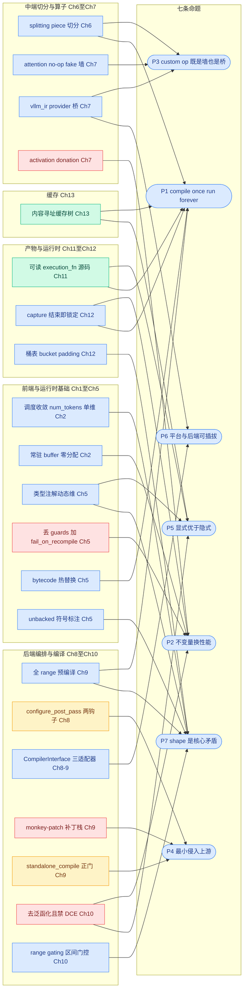

# 第 14 章 设计哲学:把机制上升为思想

```text
I   背景:   [1 为何compile] → [2 V1引擎] → [3 编译栈全景]
II  前端:   [4 配置体系] → [5 Dynamo一次捕获]
III 中端:   [6 Piecewise切分] → [7 算子边界与vllm_ir]
IV  后端:   [8 VllmBackend] → [9 逐range编译] → [10 Pass与融合]
V   运行时: [11 代码生成] → [12 CUDA Graph] → [13 缓存与AOT]
VI  收官:   [14 设计哲学]◄== → [15 动手实践]
```

## 14.0 本章俯瞰

前十三章讲了几十个机制:丢 guards、切 pieces、逐 range 编译、去泛函化、capture 锁定、内容寻址缓存……逐个复述它们并不难,难的是回答那个更根本的问题:这些机制里,哪些只是「vLLM 恰好这么写了」,哪些是「任何人站在同样的位置都必须这么做」?前者随版本漂移——本书锚点基线是 0.27.1,行号明年就会过期;后者才是带走这本书记住的东西。区分二者只有一个办法:把每个机制从 vLLM 的具体代码里拎出来,放到另一套系统、另一种负载面前,看它是否依然成立——检验过关的才配叫命题。本章是全书的思想收束章,不引入任何新机制、新源码,只做三件事:把前十三章的机制收拢成七条设计哲学命题(P1~P7),给每条命题指认机制与锚点证据,再检验它们离开 vLLM 之后是否仍然成立。答案预告:七条命题不是并列的清单,而是一个闭环——P7 是矛盾,P1 是总纲,P2/P3/P5 是手段,P4/P6 是边界与生态;而全书反复回扣的叙事主线,正是把它们串成一个整体的那条线。

先把七条命题的落点标上整条编译管线:

```text
torch.compile(model)   ◄== 本章:俯瞰整条管线,抽取七条命题
│
├─ dynamo 一次捕获 ─▶ 整图 FX        (P2:不变量换性能)
├─ 切分 ─▶ submod_0..N               (P3:隔离不可编之物)
├─ 全量预编译(片段 × range)          (P1:启动期编完一切)
├─ 造外壳                            (P5:显式优于隐式)
└─ serve 期:查 range 执行            (P1:缓存摊销启动成本)
```

## 14.1 最小前置知识

本章不引入新概念,只回收全书反复使用的五个事实框架:

- **核心叙事主线**(第 1 章):decode 是 CPU/launch bound → 必须消灭 Python 开销 → 代价是编译 → 编译代价是启动时间 → 所以全部编译前置+缓存 → 所以敢丢 guards、敢一次 trace、敢去泛函化。本章 14.3.9 将用它把七条命题串成一段话。
- **四条不变量**(第 3 章):(a) dynamo 只 trace 一次;(b) 启动期编完一切;(c) capture 结束即锁定;(d) serve 路径零编译零捕获零编排。每条都能指认到源码行号。
- **两类算子边界**(第 4/6/7 章):**splitting op**(切分算子,attention 所在,不进 Inductor)与 **vllm_ir** 算子(为融合而生的 IR 载体)——P3 的两个物证。
- **`CompilerInterface`(编译器接口)**(第 8/9 章):compile/load/compute_hash/initialize_cache 四方法契约,inductor/standalone/eager 三适配器平起平坐——P6 的代码形状。
- **内容寻址**(第 10/11/13 章):pass 的 uuid、产物存储键、缓存目录名三层键全部由内容哈希构成——P1/P5 的交汇点。

## 14.2 设计思想与设计哲学

**机制是证据,命题是迁移单位。** 单个机制的适用范围有限:换一个引擎、换一种负载,「在 `wrapper.py` 丢 guards」这个动作本身不可复制;但「用可证明的不变量换掉运行时检查」这条原则在任何系统里都成立。把机制上升为命题,提炼的正是这层可迁移性。检验一条命题是否合格的标准只有一条:**离开 vLLM 它还成立吗?** 成立的留下,不成立的只是实现细节,不配进本章。

七条命题的内部不是平的,而是一个闭环:

```text
P7  矛盾     shape 是推理编译的核心矛盾
      │  收敛到单维 + 分区经营
      ▼
P1  总纲     compile once, run forever
      │  总纲需要手段兑现
      ├────────────┬────────────┐
      ▼            ▼            ▼
     P2           P3           P5
  不变量换性能  墙与桥划分   显式可解释
      └────────────┴────────────┘
                   ▼
             P4 与 P6       边界与生态:对上游 / 对底座
```

P7 给出问题, P1 给出总方针, P2/P3/P5 是三条互相咬合的手段, P4/P6 则划定这套做法的合法边界——对上游不能横行(P4),对底座必须开放(P6)。上面闭环图给出命题间的层次,下面这张机制连线图把全书约二十个机制节点连到七条命题上,机制节点均标注章号与颜色语义(蓝=vLLM 代码,橙=torch 上游,绿=产物,红=激进点/monkey-patch,灰=外部系统):



命题与章节的对应关系汇总如下(✓ 后注机制名;空格=该章未落此命题;Ch14 列为本章定义处,Ch15 为实践章不新增落点):

| 命题 | 1 | 2 | 3 | 4 | 5 | 6 | 7 | 8 | 9 | 10 | 11 | 12 | 13 | 14 | 15 |
|---|---|---|---|---|---|---|---|---|---|---|---|---|---|---|---|
| P1 | ✓主线起点 | ✓静态运行时 | ✓monitor断言 | ✓配置即缓存键 | ✓bytecode热替换 | ✓片段去重 | ✓实现uuid | ✓六步一次编完 | ✓全range预编 | ✓range入键 | ✓sha256去重 | ✓capture once | ✓缓存+AOT | 定义处 | |
| P2 | ✓封闭负载 | ✓零分配 | ✓不变量断言 | ✓组合降单态 | ✓丢guards | ✓fake传播 | ✓激活捐赠 | ✓一次调用断言 | ✓构造期编完 | ✓去泛函化 | ✓liveness | ✓四条换四项 | ✓宁可错杀 | 定义处 | |
| P3 | | ✓图边界预告 | | | | ✓splitting piece | ✓墙与桥 | | | ✓桥被消费 | ✓splitting内联 | | | 定义处 | |
| P4 | | | | | | | ✓补丁记账 | ✓两钩子 | ✓债与正门 | ✓v2张力 | | | ✓上游化账 | 定义处 | |
| P5 | | ✓边界显式 | ✓产物契约 | ✓意图声明 | ✓类型即配置、三步手术* | ✓全名匹配 | | | ✓布局保真 | ✓身份即内容 | ✓可读源码 | ✓单一事实源 | ✓可解释键 | 定义处 | |
| P6 | | | ✓三轴正交 | ✓枚举正交 | | ✓分区旁路 | ✓provider | ✓接口四路 | ✓适配器平权 | ✓pattern绑设备 | | | | 定义处 | |
| P7 | ✓双表首现 | ✓单维收敛 | ✓轴3坐标 | | ✓显式动态维 | | ✓图静信息动 | | ✓双机制 | ✓区间门控 | | ✓桶表 | | 定义处 | |

> \* 第 5 章小结曾把「装饰器三步手术」记在 P4 名下;本章 14.3.4 作为定义处已把边界修正,详见该节。

## 14.3 具体流程:七条命题逐一展开

每条命题按三件套展开:定义、机制回指(章号+锚点)、可迁移场景。所有锚点均为前十三章已核对过的同款表述,本章不新增。

### 14.3.1 P1 compile once, run forever——一切编译成本移出请求路径

**定义**:凡是编译期才能付的成本(compile、autotune、capture),一次性全部前置到启动期,并把成果缓存到盘上;serve 期对编译的全部合法操作只剩「查表 + 调用」。缓存的功劳是把「一次」的计量单位从每次进程拉长到每台机器。

**机制回指**:① 全 range 前置编译——`PiecewiseBackend` 在构造函数里就把所有 range 编完(`vllm/compilation/piecewise_backend.py:189-190` 调 `compile_all_ranges`,详见第 9 章),serve 期 `__call__` 只剩查表;② monitor 零编译断言——`monitor_profiling_run` 进入前记录后端编译计数、断言期间零新增(`vllm/compilation/monitor.py:62-84`,详见第 3、8 章),不变量 b 的结构性守卫;③ 缓存体系——四要素哈希定目录(`vllm/compilation/backends.py:1031-1079`),叠加 handle 账本与 AOT 整体序列化(详见第 13 章);④ bytecode 热替换——把 dynamo 整个请出运行时,第二次 trace 在结构上无处发生(`vllm/compilation/wrapper.py:273-290`,详见第 5 章)。

**可迁移**:自研推理引擎的第一张检查清单应是「请求路径上还有哪行代码只在第一次需要」;任何 AOT 系统都值得抄走 monitor 的手法——把「编译已完成」做成可断言的事件(计数器对拍),而不是口头承诺。训练框架不能整条照搬(每步都可能合法 re-trace),但「编译成本集中到 warmup」同样成立。

### 14.3.2 P2 不变量换性能——先证明安全,再免掉检查;破坏时响亮失败

**定义**:用一条编译期/启动期**可证明**的不变量,换掉一类运行时检查、拷贝或决策;配套纪律是失败必须响亮(raise/assert),绝不悄悄变慢、更不悄悄出错。

**机制回指**:① 丢 guards + `fail_on_recompile`(`vllm/compilation/wrapper.py:120-122`、`:195`,详见第 5 章)——换掉每步的 guard 评估与 recompile 尾延迟,三道防线保证「发生了就当场爆炸」;② activation donation——`UnsafeCloneEliminationPass` 编译期证明激活无后继使用者后删掉防御性 clone(`vllm/compilation/passes/ir/clone_elimination.py:72`,详见第 7 章);③ 故意去泛函化且其后禁 DCE——`FixFunctionalizationPass` 固定序最后一步,换掉隐藏缓冲拷贝,docstring 明写其后绝不能再跑 DCE(`vllm/compilation/passes/utility/fix_functionalization.py:19`,详见第 10 章);④ capture 结束即锁定——`set_cudagraph_capturing_enabled(False)` 后任何捕获尝试直接 RuntimeError(`vllm/v1/worker/gpu_model_runner.py:6900`,详见第 12 章)。

**可迁移**:拿任何系统的「运行时防御清单」(防御性 clone、shape 校验、device 断言)逐条问:启动期能否证明它恒真?能,就免掉并把证明写成 assert;不能,就保留。注意 vLLM 的兑换前提是负载封闭(第 1 章);开放负载(执行任意用户代码)只能兑换其中可证明的子集。

### 14.3.3 P3 custom op 既是墙也是桥——算子边界即编译器掌控权的划分

**定义**:每个 custom op 都在回答同一个问题——编译器的掌控权到这条边为止,还是从这条边继续?**墙**是编译器不必也不该理解的复杂性(opaque,内部不可见);**桥**是编译器应该理解的融合机会(可被 pattern 匹配、替换、lowering)。判据不是技术可行性而是业务判断:算子内部是否存在跨实现的公共模式。

**机制回指**:① attention 作为 opaque 墙——以 splitting piece 形态留在图边界、不进 Inductor(详见第 6 章),其 fake impl 是彻底 no-op(`vllm/model_executor/layers/attention/attention.py:849-859`),dynamo 对内部零窥视(详见第 7 章);② vllm_ir 作为透明桥——`dispatch` 按 provider 优先级选实现(`vllm/ir/op.py:327`),整块节点供第 10 章的 pattern 消费成融合;③ custom_ops 基调——用户级的边界调节旋钮,mode≠NONE 且 backend=inductor 时基调为 none,被禁用算子回退 native、由 Inductor 生成融合 Triton kernel(`vllm/config/vllm.py:1285-1292`,详见第 4 章)。

**可迁移**:自研引擎给每个新算子先做「墙桥裁决」:内部无公共模式(各家 kernel 连抽象都不同)就筑墙,有(如 rms_norm 的加减归一量化首尾相接)就立 IR 载体 + provider。训练框架同样适用墙(flash attention、MoE kernel),但桥要谨慎——训练图更动态,pattern 命中率与稳定性都更差。

### 14.3.4 P4 最小侵入上游——侵入分级记账,债要还本息

**定义**:P4 只针对一件事——**对 torch/Inductor 上游的侵入方式**。侵入分三级记账:白=官方配置钩子(升级兼容);红=私有 API monkey-patch(升级即碎,每处圈死版本条件、附上游 issue 链接与移除条件——这是「债的本息记录」);正门=把需求推回上游,换一个官方入口。

**机制回指**:① 两钩子——`configure_post_pass` 只占用两个官方 config 键 `pre_grad_custom_pass`/`post_grad_custom_post_pass`(`vllm/compilation/backends.py:934-971`,注入点 `:1171`,详见第 8 章),还设 `_cache_config_ignore_prefix`(`:948-950`)保住上游缓存语义;② 红补丁——`InductorAdaptor` 的一叠 monkey-patch,条条对应上游隐含假设与 vLLM 用法的裂缝(详见第 9 章),第 8 章还有一处 `autograd_cache_key` 补丁(`backends.py:329-350`),源码注释自述「in the future torch should expose」;③ 正门——`InductorStandaloneAdaptor` 走 torch≥2.8 的 `standalone_compile`,同样的编译不需要那叠补丁(`vllm/compilation/compiler_interface.py:251-446`,详见第 9 章);④ 上游化协作——PyTorch 官方博客已提到 guard dropping、custom-op 的 CUDA Graph 分区等能力在上游化(仅作背景叙事),墙与桥的语义一旦被上游接纳,红补丁就能逐个退役。

**边界澄清**:第 5 章小结曾把「装饰器三步手术」(注入基类、包构造、装入口)记在 P4 名下,本章作为定义处修正:那三步全部在 vLLM 自家代码内完成,没有触碰 torch 一行——它是 P5 的例子(用显式装饰器声明「哪些模型可编译」),不是 P4。P4 的记分板只对上游生效。

**可迁移**:任何构建在他人仓库之上的集成都该有这本账:加 patch 前先找官方 config 键;找不到就评估把需求推上游;实在要 patch,版本条件、上游链接、移除条件三件套缺一不可——侵入是待偿还的债,不是资产。

### 14.3.5 P5 显式优于隐式——决定可读、失效可解释、不变量会爆炸

**定义**:凡影响行为的决定,要么写成代码里可读的事实(类型注解、源码、清单文件),要么写成会爆炸的断言;不依赖注释、文档或人的记忆。

**机制回指**:① 类型即配置——动态维写在 forward 类型注解里,配合 `dynamic=False` 关掉自动动态化(`vllm/compilation/wrapper.py:148-154`;`vllm/model_executor/models/llama.py:334-343` 的 `dynamic_arg_dims`,详见第 5 章);② 可读的 execution_fn——产物是一段与实际执行完全一致的 Python 源码(`vllm/compilation/codegen.py:21-127`,详见第 11 章);③ `cache_key_factors.json`(`vllm/compilation/backends.py:1121-1134`,详见第 13 章)与 match_table(`vllm_inductor_pass.py:104`,详见第 10 章)——缓存命中与融合命中永远可解释;④ 不变量写成 assert 而非注释(`monitor.py:62-84`,详见第 3 章);⑤ 身份即内容——pass 的 uuid 是其源码的 sha256(`vllm/compilation/passes/inductor_pass.py:72-79`),改一行源码缓存自动失效。

**可迁移**:给自己的系统连问三题:配置是声明的吗?产物是可读的吗?失效是可解释的吗?任何一题答否,维护成本都会随规模指数上升——版本号方案的「忘了 bump/白 bump」两类事故,内容寻址天然免疫。

### 14.3.6 P6 平台与后端可插拔——同一条流水线,换底座不换指挥

**定义**:可替换点收敛为少数几个显式接口,平台(硬件)、后端(编译器)、算子实现(provider)三层各自可插拔;主流水线对「底下是谁」一无所知。P6 不是配置项,是类型边界。

**机制回指**:① `CompilerInterface` 三适配器——`make_compiler` 四路分发(`vllm/compilation/backends.py:96`),inductor/standalone/eager 三路(`compiler_interface.py:251-446`、`:482-658`、`:796-810`)平起平坐,`backend` 字段一换整套机制整体替换(详见第 8、9 章);② IrOp provider 优先级——`dispatch` 按 `_priority_impls` 选实现(`vllm/ir/op.py:327`),平台经 `set_default`/`set_priority` 注册厂商实现(`:415`/`:429`,详见第 7 章);③ platform 接口——`pass_key`(`vllm/platforms/interface.py:177`)、平台编译器 qualname(`:248`,经 `backends.py:114-121` 解析)与 `current_platform.get_static_graph_wrapper_cls()`(`backends.py:667-683`,详见第 6 章)共同构成 OOT(树外)硬件后端的接入口;④ pattern 层设备绑定——示例张量的 device 跟随平台 `device_type`(`vllm_inductor_pass.py:230-249`,详见第 10 章)。

**可迁移**:自研引擎先抽象「编译器调用」为 compile/load/compute_hash/initialize_cache 四方法契约,再谈优化;新硬件接入=实现平台接口+注册 provider+给出 CompilerInterface 实现,主流水线一行不改。反过来,如果你的新后端需要改主流水线才能接入,说明接口抽象漏了。

### 14.3.7 P7 shape 是推理编译的核心矛盾——不消灭,而是收敛、分区、定价

**定义**:推理的形状逐步变(num_tokens),编译的最优条件是形状静态——这是推理编译的核心矛盾。vLLM 的态度不是解决它,而是把它压缩到单维、划分成少数静态点加区间、并给每个区间定不同的优化价。

**机制回指**:① 调度收敛——V1 调度器把全部动态性压缩进 `num_tokens` 单一维度,使其可枚举、可建表、可分桶预编译(详见第 2 章);② unbacked 符号——`mark_unbacked` 显式声明无界符号维,避免 0/1 特化(详见第 5 章);③ sizes/ranges 双机制——`compile_all_ranges` 一次编完少数精确点(开 max_autotune 全静态)加区间符号兜底(`vllm/compilation/piecewise_backend.py:245-277`,详见第 9 章);④ 桶 padding——运行时向上取整到最近捕获尺寸,矛盾最终压成一张有限档位表(`vllm/v1/cudagraph_dispatcher.py:72-109`,详见第 12 章);⑤ range gating——不同区间跑不同 pass 集、产出不同产物,矛盾被明码标价、分区经营(详见第 10 章)。

**可迁移**:任何动态 shape 编译系统都要先答四问:哪个维是活的?活维怎么声明?静态与符号的边界画在哪?运行时怎么分派?vLLM 的答案是:单维、类型注解显式声明、sizes+ranges、桶表——这四答比任何一个具体 kernel 都更值得抄走。

### 14.3.8 综合检验题:接一个新 attention 后端 / 一个新 NPU 平台

**题目**:假设你要给 vLLM (a) 接一个新 attention 后端;(b) 接一个新 NPU 平台。请按七条命题逐一推演:会触碰哪些文件与扩展点、哪些不变量必须守住、哪些决策点会被这七条原则裁决?

**(a) 新 attention 后端**。触碰点:在 `vllm/model_executor/layers/attention/attention.py` 注册算子并给出 no-op fake(`:849-859`,详见第 7 章);算子名进 splitting_ops 默认表(`vllm/config/compilation.py:1133`(`set_splitting_ops_for_v1`),详见第 4 章);模型侧经 `@support_torch_compile` 声明动态维(详见第 5 章)。裁决顺序:P3 第一个到场——你的 kernel 内部有没有跨实现的公共模式?没有就筑墙(进 splitting_ops,opaque);有就走 vllm_ir 桥。P5/P2 随后——`mutates_args` 显式声明,变长信息走 ForwardContext 侧信道、不进图。P7 收尾——唯一活维仍是 num_tokens。P1 兜底——注册在 import/启动期完成,serve 期零注册;不变量 a(一次 trace)不得被破坏:签名固定、不引入新的 guards 需求。

**(b) 新 NPU 平台**。流水线句式:上游给我平台 qualname(`current_platform.get_compile_backend()`,`vllm/platforms/interface.py:248`,详见第 8 章)→ `make_compiler` 经 `resolve_obj_by_qualname` 解析(`vllm/compilation/backends.py:114-121`)→ 产出平台的 `CompilerInterface` 实例,去向六步流水线第④步(`backends.py:1222`)——六步一行不改(详见第 8 章)。其余触碰点:实现 platform 接口(`vllm/platforms/interface.py:177`/`:248`)、`initialize_cache` 重定向两层缓存(`compiler_interface.py:463-480`)、注册 vllm_ir provider(`vllm/ir/op.py:415`)、静态图包装类(`backends.py:675-683`)、融合 pattern 的设备 helper(`vllm_inductor_pass.py:230-249`)。裁决:P6 是主通道;P4 提醒不要为图省事 patch torch——先数一数 InductorAdaptor 那叠债;P1/P2 要求全 range 预编、monitor 零编译断言、capture 锁定三件套照搬;P7 要求 sizes/ranges/桶表结构照搬(数值按硬件重定);P3 要求平台 attention 照筑墙;P5 要求配置走 CompilationConfig,不写隐式 env 分支。

参考答案要点:

| 命题 | 触碰点(文件/扩展点) | 必守不变量 |
|---|---|---|
| P1 | 算子注册在 import 期;平台编译器在 make_compiler 解析 | serve 期零编译零注册(monitor 断言) |
| P2 | signature 与 mutates_args;ForwardContext 侧信道 | 一次 trace 不破坏;失败即 raise |
| P3 | attention.py 注册 + fake;splitting_ops 表;vllm_ir provider | 墙内不窥视;桥必须可被 pattern 消费 |
| P4 | 不碰 torch;只用 config 键与 platform 接口 | 红补丁须带版本条件与移除条件 |
| P5 | 类型注解声明动态维;CompilationConfig 显式配置 | 失效可解释(内容寻址键) |
| P6 | CompilerInterface 四方法;platform 接口;provider 注册 | 主流水线零改动 |
| P7 | compile_sizes/ranges;桶表;range gating | 唯一活维仍是 num_tokens |

### 14.3.9 收束:一个闭环,一条主线

七条命题合起来是一个闭环:P7 指认矛盾——shape 逐步变而编译要静态;P1 给出总纲——把一切编译成本移出请求路径,矛盾才买得起「多份产物」的解法;P2/P3/P5 是三条手段——P2 用不变量买回运行时开销,P3 用算子边界划分编译器掌控权,P5 让一切决定可读、可解释、会爆炸;P4/P6 划定边界与生态——对上游最小侵入、对底座完全开放。没有 P7,P1 无的放矢;没有 P1,P2 的激进取舍不安全;没有 P4/P6,这一切要么难以为继、要么困死单平台。

最后用叙事主线把七条命题串成一段话,作为全书的大回扣:**decode 是 CPU/launch bound(P7 所在的负载现实),所以必须消灭 Python 开销——于是用不变量换掉检查与拷贝(P2)、用算子墙把编译器管不到的复杂性挡在外面(P3)、把一切决定显式化好让人与缓存都能读懂(P5);代价是编译,而编译的代价是启动时间,所以全部编译前置加缓存(P1),并且只经两个 config 钩子碰上游(P4)、把编译器与平台抽象成可插拔接口(P6)。** 十三章机制,不过是这条因果链在各层的落地;七条命题,是这条链的七个名字。

## 14.4 本章小结

- 命题闭环:矛盾→总纲→手段→边界。
- 机制是命题的证据,命题是机制的迁移单位。
- 检验标准:离开 vLLM 仍成立的才是命题。
- 新 attention 后端先过 P3,新平台先过 P6。
- 不变量不是注释,是 assert;侵入不是资产,是债。

本章把全书机制收束为七条命题,全部命题共同服务于同一个目标——让推理服务的热路径只剩查表与重放。下一章(第 15 章)把本书的一切放进终端:用日志、dump 与缓存目录亲眼验证这些机制的存在。七条命题不再只是文字,而是一行行可以 grep、可以 cat、可以 diff 的工程事实。

### 本章源码索引

| 锚点 | 内容 |
|---|---|
| `vllm/compilation/piecewise_backend.py:189-190`(`compile_all_ranges` 调用)与 `:245-277` | 全 range 前置编译(P1/P7) |
| `vllm/compilation/monitor.py:62-84`(`monitor_profiling_run`) | 零编译断言(P1/P2/P5) |
| `vllm/compilation/wrapper.py:120-122` / `:195` / `:148-154` / `:273-290` | 丢 guards、fail_on_recompile、fullgraph+dynamic=False、bytecode 热替换(P1/P2/P5/P7) |
| `vllm/compilation/backends.py:934-971`(`configure_post_pass`,`:948-950` ignore_prefix) | 两钩子最小侵入(P4) |
| `vllm/compilation/backends.py:329-350` | autograd_cache_key 红补丁(P4) |
| `vllm/compilation/backends.py:96`(`make_compiler`)与 `:114-121` | 四路分发与平台 qualname(P6) |
| `vllm/compilation/backends.py:1031-1079` / `:1066` / `:1121-1134` | cache hash 目录与 cache_key_factors.json(P1/P5) |
| `vllm/compilation/backends.py:667-683` | get_static_graph_wrapper_cls 解析与平台包装(P6) |
| `vllm/compilation/compiler_interface.py:251-446` / `:482-658` / `:796-810` / `:463-480` | 三适配器与 initialize_cache(P4/P6) |
| `vllm/model_executor/layers/attention/attention.py:849-859` | no-op fake 墙(P3) |
| `vllm/ir/op.py:327` / `:415` / `:429` | provider dispatch 与优先级(P3/P6) |
| `vllm/compilation/passes/ir/clone_elimination.py:72`(`UnsafeCloneEliminationPass`) | activation donation(P2) |
| `vllm/compilation/passes/utility/fix_functionalization.py:19` | 去泛函化与禁 DCE(P2/P5) |
| `vllm/compilation/passes/inductor_pass.py:72-79` | uuid=sha256(源码)(P1/P5) |
| `vllm/compilation/passes/vllm_inductor_pass.py:104` / `:230-249` | match_table 与设备绑定(P5/P6) |
| `vllm/compilation/codegen.py:21-127` | 可读 execution_fn 产物(P1/P5) |
| `vllm/v1/cudagraph_dispatcher.py:72-109` | 桶填充表(P7) |
| `vllm/v1/worker/gpu_model_runner.py:6900` | capture 锁定(P2) |
| `vllm/platforms/interface.py:177` / `:248` | pass_key 与平台编译器 qualname(P6) |
| `vllm/config/vllm.py:1285-1292` | custom_ops 基调(P3) |
| `vllm/config/compilation.py:1133`(`set_splitting_ops_for_v1`) | splitting_ops 默认表(P3/P7) |
| `vllm/model_executor/models/llama.py:334-343`(`dynamic_arg_dims`) | 动态维显式声明(P5/P7) |

### 参考资料

1. [vLLM design doc — torch.compile](https://docs.vllm.ai/en/latest/design/torch_compile/) — 已与 0.27.1 源码核对一致(全部编译在 serve 前完成、custom op 边界与缓存的官方叙事,与本章 P1/P3 落点一致)
2. [vLLM blog — Introduction to torch.compile and How It Works with vLLM (2025-08-20)](https://vllm.ai/blog/2025-08-20-torch-compile) — 仅作背景叙事
3. [vLLM design doc — Optimization Levels](https://docs.vllm.ai/en/latest/design/optimization_levels/) — 仅作背景叙事(-O 的代价交易叙事,详见第 4 章)
4. [vLLM design doc — CUDA Graphs](https://docs.vllm.ai/en/stable/design/cuda_graphs/) — 仅作背景叙事(捕获/重放与桶,详见第 12 章)
5. [vLLM design doc — Fusions](https://docs.vllm.ai/en/latest/design/fusions/) — 仅作背景叙事(融合收益数字以原文为准,详见第 10 章)
6. [vLLM design doc — Debug vLLM Compile](https://docs.vllm.ai/en/latest/design/debug_vllm_compile/) — 仅作背景叙事(第 15 章实践入口)
7. [RFC issue #6378 — A Graph Optimization System in vLLM using torch.compile](https://github.com/vllm-project/vllm/issues/6378) — 仅作背景叙事(本章收束的机制群的最初提案)
8. [PyTorch blog — PyTorch + vLLM](https://pytorch.org/blog/pytorch-vllm-%E2%99%A5%EF%B8%8F/) — 仅作背景叙事(guard dropping 与 custom-op CUDA Graph 分区的上游化,即 P4 的「正门」方向)
9. [vLLM v0.8.1 设计文档 — torch_compile(历史版)](https://docs.vllm.ai/en/v0.8.1/design/v1/torch_compile.html) — 仅作背景叙事(早期只编单一符号 shape;sizes/ranges 双机制与缓存体系为后来演进,P7 命题的历史注脚)
