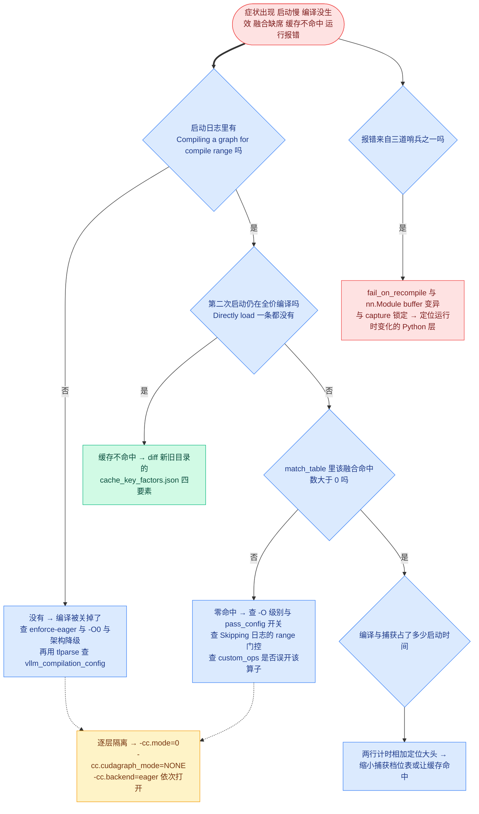

# 第 15 章 动手实践与调试

```text
I   背景:   [1 为何compile] → [2 V1引擎] → [3 编译栈全景]
II  前端:   [4 配置体系] → [5 Dynamo一次捕获]
III 中端:   [6 Piecewise切分] → [7 算子边界与vllm_ir]
IV  后端:   [8 VllmBackend] → [9 逐range编译] → [10 Pass与融合]
V   运行时: [11 代码生成] → [12 CUDA Graph] → [13 缓存与AOT]
VI  收官:   [14 设计哲学] → [15 动手实践]◄==
```

## 15.0 本章俯瞰

前 14 章把机制讲完了,但真机上的第一反应往往是:启动日志滚过几千行,我怎么知道编译有没有发生、融合有没有命中、缓存有没有复用?服务比 eager 还慢、第二次启动还在编译、某个融合神隐——这些问题在机制图上都有答案,可机制图不会自己跳到终端里。本章回答的问题是:**如何用几条可复制的命令,把前 14 章的全部机制变成肉眼可读的证据**。答案预告:vLLM 把编译系统的状态做成了三类显式产物——三张日志表分别回答「编了什么、捕了什么、融了什么」;一棵 **debug_dump_path(调试转储目录)** 保留每个中间阶段的 FX 图、变换字节码与 pattern 源码;一份 **cache_key_factors.json(缓存键因素清单)** 让每次缓存命中或失配可解释。配合四个逐层关闭的开关与三道启动期断言,任何「太慢/没生效/不命中/报错」都能沿着一条决策树收敛到五层分层中的某一层。本章是全书收官章:所有命令均可复制,每处「预期看到」都标注了来源(源码日志字符串或官方 debug 文档)。

## 15.1 最小前置知识

- **debug_dump_path(调试转储目录)**:`CompilationConfig` 字段(`vllm/config/compilation.py:461`),给定一个目录,vLLM 就把 dynamo 变换码、**depyf(dynamo 反编译工具)**的全套产物、pass 级前后图与 pattern 源码都写进去;环境变量 **`VLLM_DEBUG_DUMP_PATH`** 与之等价且优先生效(`vllm/config/vllm.py:1682-1690`)。多卡时经 **`compile_debug_dump_path`(rank 感知路径)** 派生 `rank_<tp>_dp_<dp>` 子目录(`vllm/config/vllm.py:2117-2127`)。
- **tlparse(时间线解析器)**:torch 的结构化编译日志查看器;`TORCH_TRACE=<dir>` 让 torch.compile 按 rank 落盘日志文件,`tlparse <file>` 渲染成 HTML。vLLM 专门为它埋了四个 artifact(15.3.5)。
- **-cc 点路径**:`-cc.mode=0`、`-cc.pass_config.fuse_norm_quant=true` 这类写法等价于整份 JSON 覆写(详见第 4 章 4.3.6),本章命令大量使用。
- **compilation_counter(编译计数器)**:`vllm/compilation/counter.py:13-41` 的 16 字段单例,冷/热启动对拍的读数来源(第 13 章)。
- **cache_key_factors.json(缓存键因素清单)**:缓存目录里记录 env/config/code/compiler 四要素原始值的文件(第 13 章 13.3.2),本章症状②的主要工具,机制不再复述。

## 15.2 设计思想与设计哲学

**调试方法论就是五层分层的投影。** 第 3 章把编译栈分成 L1~L5 五层;官方 debug 文档给出的排障第一原则正是「逐个子系统隔离」——四把开关恰好各切一层:`--enforce-eager` 全关,`-cc.mode=0` 只关 torch.compile,`-cc.cudagraph_mode=NONE` 只关 CUDA Graph,`-cc.backend=eager` 只关 Inductor(把图原样返回,第 9 章的 EagerAdaptor)。最小化地关、逐个地开,问题落在哪一层就到哪一章去找。这与「平台与后端可插拔」(P6)是同一件事的两面:能被独立拔掉,才谈得上独立排查。

【哲学时刻·P5】**可观测性是「显式优于隐式」的兑现。** 回看全书:handle 账本刻意写成 Python 文件让人直接打开(第 13 章),execution_code 本身就是源码(第 11 章),pass 的 uuid 就是源码哈希(第 10 章)。本章的三张表与一棵 dump 目录树不是外挂工具,而是同一哲学的收口——**系统的每个状态都有一份可读的文本形态**。融合有没有发生不用猜,**match_table(匹配统计表)**里写着计数;缓存为什么失效不用猜,json 里躺着因素。

【哲学时刻·P2】**不变量即断言,错误在启动期爆炸。** 第 5 章丢 guards、第 10 章去泛函化、第 12 章 capture 后全局锁死,这些激进决定之所以敢做,是因为配套了三道哨兵:`set_stance("fail_on_recompile")` 把二次 trace 变成异常(`vllm/compilation/wrapper.py:192-197`)、profiling run 断言零新增编译(`vllm/compilation/monitor.py:63-84`)、capture 结束后任何捕获直接 RuntimeError(`monitor.py:90-99`,不变量 c)。调试时的第一条纪律因此是:**先读异常,再关开关**——哨兵响了你才知道不变量在哪被打破,直接 `--enforce-eager` 绕过去等于把证据扔了。

## 15.3 具体流程(流水线视角)

### 15.3.1 环境约定与调试决策树

本章命令以 **CUDA 环境、vLLM 0.27.1、小模型 Qwen/Qwen2.5-0.5B-Instruct** 为例(融合实战一节需 FP8,用 `--quantization fp8` 在线量化);单机单卡,默认 `VLLM_CACHE_ROOT=~/.cache/vllm`。**命令口径全部来自源码与官方 debug 文档,未在本机逐条运行**;所有输出示例均标注「示意」。先给出本章主图——四类症状的调试决策树:



### 15.3.2 最小复现与对照:逐行读懂启动日志

**输入**→**操作**→**观察产物**:给我一次 `vllm serve` 启动(`VLLM_LOGGING_LEVEL=DEBUG`,env 注册于 `vllm/envs.py:824`)→ 我在日志里按下表逐行对号 → 产出「编译发生了没有、缓存命中了没有、各阶段花了多久」的三问答案。

```bash
# 冷启动:清缓存后全量编译(日志文案均出自源码)
VLLM_LOGGING_LEVEL=DEBUG vllm serve Qwen/Qwen2.5-0.5B-Instruct --port 8000

# 热启动:同机同配置再来一次,对照缓存行为
VLLM_LOGGING_LEVEL=DEBUG vllm serve Qwen/Qwen2.5-0.5B-Instruct --port 8000
```

| 日志行(文案出处) | 读到什么 |
|---|---|
| `Using cache directory: … for vLLM's torch.compile`(`backends.py:1094-1097`) | 本 rank 的缓存目录路径,第①步 cache hash 已定 |
| `vLLM's torch.compile cache is disabled.`(`:1092`) | 缓存被关(`VLLM_DISABLE_COMPILE_CACHE` 等三来源之一) |
| `Dynamo bytecode transform time: X s`(`:1155-1158`) | dynamo 一次 trace 的耗时,六步流水线由此开始 |
| `Compiling a graph for compile range … takes X s`(`:394-397`) | 每个 range 一条,**编译正在发生的铁证**(仅冷启动) |
| `Directly load the compiled graph(s) for compile range …`(`:293-297`) | 每个 range 一条,**缓存命中的铁证**(仅热启动) |
| `Cache the graph of compile range … for later use`(`:379-381`) | handle 正在写入账本(仅冷启动) |
| `Saved compiler manager cache in X seconds.`(`:1231-1234`) | 账本落盘耗时,超 1s 才打 |
| `Traced files (to be considered for compilation cache)`(`:1038-1041`,DEBUG) | code hash 覆盖的源文件清单 |
| `torch.compile cache factors: env=… cfg=… comp=… code=… dir=…`(`:1105-1112`,DEBUG) | 四要素哈希值,与 json 互相印证 |
| `torch.compile took X s in total`(`monitor.py:20`) | 编译总时长(计时从 `monitor_torch_compile` 进入起算) |
| `Graph capturing finished in X secs, took X GiB`(`gpu_model_runner.py:6913-6915`) | capture 总时长与图集显存 |
| `Initial profiling/warmup run took X s`(`monitor.py:81-84`) | profiling run 耗时;此前有零编译断言把守 |

两次启动的差异就是第 13 章 13.3.6 对拍表的浓缩:冷启动有 `Compiling`/`Cache the graph`,热启动换成 `Directly load` 且 `torch.compile took` 大幅缩短。**-O0 与 -O2 的对照**同法:再各跑一次,`-O2` 多出的启动时间就是「编译 + 捕获」两项,分别落在 `torch.compile took` 与 `Graph capturing finished` 两行,不用掐秒表。

```bash
vllm serve Qwen/Qwen2.5-0.5B-Instruct -O0 --port 8000      # 对照基线:无编译无图
vllm serve Qwen/Qwen2.5-0.5B-Instruct --enforce-eager --port 8000   # 语义见下
```

**`--enforce-eager` 的精确语义**(源码 warning 一字不差):等价于 `-cc.mode=none -cc.cudagraph_mode=none`(`vllm/config/vllm.py:1193-1199` 的日志文案与赋值),并连带把 `max_cudagraph_capture_size` 置 0、`cudagraph_capture_sizes` 清空(`:1425-1432`),worker 侧直接跳过 `capture_model()`(`vllm/v1/worker/gpu_worker.py:716-717`)。它与 `-O0` 的差别只在入口:`-O0` 经 -O 表归零(第 4 章),`--enforce-eager` 在 config 解析处一票否决,不再与任何默认值商量(`TORCH_COMPILE_DISABLE=1` 是另一条独立的禁用路径,`:1201-1205`)。

### 15.3.3 三张日志表:编了什么 / 捕了什么 / 融了什么

**表一(编了什么):`vllm_compilation_config`。** `_log_compilation_config`(`vllm/compilation/backends.py:973-1017`)在 `__call__` 开头被调用(`:1027`),把 mode/backend/custom_ops/splitting_ops/cudagraph_mode/compile_sizes/compile_ranges_endpoints/inductor_passes/enabled_passes/dynamic_shapes 配置整体以 **trace_structured artifact** 之名发出——它不打到控制台,而是进 `TORCH_TRACE` 的日志文件,用 tlparse 查看(见 15.3.5)。排查「编译没生效」时,这张表回答「解析定稿后 mode 到底是什么」——第 4 章的降级链可能悄悄改过它(breakable 架构自动压 mode=NONE 等)。

**表二(捕了什么):CUDA Graph 指标表。** CLI 开 `--cudagraph-metrics`(`vllm/engine/arg_utils.py:1437-1440` → `ObservabilityConfig.cudagraph_metrics`,`vllm/config/observability.py:56`),`CUDAGraphLogging.generate_metric_table`(`vllm/compilation/cuda_graph.py:71-118`)按观测频次降序聚合成 markdown 表,由 metrics logger 周期性打出(第 12 章 12.3.8)。列固定五项:Unpadded Tokens、Padded Tokens、Num Paddings、Runtime Mode、Count,表头附当前 Mode 与捕获档位:

```text
【示意】--cudagraph-metrics 打出的指标表(列名与排序规则出自 cuda_graph.py:43-49)
**CUDAGraph Config Settings:**
- Mode: CUDAGraphMode.FULL_AND_PIECEWISE
- Capture sizes: [1, 2, 4, 8, 16, 24, ...]
**CUDAGraph Stats:**
| Unpadded Tokens | Padded Tokens | Num Paddings | Runtime Mode | Count |
|-----------------|---------------|--------------|--------------|-------|
| 10              | 16            | 6            | PIECEWISE    | 512   |
| 16              | 16            | 0            | FULL         | 301   |
```

读法:大量行 `Num Paddings/Unpadded Tokens` 比值高(如 9→16),说明档位配稀了,该加密 `cudagraph_capture_sizes`(第 4 章);`Runtime Mode` 出现意外取值,则是分派旁路被触发(第 12 章)。

**表三(融了什么):match_table。** `VllmPatternMatcherPass.match_table` 是类级计数表(`vllm/compilation/passes/vllm_inductor_pass.py:104`),每次 `__call__` 把本 pass 命中数累加进去(`:335`),`log_match_summary`(`:121-123`)在 `PostGradPassManager.__call__` 末尾统一打出(`pass_manager.py:141`)。开法只有 DEBUG 一级:

```bash
VLLM_LOGGING_LEVEL=DEBUG vllm serve Qwen/Qwen2.5-0.5B-Instruct --port 8000 \
  2>&1 | grep "fusion pass matches"
# 预期看到(示意):DEBUG ... fusion pass matches: {'RMSNormQuantFusionPass': 24, ...}
```

零命中即「融合缺席」的直接证据,下一步去 15.3.6 症状④。外部代码可用 `get_match_table()`(`:90-92`)取快照做断言。

### 15.3.4 dump 编译中间图:debug_dump_path 目录树

**输入**→**操作**→**观察产物**:给我一个空目录(`-cc` 两种写法等价,JSON 与点路径)→ 我让 depyf 接管全部图输出、vLLM 各阶段自行落盘 → 产出一棵按阶段命名的目录树,每个文件都是可独立打开的 Python 源码。

```bash
vllm serve Qwen/Qwen2.5-0.5B-Instruct \
  --compilation-config '{"debug_dump_path": "/tmp/vllm-debug"}' --port 8000
# 等价点路径写法(第 4 章 4.3.6):
vllm serve Qwen/Qwen2.5-0.5B-Instruct -cc.debug_dump_path=/tmp/vllm-debug
```

```text
/tmp/vllm-debug/                     ← debug_dump_path 根目录
└── rank_0_dp_0/                     ← compile_debug_dump_path 按 rank 派生
    ├── transformed_code.py          ← dynamo 变换码 depyf 反编译 wrapper:232
    ├── full_code_for_*.py           ← depyf: 被编译函数的完整源码
    ├── __transformed_code_for_*.py  ← depyf: 每张图的变换码与字节码
    ├── __compiled_fn_*…py           ← depyf: 各阶段图(含 post_grad 段)
    └── patterns.<PassName>.<i>.py   ← dump_patterns 导出的 pattern 源码
```

相邻的另一棵是第 13 章的缓存树(13.3.1,此处只作对照):

```text
~/.cache/vllm/torch_compile_cache/<hash10>/  ← 第 13 章缓存树(相邻但不相同)
├── cache_key_factors.json           ← 四要素原始值
└── rank_0_0/                        ← rank 目录
    ├── inductor_cache/              ← TORCHINDUCTOR_CACHE_DIR 重定向至此
    ├── triton_cache/                ← TRITON_CACHE_DIR 重定向至此
    └── backbone/                    ← prefix 目录
        ├── vllm_compile_cache.py    ← handle 账本(pprint 写成,直接可读)
        └── computation_graph.py     ← 切分后整图 print_readable 转储
```

逐个读。**transformed_code.py**(`vllm/compilation/wrapper.py:232-248`):bytecode hook 捕获 dynamo 变换后字节码,depyf 反编译落盘(仅首个、best-effort)——它是 L2 前端的真相源,「哪层 Python 被 trace 了」以它为准。**depyf 三族文件**:`monitor_torch_compile` 检测到 `debug_dump_path` 且 mode=VLLM_COMPILE 时进入 `depyf.prepare_debug(path)`(`vllm/compilation/monitor.py:31-40`),此后 dynamo 每张图的捕获图/AOT 图/编译产物都被写成文件(文件族命名见 depyf 文档字符串,`depyf/explain/enable_debugging.py:139-142`):

```python
# vllm/compilation/monitor.py:31-40 (v0.27.1)
    compilation_config = vllm_config.compilation_config
    depyf_cm = None
    path = vllm_config.compile_debug_dump_path()
    if compilation_config.mode == CompilationMode.VLLM_COMPILE and path:
        import depyf

        path.mkdir(parents=True, exist_ok=True)
        logger.debug("Dumping depyf output to %s", path)
        depyf_cm = depyf.prepare_debug(path.as_posix())
        depyf_cm.__enter__()
```

**pass 级 before/after 图**:每个 pass 经 `dump_graph`(`vllm/compilation/passes/vllm_inductor_pass.py:74-80`)在执行前后各 dump 一次,图名形如 `post_grad.<N>.<PassName>.before/after`(N 为 `dump_prefix` 计数,`pass_manager.py:111-139` 逐拍递增);输出走 `lazy_format_graph_code`,depyf 已接管它落盘(`backends.py:1189-1191` 注释)。**patterns.<PassName>.<i>.py**:`dump_patterns`(`vllm_inductor_pass.py:125-190`)用 torch 的 PatternPrettyPrinter 把每个已注册 pattern 反向导出成可读 Python——对照「pattern 长什么样」与「图里实际长什么样」,是融合排查的核心手段(第 10 章 10.3.4)。注意 **computation_graph.py 不在 debug 目录**:它是切分后整图的 `print_readable` 转储(`backends.py:1259-1272`,`<lambda>` 替换为 GraphModule),写在缓存树的 prefix 目录里——两棵树用途相邻但根不同。

### 15.3.5 看 Inductor/Triton 产物与每段编译耗时

顺着上文的缓存树进 `inductor_cache/` 与 `triton_cache/`(两个环境变量重定向的组织约定见第 13 章 13.3.1,不赘述),Triton kernel 源码与 Inductor 包装代码都在其中。要看**每段编译的耗时与阶段**,用 torch 官方的 tlparse 通道:

```bash
pip install tlparse                       # 官方 debug 文档给出的安装方式
TORCH_TRACE=~/trace_dir vllm serve Qwen/Qwen2.5-0.5B-Instruct --port 8000
# Ctrl-C 退出服务后,解析该 rank 的日志文件:
tlparse ~/trace_dir/<rank_0_log_file>     # <rank_0_log_file> 换成目录内实际文件名
```

vLLM 为 tlparse 专门埋了四个结构化 artifact,渲染后按名可查:`vllm_compilation_config`(15.3.3 表一)、`vllm_piecewise_split_graph`(切分后整图,`backends.py:1194-1199`)、`vllm_piecewise_compile_start`(逐 range 编译事件,含 piecewise_index/compile_range/is_single_size,`vllm/compilation/piecewise_backend.py:279-304`)、`vllm_execution_code`(第 11 章生成的 execution_fn 源码,`vllm/compilation/codegen.py:185-192`)。tlparse 的 `compilation_metrics` 页还能显示符号 shape 约束——排查「批大小被意外特化」先看它(官方文档口径,机制以源码为准)。三个相邻的 torch 侧开关(均为官方 debug 文档口径):`TORCH_LOGS=output_code` 直接打印 Inductor 输出代码;`VLLM_COMPILE_CACHE_SAVE_FORMAT=unpacked`(或 `-cc.compile_cache_save_format=unpacked`)把产物存成可编辑的目录结构,方便在生成代码里下断点;`vllm serve <model> -cc.inductor_compile_config='{"size_asserts": true, "alignment_asserts": true, "scalar_asserts": true}'` 显式恢复 Inductor 运行时断言——torch<2.12 上 vLLM 默认关掉它们省每步约 2ms,`VLLM_LOGGING_LEVEL=DEBUG` 会自动重开(`vllm/config/compilation.py:918-935`)。

### 15.3.6 故障排查手册:五条症状

**① 运行期抛 recompile/buffer 变异异常——哪层 Python 在运行时变了。** 症状:`torch.compiler.set_stance("fail_on_recompile")` 语义下的重编译异常,或 cudagraph 开启时 `bytecode_hook` 检查 `raise`(`wrapper.py:250-264`,变换字节码 `co_names` 含 `"update"` 即判定 forward 里变异了 nn.Module buffers,报错文案会附上反编译源码并让你搜 `update` 的用法)。定位:栈顶的 code 对象就是「变了的那层 Python」;常见根因是对输入值的分支(如按 token 数 if)、运行时 monkey-patch。主动猎捕:关掉字节码钩子,让每次调用都过 stance 断言——

```bash
VLLM_USE_BYTECODE_HOOK=0 vllm serve Qwen/Qwen2.5-0.5B-Instruct --port 8000
# 默认路径(=1)走字节码热替换,dynamo 整体退场,见第 5 章;置 0 才暴露 re-trace
```

修法:把依赖输入的分支包进 custom op(dynamo 不窥其内部,第 7 章),或把该逻辑移出被 trace 的 forward。

**② 缓存永不命中——四要素逐项 diff。** 症状:第二次启动仍刷满 `Compiling a graph for compile range`。定位(机制见第 13 章 13.3.2,此处只给命令):

```bash
ls -t ~/.cache/vllm/torch_compile_cache/ | head -4     # 新旧目录的 10 位哈希名
diff -u ~/.cache/vllm/torch_compile_cache/<旧hash>/cache_key_factors.json \
        ~/.cache/vllm/torch_compile_cache/<新hash>/cache_key_factors.json
```

根因:diff 出的唯一差异项即答案——code 变(改了被 trace 的源文件,含注释)属正常失效;env 意外变(白名单外变量被部署脚本新设)最常见;compiler 变(torch/驱动升级)。修法:改回因素,或接受新目录;**怀疑缓存损坏时的官方处置是删目录重试**——InductorAdaptor 拿不到缓存哈希时的报错原文就写着「We recommend trying to remove ~/.cache/vllm/torch_compile_cache and try again」(`vllm/compilation/compiler_interface.py:645-654`),官方 debug 文档则建议 `rm -rf ~/.cache/vllm`;排查期可用 `VLLM_DISABLE_COMPILE_CACHE=1` 干脆关掉缓存三开关总闸(`compiler_interface.py:193-207`)。

**③ cudagraph capture 失败或意外捕获。** 症状一:`CUDA graph capturing detected at an inappropriate time. This operation is currently disabled.`——`validate_cudagraph_capturing_enabled`(`monitor.py:90-100`)在全局锁定期(不变量 c,`gpu_model_runner.py:6900`)拦下了 serve 期的捕获,根因是某个后端/自定义算子在运行时才惰性触发捕获。症状二:capture 期失败,常见根因是图内分配(算子没把输出写进调用方传入的 buffer,第 7、12 章的地址纪律)或捕获窗口内的 CPU 侧同步。定位与修法:先 `-cc.cudagraph_mode=NONE` 确认「确实是图的问题」,再开 DEBUG 让 replay 前的输入地址断言生效(`cuda_graph.py:346-361`,第 12 章);换成支持整图捕获的 attention 后端或降到 PIECEWISE(第 4 章降级链)。症状①的 buffer 变异检查与此同源,常一起出现。

**④ fusion 没生效——match_table 零命中。** 定位顺序四步,一层层收:(a) 查开关与级别——`-O0` 下 `fuse_norm_quant` 恒 False,`-O2` 下是门槛函数现场求值(第 4 章 4.3.2),先 `-cc.pass_config.fuse_norm_quant=true` 显式钉死;(b) 查 range 门控——DEBUG 日志 `Skipping %s with compile range %s`(`pass_manager.py:119`)说明 `is_applicable_for_range` 把 pass 挡了,如 RoPE+KV 融合仅 `compile_range.end <= max_token_num`(第 10 章 10.3.3);(c) 查 custom_ops——显式 `+op` 会让该算子保持黑盒自跑,依赖其分解形态的 pattern 自然匹配不上(`compilation.py:495-507` 的语义);(d) 对照 15.3.4 的 `patterns.<PassName>.<i>.py` 与 `post_grad.N.<PassName>.before` 图,确认图里是否真的出现了 pattern 期待的形态(常差在一个没被 NoOpElimination 折叠的 reshape,第 10 章 10.3.6)。

**⑤ -O2 反而比 -O0 慢——编译与捕获占了启动时间。** 定位:把三行计时加起来,不用猜——

```bash
vllm serve Qwen/Qwen2.5-0.5B-Instruct --port 8000 2>&1 | \
  grep -E "torch.compile took|Graph capturing finished|Dynamo bytecode"
```

根因三选:缓存冷(去 ②);捕获档位表太大(默认 [1,2,4]+8..256+..512,每档一个 range、一个 capture,第 4 章——用 `--cudagraph-capture-sizes` 裁剪);compile_sizes 显式加了太多点(每点一份全静态产物,第 9 章)。修法按根因:预热缓存、缩档位、删 compile_sizes;若场景就是短命进程冷启动,-O1 或 `--enforce-eager` 反而正确——第 13 章的冷热实验已给出度量方法。

### 15.3.7 端到端实战:验证 rms_norm+quant 融合真的发生

本章主例,一条链走完「配置→图→计数→产物→对照」五步。RMS+quant 融合要求模型带 FP8 量化(第 10 章 10.3.6 的 pattern 以 quant 算子为消费端),用 `--quantization fp8` 在线量化即可。

```bash
# 第 1 步:开 debug_dump 并显式钉死融合开关,冷启动
vllm serve Qwen/Qwen2.5-0.5B-Instruct --quantization fp8 \
  -cc.debug_dump_path=/tmp/vllm-debug -cc.pass_config.fuse_norm_quant=true \
  --port 8000

# 第 2 步:在 pass 后的图里找融合算子(算子名见 rms_quant_fusion.py:118-138 的 FUSED_OPS)
grep -rln "rms_norm_static_fp8_quant\|rms_norm_per_block_quant" \
  /tmp/vllm-debug/rank_0_dp_0/
# 预期看到(示意):__compiled_fn_5.post_grad.0.RMSNormQuantFusionPass.after.0.py
# 该 after 图里 vllm_ir.rms_norm 与 quant 两节点已合并为一个融合节点;
# before 图里则仍是两个节点——这正是第 10 章.pattern→replacement 的现场。
```

图上确认融合后,再看全局计数与缓存产物:

```bash
# 第 3 步:看全局命中计数
VLLM_LOGGING_LEVEL=DEBUG vllm serve Qwen/Qwen2.5-0.5B-Instruct --quantization fp8 \
  -cc.pass_config.fuse_norm_quant=true --port 8000 2>&1 | grep "fusion pass matches"
# 预期看到(示意):fusion pass matches: {'RMSNormQuantFusionPass': 46, ...}
# 模型有 24 层、每层 post/attn 两处 norm → 命中数应是层数的整数倍,零即转 15.3.6 ④。

# 第 4 步:在缓存树里找到单一融合 kernel 的编译产物
ls ~/.cache/vllm/torch_compile_cache/<hash10>/rank_0_0/triton_cache/
# 预期看到(示意):若干 <hash> 子目录,每目录一份 Triton 源码;
# 命中融合的 piece 不再有独立的 rms_norm kernel——两算子已并为一个 kernel。
```

```bash
# 第 5 步:对照组,关闭该融合再启动
vllm serve Qwen/Qwen2.5-0.5B-Instruct --quantization fp8 \
  -cc.pass_config.fuse_norm_quant=false --port 8000
# 预期差异(示意):match_table 不再出现 RMSNormQuantFusionPass 条目;
# pass_config 进 config hash(第 4 章),故第 4 步的缓存目录哈希名也不同——
# 开关一变、目录即变,这就是「配置即缓存键」的可观测面。
```

五步连起来的证据链:配置表(编了什么)→ 图 diff(before/after)→ 计数表(融了多少)→ 产物目录(单一 kernel)→ 对照组(开关与缓存键联动)。任何一层对不上,就沿 15.3.1 的决策树下钻。

## 15.4 本章小结

- 调试即分层:四把开关逐层剥,问题落到哪层就去哪章。(P6)
- 三张表答三问:编了什么、捕了什么、融了什么。(P5)
- 一棵 dump 树保住全程:变换码、各阶段图、pattern 源码。(P5)
- 缓存失配可解释:diff cache_key_factors.json,损坏即删即重编。(P1)
- 不变量即断言:三道哨兵让错误在启动期爆炸。(P2)

本章机制服务于 P5(显式优于隐式)与 P6(可插拔即可隔离),并反复兑现 P2(哨兵换安全)与 P1(缓存可观测面)。至此全书十五章走完:从「decode 是 CPU/launch bound」这一行出发,你已看过 guards 被丢掉、图被切开、pass 被编排、源码被生成、图被录制、缓存被落盘——而现在,你手上的命令可以让这条链的每一环开口说话。你完成的不是「会用 Inductor」,而是「看懂 vLLM 如何驯化 Inductor」:知道每个激进决定换来什么、押上什么、在哪里爆炸。下次再遇到一个新编译器集成,不妨照着第 14 章的七条命题问一遍。需要回查时,附录 A 的术语表、附录 B 的图例规范与附录 C 的锚点索引是常备工具箱;若想重走一遍这条因果链,不妨回到[第 1 章](01-为何推理服务需要torch-compile.md),看看一切开始的地方——为什么推理服务的 decode,非 compile 不可。

### 本章源码索引

| 锚点 | 内容 |
|---|---|
| `vllm/compilation/backends.py:973-1017`(`_log_compilation_config`) | 编译配置整体发为 artifact vllm_compilation_config |
| `vllm/compilation/backends.py:1027` | `__call__` 开头调用,六步流水线第 0 拍 |
| `vllm/compilation/backends.py:1031-1057` | 四要素哈希与 traced_files 清算(详见第 13 章) |
| `vllm/compilation/backends.py:1038-1041` | DEBUG:Traced files 清单 |
| `vllm/compilation/backends.py:1092-1097` | 缓存开/关两条 info_once 日志 |
| `vllm/compilation/backends.py:1105-1112` | DEBUG:cache factors 四哈希一行 |
| `vllm/compilation/backends.py:1121-1134` | cache_key_factors.json best-effort 写入 |
| `vllm/compilation/backends.py:1150-1164` | Dynamo bytecode transform time 与结构化计时 |
| `vllm/compilation/backends.py:1194-1199` | vllm_piecewise_split_graph artifact(depyf 注释 :1189-1191) |
| `vllm/compilation/backends.py:1231-1234` | Saved compiler manager cache 日志 |
| `vllm/compilation/backends.py:1259-1272` | computation_graph.py 转储(落缓存树 prefix 目录) |
| `vllm/compilation/backends.py:280-297` | 热装载日志 Directly load the compiled graph(s) |
| `vllm/compilation/backends.py:369-397` | 冷编译两条日志 Cache the graph / Compiling a graph |
| `vllm/compilation/wrapper.py:192-197` | 非 hook 路径 set_stance fail_on_recompile |
| `vllm/compilation/wrapper.py:210-264`(`bytecode_hook`) | 捕获 + transformed_code.py 落盘 :232-248 + update 检查 :250-264 |
| `vllm/compilation/monitor.py:18-60`(`monitor_torch_compile`) | 总计时;depyf prepare_debug :31-40 |
| `vllm/compilation/monitor.py:63-84`(`monitor_profiling_run`) | profiling run 零编译断言与耗时日志 |
| `vllm/compilation/monitor.py:87-104` | 捕获闸门 validate/set_cudagraph_capturing_enabled |
| `vllm/compilation/passes/vllm_inductor_pass.py:74-80`(`dump_graph`) | pass 前后图 dump,图名 post_grad.N.Pass.stage |
| `vllm/compilation/passes/vllm_inductor_pass.py:90-92`(`get_match_table`) | 命中表快照 |
| `vllm/compilation/passes/vllm_inductor_pass.py:104,335`(`match_table`) | 类级计数与累加点 |
| `vllm/compilation/passes/vllm_inductor_pass.py:121-123`(`log_match_summary`) | DEBUG: fusion pass matches 汇总 |
| `vllm/compilation/passes/vllm_inductor_pass.py:125-190`(`dump_patterns`) | 导出 patterns.<PassName>.<i>.py |
| `vllm/compilation/passes/pass_manager.py:109-141` | dump_prefix 逐拍递增;Skipping 日志 :119;汇总调用 :141 |
| `vllm/compilation/passes/fusion/rms_quant_fusion.py:118-138` | FUSED_OPS 表(本章实战的 grep 目标) |
| `vllm/compilation/cuda_graph.py:32-37`(`CUDAGraphStat`) | 每步 padding 四字段 |
| `vllm/compilation/cuda_graph.py:40-124`(`CUDAGraphLogging`) | 五列 markdown 指标表;generate_metric_table :71-118 |
| `vllm/compilation/cuda_graph.py:346-361` | DEBUG 级 replay 输入地址断言 |
| `vllm/compilation/piecewise_backend.py:279-304`(`_log_compile_start`) | vllm_piecewise_compile_start artifact |
| `vllm/compilation/codegen.py:185-192` | vllm_execution_code artifact(详见第 11 章) |
| `vllm/compilation/compiler_interface.py:193-207`(`is_compile_cache_enabled`) | 缓存三开关总闸 |
| `vllm/compilation/compiler_interface.py:645-654` | 报错建议删 ~/.cache/vllm/torch_compile_cache |
| `vllm/config/compilation.py:461-463` | debug_dump_path 与 cache_dir 字段 |
| `vllm/config/compilation.py:495-507` | custom_ops 的 +- 与 all/none 语义 |
| `vllm/config/compilation.py:918-935` | DEBUG 重开 Inductor 运行时断言(torch<2.12) |
| `vllm/config/vllm.py:1193-1199` | enforce_eager 精确语义(源码 warning 文案) |
| `vllm/config/vllm.py:1425-1432` | enforce_eager 连带 max=0、sizes=[] |
| `vllm/config/vllm.py:1682-1690` | VLLM_DEBUG_DUMP_PATH 覆盖 config 字段 |
| `vllm/config/vllm.py:2117-2127`(`compile_debug_dump_path`) | rank_<tp>_dp_<dp> 子目录派生 |
| `vllm/config/observability.py:56` | cudagraph_metrics 字段 |
| `vllm/engine/arg_utils.py:1437-1440` | --cudagraph-metrics CLI |
| `vllm/envs.py:34,41,115,151,268,824` | VLLM_CACHE_ROOT / LOGGING_LEVEL / USE_BYTECODE_HOOK / DISABLE_COMPILE_CACHE / DEBUG_DUMP_PATH 等注册 |
| `vllm/v1/worker/gpu_model_runner.py:6900` | capture 结束全局锁定(不变量 c) |
| `vllm/v1/worker/gpu_model_runner.py:6911-6917` | Graph capturing finished 计时日志 |
| `vllm/v1/worker/gpu_worker.py:716-717` | 非 enforce_eager 才 capture_model |
| `vllm/compilation/counter.py:13-41` | 冷热对拍所用 16 个计数器 |

### 参考资料

1. [vLLM design doc — How to debug the vLLM-torch.compile integration](https://docs.vllm.ai/en/latest/design/debug_vllm_compile/) — 已与 0.27.1 源码核对一致(TORCH_TRACE/tlparse 命令与用法、逐层关闭开关表、Inductor 断言与 DEBUG 重开、unpacked 缓存格式、删 ~/.cache/vllm 的官方处置、TORCH_LOGS=output_code)
2. [vLLM design doc — torch.compile](https://docs.vllm.ai/en/latest/design/torch_compile/) — 已与 0.27.1 源码核对一致(compilation cache 一节,详见第 13 章)
3. [vLLM design doc — Optimization Levels](https://docs.vllm.ai/en/latest/design/optimization_levels/) — 已与 0.27.1 源码核对一致(-O 与 -cc 口径,详见第 4 章)
4. [vLLM design doc — CUDA Graphs](https://docs.vllm.ai/en/stable/design/cuda_graphs/) — 已与 0.27.1 源码核对一致(详见第 12 章)
5. [vLLM design doc — Fusions](https://docs.vllm.ai/en/latest/design/fusions/) — 已与 0.27.1 源码核对一致(pattern/match table 用法,详见第 10 章)
6. [vLLM blog — Introduction to torch.compile and How It Works with vLLM (2025-08-20)](https://vllm.ai/blog/2025-08-20-torch-compile) — 仅作背景叙事
7. [RFC issue #6378 — A Graph Optimization System in vLLM using torch.compile](https://github.com/vllm-project/vllm/issues/6378) — 仅作背景叙事
8. [PyTorch blog — PyTorch + vLLM](https://pytorch.org/blog/pytorch-vllm-%E2%99%A5%EF%B8%8F/) — 仅作背景叙事
9. [vLLM v0.8.1 设计文档 — torch_compile(历史版)](https://docs.vllm.ai/en/v0.8.1/design/v1/torch_compile.html) — 仅作背景叙事(演进对比:早期调试手段远少于今日)
